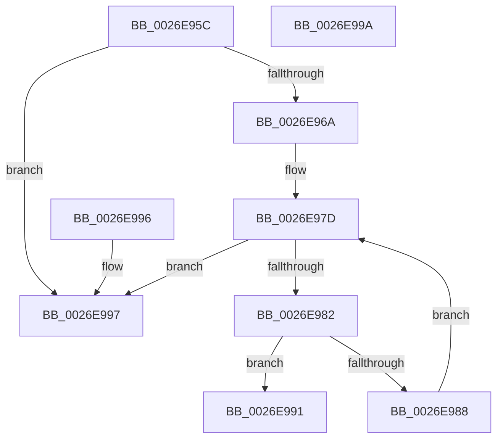

# IoFindDeviceThatFailedIrp

- RVA: `0x0026E95C`–`0x0026E99B` (길이 `63` bytes)
- VA: `0x000000014026E95C`
- 실행 섹션: `.text`
- PDB 이름 있음: `예`; PDB Function 태그: `아니요`
- unwind 정보 RVA: `0x000DB714`
- 디코드: `21`개 명령, `63/63` bytes 표시
- 미해석 바이트: `0` (있으면 어셈블리에 `.byte`로 보존)

> 이 문서는 커널 이미지의 기계어와 PDB 기호를 분석해 생성했습니다. 4번과 5번은 함수 원형과 자료형을 바이너리 사용 방식에서 추정한 C 해석이며 원본 소스 복구 결과는 아닙니다.

## 1. Dependencies

- 직접 호출 지점: **0**; 고유 호출 대상: **0**
- 직접 호출자로 확인된 함수: **5**
- RIP 상대 이미지 참조: **0**

### Outgoing calls
- 직접 디코드된 call 명령이 없습니다.

### Direct callers
- [PnpDeviceCompletionRoutine](PnpDeviceCompletionRoutine_function_0026E6C0.md) at `0x0026E755`
- [PopDiagTraceIrpFinish](PopDiagTraceIrpFinish_function_0026F2A8.md) at `0x0026F40F`
- [PopDiagTraceIrpFinishTelemetry](PopDiagTraceIrpFinishTelemetry_function_0026F46C.md) at `0x0026F59F`
- [PnpDiagnosticCompletionRoutine](../5A/PnpDiagnosticCompletionRoutine_function_005AA540.md) at `0x005AA557`
- [PopSystemIrpCompletion](../../pagelk/B7/PopSystemIrpCompletion_function_00B70CC0.md) at `0x00B70E39`

### Static image references
- 디코드된 RIP-relative 메모리 참조가 없습니다.

## 2. Other-region calls and transfers

- 다른 실행 섹션으로 향하는 call: **0**
- 별도 외부 분기/꼬리 이동을 확인하지 못했습니다.

## 3. Assembly (complete function range)

```asm
0026E95C  44 0F BE 49 42                  movsx r9d, byte ptr [rcx + 0x42]
0026E961  45 33 C0                        xor r8d, r8d
0026E964  44 39 41 30                     cmp dword ptr [rcx + 0x30], r8d
0026E968  7D 2D                           jge 0x14026e997
0026E96A  41 8D 41 FF                     lea eax, [r9 - 1]
0026E96E  48 8D 04 C0                     lea rax, [rax + rax*8]
0026E972  48 8D 0C C1                     lea rcx, [rcx + rax*8]
0026E976  48 81 C1 D0 00 00 00            add rcx, 0xd0
0026E97D  45 3B C1                        cmp r8d, r9d
0026E980  73 15                           jae 0x14026e997
0026E982  F6 41 03 02                     test byte ptr [rcx + 3], 2
0026E986  75 09                           jne 0x14026e991
0026E988  41 FF C0                        inc r8d
0026E98B  48 83 E9 48                     sub rcx, 0x48
0026E98F  EB EC                           jmp 0x14026e97d
0026E991  48 8B 41 28                     mov rax, qword ptr [rcx + 0x28]
0026E995  C3                              ret
0026E996  CC                              int3
0026E997  33 C0                           xor eax, eax
0026E999  C3                              ret
0026E99A  CC                              int3
```

## 4. C-style interpretation (structured pseudocode)

```c
__int64 __fastcall IoFindDeviceThatFailedIrp(__int64 a1, __int64 a2, int a3)
{
    __int64 result;

    a3 = 0;
    if ((*(unsigned int *)(a1 + 48)) >= 0) goto loc_0026E997;
    a1 = (a1 + (__int8)(*(unsigned __int8 *)(a1 + 66)) - 1 + (__int8)(*(unsigned __int8 *)(a1 + 66)) - 1 * 8 * 8) + (208);
loc_0026E97D:
    if (0 >= ((unsigned int)((__int8)(*(unsigned __int8 *)(a1 + 66))))) goto loc_0026E997;
    if (((*(unsigned __int8 *)(a1 + 3)) & (2)) != 0) goto loc_0026E991;
    a3 = (unsigned int)((a3) + 1);
    a1 = (a1) - (72);
    goto loc_0026E97D;
loc_0026E991:
    return *(unsigned __int64 *)(a1 + 40);
loc_0026E997:
    result = 0;
    return result;
}
```

## 5. (Beta) C Style

```c
int64_t IoFindDeviceThatFailedIrp(void *Arg1, int64_t Arg2, int32_t Arg3)
{
    uint8_t *arg1 = (uint8_t *)Arg1;

    int64_t result;

    Arg3 = 0;
    if ((*(uint32_t *)(arg1 + 0x30)) >= 0) goto loc_0026E997;
    Arg1 = (Arg1 + (int8_t)(*(uint8_t *)(arg1 + 0x42)) - 1 + (int8_t)(*(uint8_t *)(arg1 + 0x42)) - 1 * 8 * 8) + (208);
loc_0026E97D:
    if (0 >= ((uint32_t)((int8_t)(*(uint8_t *)(arg1 + 0x42))))) goto loc_0026E997;
    if (((*(uint8_t *)(arg1 + 0x3)) & (2)) != 0) goto loc_0026E991;
    Arg3 = (uint32_t)((Arg3) + 1);
    Arg1 = (Arg1) - (72);
    goto loc_0026E97D;
loc_0026E991:
    return *(uint64_t *)(arg1 + 0x28);
loc_0026E997:
    result = 0;
    return result;
}
```

### 관측된 메모리 오프셋

구조체 형식이 확인되지 않은 접근은 인자 기준의 오프셋으로만 기록했습니다.

| 기준 인자 | 오프셋 표현 | 폭 (bit) | 접근 |
|---|---:|---:|---|
| `Arg1` | `+ 0x0 + rax*8` | `64` | `R` |
| `Arg1` | `+ 0x3` | `8` | `R` |
| `Arg1` | `+ 0x28` | `64` | `R` |
| `Arg1` | `+ 0x30` | `32` | `R` |
| `Arg1` | `+ 0x42` | `8` | `R` |

## 6. Execution-region graph

[열기: 2D/3D 그래프와 함수 탐색 컨트롤 패널](../../../control-panel.html?section=text&rva=0x0026E95C&view=graph)

- 2D 그래프는 위에서 아래로 흐르고, 3D 그래프는 빈 공간을 드래그해 회전합니다. Shift+드래그는 이동, 휠은 확대·축소, 함수 노드 선택은 대상 보고서 이동입니다.

### Static fallback


