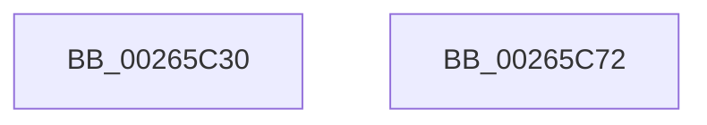

# IopBoostThreadCallback

- RVA: `0x00265C30`–`0x00265C73` (길이 `67` bytes)
- VA: `0x0000000140265C30`
- 실행 섹션: `.text`
- PDB 이름 있음: `예`; PDB Function 태그: `아니요`
- unwind 정보 RVA: `0x00064C80`
- 디코드: `19`개 명령, `67/67` bytes 표시
- 미해석 바이트: `0` (있으면 어셈블리에 `.byte`로 보존)

> 이 문서는 커널 이미지의 기계어와 PDB 기호를 분석해 생성했습니다. 4번과 5번은 함수 원형과 자료형을 바이너리 사용 방식에서 추정한 C 해석이며 원본 소스 복구 결과는 아닙니다.

## 1. Dependencies

- 직접 호출 지점: **3**; 고유 호출 대상: **2**
- 직접 호출자로 확인된 함수: **0**
- RIP 상대 이미지 참조: **0**

### Outgoing calls
- `0x00265C4C` → [guard_dispatch_icall](../6B/guard_dispatch_icall_function_006BAAD0.md) (function, `0x006BAAD0`)
- `0x00265C59` → [ObDereferenceObjectDeferDeleteWithTag](ObDereferenceObjectDeferDeleteWithTag_function_00263EA0.md) (function, `0x00263EA0`)
- `0x00265C67` → [ObDereferenceObjectDeferDeleteWithTag](ObDereferenceObjectDeferDeleteWithTag_function_00263EA0.md) (function, `0x00263EA0`)

### Direct callers
- 이 함수 시작 RVA로 연결되는 직접 call은 확인되지 않았습니다. 간접 호출은 완전히 역산할 수 없습니다.

### Static image references
- 디코드된 RIP-relative 메모리 참조가 없습니다.

## 2. Other-region calls and transfers

- 다른 실행 섹션으로 향하는 call: **0**
- 별도 외부 분기/꼬리 이동을 확인하지 못했습니다.

## 3. Assembly (complete function range)

```asm
00265C30  40 53                           push rbx
00265C32  48 83 EC 30                     sub rsp, 0x30
00265C36  48 8B 41 18                     mov rax, qword ptr [rcx + 0x18]
00265C3A  48 8B DA                        mov rbx, rdx
00265C3D  44 8B 4A 10                     mov r9d, dword ptr [rdx + 0x10]
00265C41  4C 8B 42 08                     mov r8, qword ptr [rdx + 8]
00265C45  48 8B 12                        mov rdx, qword ptr [rdx]
00265C48  48 8B 49 20                     mov rcx, qword ptr [rcx + 0x20]
00265C4C  E8 7F 4E 45 00                  call 0x1406baad0
00265C51  48 8B 0B                        mov rcx, qword ptr [rbx]
00265C54  BA 44 66 6C 74                  mov edx, 0x746c6644
00265C59  E8 42 E2 FF FF                  call 0x140263ea0
00265C5E  48 8B 4B 08                     mov rcx, qword ptr [rbx + 8]
00265C62  BA 44 66 6C 74                  mov edx, 0x746c6644
00265C67  E8 34 E2 FF FF                  call 0x140263ea0
00265C6C  48 83 C4 30                     add rsp, 0x30
00265C70  5B                              pop rbx
00265C71  C3                              ret
00265C72  CC                              int3
```

## 4. C-style interpretation (structured pseudocode)

```c
__int64 __fastcall IopBoostThreadCallback(__int64 a1, __int64 a2)
{
    __int64 result;
    __int64 v_rsp;

    v_rsp = (v_rsp) - (48);
    result = guard_dispatch_icall(*(unsigned __int64 *)(a1 + 32), *(unsigned __int64 *)(a2), *(unsigned __int64 *)(a2 + 8), (unsigned int)(*(unsigned int *)(a2 + 16)));
    result = ObDereferenceObjectDeferDeleteWithTag(*(unsigned __int64 *)(a2), (unsigned int)(0x746C6644ULL), *(unsigned __int64 *)(a2 + 8), (unsigned int)(*(unsigned int *)(a2 + 16)));
    result = ObDereferenceObjectDeferDeleteWithTag(*(unsigned __int64 *)(a2 + 8), (unsigned int)(0x746C6644ULL), *(unsigned __int64 *)(a2 + 8), (unsigned int)(*(unsigned int *)(a2 + 16)));
    v_rsp = (v_rsp) + (48);
    return result;
}
```

## 5. (Beta) C Style

```c
int64_t IopBoostThreadCallback(void *Arg1, void *Arg2)
{
    uint8_t *arg1 = (uint8_t *)Arg1;
    uint8_t *arg2 = (uint8_t *)Arg2;

    int64_t result;
    int64_t local_rsp;

    local_rsp = (local_rsp) - (48);
    result = guard_dispatch_icall(*(uint64_t *)(arg1 + 0x20), *(uint64_t *)(arg2), *(uint64_t *)(arg2 + 0x8), (uint32_t)(*(uint32_t *)(arg2 + 0x10)));
    result = ObDereferenceObjectDeferDeleteWithTag(*(uint64_t *)(arg2), (uint32_t)(0x746C6644ULL), *(uint64_t *)(arg2 + 0x8), (uint32_t)(*(uint32_t *)(arg2 + 0x10)));
    result = ObDereferenceObjectDeferDeleteWithTag(*(uint64_t *)(arg2 + 0x8), (uint32_t)(0x746C6644ULL), *(uint64_t *)(arg2 + 0x8), (uint32_t)(*(uint32_t *)(arg2 + 0x10)));
    local_rsp = (local_rsp) + (48);
    return result;
}
```

### 관측된 메모리 오프셋

구조체 형식이 확인되지 않은 접근은 인자 기준의 오프셋으로만 기록했습니다.

| 기준 인자 | 오프셋 표현 | 폭 (bit) | 접근 |
|---|---:|---:|---|
| `Arg1` | `+ 0x18` | `64` | `R` |
| `Arg1` | `+ 0x20` | `64` | `R` |
| `Arg2` | `+ 0x0` | `64` | `R` |
| `Arg2` | `+ 0x8` | `64` | `R` |
| `Arg2` | `+ 0x10` | `32` | `R` |

## 6. Execution-region graph

[열기: 2D/3D 그래프와 함수 탐색 컨트롤 패널](../../../control-panel.html?section=text&rva=0x00265C30&view=graph)

- 2D 그래프는 위에서 아래로 흐르고, 3D 그래프는 빈 공간을 드래그해 회전합니다. Shift+드래그는 이동, 휠은 확대·축소, 함수 노드 선택은 대상 보고서 이동입니다.

### Static fallback


