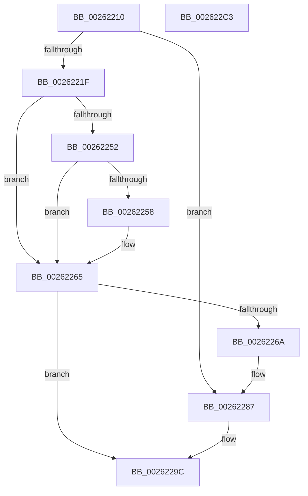

# KeAbPostReleaseEx

- RVA: `0x00262210`–`0x002622C4` (길이 `180` bytes)
- VA: `0x0000000140262210`
- 실행 섹션: `.text`
- PDB 이름 있음: `예`; PDB Function 태그: `아니요`
- unwind 정보 RVA: `0x0005D2F4`
- 디코드: `46`개 명령, `180/180` bytes 표시
- 미해석 바이트: `0` (있으면 어셈블리에 `.byte`로 보존)

> 이 문서는 커널 이미지의 기계어와 PDB 기호를 분석해 생성했습니다. 4번과 5번은 함수 원형과 자료형을 바이너리 사용 방식에서 추정한 C 해석이며 원본 소스 복구 결과는 아닙니다.

## 1. Dependencies

- 직접 호출 지점: **2**; 고유 호출 대상: **2**
- 직접 호출자로 확인된 함수: **52**
- RIP 상대 이미지 참조: **0**

### Outgoing calls
- `0x00262281` → [KeBugCheckEx](../4F/KeBugCheckEx_function_004FD660.md) (function, `0x004FD660`)
- `0x002622B9` → [KiAbEntryFreeAndEnableInterrupts](KiAbEntryFreeAndEnableInterrupts_function_002622D0.md) (function, `0x002622D0`)

### Direct callers
- [sub_0020D5AD](../20/Unknown_function_0020D5AD.md) at `0x0020D7D1`
- [KeWaitForSingleObject](../20/KeWaitForSingleObject_function_0020E6B0.md) at `0x0020F20E`
- [ExTryAcquirePushLockExclusiveEx](../20/ExTryAcquirePushLockExclusiveEx_function_0020F6C0.md) at `0x0020F724`
- [ExpAcquireFastResourceSharedSlow](../21/ExpAcquireFastResourceSharedSlow_function_00211260.md) at `0x002118F9`
- [ExpAcquireFastResourceSharedSlow](../21/ExpAcquireFastResourceSharedSlow_function_00211260.md) at `0x00211B06`
- [sub_00215166](../21/Unknown_function_00215166.md) at `0x00215A06`
- [sub_00215166](../21/Unknown_function_00215166.md) at `0x00215A37`
- [ExReleaseFastResource](ExReleaseFastResource_function_002613D0.md) at `0x002616B9`
- [ExReleaseFastResource](ExReleaseFastResource_function_002613D0.md) at `0x00261B0A`
- [sub_00261C24](Unknown_function_00261C24.md) at `0x00261DC6`
- [sub_00262C17](Unknown_function_00262C17.md) at `0x00262C89`
- [sub_00262D5A](Unknown_function_00262D5A.md) at `0x00262F0A`
- [MiLockAddressSpaceToo](../2A/MiLockAddressSpaceToo_function_002A5670.md) at `0x002A56FE`
- [MiReferenceControlArea](../2B/MiReferenceControlArea_function_002BC198.md) at `0x002BC4B1`
- [MiLockControlAreaSectionExtend](../2C/MiLockControlAreaSectionExtend_function_002C9D60.md) at `0x002C9E9E`
- [RtlpHpTryAcquireQueuedLockExclusive](../2E/RtlpHpTryAcquireQueuedLockExclusive_function_002EB23C.md) at `0x002EB309`
- [MiWaitForCollidedFaultComplete](../36/MiWaitForCollidedFaultComplete_function_00369EDC.md) at `0x0036A020`
- [sub_0036C6B5](../36/Unknown_function_0036C6B5.md) at `0x0036CA09`
- [sub_0036CB1C](../36/Unknown_function_0036CB1C.md) at `0x0036CB88`
- [sub_003BE220](../3B/Unknown_function_003BE220.md) at `0x003BE250`
- [sub_003BE220](../3B/Unknown_function_003BE220.md) at `0x003BE276`
- [ExTryAcquireAutoExpandPushLockShared](../3F/ExTryAcquireAutoExpandPushLockShared_function_003FBF00.md) at `0x003FC014`
- [PfLockSharedTryAcquire](../3F/PfLockSharedTryAcquire_function_003FC0D0.md) at `0x003FC146`
- [ExTryAcquirePushLockSharedEx](../3F/ExTryAcquirePushLockSharedEx_function_003FC160.md) at `0x003FC1F1`
- [MiTryLockVad](../42/MiTryLockVad_function_0042ABFC.md) at `0x0042AC76`
- [ExTryToAcquireFastMutex](../44/ExTryToAcquireFastMutex_function_0044C2E0.md) at `0x0044C37F`
- [ExTryAcquireAutoExpandPushLockExclusive](../4A/ExTryAcquireAutoExpandPushLockExclusive_function_004A9AA0.md) at `0x004A9B7E`
- [IopProcessIoTracking](../59/IopProcessIoTracking_function_005986C0.md) at `0x00598764`
- [PopPropogateCoolingChangeV2](../5D/PopPropogateCoolingChangeV2_function_005D1058.md) at `0x005D10C7`
- [ExTryAcquireCacheAwarePushLockExclusiveEx](../65/ExTryAcquireCacheAwarePushLockExclusiveEx_function_00657F20.md) at `0x00657FB9`
- [ExTryAcquireCacheAwarePushLockSharedEx](../65/ExTryAcquireCacheAwarePushLockSharedEx_function_00657FF0.md) at `0x00658086`
- [ExAcquireFastResourceWithFlags](../65/ExAcquireFastResourceWithFlags_function_00658120.md) at `0x0065831A`
- [ExAcquireFastResourceWithFlags](../65/ExAcquireFastResourceWithFlags_function_00658120.md) at `0x00658334`
- [ExTryToConvertFastResourceSharedToExclusive](../65/ExTryToConvertFastResourceSharedToExclusive_function_00658A30.md) at `0x00658C5F`
- [MiTryAcquirePushLockUnordered](../67/MiTryAcquirePushLockUnordered_function_0067B4CC.md) at `0x0067B516`
- [MiChangingSubsectionProtos](../68/MiChangingSubsectionProtos_function_0068057C.md) at `0x00680713`
- [MiWaitForExtentDeletions](../68/MiWaitForExtentDeletions_function_00681F80.md) at `0x0068202E`
- [sub_006D969C](../6D/Unknown_function_006D969C.md) at `0x006D98E3`
- [sub_006E8106](../6E/Unknown_function_006E8106.md) at `0x006E81D4`
- [ExTryAcquireTimeRefreshLockExclusive](../../page/7C/ExTryAcquireTimeRefreshLockExclusive_function_007C5A7C.md) at `0x007C5ACE`
- [CmFcpManagerPublishFeatureUsageDataIfNearCapacity](../../page/7F/CmFcpManagerPublishFeatureUsageDataIfNearCapacity_function_007F5548.md) at `0x007F55DD`
- [CmpCreateKeyControlBlock](../../page/85/CmpCreateKeyControlBlock_function_00851DB0.md) at `0x00852638`
- [ObpDecrementHandleCount](../../page/86/ObpDecrementHandleCount_function_008632E0.md) at `0x00863926`
- [ObCloseHandleTableEntry](../../page/86/ObCloseHandleTableEntry_function_00869E20.md) at `0x0086A88C`
- [sub_0089A511](../../page/89/Unknown_function_0089A511.md) at `0x0089A6ED`
- [ObpLookupObjectName](../../page/89/ObpLookupObjectName_function_0089BE90.md) at `0x0089DCB5`
- [IopWaitAndAcquireFileObjectLock](../../page/8A/IopWaitAndAcquireFileObjectLock_function_008AE6D8.md) at `0x008AE800`
- [VrpWaitForDiffHiveEntryTransitionOwnerToLeave](../../page/93/VrpWaitForDiffHiveEntryTransitionOwnerToLeave_function_00937128.md) at `0x009371DD`
- [MmPrefetchPagesEx](../../page/93/MmPrefetchPagesEx_function_0093C9A0.md) at `0x0093CB14`
- [MiPrefetchControlArea](../../page/93/MiPrefetchControlArea_function_0093E830.md) at `0x0093E8E9`
- [AlpcpTryLockForCachedReferenceBlob](../../page/9E/AlpcpTryLockForCachedReferenceBlob_function_009E7920.md) at `0x009E797E`
- [CmpTryToLockKcbExclusive](../../page/9E/CmpTryToLockKcbExclusive_function_009E7B30.md) at `0x009E7B85`
- [CmpTryToLockHashEntryExclusive](../../page/A6/CmpTryToLockHashEntryExclusive_function_00A68030.md) at `0x00A680DC`
- [CmpWaitOnHiveWriteQueue](../../page/AA/CmpWaitOnHiveWriteQueue_function_00AA0110.md) at `0x00AA01C3`
- [PfpPrefetchSharedConflictNotifyEnd](../../page/AC/PfpPrefetchSharedConflictNotifyEnd_function_00AC1210.md) at `0x00AC124C`
- [TlgAggregateInternalProviderCallback](../../page/AC/TlgAggregateInternalProviderCallback_function_00AC1A80.md) at `0x00AC1B18`
- [KiForceSymbolReferences](../../init/C3/KiForceSymbolReferences_function_00C381DC.md) at `0x00C38229`

### Static image references
- 디코드된 RIP-relative 메모리 참조가 없습니다.

## 2. Other-region calls and transfers

- 다른 실행 섹션으로 향하는 call: **0**
- 별도 외부 분기/꼬리 이동을 확인하지 못했습니다.

## 3. Assembly (complete function range)

```asm
00262210  48 83 EC 38                     sub rsp, 0x38
00262214  48 8B C2                        mov rax, rdx
00262217  4C 8B D1                        mov r10, rcx
0026221A  F6 C2 01                        test dl, 1
0026221D  74 68                           je 0x140262287
0026221F  65 48 8B 0C 25 88 01 00 00      mov rcx, qword ptr gs:[0x188]
00262228  48 D1 E8                        shr rax, 1
0026222B  0F B6 D0                        movzx edx, al
0026222E  4C 6B C2 58                     imul r8, rdx, 0x58
00262232  48 8B 81 70 04 00 00            mov rax, qword ptr [rcx + 0x470]
00262239  48 BA FC FF FF FF FF FF FF 7F   movabs rdx, 0x7ffffffffffffffc
00262243  48 83 C0 10                     add rax, 0x10
00262247  49 03 C0                        add rax, r8
0026224A  4C 8B 00                        mov r8, qword ptr [rax]
0026224D  4C 23 C2                        and r8, rdx
00262250  74 13                           je 0x140262265
00262252  80 78 08 00                     cmp byte ptr [rax + 8], 0
00262256  7C 0D                           jl 0x140262265
00262258  48 BA 00 00 00 00 00 00 00 80   movabs rdx, 0x8000000000000000
00262262  4C 0B C2                        or r8, rdx
00262265  4D 3B C2                        cmp r8, r10
00262268  74 32                           je 0x14026229c
0026226A  48 8B D1                        mov rdx, rcx
0026226D  48 C7 44 24 20 00 00 00 00      mov qword ptr [rsp + 0x20], 0
00262276  B9 62 01 00 00                  mov ecx, 0x162
0026227B  4C 8B C8                        mov r9, rax
0026227E  4D 8B C2                        mov r8, r10
00262281  E8 DA B3 29 00                  call 0x1404fd660
00262286  CC                              int3
00262287  0F B6 4A 08                     movzx ecx, byte ptr [rdx + 8]
0026228B  83 E1 3F                        and ecx, 0x3f
0026228E  48 6B D1 58                     imul rdx, rcx, 0x58
00262292  48 8B C8                        mov rcx, rax
00262295  48 2B CA                        sub rcx, rdx
00262298  48 8B 49 F0                     mov rcx, qword ptr [rcx - 0x10]
0026229C  FA                              cli
0026229D  48 8B D1                        mov rdx, rcx
002622A0  C6 40 0A 00                     mov byte ptr [rax + 0xa], 0
002622A4  48 8B C8                        mov rcx, rax
002622A7  48 C7 44 24 20 00 00 00 00      mov qword ptr [rsp + 0x20], 0
002622B0  41 B9 01 00 00 00               mov r9d, 1
002622B6  4D 8B C2                        mov r8, r10
002622B9  E8 12 00 00 00                  call 0x1402622d0
002622BE  48 83 C4 38                     add rsp, 0x38
002622C2  C3                              ret
002622C3  CC                              int3
```

## 4. C-style interpretation (structured pseudocode)

```c
__int64 __fastcall KeAbPostReleaseEx(__int64 a1, __int64 a2)
{
    __int64 result;
    __int64 v_rsp;
    unsigned __int64 v_stack_m18;

    v_rsp = (v_rsp) - (56);
    if ((((unsigned __int8)(a2)) & (1)) == 0) goto loc_00262287;
    result = (a2) >> (1);
    a3 = (a3) * ((unsigned __int8)(result));
    result = (*(unsigned __int64 *)(*(unsigned __int64 *)(gs_base + (0 + 392)) + 1136)) + (16);
    result = (result) + (a3);
    a3 = (*(unsigned __int64 *)(result)) & ((unsigned __int8)(result));
    if (condition_is_equal) goto loc_00262265;
    if ((*(unsigned __int8 *)(result + 8)) >= 0) {
        a3 = (a3) | ((unsigned __int8)(result));
    }
    if (a3 == a1) goto loc_0026229C;
    v_stack_m18 = 0;
    result = KeBugCheckEx(354, *(unsigned __int64 *)(gs_base + (0 + 392)), a1, result);
loc_00262287:
    a1 = (unsigned int)((*(unsigned __int8 *)(*(unsigned __int64 *)(gs_base + (0 + 392)) + 8)) & (63));
    a2 = (*(unsigned __int64 *)(gs_base + (0 + 392))) * (a1);
    a1 = (result) - (a2);
loc_0026229C:
    *(unsigned __int8 *)(result + 10) = 0;
    v_stack_m18 = 0;
    result = KiAbEntryFreeAndEnableInterrupts(result, *(unsigned __int64 *)(a1 - 16), a1, 1);
    v_rsp = (v_rsp) + (56);
    return result;
}
```

## 5. (Beta) C Style

```c
int64_t KeAbPostReleaseEx(int64_t Arg1, int64_t Arg2)
{
    int64_t result;
    int64_t local_rsp;
    uint64_t v_stack_m18;

    local_rsp = (local_rsp) - (56);
    if ((((uint8_t)(Arg2)) & (1)) == 0) goto loc_00262287;
    result = (Arg2) >> (1);
    a3 = (a3) * ((uint8_t)(result));
    result = (*(uint64_t *)(*(uint64_t *)(gs_base + (0 + 0x188)) + 0x470)) + (16);
    result = (result) + (a3);
    a3 = (*(uint64_t *)(result)) & ((uint8_t)(result));
    if (condition_is_equal) goto loc_00262265;
    if ((*(uint8_t *)(result + 0x8)) >= 0) {
        a3 = (a3) | ((uint8_t)(result));
    }
    if (a3 == Arg1) goto loc_0026229C;
    v_stack_m18 = 0;
    result = KeBugCheckEx(354, *(uint64_t *)(gs_base + (0 + 0x188)), Arg1, result);
loc_00262287:
    Arg1 = (uint32_t)((*(uint8_t *)(*(uint64_t *)(gs_base + (0 + 0x188)) + 0x8)) & (63));
    Arg2 = (*(uint64_t *)(gs_base + (0 + 0x188))) * (Arg1);
    Arg1 = (result) - (Arg2);
loc_0026229C:
    *(uint8_t *)(result + 0xA) = 0;
    v_stack_m18 = 0;
    result = KiAbEntryFreeAndEnableInterrupts(result, *(uint64_t *)(Arg1 - 0x10), Arg1, 1);
    local_rsp = (local_rsp) + (56);
    return result;
}
```

## 6. Execution-region graph

[열기: 2D/3D 그래프와 함수 탐색 컨트롤 패널](../../../control-panel.html?section=text&rva=0x00262210&view=graph)

- 2D 그래프는 위에서 아래로 흐르고, 3D 그래프는 빈 공간을 드래그해 회전합니다. Shift+드래그는 이동, 휠은 확대·축소, 함수 노드 선택은 대상 보고서 이동입니다.

### Static fallback


