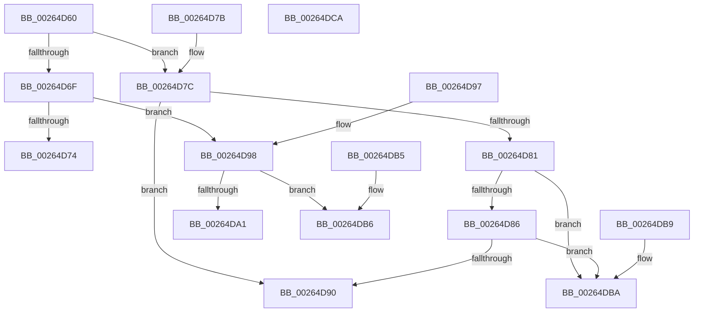

# KeQueryMaximumProcessorCountEx

- RVA: `0x00264D60`–`0x00264DCB` (길이 `107` bytes)
- VA: `0x0000000140264D60`
- 실행 섹션: `.text`
- PDB 이름 있음: `예`; PDB Function 태그: `아니요`
- unwind 정보 RVA: `0x000DB714`
- 디코드: `34`개 명령, `107/107` bytes 표시
- 미해석 바이트: `0` (있으면 어셈블리에 `.byte`로 보존)

> 이 문서는 커널 이미지의 기계어와 PDB 기호를 분석해 생성했습니다. 4번과 5번은 함수 원형과 자료형을 바이너리 사용 방식에서 추정한 C 해석이며 원본 소스 복구 결과는 아닙니다.

## 1. Dependencies

- 직접 호출 지점: **0**; 고유 호출 대상: **0**
- 직접 호출자로 확인된 함수: **29**
- RIP 상대 이미지 참조: **7**

### Outgoing calls
- 직접 디코드된 call 명령이 없습니다.

### Direct callers
- [sub_00264BFE](Unknown_function_00264BFE.md) at `0x00264C3C`
- [ExpReleaseFannedOutPushLockExclusive](ExpReleaseFannedOutPushLockExclusive_function_00264F74.md) at `0x00264F90`
- [FsRtlAcquireAutoExpandPushLockExclusive](FsRtlAcquireAutoExpandPushLockExclusive_function_0026539C.md) at `0x00265441`
- [ExpGetSystemProcessorInformation](ExpGetSystemProcessorInformation_function_00265AFC.md) at `0x00265B30`
- [ExpGetSystemEmulationProcessorInformation](ExpGetSystemEmulationProcessorInformation_function_0026603C.md) at `0x00266069`
- [KeQueryLogicalProcessorRelationship](../2C/KeQueryLogicalProcessorRelationship_function_002CEA60.md) at `0x002CF000`
- [ExpAllocateFannedOutPushLock](../3B/ExpAllocateFannedOutPushLock_function_003B2B48.md) at `0x003B2B72`
- [ExpSaPageGroupDescriptorAllocate](../3B/ExpSaPageGroupDescriptorAllocate_function_003B4224.md) at `0x003B4277`
- [PpmEventHgsHardwareTable](../3B/PpmEventHgsHardwareTable_function_003BF110.md) at `0x003BF148`
- [EtwpCovSampCaptureFlushSampleBuffers](../43/EtwpCovSampCaptureFlushSampleBuffers_function_0043C0B4.md) at `0x0043C0D3`
- [ExpTryAcquireFannedOutPushLockExclusive](../4A/ExpTryAcquireFannedOutPushLockExclusive_function_004A1270.md) at `0x004A128A`
- [ExpSaPageGroupDescriptorFree](../4B/ExpSaPageGroupDescriptorFree_function_004B5EA8.md) at `0x004B5EC2`
- [PpmEventHgsNormalizedTable](../4C/PpmEventHgsNormalizedTable_function_004CC7BC.md) at `0x004CC7E6`
- [HalpHvInitMcaPcrContext](../4D/HalpHvInitMcaPcrContext_function_004D7D88.md) at `0x004D7DE1`
- [KeStartProfile](../4E/KeStartProfile_function_004E1120.md) at `0x004E11A0`
- [KeQueryMaximumProcessorCount](../5B/KeQueryMaximumProcessorCount_function_005BBDD0.md) at `0x005BBDD6`
- [RtlpHpEnvTlsAlloc](../60/RtlpHpEnvTlsAlloc_function_0060411C.md) at `0x00604148`
- [ExpSaInitialize](../65/ExpSaInitialize_function_0065CADC.md) at `0x0065CB63`
- [PpmHeteroRegisterWpsUpdatesAmd](../../page/77/PpmHeteroRegisterWpsUpdatesAmd_function_00772B10.md) at `0x00772BB6`
- [EtwpAllocatePmcData](../../page/7B/EtwpAllocatePmcData_function_007B5944.md) at `0x007B5956`
- [EtwpInitializeSiloState](../../page/7B/EtwpInitializeSiloState_function_007B6A3C.md) at `0x007B6A7D`
- [EtwpCovSampCaptureContextStart](../../page/7C/EtwpCovSampCaptureContextStart_function_007C14AC.md) at `0x007C177E`
- [KeInitializeProcess](../../page/A6/KeInitializeProcess_function_00A63CF4.md) at `0x00A63FD6`
- [KeInitializeProcess](../../page/A6/KeInitializeProcess_function_00A63CF4.md) at `0x00A64037`
- [EtwpInitLoggerContext](../../page/A7/EtwpInitLoggerContext_function_00A7154C.md) at `0x00A7158E`
- [EtwpCovSampCaptureFlushStats](../../page/AA/EtwpCovSampCaptureFlushStats_function_00AAF6C0.md) at `0x00AAF6DF`
- [HalpDmaAllocateMappingResources](../../init/C2/HalpDmaAllocateMappingResources_function_00C2087C.md) at `0x00C2089A`
- [PopDetectSimulatedHeteroProcessors](../../init/C4/PopDetectSimulatedHeteroProcessors_function_00C40DD8.md) at `0x00C40DFC`
- [PpmInitHeteroEngine](../../init/C4/PpmInitHeteroEngine_function_00C41AF8.md) at `0x00C41B1C`
- [ExpInitSystemPhase1](../../init/C5/ExpInitSystemPhase1_function_00C51508.md) at `0x00C51534`

### Static image references
- `0x00264D67` → RVA `0x00FC6AA4` (`ALMOSTRO`; read)
- `0x00264D74` → RVA `0x00FC6A80` (`ALMOSTRO`; read)
- `0x00264D86` → RVA `0x00FC5014` (`ALMOSTRO`; read)
- `0x00264D90` → RVA `0x00FC6AE8` (`ALMOSTRO`; read)
- `0x00264D98` → RVA `0x00FC5018` (`ALMOSTRO`; read)
- `0x00264DA4` → RVA `0x00FC7128` (`ALMOSTRO`; read)
- `0x00264DC3` → RVA `0x00FC5044` (`ALMOSTRO`; read)

## 2. Other-region calls and transfers

- 다른 실행 섹션으로 향하는 call: **0**
- 별도 외부 분기/꼬리 이동을 확인하지 못했습니다.

## 3. Assembly (complete function range)

```asm
00264D60  33 D2                           xor edx, edx
00264D62  B8 FF FF 00 00                  mov eax, 0xffff
00264D67  38 15 37 1D D6 00               cmp byte ptr [rip + 0xd61d37], dl
00264D6D  75 0D                           jne 0x140264d7c
00264D6F  66 3B C8                        cmp cx, ax
00264D72  75 24                           jne 0x140264d98
00264D74  8B 05 06 1D D6 00               mov eax, dword ptr [rip + 0xd61d06]
00264D7A  C3                              ret
00264D7B  CC                              int3
00264D7C  66 3B C8                        cmp cx, ax
00264D7F  74 0F                           je 0x140264d90
00264D81  66 85 C9                        test cx, cx
00264D84  75 34                           jne 0x140264dba
00264D86  66 83 3D 86 02 D6 00 01         cmp word ptr [rip + 0xd60286], 1
00264D8E  75 2A                           jne 0x140264dba
00264D90  8B 05 52 1D D6 00               mov eax, dword ptr [rip + 0xd61d52]
00264D96  C3                              ret
00264D97  CC                              int3
00264D98  66 3B 0D 79 02 D6 00            cmp cx, word ptr [rip + 0xd60279]
00264D9F  73 15                           jae 0x140264db6
00264DA1  0F B7 C1                        movzx eax, cx
00264DA4  48 8D 0D 7D 23 D6 00            lea rcx, [rip + 0xd6237d]
00264DAB  48 8B 04 C1                     mov rax, qword ptr [rcx + rax*8]
00264DAF  F3 48 0F B8 C0                  popcnt rax, rax
00264DB4  C3                              ret
00264DB5  CC                              int3
00264DB6  8B C2                           mov eax, edx
00264DB8  C3                              ret
00264DB9  CC                              int3
00264DBA  66 3B 0D 53 02 D6 00            cmp cx, word ptr [rip + 0xd60253]
00264DC1  1B C0                           sbb eax, eax
00264DC3  23 05 7B 02 D6 00               and eax, dword ptr [rip + 0xd6027b]
00264DC9  C3                              ret
00264DCA  CC                              int3
```

## 4. C-style interpretation (structured pseudocode)

```c
__int64 __fastcall KeQueryMaximumProcessorCountEx(unsigned __int16 a1, int a2)
{
    __int64 result;

    a2 = 0;
    if ((*(unsigned __int8 *)(v_rip + 14032183)) != 0) goto loc_00264D7C;
    if (a1 != ((unsigned __int16)((unsigned int)(0xFFFFULL)))) goto loc_00264D98;
    return (unsigned int)(*(unsigned int *)(v_rip + 14032134));
loc_00264D7C:
    if (a1 == ((unsigned __int16)((unsigned int)(*(unsigned int *)(v_rip + 14032134))))) goto loc_00264D90;
    if (a1 != 0) goto loc_00264DBA;
    if ((*(unsigned __int16 *)(v_rip + 14025350)) != 1) goto loc_00264DBA;
loc_00264D90:
    return (unsigned int)(*(unsigned int *)(v_rip + 14032210));
loc_00264D98:
    if (a1 >= (*(unsigned __int16 *)(v_rip + 14025337))) goto loc_00264DB6;
    return *(unsigned __int64 *)(v_rip + 14033789 + a1 * 8);
loc_00264DB6:
    return 0;
loc_00264DBA:
    result = (unsigned int)((0) & (*(unsigned int *)(v_rip + 14025339)));
    return result;
}
```

## 5. (Beta) C Style

```c
int64_t KeQueryMaximumProcessorCountEx(uint16_t Arg1, int32_t Arg2)
{
    int64_t result;

    Arg2 = 0;
    if ((*(uint8_t *)(v_rip + 0xD61D37)) != 0) goto loc_00264D7C;
    if (Arg1 != ((uint16_t)((uint32_t)(0xFFFFULL)))) goto loc_00264D98;
    return (uint32_t)(*(uint32_t *)(v_rip + 0xD61D06));
loc_00264D7C:
    if (Arg1 == ((uint16_t)((uint32_t)(*(uint32_t *)(v_rip + 0xD61D06))))) goto loc_00264D90;
    if (Arg1 != 0) goto loc_00264DBA;
    if ((*(uint16_t *)(v_rip + 0xD60286)) != 1) goto loc_00264DBA;
loc_00264D90:
    return (uint32_t)(*(uint32_t *)(v_rip + 0xD61D52));
loc_00264D98:
    if (Arg1 >= (*(uint16_t *)(v_rip + 0xD60279))) goto loc_00264DB6;
    return *(uint64_t *)(v_rip + 0xD6237D + Arg1 * 8);
loc_00264DB6:
    return 0;
loc_00264DBA:
    result = (uint32_t)((0) & (*(uint32_t *)(v_rip + 0xD6027B)));
    return result;
}
```

## 6. Execution-region graph

[열기: 2D/3D 그래프와 함수 탐색 컨트롤 패널](../../../control-panel.html?section=text&rva=0x00264D60&view=graph)

- 2D 그래프는 위에서 아래로 흐르고, 3D 그래프는 빈 공간을 드래그해 회전합니다. Shift+드래그는 이동, 휠은 확대·축소, 함수 노드 선택은 대상 보고서 이동입니다.

### Static fallback


