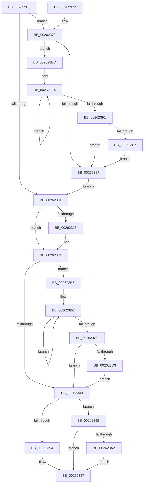

# KiAbEntryFreeAndEnableInterrupts

- RVA: `0x002622D0`–`0x002623FE` (길이 `302` bytes)
- VA: `0x00000001402622D0`
- 실행 섹션: `.text`
- PDB 이름 있음: `예`; PDB Function 태그: `아니요`
- unwind 정보 RVA: `0x00064550`
- 디코드: `88`개 명령, `302/302` bytes 표시
- 미해석 바이트: `0` (있으면 어셈블리에 `.byte`로 보존)

> 이 문서는 커널 이미지의 기계어와 PDB 기호를 분석해 생성했습니다. 4번과 5번은 함수 원형과 자료형을 바이너리 사용 방식에서 추정한 C 해석이며 원본 소스 복구 결과는 아닙니다.

## 1. Dependencies

- 직접 호출 지점: **4**; 고유 호출 대상: **3**
- 직접 호출자로 확인된 함수: **33**
- RIP 상대 이미지 참조: **0**

### Outgoing calls
- `0x00262393` → [KiAbEntryRemoveFromTree](KiAbEntryRemoveFromTree_function_00262410.md) (function, `0x00262410`)
- `0x002623AE` → [KiAbThreadRemoveBoostsSlow](../21/KiAbThreadRemoveBoostsSlow_function_00210BB0.md) (function, `0x00210BB0`)
- `0x002623D3` → [KiRemoveSystemWorkPriorityKick](KiRemoveSystemWorkPriorityKick_function_002631D0.md) (function, `0x002631D0`)
- `0x002623F7` → [KiRemoveSystemWorkPriorityKick](KiRemoveSystemWorkPriorityKick_function_002631D0.md) (function, `0x002631D0`)

### Direct callers
- [sub_00210084](../21/Unknown_function_00210084.md) at `0x002101A9`
- [sub_002102E2](../21/Unknown_function_002102E2.md) at `0x0021035F`
- [sub_0021D622](../21/Unknown_function_0021D622.md) at `0x0021D65D`
- [ExReleaseFastMutexUnsafe](../25/ExReleaseFastMutexUnsafe_function_002503A0.md) at `0x002505AE`
- [IopReleaseFileObjectLock](../25/IopReleaseFileObjectLock_function_00250A90.md) at `0x00250CBE`
- [FsRtlReleaseHeaderMutex](../25/FsRtlReleaseHeaderMutex_function_002516C0.md) at `0x00251913`
- [ExReleaseFastMutex](../25/ExReleaseFastMutex_function_002519C0.md) at `0x00251BEC`
- [KeAbPostReleaseEx](KeAbPostReleaseEx_function_00262210.md) at `0x002622B9`
- [ExReleasePushLockSharedEx](ExReleasePushLockSharedEx_function_00263300.md) at `0x002633E0`
- [ExReleasePushLockExclusiveEx](ExReleasePushLockExclusiveEx_function_00263510.md) at `0x002635FB`
- [sub_00263695](Unknown_function_00263695.md) at `0x0026373F`
- [PspUnlockProcessShared](PspUnlockProcessShared_function_00263950.md) at `0x00263A13`
- [ExReleasePushLockEx](ExReleasePushLockEx_function_00263A80.md) at `0x00263B69`
- [ExReleaseCacheAwarePushLockSharedEx](ExReleaseCacheAwarePushLockSharedEx_function_00263BE0.md) at `0x00263CC2`
- [sub_00263D49](Unknown_function_00263D49.md) at `0x00263E19`
- [MiPostInsertVad](MiPostInsertVad_function_002643C0.md) at `0x0026452C`
- [ExReleaseAutoExpandPushLockExclusive](ExReleaseAutoExpandPushLockExclusive_function_00264DE0.md) at `0x00264F1D`
- [StLockReleaseExclusive](StLockReleaseExclusive_function_00267050.md) at `0x0026710C`
- [MiSetVadDeleted](../29/MiSetVadDeleted_function_00296E00.md) at `0x00296F91`
- [KeAbPostRelease](../2E/KeAbPostRelease_function_002E1600.md) at `0x002E16A5`
- [MiUnlockControlAreaFileObjectExclusive](../2E/MiUnlockControlAreaFileObjectExclusive_function_002E22D0.md) at `0x002E239C`
- [MiUnlockVadShared](../2E/MiUnlockVadShared_function_002E2420.md) at `0x002E24F0`
- [MiManageSubsectionView](../2E/MiManageSubsectionView_function_002E2570.md) at `0x002E26F8`
- [UNLOCK_PAGE_TABLE_COMMITMENT](../2E/UNLOCK_PAGE_TABLE_COMMITMENT_function_002E27D0.md) at `0x002E289C`
- [PspUnlockProcessListShared](../2E/PspUnlockProcessListShared_function_002E2920.md) at `0x002E29EC`
- [RtlpHpReleaseQueuedLockExclusive](../2E/RtlpHpReleaseQueuedLockExclusive_function_002E2A70.md) at `0x002E2BD2`
- [sub_002E33E2](../2E/Unknown_function_002E33E2.md) at `0x002E340C`
- [sub_00324361](../32/Unknown_function_00324361.md) at `0x0032438D`
- [MiAddViewsForSection](../32/MiAddViewsForSection_function_00324990.md) at `0x00324D5C`
- [KiAbUmPostWait](../3C/KiAbUmPostWait_function_003C4F58.md) at `0x003C5025`
- [PspUnlockProcessThreadListShared](../3E/PspUnlockProcessThreadListShared_function_003ECC10.md) at `0x003ECCD3`
- [KiAbCleanupLockEntriesState](../44/KiAbCleanupLockEntriesState_function_0044B600.md) at `0x0044B660`
- [KeAbUserModeEntryFree](../47/KeAbUserModeEntryFree_function_004744D0.md) at `0x00474548`

### Static image references
- 디코드된 RIP-relative 메모리 참조가 없습니다.

## 2. Other-region calls and transfers

- 다른 실행 섹션으로 향하는 call: **0**
- 별도 외부 분기/꼬리 이동을 확인하지 못했습니다.

## 3. Assembly (complete function range)

```asm
002622D0  48 89 5C 24 08                  mov qword ptr [rsp + 8], rbx
002622D5  48 89 6C 24 10                  mov qword ptr [rsp + 0x10], rbp
002622DA  48 89 74 24 18                  mov qword ptr [rsp + 0x18], rsi
002622DF  48 89 7C 24 20                  mov qword ptr [rsp + 0x20], rdi
002622E4  41 56                           push r14
002622E6  48 83 EC 20                     sub rsp, 0x20
002622EA  48 8B 01                        mov rax, qword ptr [rcx]
002622ED  41 8B F1                        mov esi, r9d
002622F0  48 C1 E8 3F                     shr rax, 0x3f
002622F4  49 8B E8                        mov rbp, r8
002622F7  4C 8B F2                        mov r14, rdx
002622FA  48 8B F9                        mov rdi, rcx
002622FD  84 C0                           test al, al
002622FF  75 72                           jne 0x140262373
00262301  8B 5F 50                        mov ebx, dword ptr [rdi + 0x50]
00262304  33 C0                           xor eax, eax
00262306  89 47 50                        mov dword ptr [rdi + 0x50], eax
00262309  88 47 09                        mov byte ptr [rdi + 9], al
0026230C  48 89 07                        mov qword ptr [rdi], rax
0026230F  85 F6                           test esi, esi
00262311  74 21                           je 0x140262334
00262313  0F B6 47 08                     movzx eax, byte ptr [rdi + 8]
00262317  8B C8                           mov ecx, eax
00262319  83 E0 3F                        and eax, 0x3f
0026231C  48 6B C0 58                     imul rax, rax, 0x58
00262320  83 E1 3F                        and ecx, 0x3f
00262323  48 2B F8                        sub rdi, rax
00262326  B8 01 00 00 00                  mov eax, 1
0026232B  D2 E0                           shl al, cl
0026232D  0F B6 C0                        movzx eax, al
00262330  66 09 47 F8                     or word ptr [rdi - 8], ax
00262334  65 48 8B 0C 25 20 00 00 00      mov rcx, qword ptr gs:[0x20]
0026233D  4C 8B 81 B8 8E 00 00            mov r8, qword ptr [rcx + 0x8eb8]
00262344  4D 85 C0                        test r8, r8
00262347  75 6C                           jne 0x1402623b5
00262349  FB                              sti
0026234A  48 8B 44 24 50                  mov rax, qword ptr [rsp + 0x50]
0026234F  48 85 C0                        test rax, rax
00262352  74 4A                           je 0x14026239e
00262354  48 89 18                        mov qword ptr [rax], rbx
00262357  48 8B 5C 24 30                  mov rbx, qword ptr [rsp + 0x30]
0026235C  48 8B 6C 24 38                  mov rbp, qword ptr [rsp + 0x38]
00262361  48 8B 74 24 40                  mov rsi, qword ptr [rsp + 0x40]
00262366  48 8B 7C 24 48                  mov rdi, qword ptr [rsp + 0x48]
0026236B  48 83 C4 20                     add rsp, 0x20
0026236F  41 5E                           pop r14
00262371  C3                              ret
00262372  CC                              int3
00262373  0F B6 01                        movzx eax, byte ptr [rcx]
00262376  0C 02                           or al, 2
00262378  88 01                           mov byte ptr [rcx], al
0026237A  65 48 8B 0C 25 20 00 00 00      mov rcx, qword ptr gs:[0x20]
00262383  4C 8B 81 B8 8E 00 00            mov r8, qword ptr [rcx + 0x8eb8]
0026238A  4D 85 C0                        test r8, r8
0026238D  75 4E                           jne 0x1402623dd
0026238F  FB                              sti
00262390  48 8B CF                        mov rcx, rdi
00262393  E8 78 00 00 00                  call 0x140262410
00262398  FA                              cli
00262399  E9 63 FF FF FF                  jmp 0x140262301
0026239E  85 DB                           test ebx, ebx
002623A0  74 B5                           je 0x140262357
002623A2  45 33 C9                        xor r9d, r9d
002623A5  4C 8B C3                        mov r8, rbx
002623A8  48 8B D5                        mov rdx, rbp
002623AB  49 8B CE                        mov rcx, r14
002623AE  E8 FD E7 FA FF                  call 0x140210bb0
002623B3  EB A2                           jmp 0x140262357
002623B5  41 0F 0D 08                     prefetchw byte ptr [r8]
002623B9  41 8B 00                        mov eax, dword ptr [r8]
002623BC  8B D0                           mov edx, eax
002623BE  0F BA F2 15                     btr edx, 0x15
002623C2  F0 41 0F B1 10                  lock cmpxchg dword ptr [r8], edx
002623C7  75 F3                           jne 0x1402623bc
002623C9  0F BA E0 15                     bt eax, 0x15
002623CD  0F 83 76 FF FF FF               jae 0x140262349
002623D3  E8 F8 0D 00 00                  call 0x1402631d0
002623D8  E9 6C FF FF FF                  jmp 0x140262349
002623DD  41 0F 0D 08                     prefetchw byte ptr [r8]
002623E1  41 8B 00                        mov eax, dword ptr [r8]
002623E4  8B D0                           mov edx, eax
002623E6  0F BA F2 15                     btr edx, 0x15
002623EA  F0 41 0F B1 10                  lock cmpxchg dword ptr [r8], edx
002623EF  75 F3                           jne 0x1402623e4
002623F1  0F BA E0 15                     bt eax, 0x15
002623F5  73 98                           jae 0x14026238f
002623F7  E8 D4 0D 00 00                  call 0x1402631d0
002623FC  EB 91                           jmp 0x14026238f
```

## 4. C-style interpretation (structured pseudocode)

```c
__int64 __fastcall KiAbEntryFreeAndEnableInterrupts(__int64 a1, __int64 a2, __int64 a3, int a4, __int64 a5)
{
    __int64 result;
    __int64 v_rdi;
    __int64 v_rsp;
    unsigned __int64 v_stack_p10;
    unsigned __int64 v_stack_p18;
    unsigned __int64 v_stack_p20;
    unsigned __int64 v_stack_p8;

    v_stack_p8 = v_rbx;
    v_stack_p10 = v_rbp;
    v_stack_p18 = v_rsi;
    v_stack_p20 = v_rdi;
    v_rsp = (v_rsp) - (32);
    result = (*(unsigned __int64 *)(a1)) >> (63);
    if ((unsigned __int8)(result) != 0) goto loc_00262373;
loc_00262301:
    result = 0;
    *(unsigned int *)(a1 + 80) = 0;
    *(unsigned __int8 *)(a1 + 9) = 0;
    *(unsigned __int64 *)(a1) = 0;
    v_rdi = a1;
    if ((unsigned int)((unsigned int)(a4)) != 0) {
        result = *(unsigned __int8 *)(a1 + 8);
        a1 = (unsigned int)(result);
        result = (unsigned int)((result) & (63));
        result = (result) * (result);
        a1 = (unsigned int)((a1) & (63));
        v_rdi = (a1) - (result);
        result = 1;
        result = (unsigned __int8)((result) << ((unsigned __int8)(a1)));
        result = (unsigned __int8)(result);
    }
    if (*(unsigned __int64 *)(*(unsigned __int64 *)(gs_base + (0 + 32)) + 36536) != 0) goto loc_002623B5;
loc_00262349:
    if (a5 == 0) goto loc_0026239E;
    *(unsigned __int64 *)(a5) = (unsigned int)(*(unsigned int *)(a1 + 80));
loc_00262357:
    v_rsp = (v_rsp) + (32);
    return a5;
loc_00262373:
    result = (unsigned __int8)((*(unsigned __int8 *)(*(unsigned __int64 *)(gs_base + (0 + 32)))) | (2));
    *(unsigned __int8 *)(*(unsigned __int64 *)(gs_base + (0 + 32))) = (unsigned __int8)(result);
    if (*(unsigned __int64 *)(*(unsigned __int64 *)(gs_base + (0 + 32)) + 36536) != 0) goto loc_002623DD;
loc_0026238F:
    result = KiAbEntryRemoveFromTree(v_stack_p20, a2, *(unsigned __int64 *)(*(unsigned __int64 *)(gs_base + (0 + 32)) + 36536), a4);
    goto loc_00262301;
loc_0026239E:
    if ((unsigned int)(v_stack_p8) == 0) goto loc_00262357;
    a4 = 0;
    result = KiAbThreadRemoveBoostsSlow(a2, v_stack_p10, v_stack_p8, a4);
    goto loc_00262357;
loc_002623B5:
loc_002623BC:
    if (condition_is_not_equal) goto loc_002623BC;
    if (condition_is_above_or_equal) goto loc_00262349;
    result = KiRemoveSystemWorkPriorityKick(a2, (unsigned int)((unsigned int)((unsigned int)(*(unsigned int *)(v_stack_p8)))), v_stack_p8, a4);
    goto loc_00262349;
loc_002623DD:
loc_002623E4:
    if (condition_is_not_equal) goto loc_002623E4;
    if (condition_is_above_or_equal) goto loc_0026238F;
    result = KiRemoveSystemWorkPriorityKick(a2, (unsigned int)((unsigned int)((unsigned int)(*(unsigned int *)(v_stack_p8)))), v_stack_p8, a4);
    goto loc_0026238F;
}
```

## 5. (Beta) C Style

```c
int64_t KiAbEntryFreeAndEnableInterrupts(void *Arg1, int64_t Arg2, int64_t Arg3, int32_t Arg4, int64_t Arg5)
{
    uint8_t *arg1 = (uint8_t *)Arg1;

    int64_t result;
    int64_t local_rdi;
    int64_t local_rsp;
    uint64_t v_stack_p10;
    uint64_t v_stack_p18;
    uint64_t v_stack_p20;
    uint64_t v_stack_p8;

    v_stack_p8 = local_rbx;
    v_stack_p10 = local_rbp;
    v_stack_p18 = local_rsi;
    v_stack_p20 = local_rdi;
    local_rsp = (local_rsp) - (32);
    result = (*(uint64_t *)(arg1)) >> (63);
    if ((uint8_t)(result) != 0) goto loc_00262373;
loc_00262301:
    result = 0;
    *(uint32_t *)(arg1 + 0x50) = 0;
    *(uint8_t *)(arg1 + 0x9) = 0;
    *(uint64_t *)(arg1) = 0;
    local_rdi = Arg1;
    if ((uint32_t)((uint32_t)(Arg4)) != 0) {
        result = *(uint8_t *)(arg1 + 0x8);
        Arg1 = (uint32_t)(result);
        result = (uint32_t)((result) & (63));
        result = (result) * (result);
        Arg1 = (uint32_t)((Arg1) & (63));
        local_rdi = (Arg1) - (result);
        result = 1;
        result = (uint8_t)((result) << ((uint8_t)(Arg1)));
        result = (uint8_t)(result);
    }
    if (*(uint64_t *)(*(uint64_t *)(gs_base + (0 + 0x20)) + 0x8EB8) != 0) goto loc_002623B5;
loc_00262349:
    if (Arg5 == 0) goto loc_0026239E;
    *(uint64_t *)(Arg5) = (uint32_t)(*(uint32_t *)(arg1 + 0x50));
loc_00262357:
    local_rsp = (local_rsp) + (32);
    return Arg5;
loc_00262373:
    result = (uint8_t)((*(uint8_t *)(*(uint64_t *)(gs_base + (0 + 0x20)))) | (2));
    *(uint8_t *)(*(uint64_t *)(gs_base + (0 + 0x20))) = (uint8_t)(result);
    if (*(uint64_t *)(*(uint64_t *)(gs_base + (0 + 0x20)) + 0x8EB8) != 0) goto loc_002623DD;
loc_0026238F:
    result = KiAbEntryRemoveFromTree(v_stack_p20, Arg2, *(uint64_t *)(*(uint64_t *)(gs_base + (0 + 0x20)) + 0x8EB8), Arg4);
    goto loc_00262301;
loc_0026239E:
    if ((uint32_t)(v_stack_p8) == 0) goto loc_00262357;
    Arg4 = 0;
    result = KiAbThreadRemoveBoostsSlow(Arg2, v_stack_p10, v_stack_p8, Arg4);
    goto loc_00262357;
loc_002623B5:
loc_002623BC:
    if (condition_is_not_equal) goto loc_002623BC;
    if (condition_is_above_or_equal) goto loc_00262349;
    result = KiRemoveSystemWorkPriorityKick(Arg2, (uint32_t)((uint32_t)((uint32_t)(*(uint32_t *)(v_stack_p8)))), v_stack_p8, Arg4);
    goto loc_00262349;
loc_002623DD:
loc_002623E4:
    if (condition_is_not_equal) goto loc_002623E4;
    if (condition_is_above_or_equal) goto loc_0026238F;
    result = KiRemoveSystemWorkPriorityKick(Arg2, (uint32_t)((uint32_t)((uint32_t)(*(uint32_t *)(v_stack_p8)))), v_stack_p8, Arg4);
    goto loc_0026238F;
}
```

### 관측된 메모리 오프셋

구조체 형식이 확인되지 않은 접근은 인자 기준의 오프셋으로만 기록했습니다.

| 기준 인자 | 오프셋 표현 | 폭 (bit) | 접근 |
|---|---:|---:|---|
| `Arg1` | `- 0x8` | `16` | `R/W` |
| `Arg1` | `+ 0x0` | `8` | `R` |
| `Arg1` | `+ 0x0` | `8` | `W` |
| `Arg1` | `+ 0x0` | `64` | `R` |
| `Arg1` | `+ 0x0` | `64` | `W` |
| `Arg1` | `+ 0x8` | `8` | `R` |
| `Arg1` | `+ 0x9` | `8` | `W` |
| `Arg1` | `+ 0x50` | `32` | `R` |
| `Arg1` | `+ 0x50` | `32` | `W` |

## 6. Execution-region graph

[열기: 2D/3D 그래프와 함수 탐색 컨트롤 패널](../../../control-panel.html?section=text&rva=0x002622D0&view=graph)

- 2D 그래프는 위에서 아래로 흐르고, 3D 그래프는 빈 공간을 드래그해 회전합니다. Shift+드래그는 이동, 휠은 확대·축소, 함수 노드 선택은 대상 보고서 이동입니다.

### Static fallback


