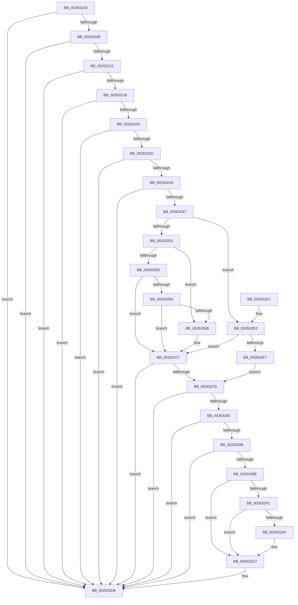

# KiRemoveSystemWorkPriorityKick

- RVA: `0x002631D0`–`0x002632EB` (길이 `283` bytes)
- VA: `0x00000001402631D0`
- 실행 섹션: `.text`
- PDB 이름 있음: `예`; PDB Function 태그: `아니요`
- unwind 정보 RVA: `0x00060BE4`
- 디코드: `75`개 명령, `283/283` bytes 표시
- 미해석 바이트: `0` (있으면 어셈블리에 `.byte`로 보존)

> 이 문서는 커널 이미지의 기계어와 PDB 기호를 분석해 생성했습니다. 4번과 5번은 함수 원형과 자료형을 바이너리 사용 방식에서 추정한 C 해석이며 원본 소스 복구 결과는 아닙니다.

## 1. Dependencies

- 직접 호출 지점: **2**; 고유 호출 대상: **2**
- 직접 호출자로 확인된 함수: **203**
- RIP 상대 이미지 참조: **2**

### Outgoing calls
- `0x002632BA` → [EtwTraceXSchedulerPriorityKickSend](../4F/EtwTraceXSchedulerPriorityKickSend_function_004FB2C0.md) (function, `0x004FB2C0`)
- `0x002632D1` → [HvlpSetRegister64](../4D/HvlpSetRegister64_function_004DDA70.md) (function, `0x004DDA70`)

### Direct callers
- [PpmIdleSnapConcurrency](../20/PpmIdleSnapConcurrency_function_00204694.md) at `0x0020475E`
- [sub_002099FA](../20/Unknown_function_002099FA.md) at `0x00209E3C`
- [sub_002099FA](../20/Unknown_function_002099FA.md) at `0x00209E94`
- [sub_002099FA](../20/Unknown_function_002099FA.md) at `0x00209EB9`
- [KeYieldExecution](../20/KeYieldExecution_function_00209FA0.md) at `0x0020A3B4`
- [sub_0020C2D4](../20/Unknown_function_0020C2D4.md) at `0x0020CD6E`
- [sub_0020C2D4](../20/Unknown_function_0020C2D4.md) at `0x0020CDBB`
- [sub_0020C2D4](../20/Unknown_function_0020C2D4.md) at `0x0020CDE0`
- [sub_0020D8DF](../20/Unknown_function_0020D8DF.md) at `0x0020DD77`
- [sub_0020D8DF](../20/Unknown_function_0020D8DF.md) at `0x0020DDB9`
- [sub_0020D8DF](../20/Unknown_function_0020D8DF.md) at `0x0020DDDE`
- [KeWaitForSingleObject](../20/KeWaitForSingleObject_function_0020E6B0.md) at `0x0020F534`
- [KeWaitForSingleObject](../20/KeWaitForSingleObject_function_0020E6B0.md) at `0x0020F592`
- [KeWaitForSingleObject](../20/KeWaitForSingleObject_function_0020E6B0.md) at `0x0020F5F0`
- [sub_00210084](../21/Unknown_function_00210084.md) at `0x0021020B`
- [sub_002102E2](../21/Unknown_function_002102E2.md) at `0x00210380`
- [sub_002102E2](../21/Unknown_function_002102E2.md) at `0x002103A5`
- [sub_00211104](../21/Unknown_function_00211104.md) at `0x002111FD`
- [ExpAcquireFastResourceSharedSlow](../21/ExpAcquireFastResourceSharedSlow_function_00211260.md) at `0x00211624`
- [ExpAcquireFastResourceSharedSlow](../21/ExpAcquireFastResourceSharedSlow_function_00211260.md) at `0x00211758`
- [ExpAcquireFastResourceSharedSlow](../21/ExpAcquireFastResourceSharedSlow_function_00211260.md) at `0x00211780`
- [ExpAcquireFastResourceSharedSlow](../21/ExpAcquireFastResourceSharedSlow_function_00211260.md) at `0x002119B9`
- [ExpAcquireFastResourceSharedSlow](../21/ExpAcquireFastResourceSharedSlow_function_00211260.md) at `0x00211A1F`
- [ExpAcquireFastResourceSharedSlow](../21/ExpAcquireFastResourceSharedSlow_function_00211260.md) at `0x00211ACE`
- [sub_00211E87](../21/Unknown_function_00211E87.md) at `0x00211F4E`
- [ExpAcquireResourceSharedLite](../21/ExpAcquireResourceSharedLite_function_00212040.md) at `0x00212C57`
- [ExpAcquireResourceSharedLite](../21/ExpAcquireResourceSharedLite_function_00212040.md) at `0x00212C7F`
- [sub_002150DC](../21/Unknown_function_002150DC.md) at `0x00215142`
- [sub_00215166](../21/Unknown_function_00215166.md) at `0x002159EF`
- [sub_00217100](../21/Unknown_function_00217100.md) at `0x0021713C`
- [sub_00217258](../21/Unknown_function_00217258.md) at `0x0021728A`
- [KiSetAddressPolicy](../21/KiSetAddressPolicy_function_002178A0.md) at `0x002178F6`
- [sub_00217C95](../21/Unknown_function_00217C95.md) at `0x00217CE0`
- [KiRetireDpcList](../21/KiRetireDpcList_function_0021A0B0.md) at `0x0021ADD5`
- [KiRetireDpcList](../21/KiRetireDpcList_function_0021A0B0.md) at `0x0021AE10`
- [KiRetireDpcList](../21/KiRetireDpcList_function_0021A0B0.md) at `0x0021AEEB`
- [KiRetireDpcList](../21/KiRetireDpcList_function_0021A0B0.md) at `0x0021AFAE`
- [KiRetireDpcList](../21/KiRetireDpcList_function_0021A0B0.md) at `0x0021AFE7`
- [sub_0021B161](../21/Unknown_function_0021B161.md) at `0x0021B2D5`
- [sub_0021B161](../21/Unknown_function_0021B161.md) at `0x0021B328`
- [sub_0021B161](../21/Unknown_function_0021B161.md) at `0x0021B34D`
- [sub_0021B9AC](../21/Unknown_function_0021B9AC.md) at `0x0021BA2E`
- [sub_0021D7F8](../21/Unknown_function_0021D7F8.md) at `0x0021E3A3`
- [KiSetNextClockTickDueTime](../23/KiSetNextClockTickDueTime_function_002363F0.md) at `0x002366CC`
- [sub_00241E90](../24/Unknown_function_00241E90.md) at `0x002421CC`
- [MiWalkVaRange](../24/MiWalkVaRange_function_00243BF0.md) at `0x0024482E`
- [ExReleaseFastMutexUnsafe](../25/ExReleaseFastMutexUnsafe_function_002503A0.md) at `0x0025061C`
- [IopReleaseFileObjectLock](../25/IopReleaseFileObjectLock_function_00250A90.md) at `0x00250E83`
- [FsRtlReleaseHeaderMutex](../25/FsRtlReleaseHeaderMutex_function_002516C0.md) at `0x00251989`
- [ExReleaseFastMutex](../25/ExReleaseFastMutex_function_002519C0.md) at `0x00251C5A`
- [sub_0025758D](../25/Unknown_function_0025758D.md) at `0x002575AB`
- [KiExecuteAllDpcs](../25/KiExecuteAllDpcs_function_0025B740.md) at `0x0025C3EE`
- [KiExecuteAllDpcs](../25/KiExecuteAllDpcs_function_0025B740.md) at `0x0025C761`
- [sub_0025E5F6](../25/Unknown_function_0025E5F6.md) at `0x0025E762`
- [sub_0025E5F6](../25/Unknown_function_0025E5F6.md) at `0x0025E8B4`
- [sub_00260366](Unknown_function_00260366.md) at `0x00260989`
- [sub_00260366](Unknown_function_00260366.md) at `0x00260AD2`
- [sub_00260366](Unknown_function_00260366.md) at `0x00260B64`
- [ExReleaseFastResource](ExReleaseFastResource_function_002613D0.md) at `0x0026183C`
- [ExReleaseFastResource](ExReleaseFastResource_function_002613D0.md) at `0x00261B57`
- [sub_00261DFE](Unknown_function_00261DFE.md) at `0x00261FAA`
- [sub_00261DFE](Unknown_function_00261DFE.md) at `0x0026213F`
- [KiAbEntryFreeAndEnableInterrupts](KiAbEntryFreeAndEnableInterrupts_function_002622D0.md) at `0x002623D3`
- [KiAbEntryFreeAndEnableInterrupts](KiAbEntryFreeAndEnableInterrupts_function_002622D0.md) at `0x002623F7`
- [sub_00262CBC](Unknown_function_00262CBC.md) at `0x00262CD6`
- [ExReleasePushLockSharedEx](ExReleasePushLockSharedEx_function_00263300.md) at `0x00263428`
- [ExReleasePushLockExclusiveEx](ExReleasePushLockExclusiveEx_function_00263510.md) at `0x00263648`
- [sub_0026377E](Unknown_function_0026377E.md) at `0x00263798`
- [PspUnlockProcessShared](PspUnlockProcessShared_function_00263950.md) at `0x00263A68`
- [ExReleasePushLockEx](ExReleasePushLockEx_function_00263A80.md) at `0x00263BB1`
- [ExReleaseCacheAwarePushLockSharedEx](ExReleaseCacheAwarePushLockSharedEx_function_00263BE0.md) at `0x00263D14`
- [sub_00263E78](Unknown_function_00263E78.md) at `0x00263E92`
- [sub_00264063](Unknown_function_00264063.md) at `0x00264110`
- [sub_00264921](Unknown_function_00264921.md) at `0x0026493F`
- [ExReleaseAutoExpandPushLockExclusive](ExReleaseAutoExpandPushLockExclusive_function_00264DE0.md) at `0x00264F65`
- [StLockReleaseExclusive](StLockReleaseExclusive_function_00267050.md) at `0x0026717A`
- [IopDecrementDeviceObjectRef](../27/IopDecrementDeviceObjectRef_function_00270970.md) at `0x00270B75`
- [sub_00272621](../27/Unknown_function_00272621.md) at `0x00272653`
- [sub_0027475D](../27/Unknown_function_0027475D.md) at `0x00274DD3`
- [sub_0027475D](../27/Unknown_function_0027475D.md) at `0x00274F28`
- [sub_0027475D](../27/Unknown_function_0027475D.md) at `0x00274FBB`
- [sub_0027475D](../27/Unknown_function_0027475D.md) at `0x0027504A`
- [KeShouldYieldProcessor](../27/KeShouldYieldProcessor_function_002773E0.md) at `0x00277547`
- [MiDeleteVaDirect](../27/MiDeleteVaDirect_function_00277560.md) at `0x00278624`
- [MiDeleteVaDirect](../27/MiDeleteVaDirect_function_00277560.md) at `0x00278856`
- [MiPeriodicGoodCitizen](../27/MiPeriodicGoodCitizen_function_00279250.md) at `0x002796A5`
- [MiWalkPageTablesRecursively](../27/MiWalkPageTablesRecursively_function_002796C0.md) at `0x0027B25E`
- [MiReleaseFaultState](../27/MiReleaseFaultState_function_0027D290.md) at `0x0027D61A`
- [sub_0027D95C](../27/Unknown_function_0027D95C.md) at `0x0027DB8D`
- [MiLockLowestValidPageTableEx](../28/MiLockLowestValidPageTableEx_function_00280D10.md) at `0x00281617`
- [MiSetVadDeleted](../29/MiSetVadDeleted_function_00296E00.md) at `0x00297008`
- [KeSetPriorityThread](../2C/KeSetPriorityThread_function_002C76E0.md) at `0x002C790D`
- [PpmPerfSetProcessorIdle](../2C/PpmPerfSetProcessorIdle_function_002CFD7C.md) at `0x002CFEE1`
- [PpmParkReportParkedCore](../2D/PpmParkReportParkedCore_function_002D8488.md) at `0x002D85A8`
- [PpmSnapPerformanceAccumulation](../2D/PpmSnapPerformanceAccumulation_function_002DE090.md) at `0x002DE52B`
- [PpmUpdatePerformanceFeedback](../2D/PpmUpdatePerformanceFeedback_function_002DE580.md) at `0x002DEEF6`
- [KeAbPostRelease](../2E/KeAbPostRelease_function_002E1600.md) at `0x002E16E8`
- [MiUnlockControlAreaFileObjectExclusive](../2E/MiUnlockControlAreaFileObjectExclusive_function_002E22D0.md) at `0x002E2406`
- [MiUnlockVadShared](../2E/MiUnlockVadShared_function_002E2420.md) at `0x002E255A`
- [MiManageSubsectionView](../2E/MiManageSubsectionView_function_002E2570.md) at `0x002E27B1`
- [UNLOCK_PAGE_TABLE_COMMITMENT](../2E/UNLOCK_PAGE_TABLE_COMMITMENT_function_002E27D0.md) at `0x002E2906`
- [PspUnlockProcessListShared](../2E/PspUnlockProcessListShared_function_002E2920.md) at `0x002E2A56`
- [RtlpHpReleaseQueuedLockExclusive](../2E/RtlpHpReleaseQueuedLockExclusive_function_002E2A70.md) at `0x002E2C24`
- [sub_002E3461](../2E/Unknown_function_002E3461.md) at `0x002E347F`
- [KiResumeThreadCycleAccumulation](../30/KiResumeThreadCycleAccumulation_function_00309BC4.md) at `0x00309BFD`
- [KiStartThreadCycleAccumulationContextSwap](../30/KiStartThreadCycleAccumulationContextSwap_function_00309C10.md) at `0x0030A0D3`
- [KiStartThreadCycleAccumulationContextSwap](../30/KiStartThreadCycleAccumulationContextSwap_function_00309C10.md) at `0x0030A19B`
- [sub_0030A776](../30/Unknown_function_0030A776.md) at `0x0030A84E`
- [sub_0030A776](../30/Unknown_function_0030A776.md) at `0x0030A8A0`
- [KiEnterLongDpcProcessing](../30/KiEnterLongDpcProcessing_function_0030BE54.md) at `0x0030C210`
- [sub_003243BB](../32/Unknown_function_003243BB.md) at `0x003243D9`
- [MiAddViewsForSection](../32/MiAddViewsForSection_function_00324990.md) at `0x00324F86`
- [MiQueryAddressState](../32/MiQueryAddressState_function_0032C380.md) at `0x0032D311`
- [sub_00342DC8](../34/Unknown_function_00342DC8.md) at `0x00342DE2`
- [KiRemoveThreadFromSchedulingGroup](../35/KiRemoveThreadFromSchedulingGroup_function_00356514.md) at `0x00356769`
- [sub_0037D19C](../37/Unknown_function_0037D19C.md) at `0x0037D1BA`
- [KeQueryTotalCycleTimeThread](../37/KeQueryTotalCycleTimeThread_function_0037EF20.md) at `0x0037F6F0`
- [ExInterlockedInsertTailList](../38/ExInterlockedInsertTailList_function_00386700.md) at `0x003867A0`
- [ExInterlockedRemoveHeadList](../38/ExInterlockedRemoveHeadList_function_003867B0.md) at `0x00386842`
- [ExpAcquireSpinLockDisabled](../38/ExpAcquireSpinLockDisabled_function_00386858.md) at `0x003868DE`
- [ExpReleaseSpinLockDisabled](../38/ExpReleaseSpinLockDisabled_function_003869E4.md) at `0x00386A29`
- [KeRcuReadUnlock](../38/KeRcuReadUnlock_function_0038A070.md) at `0x0038A13C`
- [KeRcuReadLock](../38/KeRcuReadLock_function_0038A1A0.md) at `0x0038A256`
- [sub_00391AD7](../39/Unknown_function_00391AD7.md) at `0x00391AF5`
- [sub_00393045](../39/Unknown_function_00393045.md) at `0x0039309C`
- [KeApplyWobBamQos](../39/KeApplyWobBamQos_function_003937AC.md) at `0x00393903`
- [NtWaitForWorkViaWorkerFactory](../39/NtWaitForWorkViaWorkerFactory_function_00394270.md) at `0x00394D0B`
- [sub_003954C8](../39/Unknown_function_003954C8.md) at `0x0039551F`
- [KeClockInterruptNotify](../39/KeClockInterruptNotify_function_0039A970.md) at `0x0039AD8A`
- [KeClockInterruptNotify](../39/KeClockInterruptNotify_function_0039A970.md) at `0x0039AFAE`
- [KeClockInterruptNotify](../39/KeClockInterruptNotify_function_0039A970.md) at `0x0039B13B`
- [KeClockInterruptNotify](../39/KeClockInterruptNotify_function_0039A970.md) at `0x0039B191`
- [KeClockInterruptNotify](../39/KeClockInterruptNotify_function_0039A970.md) at `0x0039B1B6`
- [KiUpdateTime](../39/KiUpdateTime_function_0039B530.md) at `0x0039BA96`
- [KiUpdateRunTime](../39/KiUpdateRunTime_function_0039BB70.md) at `0x0039BF63`
- [PpmExecutePeriodicPerfCheck](../39/PpmExecutePeriodicPerfCheck_function_0039D0CC.md) at `0x0039D220`
- [KiCheckForPendingQosUpdate](../39/KiCheckForPendingQosUpdate_function_0039DD48.md) at `0x0039DEC8`
- [KiSetClockIntervalToMinimumRequested](../39/KiSetClockIntervalToMinimumRequested_function_0039DF1C.md) at `0x0039E0B5`
- [KiCheckAndRearmForceIdle](../3A/KiCheckAndRearmForceIdle_function_003A1C58.md) at `0x003A1CE9`
- [ExAcquireFastResourceSharedStarveExclusive](../3B/ExAcquireFastResourceSharedStarveExclusive_function_003BDC80.md) at `0x003BDF55`
- [sub_003BE220](../3B/Unknown_function_003BE220.md) at `0x003BE23A`
- [ExpAcquireFastResourceExclusiveSlow](../3B/ExpAcquireFastResourceExclusiveSlow_function_003BE2E0.md) at `0x003BE6C9`
- [PpmCheckCustomRun](../3B/PpmCheckCustomRun_function_003BEC2C.md) at `0x003BED31`
- [PpmCheckCustomRun](../3B/PpmCheckCustomRun_function_003BEC2C.md) at `0x003BED59`
- [KeSetPriorityAndQuantumProcess](../3C/KeSetPriorityAndQuantumProcess_function_003C2EC0.md) at `0x003C3255`
- [KeSetActualBasePriorityThread](../3C/KeSetActualBasePriorityThread_function_003C4370.md) at `0x003C45E3`
- [KeWaitForAlertByThreadId](../3C/KeWaitForAlertByThreadId_function_003C4B14.md) at `0x003C4E7A`
- [KeRemovePriQueue](../3C/KeRemovePriQueue_function_003C5090.md) at `0x003C572C`
- [sub_003C6144](../3C/Unknown_function_003C6144.md) at `0x003C62C5`
- [sub_003C6144](../3C/Unknown_function_003C6144.md) at `0x003C6327`
- [sub_003C6144](../3C/Unknown_function_003C6144.md) at `0x003C634C`
- [KeSetBasePriorityThread](../3C/KeSetBasePriorityThread_function_003C6EB0.md) at `0x003C71BA`
- [KiDispatchException](../3D/KiDispatchException_function_003D7650.md) at `0x003D7D3E`
- [sub_003E69E9](../3E/Unknown_function_003E69E9.md) at `0x003E6A07`
- [sub_003E6BE8](../3E/Unknown_function_003E6BE8.md) at `0x003E6C06`
- [PspUnlockProcessThreadListShared](../3E/PspUnlockProcessThreadListShared_function_003ECC10.md) at `0x003ECD28`
- [KeUpdateTotalCyclesCurrentThread](../3F/KeUpdateTotalCyclesCurrentThread_function_003FA2B0.md) at `0x003FA9B3`
- [IopCheckDeviceAndDriver](../3F/IopCheckDeviceAndDriver_function_003FCBE0.md) at `0x003FCDCE`
- [KiInsertNewDpcRuntime](../3F/KiInsertNewDpcRuntime_function_003FE4CC.md) at `0x003FE621`
- [KiCompleteDirectSwitchThread](../3F/KiCompleteDirectSwitchThread_function_003FFE1C.md) at `0x003FFEBB`
- [sub_00401C5B](../40/Unknown_function_00401C5B.md) at `0x00401C79`
- [sub_0040EC21](../40/Unknown_function_0040EC21.md) at `0x0040EC75`
- [PpmParkSnapNodeStatistics](../41/PpmParkSnapNodeStatistics_function_0041419C.md) at `0x004142C4`
- [ExpMoveSharedFastResourceOwnershipWithFlags](../41/ExpMoveSharedFastResourceOwnershipWithFlags_function_00415C4C.md) at `0x00415F20`
- [sub_0043C740](../43/Unknown_function_0043C740.md) at `0x0043C81D`
- [sub_0043C86B](../43/Unknown_function_0043C86B.md) at `0x0043C885`
- [HvlpSlowFlushAddressSpaceTb](../44/HvlpSlowFlushAddressSpaceTb_function_004402C4.md) at `0x004404D2`
- [KxReenterRetpolinedCode](../44/KxReenterRetpolinedCode_function_0044EE64.md) at `0x0044EEB9`
- [KiWakeAddressAll](../45/KiWakeAddressAll_function_0045B334.md) at `0x0045B39B`
- [KeExitRetpoline](../46/KeExitRetpoline_function_00468E7C.md) at `0x00468EF5`
- [KeRemoveQueueDpcEx](../46/KeRemoveQueueDpcEx_function_0046CDC0.md) at `0x0046CEE8`
- [KeUpdateThreadTag](../47/KeUpdateThreadTag_function_00475770.md) at `0x00475C2E`
- [KiDpcRuntimeHistoryHashTableCleanupDpcRoutine](../48/KiDpcRuntimeHistoryHashTableCleanupDpcRoutine_function_00482F60.md) at `0x004830CF`
- [PpmIdleUpdateConcurrency](../48/PpmIdleUpdateConcurrency_function_004854C0.md) at `0x004855A1`
- [HvlPerformEndOfInterrupt](../48/HvlPerformEndOfInterrupt_function_004855F0.md) at `0x00485640`
- [KeSetForceIdle](../48/KeSetForceIdle_function_0048D5A8.md) at `0x0048D64B`
- [KeClearForceIdle](../48/KeClearForceIdle_function_0048D69C.md) at `0x0048D752`
- [KiForceIdleStopDpcRoutine](../48/KiForceIdleStopDpcRoutine_function_0048D7B0.md) at `0x0048D865`
- [ExInitializeFastResourceAcquired](../49/ExInitializeFastResourceAcquired_function_0049ADE0.md) at `0x0049AF4D`
- [PpmIdleSnapConcurrencyIdleTime](../4A/PpmIdleSnapConcurrencyIdleTime_function_004A0BD4.md) at `0x004A0C9E`
- [ExDisownFastResource](../4A/ExDisownFastResource_function_004A2C10.md) at `0x004A2DE4`
- [KiUpdateSystemTime](../4B/KiUpdateSystemTime_function_004B1570.md) at `0x004B169A`
- [PpmResetInterruptRate](../4B/PpmResetInterruptRate_function_004B3430.md) at `0x004B3477`
- [KiForceIdleStartDpcRoutine](../4C/KiForceIdleStartDpcRoutine_function_004C3F40.md) at `0x004C3FF8`
- [RtlpFcWriteHighLowHigh](../4C/RtlpFcWriteHighLowHigh_function_004C84BC.md) at `0x004C850F`
- [HvlpSetPowerProperty](../4C/HvlpSetPowerProperty_function_004C9124.md) at `0x004C9300`
- [KeBoostPriorityThread](../4D/KeBoostPriorityThread_function_004D37F8.md) at `0x004D396E`
- [PpmInstallFeedbackCounters](../4D/PpmInstallFeedbackCounters_function_004D477C.md) at `0x004D48F5`
- [KeThawExecution](../4F/KeThawExecution_function_004F5240.md) at `0x004F534D`
- [KiLowerIrqlProcessIrqlFlags](../4F/KiLowerIrqlProcessIrqlFlags_function_004F5698.md) at `0x004F56E9`
- [HvlSetQpcBias](../4F/HvlSetQpcBias_function_004F8EF0.md) at `0x004F90F6`
- [KiHaltOnAddress](../4F/KiHaltOnAddress_function_004FBA3C.md) at `0x004FBB1E`
- [KiInitializeProcessorCycleAccumulation](../5B/KiInitializeProcessorCycleAccumulation_function_005B2014.md) at `0x005B20D3`
- [KiCopyCounters](../5C/KiCopyCounters_function_005C0710.md) at `0x005C077E`
- [KeSrcuReadLock](../5C/KeSrcuReadLock_function_005C2090.md) at `0x005C20FD`
- [KeSrcuReadUnlock](../5C/KeSrcuReadUnlock_function_005C2140.md) at `0x005C21A9`
- [KeSrcuReadUnlock](../5C/KeSrcuReadUnlock_function_005C2140.md) at `0x005C2272`
- [KiSrcuNotifyGracePeriodStartedOnCpu](../5C/KiSrcuNotifyGracePeriodStartedOnCpu_function_005C2788.md) at `0x005C283C`
- [KiSrcuNotifyWorkerDpcRoutine](../5C/KiSrcuNotifyWorkerDpcRoutine_function_005C28D0.md) at `0x005C299C`
- [KiFreezeTargetExecution](../5C/KiFreezeTargetExecution_function_005C30A0.md) at `0x005C3320`
- [KiExecuteSmtIsolationThread](../5C/KiExecuteSmtIsolationThread_function_005C4070.md) at `0x005C40E8`
- [KiExecuteSmtIsolationThread](../5C/KiExecuteSmtIsolationThread_function_005C4070.md) at `0x005C426A`
- [KiBugCheckRecoveryCleanupFromCrashDump](../5C/KiBugCheckRecoveryCleanupFromCrashDump_function_005C706C.md) at `0x005C7105`
- [KiBugCheckRecoveryFreezeProcessorDpc](../5C/KiBugCheckRecoveryFreezeProcessorDpc_function_005C7360.md) at `0x005C73F8`
- [KiScheduleBugcheckRecovery](../5C/KiScheduleBugcheckRecovery_function_005C7B20.md) at `0x005C7B62`
- [KiUpdateBugcheckRecoveryProgress](../5C/KiUpdateBugcheckRecoveryProgress_function_005C7E1C.md) at `0x005C7F25`
- [KiFixupControlProtectionKernelModeReturnMismatch](../5C/KiFixupControlProtectionKernelModeReturnMismatch_function_005C8028.md) at `0x005C8136`
- [KiAcquireReleaseDpcData](../5C/KiAcquireReleaseDpcData_function_005C8404.md) at `0x005C8469`
- [KiDpcWatchdog](../5C/KiDpcWatchdog_function_005C8490.md) at `0x005C84D2`
- [KiExecuteDpc](../5C/KiExecuteDpc_function_005C84F0.md) at `0x005C85E1`
- [KiExecuteDpcDelegate](../5C/KiExecuteDpcDelegate_function_005C8620.md) at `0x005C8695`
- [KiTimerExpirationDpc](../5C/KiTimerExpirationDpc_function_005C86D0.md) at `0x005C87EA`
- [ExAcquireFastResourceWithFlags](../65/ExAcquireFastResourceWithFlags_function_00658120.md) at `0x006582D9`
- [ExAcquireFastResourceWithFlags](../65/ExAcquireFastResourceWithFlags_function_00658120.md) at `0x006585F2`
- [ExTryToConvertFastResourceSharedToExclusive](../65/ExTryToConvertFastResourceSharedToExclusive_function_00658A30.md) at `0x00658C30`
- [MiReapplyImportOptimizationWorker](../68/MiReapplyImportOptimizationWorker_function_00682720.md) at `0x00682A3A`
- [sub_006D6552](../6D/Unknown_function_006D6552.md) at `0x006D65F1`
- [sub_006D66EC](../6D/Unknown_function_006D66EC.md) at `0x006D66FF`
- [sub_006D8D08](../6D/Unknown_function_006D8D08.md) at `0x006D8D56`
- [sub_006DD630](../6D/Unknown_function_006DD630.md) at `0x006DD80D`
- [sub_006DDD5E](../6D/Unknown_function_006DDD5E.md) at `0x006DDD71`
- [sub_006E0A74](../6E/Unknown_function_006E0A74.md) at `0x006E0B10`
- [sub_006E112E](../6E/Unknown_function_006E112E.md) at `0x006E11A7`
- [sub_006E2712](../6E/Unknown_function_006E2712.md) at `0x006E2725`
- [sub_006E57A6](../6E/Unknown_function_006E57A6.md) at `0x006E57B9`
- [sub_006E57C4](../6E/Unknown_function_006E57C4.md) at `0x006E57D7`
- [sub_006E5E2E](../6E/Unknown_function_006E5E2E.md) at `0x006E5F68`
- [sub_006E6412](../6E/Unknown_function_006E6412.md) at `0x006E6425`
- [sub_006E650A](../6E/Unknown_function_006E650A.md) at `0x006E65A5`
- [sub_006E7EC2](../6E/Unknown_function_006E7EC2.md) at `0x006E7F22`
- [sub_006E9870](../6E/Unknown_function_006E9870.md) at `0x006E9923`
- [sub_006EBEFC](../6E/Unknown_function_006EBEFC.md) at `0x006EC08F`
- [sub_006ED39E](../6E/Unknown_function_006ED39E.md) at `0x006ED3F5`
- [sub_006EF752](../6E/Unknown_function_006EF752.md) at `0x006EF765`
- [sub_006F3CE0](../6F/Unknown_function_006F3CE0.md) at `0x006F3CF3`
- [sub_006F48A4](../6F/Unknown_function_006F48A4.md) at `0x006F4944`
- [sub_006F5356](../6F/Unknown_function_006F5356.md) at `0x006F53F4`
- [sub_006F9072](../6F/Unknown_function_006F9072.md) at `0x006F910D`
- [sub_006FC6A8](../6F/Unknown_function_006FC6A8.md) at `0x006FC736`
- [sub_006FC6A8](../6F/Unknown_function_006FC6A8.md) at `0x006FC7B6`
- [PnprQuiesceProcessorDpc](../../pagelk/B6/PnprQuiesceProcessorDpc_function_00B64B50.md) at `0x00B64DAD`
- [PnprQuiesceProcessorDpc](../../pagelk/B6/PnprQuiesceProcessorDpc_function_00B64B50.md) at `0x00B64F3F`
- [KiUpdateProcessorCount](../../pagelk/B6/KiUpdateProcessorCount_function_00B65D18.md) at `0x00B65D81`
- [PopHandleNextState](../../pagelk/B7/PopHandleNextState_function_00B77350.md) at `0x00B774C4`
- [KiCalibrateTimeAdjustment](../../pagelk/B7/KiCalibrateTimeAdjustment_function_00B797E0.md) at `0x00B7990A`
- [KiSetPageAttributesTable](../../pagelk/B7/KiSetPageAttributesTable_function_00B7D7FC.md) at `0x00B7D8D9`
- [KeLoadMTRR](../../pagelk/B7/KeLoadMTRR_function_00B7DDA0.md) at `0x00B7DF62`
- [ExpComputeCyclesPerYield](../../init/C1/ExpComputeCyclesPerYield_function_00C1AF20.md) at `0x00C1AF94`
- [KiComputeDispatchInterruptCost](../../init/C3/KiComputeDispatchInterruptCost_function_00C377C0.md) at `0x00C379DA`

### Static image references
- `0x0026326B` → RVA `0x00FC504C` (`ALMOSTRO`; read)
- `0x00263297` → RVA `0x00FC6B14` (`ALMOSTRO`; read)

## 2. Other-region calls and transfers

- 다른 실행 섹션으로 향하는 call: **0**
- 별도 외부 분기/꼬리 이동을 확인하지 못했습니다.

## 3. Assembly (complete function range)

```asm
002631D0  48 89 5C 24 08                  mov qword ptr [rsp + 8], rbx
002631D5  57                              push rdi
002631D6  48 83 EC 20                     sub rsp, 0x20
002631DA  4C 8B 81 B8 8E 00 00            mov r8, qword ptr [rcx + 0x8eb8]
002631E1  48 8B D9                        mov rbx, rcx
002631E4  45 8B 18                        mov r11d, dword ptr [r8]
002631E7  41 8B 40 14                     mov eax, dword ptr [r8 + 0x14]
002631EB  45 8B 48 1C                     mov r9d, dword ptr [r8 + 0x1c]
002631EF  45 8B 50 20                     mov r10d, dword ptr [r8 + 0x20]
002631F3  49 8B 48 28                     mov rcx, qword ptr [r8 + 0x28]
002631F7  49 8B 50 30                     mov rdx, qword ptr [r8 + 0x30]
002631FB  41 F7 C3 00 00 28 00            test r11d, 0x280000
00263202  0F 85 CE 00 00 00               jne 0x1402632d6
00263208  33 FF                           xor edi, edi
0026320A  85 C0                           test eax, eax
0026320C  0F 85 C4 00 00 00               jne 0x1402632d6
00263212  45 85 C9                        test r9d, r9d
00263215  0F 85 BB 00 00 00               jne 0x1402632d6
0026321B  45 85 D2                        test r10d, r10d
0026321E  0F 85 B2 00 00 00               jne 0x1402632d6
00263224  48 3B CA                        cmp rcx, rdx
00263227  0F 85 A9 00 00 00               jne 0x1402632d6
0026322D  48 8B 43 38                     mov rax, qword ptr [rbx + 0x38]
00263231  48 85 C0                        test rax, rax
00263234  0F 84 9C 00 00 00               je 0x1402632d6
0026323A  40 38 BB 65 87 00 00            cmp byte ptr [rbx + 0x8765], dil
00263241  0F 85 8F 00 00 00               jne 0x1402632d6
00263247  0F B6 08                        movzx ecx, byte ptr [rax]
0026324A  83 E1 7F                        and ecx, 0x7f
0026324D  0F 85 8F 00 00 00               jne 0x1402632e2
00263253  48 8B 43 10                     mov rax, qword ptr [rbx + 0x10]
00263257  48 8B 53 18                     mov rdx, qword ptr [rbx + 0x18]
0026325B  48 3B C2                        cmp rax, rdx
0026325E  74 0B                           je 0x14026326b
00263260  48 39 53 08                     cmp qword ptr [rbx + 8], rdx
00263264  75 0B                           jne 0x140263271
00263266  48 85 C0                        test rax, rax
00263269  75 06                           jne 0x140263271
0026326B  8B 0D DB 1D D6 00               mov ecx, dword ptr [rip + 0xd61ddb]
00263271  83 F9 10                        cmp ecx, 0x10
00263274  7D 60                           jge 0x1402632d6
00263276  41 0F B6 D3                     movzx edx, r11b
0026327A  8D 42 FF                        lea eax, [rdx - 1]
0026327D  83 F8 1E                        cmp eax, 0x1e
00263280  77 54                           ja 0x1402632d6
00263282  3B D1                           cmp edx, ecx
00263284  7E 50                           jle 0x1402632d6
00263286  3B 15 C0 1D D6 00               cmp edx, dword ptr [rip + 0xd61dc0]
0026328C  7C 48                           jl 0x1402632d6
0026328E  BA 03 00 00 00                  mov edx, 3
00263293  41 89 50 0C                     mov dword ptr [r8 + 0xc], edx
00263297  8B 05 77 38 D6 00               mov eax, dword ptr [rip + 0xd63877]
0026329D  A8 20                           test al, 0x20
0026329F  74 26                           je 0x1402632c7
002632A1  65 66 8B 04 25 26 85 00 00      mov ax, word ptr gs:[0x8526]
002632AA  66 85 C0                        test ax, ax
002632AD  75 18                           jne 0x1402632c7
002632AF  C6 83 65 87 00 00 01            mov byte ptr [rbx + 0x8765], 1
002632B6  90                              nop
002632B7  8B 4B 24                        mov ecx, dword ptr [rbx + 0x24]
002632BA  E8 01 80 29 00                  call 0x1404fb2c0
002632BF  90                              nop
002632C0  40 88 BB 65 87 00 00            mov byte ptr [rbx + 0x8765], dil
002632C7  BA FE FF FF FF                  mov edx, 0xfffffffe
002632CC  B9 1B 00 09 00                  mov ecx, 0x9001b
002632D1  E8 9A A7 27 00                  call 0x1404dda70
002632D6  48 8B 5C 24 30                  mov rbx, qword ptr [rsp + 0x30]
002632DB  48 83 C4 20                     add rsp, 0x20
002632DF  5F                              pop rdi
002632E0  C3                              ret
002632E1  CC                              int3
002632E2  83 F9 3F                        cmp ecx, 0x3f
002632E5  75 8A                           jne 0x140263271
002632E7  8B CF                           mov ecx, edi
002632E9  EB 8B                           jmp 0x140263276
```

## 4. C-style interpretation (structured pseudocode)

```c
__int64 __fastcall KiRemoveSystemWorkPriorityKick(__int64 a1)
{
    __int64 result;
    __int64 v_rdi;
    __int64 v_rsp;
    unsigned __int64 v_stack_p8;

    v_stack_p8 = v_rbx;
    v_rsp = (v_rsp) - (32);
    if ((((unsigned int)((unsigned int)(*(unsigned int *)(*(unsigned __int64 *)(a1 + 36536))))) & (0x280000ULL)) != 0) goto loc_002632D6;
    v_rdi = 0;
    if ((unsigned int)((unsigned int)(*(unsigned int *)(*(unsigned __int64 *)(a1 + 36536) + 20))) != 0) goto loc_002632D6;
    if ((unsigned int)((unsigned int)(*(unsigned int *)(*(unsigned __int64 *)(a1 + 36536) + 28))) != 0) goto loc_002632D6;
    if ((unsigned int)((unsigned int)(*(unsigned int *)(*(unsigned __int64 *)(a1 + 36536) + 32))) != 0) goto loc_002632D6;
    if ((*(unsigned __int64 *)(*(unsigned __int64 *)(a1 + 36536) + 40)) != (*(unsigned __int64 *)(*(unsigned __int64 *)(a1 + 36536) + 48))) goto loc_002632D6;
    if (*(unsigned __int64 *)(a1 + 56) == 0) goto loc_002632D6;
    if ((*(unsigned __int8 *)(a1 + 34661)) != 0) goto loc_002632D6;
    a1 = (unsigned int)((*(unsigned __int8 *)(*(unsigned __int64 *)(a1 + 56))) & (127));
    if (condition_is_not_equal) goto loc_002632E2;
    if ((*(unsigned __int64 *)(a1 + 16)) == (*(unsigned __int64 *)(a1 + 24))) goto loc_0026326B;
    if ((*(unsigned __int64 *)(a1 + 8)) != (*(unsigned __int64 *)(a1 + 24))) goto loc_00263271;
    if (*(unsigned __int64 *)(a1 + 16) == 0) {
        a1 = *(unsigned int *)(v_rip + 14032347);
    }
    if (((unsigned int)(a1)) >= 16) goto loc_002632D6;
loc_00263276:
    if (((unsigned int)((unsigned __int8)((unsigned int)(*(unsigned int *)(*(unsigned __int64 *)(a1 + 36536)))) - 1)) > 30) goto loc_002632D6;
    if (((unsigned int)((unsigned __int8)((unsigned int)(*(unsigned int *)(*(unsigned __int64 *)(a1 + 36536)))))) <= ((unsigned int)(a1))) goto loc_002632D6;
    if (((unsigned int)((unsigned __int8)((unsigned int)(*(unsigned int *)(*(unsigned __int64 *)(a1 + 36536)))))) < (*(unsigned int *)(v_rip + 14032320))) goto loc_002632D6;
    *(unsigned int *)(*(unsigned __int64 *)(a1 + 36536) + 12) = 3;
    if ((((unsigned __int8)((unsigned int)(*(unsigned int *)(v_rip + 14039159)))) & (32)) == 0) goto loc_002632C7;
    result = *(unsigned __int16 *)(gs_base + (0 + 34086));
    if ((unsigned __int16)(*(unsigned __int16 *)(gs_base + (0 + 34086))) == 0) {
        *(unsigned __int8 *)(a1 + 34661) = 1;
        a1 = *(unsigned int *)(a1 + 36);
        result = EtwTraceXSchedulerPriorityKickSend(a1, 3, *(unsigned __int64 *)(a1 + 36536), (unsigned int)(*(unsigned int *)(*(unsigned __int64 *)(a1 + 36536) + 28)));
        *(unsigned __int8 *)(a1 + 34661) = 0;
    }
    result = HvlpSetRegister64((unsigned int)(0x9001BULL), (unsigned int)(0xFFFFFFFEULL), *(unsigned __int64 *)(a1 + 36536), (unsigned int)(*(unsigned int *)(*(unsigned __int64 *)(a1 + 36536) + 28)));
loc_002632D6:
    v_rsp = (v_rsp) + (32);
    return result;
loc_002632E2:
    if (((unsigned int)((unsigned int)(0x9001BULL))) != 63) goto loc_00263271;
    goto loc_00263276;
}
```

## 5. (Beta) C Style

```c
int64_t KiRemoveSystemWorkPriorityKick(void *Arg1)
{
    uint8_t *arg1 = (uint8_t *)Arg1;

    int64_t result;
    int64_t local_rdi;
    int64_t local_rsp;
    uint64_t v_stack_p8;

    v_stack_p8 = local_rbx;
    local_rsp = (local_rsp) - (32);
    if ((((uint32_t)((uint32_t)(*(uint32_t *)(*(uint64_t *)(arg1 + 0x8EB8))))) & (0x280000ULL)) != 0) goto loc_002632D6;
    local_rdi = 0;
    if ((uint32_t)((uint32_t)(*(uint32_t *)(*(uint64_t *)(arg1 + 0x8EB8) + 0x14))) != 0) goto loc_002632D6;
    if ((uint32_t)((uint32_t)(*(uint32_t *)(*(uint64_t *)(arg1 + 0x8EB8) + 0x1C))) != 0) goto loc_002632D6;
    if ((uint32_t)((uint32_t)(*(uint32_t *)(*(uint64_t *)(arg1 + 0x8EB8) + 0x20))) != 0) goto loc_002632D6;
    if ((*(uint64_t *)(*(uint64_t *)(arg1 + 0x8EB8) + 0x28)) != (*(uint64_t *)(*(uint64_t *)(arg1 + 0x8EB8) + 0x30))) goto loc_002632D6;
    if (*(uint64_t *)(arg1 + 0x38) == 0) goto loc_002632D6;
    if ((*(uint8_t *)(arg1 + 0x8765)) != 0) goto loc_002632D6;
    Arg1 = (uint32_t)((*(uint8_t *)(*(uint64_t *)(arg1 + 0x38))) & (127));
    if (condition_is_not_equal) goto loc_002632E2;
    if ((*(uint64_t *)(arg1 + 0x10)) == (*(uint64_t *)(arg1 + 0x18))) goto loc_0026326B;
    if ((*(uint64_t *)(arg1 + 0x8)) != (*(uint64_t *)(arg1 + 0x18))) goto loc_00263271;
    if (*(uint64_t *)(arg1 + 0x10) == 0) {
        Arg1 = *(uint32_t *)(v_rip + 0xD61DDB);
    }
    if (((uint32_t)(Arg1)) >= 16) goto loc_002632D6;
loc_00263276:
    if (((uint32_t)((uint8_t)((uint32_t)(*(uint32_t *)(*(uint64_t *)(arg1 + 0x8EB8)))) - 1)) > 30) goto loc_002632D6;
    if (((uint32_t)((uint8_t)((uint32_t)(*(uint32_t *)(*(uint64_t *)(arg1 + 0x8EB8)))))) <= ((uint32_t)(Arg1))) goto loc_002632D6;
    if (((uint32_t)((uint8_t)((uint32_t)(*(uint32_t *)(*(uint64_t *)(arg1 + 0x8EB8)))))) < (*(uint32_t *)(v_rip + 0xD61DC0))) goto loc_002632D6;
    *(uint32_t *)(*(uint64_t *)(arg1 + 0x8EB8) + 0xC) = 3;
    if ((((uint8_t)((uint32_t)(*(uint32_t *)(v_rip + 0xD63877)))) & (32)) == 0) goto loc_002632C7;
    result = *(uint16_t *)(gs_base + (0 + 0x8526));
    if ((uint16_t)(*(uint16_t *)(gs_base + (0 + 0x8526))) == 0) {
        *(uint8_t *)(arg1 + 0x8765) = 1;
        Arg1 = *(uint32_t *)(arg1 + 0x24);
        result = EtwTraceXSchedulerPriorityKickSend(Arg1, 3, *(uint64_t *)(arg1 + 0x8EB8), (uint32_t)(*(uint32_t *)(*(uint64_t *)(arg1 + 0x8EB8) + 0x1C)));
        *(uint8_t *)(arg1 + 0x8765) = 0;
    }
    result = HvlpSetRegister64((uint32_t)(0x9001BULL), (uint32_t)(0xFFFFFFFEULL), *(uint64_t *)(arg1 + 0x8EB8), (uint32_t)(*(uint32_t *)(*(uint64_t *)(arg1 + 0x8EB8) + 0x1C)));
loc_002632D6:
    local_rsp = (local_rsp) + (32);
    return result;
loc_002632E2:
    if (((uint32_t)((uint32_t)(0x9001BULL))) != 63) goto loc_00263271;
    goto loc_00263276;
}
```

### 관측된 메모리 오프셋

구조체 형식이 확인되지 않은 접근은 인자 기준의 오프셋으로만 기록했습니다.

| 기준 인자 | 오프셋 표현 | 폭 (bit) | 접근 |
|---|---:|---:|---|
| `Arg1` | `+ 0x8` | `64` | `R` |
| `Arg1` | `+ 0x10` | `64` | `R` |
| `Arg1` | `+ 0x18` | `64` | `R` |
| `Arg1` | `+ 0x24` | `32` | `R` |
| `Arg1` | `+ 0x38` | `64` | `R` |
| `Arg1` | `+ 0x8765` | `8` | `R` |
| `Arg1` | `+ 0x8765` | `8` | `W` |
| `Arg1` | `+ 0x8EB8` | `64` | `R` |

## 6. Execution-region graph

[열기: 2D/3D 그래프와 함수 탐색 컨트롤 패널](../../../control-panel.html?section=text&rva=0x002631D0&view=graph)

- 2D 그래프는 위에서 아래로 흐르고, 3D 그래프는 빈 공간을 드래그해 회전합니다. Shift+드래그는 이동, 휠은 확대·축소, 함수 노드 선택은 대상 보고서 이동입니다.

### Static fallback


