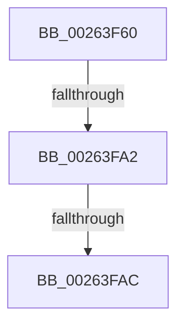

# KiSynchronizeUserIsolationDomainEntry

- RVA: `0x00263F60`–`0x00263FB0` (길이 `80` bytes)
- VA: `0x0000000140263F60`
- 실행 섹션: `.text`
- PDB 이름 있음: `예`; PDB Function 태그: `아니요`
- unwind 정보 RVA: `0x00064824`
- 디코드: `16`개 명령, `80/80` bytes 표시
- 미해석 바이트: `0` (있으면 어셈블리에 `.byte`로 보존)

> 이 문서는 커널 이미지의 기계어와 PDB 기호를 분석해 생성했습니다. 4번과 5번은 함수 원형과 자료형을 바이너리 사용 방식에서 추정한 C 해석이며 원본 소스 복구 결과는 아닙니다.

## 1. Dependencies

- 직접 호출 지점: **0**; 고유 호출 대상: **0**
- 직접 호출자로 확인된 함수: **27**
- RIP 상대 이미지 참조: **0**

### Outgoing calls
- 직접 디코드된 call 명령이 없습니다.

### Direct callers
- [NtContinueEx](../6B/NtContinueEx_function_006B10D0.md) at `0x006B123C`
- [NtRaiseException](../6B/NtRaiseException_function_006B1560.md) at `0x006B16DC`
- [KiCallUserMode](../6B/KiCallUserMode_function_006B2180.md) at `0x006B2321`
- [KxStartUserThread](../6B/KxStartUserThread_function_006B2E50.md) at `0x006B2F77`
- [KiChainedDispatch](../6B/KiChainedDispatch_function_006B3480.md) at `0x006B3549`
- [KiInterruptDispatch](../6B/KiInterruptDispatch_function_006B3B30.md) at `0x006B3BF9`
- [KiInterruptDispatchNoLock](../6B/KiInterruptDispatchNoLock_function_006B3F10.md) at `0x006B3FD9`
- [KiInterruptDispatchNoLockNoEtw](../6B/KiInterruptDispatchNoLockNoEtw_function_006B42F0.md) at `0x006B43B9`
- [KiInterruptDispatchNoEOI](../6B/KiInterruptDispatchNoEOI_function_006B46D0.md) at `0x006B4791`
- [KiSpuriousDispatchNoEOI](../6B/KiSpuriousDispatchNoEOI_function_006B4AA0.md) at `0x006B4B56`
- [KxIsrLinkage](../6B/KxIsrLinkage_function_006B5680.md) at `0x006B5B05`
- [KiApcInterrupt](../6B/KiApcInterrupt_function_006B5E20.md) at `0x006B6232`
- [KiHvInterruptDispatch](../6B/KiHvInterruptDispatch_function_006B7750.md) at `0x006B7827`
- [KiVmbusInterruptDispatch](../6B/KiVmbusInterruptDispatch_function_006B7B40.md) at `0x006B7C03`
- [KiSwInterrupt](../6B/KiSwInterrupt_function_006B8070.md) at `0x006B849E`
- [KiDpcInterrupt](../6B/KiDpcInterrupt_function_006B87C0.md) at `0x006B8BC6`
- [KiIpiInterrupt](../6B/KiIpiInterrupt_function_006B8F20.md) at `0x006B9347`
- [NtCallEnclave](../6B/NtCallEnclave_function_006BABA0.md) at `0x006BAC4E`
- [KiBoundFault](../6B/KiBoundFault_function_006BE040.md) at `0x006BE421`
- [KiInvalidOpcodeFault](../6B/KiInvalidOpcodeFault_function_006BE740.md) at `0x006BEAD7`
- [KiPageFault](../6C/KiPageFault_function_006C0740.md) at `0x006C0C38`
- [KxMcheckAlternateReturn](../6C/KxMcheckAlternateReturn_function_006C1E00.md) at `0x006C21C6`
- [KiVirtualizationException](../6C/KiVirtualizationException_function_006C2900.md) at `0x006C2CE8`
- [KiControlProtectionFault](../6C/KiControlProtectionFault_function_006C3040.md) at `0x006C348A`
- [KiSystemCall64](../6C/KiSystemCall64_function_006C4A40.md) at `0x006C5021`
- [KiExceptionDispatch](../6C/KiExceptionDispatch_function_006C5900.md) at `0x006C5AFA`
- [KiFastFailDispatch](../6C/KiFastFailDispatch_function_006C5E40.md) at `0x006C5FBB`

### Static image references
- 디코드된 RIP-relative 메모리 참조가 없습니다.

## 2. Other-region calls and transfers

- 다른 실행 섹션으로 향하는 call: **0**
- call이 아닌 외부 분기/꼬리 이동: **2**
  - `0x00263F9C` → [sub_002641C6 + 0x4](Unknown_function_002641C6.md) (`tail-transfer`)
  - `0x00263FA6` → [sub_002641C6](Unknown_function_002641C6.md) (`tail-transfer`)

## 3. Assembly (complete function range)

```asm
00263F60  48 89 5C 24 10                  mov qword ptr [rsp + 0x10], rbx
00263F65  48 89 6C 24 18                  mov qword ptr [rsp + 0x18], rbp
00263F6A  48 89 74 24 20                  mov qword ptr [rsp + 0x20], rsi
00263F6F  57                              push rdi
00263F70  48 83 EC 20                     sub rsp, 0x20
00263F74  65 48 8B 3C 25 20 00 00 00      mov rdi, qword ptr gs:[0x20]
00263F7D  48 8B 47 08                     mov rax, qword ptr [rdi + 8]
00263F81  48 8B 9F 58 8E 00 00            mov rbx, qword ptr [rdi + 0x8e58]
00263F88  8B B7 B4 AE 00 00               mov esi, dword ptr [rdi + 0xaeb4]
00263F8E  48 8B A8 18 07 00 00            mov rbp, qword ptr [rax + 0x718]
00263F95  48 8B 5B 28                     mov rbx, qword ptr [rbx + 0x28]
00263F99  48 85 ED                        test rbp, rbp
00263F9C  0F 84 28 02 00 00               je 0x1402641ca
00263FA2  80 7B 18 01                     cmp byte ptr [rbx + 0x18], 1
00263FA6  0F 84 1A 02 00 00               je 0x1402641c6
00263FAC  48 8B 43 10                     mov rax, qword ptr [rbx + 0x10]
```

## 4. C-style interpretation (structured pseudocode)

```c
__int64 __fastcall KiSynchronizeUserIsolationDomainEntry(void)
{
    __int64 v_rsp;
    unsigned __int64 v_stack_p10;
    unsigned __int64 v_stack_p18;
    unsigned __int64 v_stack_p20;

    v_stack_p10 = v_rbx;
    v_stack_p18 = v_rbp;
    v_stack_p20 = v_rsi;
    v_rsp = (v_rsp) - (32);
    return *(unsigned __int64 *)(*(unsigned __int64 *)(*(unsigned __int64 *)(*(unsigned __int64 *)(gs_base + (0 + 32)) + 36440) + 40) + 16);
}
```

## 5. (Beta) C Style

```c
void KiSynchronizeUserIsolationDomainEntry(void)
{
    int64_t local_rsp;
    uint64_t v_stack_p10;
    uint64_t v_stack_p18;
    uint64_t v_stack_p20;

    v_stack_p10 = local_rbx;
    v_stack_p18 = local_rbp;
    v_stack_p20 = local_rsi;
    local_rsp = (local_rsp) - (32);
    return *(uint64_t *)(*(uint64_t *)(*(uint64_t *)(*(uint64_t *)(gs_base + (0 + 0x20)) + 0x8E58) + 0x28) + 0x10);
}
```

## 6. Execution-region graph

[열기: 2D/3D 그래프와 함수 탐색 컨트롤 패널](../../../control-panel.html?section=text&rva=0x00263F60&view=graph)

- 2D 그래프는 위에서 아래로 흐르고, 3D 그래프는 빈 공간을 드래그해 회전합니다. Shift+드래그는 이동, 휠은 확대·축소, 함수 노드 선택은 대상 보고서 이동입니다.

### Static fallback


