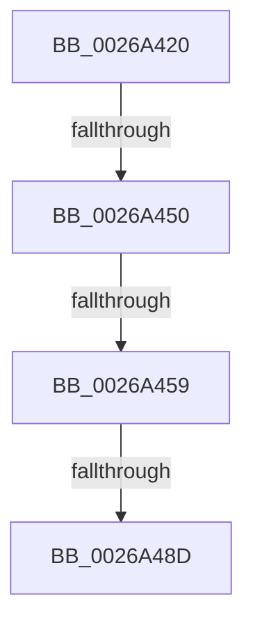

# LZ4_compress_fast_extState

- RVA: `0x0026A420`–`0x0026A4AD` (길이 `141` bytes)
- VA: `0x000000014026A420`
- 실행 섹션: `.text`
- PDB 이름 있음: `예`; PDB Function 태그: `아니요`
- unwind 정보 RVA: `0x00065428`
- 디코드: `34`개 명령, `141/141` bytes 표시
- 미해석 바이트: `0` (있으면 어셈블리에 `.byte`로 보존)

> 이 문서는 커널 이미지의 기계어와 PDB 기호를 분석해 생성했습니다. 4번과 5번은 함수 원형과 자료형을 바이너리 사용 방식에서 추정한 C 해석이며 원본 소스 복구 결과는 아닙니다.

## 1. Dependencies

- 직접 호출 지점: **1**; 고유 호출 대상: **1**
- 직접 호출자로 확인된 함수: **1**
- RIP 상대 이미지 참조: **0**

### Outgoing calls
- `0x0026A461` → [memset](../6C/memset_function_006C6C40.md) (function, `0x006C6C40`)

### Direct callers
- [RtlCompressBufferLz4](RtlCompressBufferLz4_function_0026A3A0.md) at `0x0026A3D1`

### Static image references
- 디코드된 RIP-relative 메모리 참조가 없습니다.

## 2. Other-region calls and transfers

- 다른 실행 섹션으로 향하는 call: **0**
- call이 아닌 외부 분기/꼬리 이동: **3**
  - `0x0026A44A` → [sub_0026B86F](Unknown_function_0026B86F.md) (`tail-transfer`)
  - `0x0026A453` → [sub_0026A9B4](Unknown_function_0026A9B4.md) (`tail-transfer`)
  - `0x0026A487` → [sub_0026A9F7](Unknown_function_0026A9F7.md) (`tail-transfer`)

## 3. Assembly (complete function range)

```asm
0026A420  4C 89 44 24 18                  mov qword ptr [rsp + 0x18], r8
0026A425  48 89 54 24 10                  mov qword ptr [rsp + 0x10], rdx
0026A42A  48 89 4C 24 08                  mov qword ptr [rsp + 8], rcx
0026A42F  53                              push rbx
0026A430  57                              push rdi
0026A431  48 81 EC A8 00 00 00            sub rsp, 0xa8
0026A438  45 33 DB                        xor r11d, r11d
0026A43B  49 63 D9                        movsxd rbx, r9d
0026A43E  4D 8B C8                        mov r9, r8
0026A441  4C 8B D2                        mov r10, rdx
0026A444  48 8B F9                        mov rdi, rcx
0026A447  48 85 C9                        test rcx, rcx
0026A44A  0F 84 1F 14 00 00               je 0x14026b86f
0026A450  F6 C1 07                        test cl, 7
0026A453  0F 85 5B 05 00 00               jne 0x14026a9b4
0026A459  33 D2                           xor edx, edx
0026A45B  41 B8 20 40 00 00               mov r8d, 0x4020
0026A461  E8 DA C7 45 00                  call 0x1406c6c40
0026A466  4C 8B 94 24 C8 00 00 00         mov r10, qword ptr [rsp + 0xc8]
0026A46E  45 33 DB                        xor r11d, r11d
0026A471  4C 8B 8C 24 D0 00 00 00         mov r9, qword ptr [rsp + 0xd0]
0026A479  48 89 BC 24 C0 00 00 00         mov qword ptr [rsp + 0xc0], rdi
0026A481  81 FB 00 00 00 7E               cmp ebx, 0x7e000000
0026A487  0F 87 6A 05 00 00               ja 0x14026a9f7
0026A48D  B8 81 80 80 80                  mov eax, 0x80808081
0026A492  F7 EB                           imul ebx
0026A494  03 D3                           add edx, ebx
0026A496  C1 FA 07                        sar edx, 7
0026A499  8B C2                           mov eax, edx
0026A49B  C1 E8 1F                        shr eax, 0x1f
0026A49E  83 C0 10                        add eax, 0x10
0026A4A1  03 C2                           add eax, edx
0026A4A3  03 C3                           add eax, ebx
0026A4A5  48 63 8C 24 E0 00 00 00         movsxd rcx, dword ptr [rsp + 0xe0]
```

## 4. C-style interpretation (structured pseudocode)

```c
__int64 __fastcall LZ4_compress_fast_extState(__int64 a1, __int64 a2, __int64 a3, int a4, unsigned int a5)
{
    __int64 result;
    __int64 v_r11;
    __int64 v_rsp;
    unsigned __int64 v_stack_p10;
    unsigned __int64 v_stack_p18;
    unsigned __int64 v_stack_p8;

    v_stack_p18 = a3;
    v_stack_p10 = a2;
    v_stack_p8 = a1;
    v_rsp = (v_rsp) - (168);
    v_r11 = 0;
    a2 = 0;
    result = memset(a1, a2, (unsigned int)(0x4020ULL), a3);
    v_r11 = 0;
    v_stack_p8 = a1;
    a2 = (unsigned int)((a2) + ((unsigned int)((int)(a4))));
    a2 = (unsigned int)((a2) >> (7));
    result = (unsigned int)(((unsigned int)((unsigned int)(a2))) >> (31));
    result = (unsigned int)((result) + (16));
    result = (unsigned int)((result) + ((unsigned int)(a2)));
    result = (unsigned int)((result) + ((unsigned int)((int)(a4))));
    return result;
}
```

## 5. (Beta) C Style

```c
int64_t LZ4_compress_fast_extState(int64_t Arg1, int64_t Arg2, int64_t Arg3, int32_t Arg4, uint32_t Arg5)
{
    int64_t result;
    int64_t local_r11;
    int64_t local_rsp;
    uint64_t v_stack_p10;
    uint64_t v_stack_p18;
    uint64_t v_stack_p8;

    v_stack_p18 = Arg3;
    v_stack_p10 = Arg2;
    v_stack_p8 = Arg1;
    local_rsp = (local_rsp) - (168);
    local_r11 = 0;
    Arg2 = 0;
    result = memset(Arg1, Arg2, (uint32_t)(0x4020ULL), Arg3);
    local_r11 = 0;
    v_stack_p8 = Arg1;
    Arg2 = (uint32_t)((Arg2) + ((uint32_t)((int32_t)(Arg4))));
    Arg2 = (uint32_t)((Arg2) >> (7));
    result = (uint32_t)(((uint32_t)((uint32_t)(Arg2))) >> (31));
    result = (uint32_t)((result) + (16));
    result = (uint32_t)((result) + ((uint32_t)(Arg2)));
    result = (uint32_t)((result) + ((uint32_t)((int32_t)(Arg4))));
    return result;
}
```

## 6. Execution-region graph

[열기: 2D/3D 그래프와 함수 탐색 컨트롤 패널](../../../control-panel.html?section=text&rva=0x0026A420&view=graph)

- 2D 그래프는 위에서 아래로 흐르고, 3D 그래프는 빈 공간을 드래그해 회전합니다. Shift+드래그는 이동, 휠은 확대·축소, 함수 노드 선택은 대상 보고서 이동입니다.

### Static fallback


