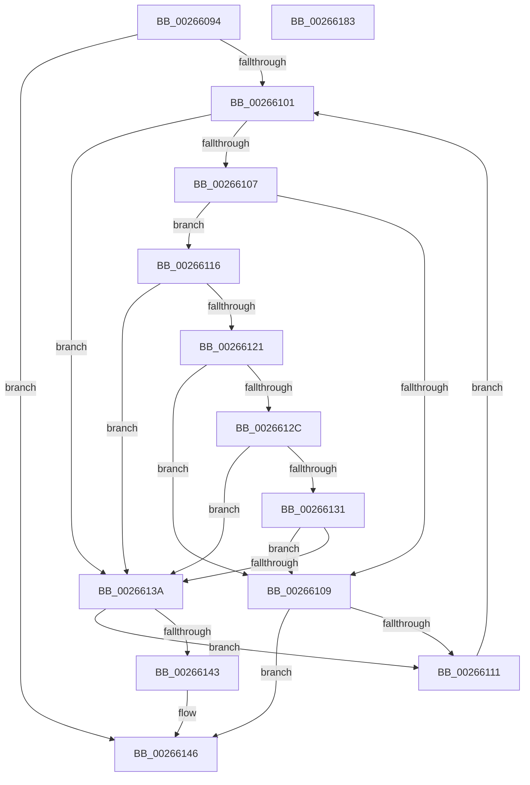

# MiActivateCombineBlock

- RVA: `0x00266094`–`0x00266184` (길이 `240` bytes)
- VA: `0x0000000140266094`
- 실행 섹션: `.text`
- PDB 이름 있음: `예`; PDB Function 태그: `아니요`
- unwind 정보 RVA: `0x0005FEF8`
- 디코드: `74`개 명령, `240/240` bytes 표시
- 미해석 바이트: `0` (있으면 어셈블리에 `.byte`로 보존)

> 이 문서는 커널 이미지의 기계어와 PDB 기호를 분석해 생성했습니다. 4번과 5번은 함수 원형과 자료형을 바이너리 사용 방식에서 추정한 C 해석이며 원본 소스 복구 결과는 아닙니다.

## 1. Dependencies

- 직접 호출 지점: **3**; 고유 호출 대상: **3**
- 직접 호출자로 확인된 함수: **1**
- RIP 상대 이미지 참조: **0**

### Outgoing calls
- `0x002660E6` → [ExAcquireSpinLockExclusiveAtDpcLevel](../24/ExAcquireSpinLockExclusiveAtDpcLevel_function_00248E80.md) (function, `0x00248E80`)
- `0x0026614C` → [RtlAvlInsertNodeEx](RtlAvlInsertNodeEx_function_00265790.md) (function, `0x00265790`)
- `0x0026615F` → [ExReleaseSpinLockExclusiveFromDpcLevel](../24/ExReleaseSpinLockExclusiveFromDpcLevel_function_002497E0.md) (function, `0x002497E0`)

### Direct callers
- [MiCombineInitialInstance](../22/MiCombineInitialInstance_function_0022BC0C.md) at `0x0022C380`

### Static image references
- 디코드된 RIP-relative 메모리 참조가 없습니다.

## 2. Other-region calls and transfers

- 다른 실행 섹션으로 향하는 call: **0**
- 별도 외부 분기/꼬리 이동을 확인하지 못했습니다.

## 3. Assembly (complete function range)

```asm
00266094  48 8B C4                        mov rax, rsp
00266097  48 89 58 08                     mov qword ptr [rax + 8], rbx
0026609B  48 89 68 10                     mov qword ptr [rax + 0x10], rbp
0026609F  48 89 70 18                     mov qword ptr [rax + 0x18], rsi
002660A3  48 89 78 20                     mov qword ptr [rax + 0x20], rdi
002660A7  41 54                           push r12
002660A9  41 56                           push r14
002660AB  41 57                           push r15
002660AD  48 83 EC 20                     sub rsp, 0x20
002660B1  48 8B EA                        mov rbp, rdx
002660B4  4C 8B F9                        mov r15, rcx
002660B7  F0 FF 81 88 01 00 00            lock inc dword ptr [rcx + 0x188]
002660BE  44 8B 62 18                     mov r12d, dword ptr [rdx + 0x18]
002660C2  4C 8D 72 40                     lea r14, [rdx + 0x40]
002660C6  48 8B 5A 30                     mov rbx, qword ptr [rdx + 0x30]
002660CA  41 83 E4 0F                     and r12d, 0xf
002660CE  48 8B 72 18                     mov rsi, qword ptr [rdx + 0x18]
002660D2  48 83 C1 68                     add rcx, 0x68
002660D6  41 8B C4                        mov eax, r12d
002660D9  83 E3 1F                        and ebx, 0x1f
002660DC  48 C1 E0 04                     shl rax, 4
002660E0  48 03 C8                        add rcx, rax
002660E3  41 8B FC                        mov edi, r12d
002660E6  E8 95 2D FE FF                  call 0x140248e80
002660EB  48 83 C7 06                     add rdi, 6
002660EF  45 33 C0                        xor r8d, r8d
002660F2  48 C1 E7 04                     shl rdi, 4
002660F6  49 03 FF                        add rdi, r15
002660F9  48 8B 17                        mov rdx, qword ptr [rdi]
002660FC  48 85 D2                        test rdx, rdx
002660FF  74 45                           je 0x140266146
00266101  48 3B 72 18                     cmp rsi, qword ptr [rdx + 0x18]
00266105  77 33                           ja 0x14026613a
00266107  73 0D                           jae 0x140266116
00266109  48 8B 02                        mov rax, qword ptr [rdx]
0026610C  48 85 C0                        test rax, rax
0026610F  74 35                           je 0x140266146
00266111  48 8B D0                        mov rdx, rax
00266114  EB EB                           jmp 0x140266101
00266116  48 8B 42 30                     mov rax, qword ptr [rdx + 0x30]
0026611A  83 E0 1F                        and eax, 0x1f
0026611D  3B D8                           cmp ebx, eax
0026611F  77 19                           ja 0x14026613a
00266121  48 8B 42 30                     mov rax, qword ptr [rdx + 0x30]
00266125  83 E0 1F                        and eax, 0x1f
00266128  3B D8                           cmp ebx, eax
0026612A  72 DD                           jb 0x140266109
0026612C  4D 85 F6                        test r14, r14
0026612F  74 09                           je 0x14026613a
00266131  49 8B 06                        mov rax, qword ptr [r14]
00266134  48 3B 42 40                     cmp rax, qword ptr [rdx + 0x40]
00266138  72 CF                           jb 0x140266109
0026613A  48 8B 42 08                     mov rax, qword ptr [rdx + 8]
0026613E  48 85 C0                        test rax, rax
00266141  75 CE                           jne 0x140266111
00266143  41 B0 01                        mov r8b, 1
00266146  4C 8B CD                        mov r9, rbp
00266149  48 8B CF                        mov rcx, rdi
0026614C  E8 3F F6 FF FF                  call 0x140265790
00266151  49 83 C7 68                     add r15, 0x68
00266155  41 8B CC                        mov ecx, r12d
00266158  48 C1 E1 04                     shl rcx, 4
0026615C  49 03 CF                        add rcx, r15
0026615F  E8 7C 36 FE FF                  call 0x1402497e0
00266164  48 8B 5C 24 40                  mov rbx, qword ptr [rsp + 0x40]
00266169  48 8B 6C 24 48                  mov rbp, qword ptr [rsp + 0x48]
0026616E  48 8B 74 24 50                  mov rsi, qword ptr [rsp + 0x50]
00266173  48 8B 7C 24 58                  mov rdi, qword ptr [rsp + 0x58]
00266178  48 83 C4 20                     add rsp, 0x20
0026617C  41 5F                           pop r15
0026617E  41 5E                           pop r14
00266180  41 5C                           pop r12
00266182  C3                              ret
00266183  CC                              int3
```

## 4. C-style interpretation (structured pseudocode)

```c
__int64 __fastcall MiActivateCombineBlock(__int64 a1, __int64 a2, int a3)
{
    __int64 result;
    __int64 v_r12;
    __int64 v_r15;
    __int64 v_rbx;
    __int64 v_rdi;
    __int64 v_rsp;
    unsigned __int64 v_stack_p10;
    unsigned __int64 v_stack_p18;
    unsigned __int64 v_stack_p20;
    unsigned __int64 v_stack_p8;

    *(unsigned __int64 *)(v_rsp + 8) = v_rbx;
    *(unsigned __int64 *)(v_rsp + 16) = v_rbp;
    *(unsigned __int64 *)(v_rsp + 24) = v_rsi;
    *(unsigned __int64 *)(v_rsp + 32) = v_rdi;
    v_rsp = (v_rsp) - (32);
    v_r12 = (unsigned int)(((unsigned int)(*(unsigned int *)(a2 + 24))) & (15));
    a1 = (a1) + (104);
    v_rbx = (unsigned int)((*(unsigned __int64 *)(a2 + 48)) & (31));
    result = ((unsigned int)((unsigned int)(v_r12))) << (4);
    a1 = (a1) + (result);
    result = ExAcquireSpinLockExclusiveAtDpcLevel(a1, a2, a3, a4);
    v_rdi = ((unsigned int)((unsigned int)(v_r12))) + (6);
    a3 = 0;
    v_rdi = (v_rdi) << (4);
    v_rdi = (v_rdi) + (a1);
    if (*(unsigned __int64 *)(v_rdi) == 0) goto loc_00266146;
loc_00266101:
    if ((*(unsigned __int64 *)(a2 + 24)) > (*(unsigned __int64 *)(*(unsigned __int64 *)(v_rdi) + 24))) goto loc_0026613A;
    if ((*(unsigned __int64 *)(a2 + 24)) >= (*(unsigned __int64 *)(*(unsigned __int64 *)(v_rdi) + 24))) goto loc_00266116;
loc_00266109:
    if (*(unsigned __int64 *)(*(unsigned __int64 *)(v_rdi)) == 0) goto loc_00266146;
loc_00266111:
    goto loc_00266101;
loc_00266116:
    result = (unsigned int)((*(unsigned __int64 *)(*(unsigned __int64 *)(*(unsigned __int64 *)(v_rdi)) + 48)) & (31));
    if (((unsigned int)(v_rbx)) > ((unsigned int)(result))) goto loc_0026613A;
    result = (unsigned int)((*(unsigned __int64 *)(*(unsigned __int64 *)(*(unsigned __int64 *)(v_rdi)) + 48)) & (31));
    if (((unsigned int)(v_rbx)) < ((unsigned int)(result))) goto loc_00266109;
    if (a2 + 64 == 0) goto loc_0026613A;
    if ((*(unsigned __int64 *)(a2 + 64)) < (*(unsigned __int64 *)(*(unsigned __int64 *)(*(unsigned __int64 *)(v_rdi)) + 64))) goto loc_00266109;
loc_0026613A:
    if (*(unsigned __int64 *)(*(unsigned __int64 *)(*(unsigned __int64 *)(v_rdi)) + 8) != 0) goto loc_00266111;
loc_00266146:
    result = RtlAvlInsertNodeEx(v_rdi, *(unsigned __int64 *)(*(unsigned __int64 *)(v_rdi)), 1, a2);
    v_r15 = (a1) + (104);
    a1 = ((unsigned int)((unsigned int)(v_r12))) << (4);
    a1 = (a1) + (v_r15);
    result = ExReleaseSpinLockExclusiveFromDpcLevel(a1, *(unsigned __int64 *)(*(unsigned __int64 *)(v_rdi)), 1, a2);
    v_rsp = (v_rsp) + (32);
    return result;
}
```

## 5. (Beta) C Style

```c
int64_t MiActivateCombineBlock(void *Arg1, void *Arg2, int32_t Arg3)
{
    uint8_t *arg1 = (uint8_t *)Arg1;
    uint8_t *arg2 = (uint8_t *)Arg2;

    int64_t result;
    int64_t local_r12;
    int64_t local_r15;
    int64_t local_rbx;
    int64_t local_rdi;
    int64_t local_rsp;
    uint64_t v_stack_p10;
    uint64_t v_stack_p18;
    uint64_t v_stack_p20;
    uint64_t v_stack_p8;

    *(uint64_t *)(local_rsp + 0x8) = local_rbx;
    *(uint64_t *)(local_rsp + 0x10) = local_rbp;
    *(uint64_t *)(local_rsp + 0x18) = local_rsi;
    *(uint64_t *)(local_rsp + 0x20) = local_rdi;
    local_rsp = (local_rsp) - (32);
    local_r12 = (uint32_t)(((uint32_t)(*(uint32_t *)(arg2 + 0x18))) & (15));
    Arg1 = (Arg1) + (104);
    local_rbx = (uint32_t)((*(uint64_t *)(arg2 + 0x30)) & (31));
    result = ((uint32_t)((uint32_t)(local_r12))) << (4);
    Arg1 = (Arg1) + (result);
    result = ExAcquireSpinLockExclusiveAtDpcLevel(Arg1, Arg2, Arg3, a4);
    local_rdi = ((uint32_t)((uint32_t)(local_r12))) + (6);
    Arg3 = 0;
    local_rdi = (local_rdi) << (4);
    local_rdi = (local_rdi) + (Arg1);
    if (*(uint64_t *)(local_rdi) == 0) goto loc_00266146;
loc_00266101:
    if ((*(uint64_t *)(arg2 + 0x18)) > (*(uint64_t *)(*(uint64_t *)(local_rdi) + 0x18))) goto loc_0026613A;
    if ((*(uint64_t *)(arg2 + 0x18)) >= (*(uint64_t *)(*(uint64_t *)(local_rdi) + 0x18))) goto loc_00266116;
loc_00266109:
    if (*(uint64_t *)(*(uint64_t *)(local_rdi)) == 0) goto loc_00266146;
loc_00266111:
    goto loc_00266101;
loc_00266116:
    result = (uint32_t)((*(uint64_t *)(*(uint64_t *)(*(uint64_t *)(local_rdi)) + 0x30)) & (31));
    if (((uint32_t)(local_rbx)) > ((uint32_t)(result))) goto loc_0026613A;
    result = (uint32_t)((*(uint64_t *)(*(uint64_t *)(*(uint64_t *)(local_rdi)) + 0x30)) & (31));
    if (((uint32_t)(local_rbx)) < ((uint32_t)(result))) goto loc_00266109;
    if (Arg2 + 64 == 0) goto loc_0026613A;
    if ((*(uint64_t *)(arg2 + 0x40)) < (*(uint64_t *)(*(uint64_t *)(*(uint64_t *)(local_rdi)) + 0x40))) goto loc_00266109;
loc_0026613A:
    if (*(uint64_t *)(*(uint64_t *)(*(uint64_t *)(local_rdi)) + 0x8) != 0) goto loc_00266111;
loc_00266146:
    result = RtlAvlInsertNodeEx(local_rdi, *(uint64_t *)(*(uint64_t *)(local_rdi)), 1, Arg2);
    local_r15 = (Arg1) + (104);
    Arg1 = ((uint32_t)((uint32_t)(local_r12))) << (4);
    Arg1 = (Arg1) + (local_r15);
    result = ExReleaseSpinLockExclusiveFromDpcLevel(Arg1, *(uint64_t *)(*(uint64_t *)(local_rdi)), 1, Arg2);
    local_rsp = (local_rsp) + (32);
    return result;
}
```

### 관측된 메모리 오프셋

구조체 형식이 확인되지 않은 접근은 인자 기준의 오프셋으로만 기록했습니다.

| 기준 인자 | 오프셋 표현 | 폭 (bit) | 접근 |
|---|---:|---:|---|
| `Arg1` | `+ 0x188` | `32` | `R/W` |
| `Arg2` | `+ 0x18` | `32` | `R` |
| `Arg2` | `+ 0x18` | `64` | `R` |
| `Arg2` | `+ 0x30` | `64` | `R` |
| `Arg2` | `+ 0x40` | `64` | `R` |

## 6. Execution-region graph

[열기: 2D/3D 그래프와 함수 탐색 컨트롤 패널](../../../control-panel.html?section=text&rva=0x00266094&view=graph)

- 2D 그래프는 위에서 아래로 흐르고, 3D 그래프는 빈 공간을 드래그해 회전합니다. Shift+드래그는 이동, 휠은 확대·축소, 함수 노드 선택은 대상 보고서 이동입니다.

### Static fallback


