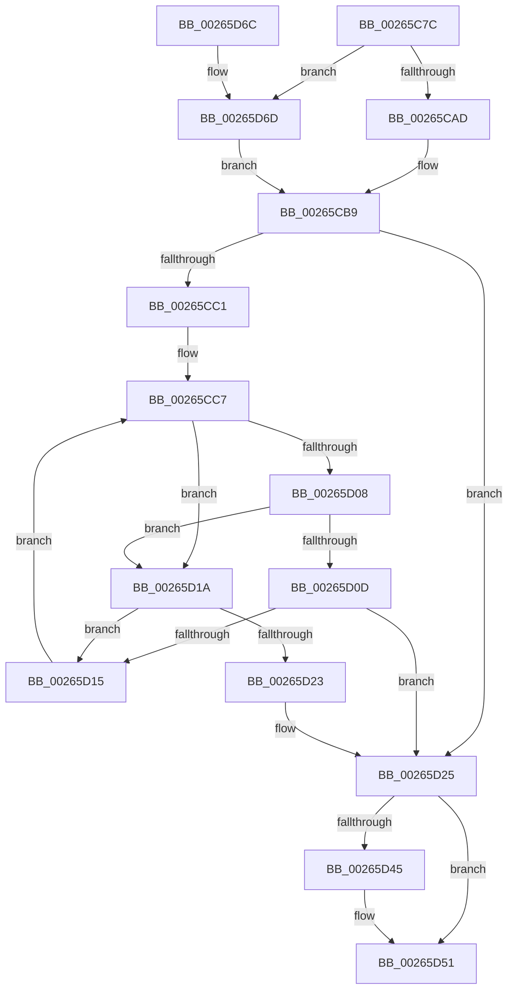

# MiInsertSubsectionNode

- RVA: `0x00265C7C`–`0x00265D75` (길이 `249` bytes)
- VA: `0x0000000140265C7C`
- 실행 섹션: `.text`
- PDB 이름 있음: `예`; PDB Function 태그: `아니요`
- unwind 정보 RVA: `0x00064C8C`
- 디코드: `71`개 명령, `249/249` bytes 표시
- 미해석 바이트: `0` (있으면 어셈블리에 `.byte`로 보존)

> 이 문서는 커널 이미지의 기계어와 PDB 기호를 분석해 생성했습니다. 4번과 5번은 함수 원형과 자료형을 바이너리 사용 방식에서 추정한 C 해석이며 원본 소스 복구 결과는 아닙니다.

## 1. Dependencies

- 직접 호출 지점: **3**; 고유 호출 대상: **3**
- 직접 호출자로 확인된 함수: **2**
- RIP 상대 이미지 참조: **0**

### Outgoing calls
- `0x00265CB1` → [ExAcquireSpinLockExclusive](../24/ExAcquireSpinLockExclusive_function_00248690.md) (function, `0x00248690`)
- `0x00265D32` → [RtlAvlInsertNodeEx](RtlAvlInsertNodeEx_function_00265790.md) (function, `0x00265790`)
- `0x00265D4C` → [MiReleaseSpinLockExclusive](../24/MiReleaseSpinLockExclusive_function_002482C0.md) (function, `0x002482C0`)

### Direct callers
- [MiAppendSubsectionChain](../48/MiAppendSubsectionChain_function_00480228.md) at `0x004802D1`
- [MiCreateDataFileMap](../../page/98/MiCreateDataFileMap_function_00983494.md) at `0x0098371F`

### Static image references
- 디코드된 RIP-relative 메모리 참조가 없습니다.

## 2. Other-region calls and transfers

- 다른 실행 섹션으로 향하는 call: **0**
- 별도 외부 분기/꼬리 이동을 확인하지 못했습니다.

## 3. Assembly (complete function range)

```asm
00265C7C  48 8B C4                        mov rax, rsp
00265C7F  48 89 58 08                     mov qword ptr [rax + 8], rbx
00265C83  48 89 68 10                     mov qword ptr [rax + 0x10], rbp
00265C87  48 89 70 18                     mov qword ptr [rax + 0x18], rsi
00265C8B  48 89 78 20                     mov qword ptr [rax + 0x20], rdi
00265C8F  41 56                           push r14
00265C91  48 83 EC 20                     sub rsp, 0x20
00265C95  33 DB                           xor ebx, ebx
00265C97  48 8D B9 18 01 00 00            lea rdi, [rcx + 0x118]
00265C9E  4C 8B F2                        mov r14, rdx
00265CA1  48 8B E9                        mov rbp, rcx
00265CA4  45 85 C0                        test r8d, r8d
00265CA7  0F 85 C0 00 00 00               jne 0x140265d6d
00265CAD  48 83 C1 48                     add rcx, 0x48
00265CB1  E8 DA 29 FE FF                  call 0x140248690
00265CB6  40 8A F0                        mov sil, al
00265CB9  4C 8B 17                        mov r10, qword ptr [rdi]
00265CBC  4D 85 D2                        test r10, r10
00265CBF  74 64                           je 0x140265d25
00265CC1  41 BB C0 FF 00 00               mov r11d, 0xffc0
00265CC7  45 8B 46 20                     mov r8d, dword ptr [r14 + 0x20]
00265CCB  45 8B 4A E8                     mov r9d, dword ptr [r10 - 0x18]
00265CCF  4D 23 C3                        and r8, r11
00265CD2  41 8B 46 24                     mov eax, dword ptr [r14 + 0x24]
00265CD6  4D 23 CB                        and r9, r11
00265CD9  41 8B 52 F0                     mov edx, dword ptr [r10 - 0x10]
00265CDD  49 C1 E0 1A                     shl r8, 0x1a
00265CE1  4C 0B C0                        or r8, rax
00265CE4  49 C1 E1 1A                     shl r9, 0x1a
00265CE8  41 8B 42 EC                     mov eax, dword ptr [r10 - 0x14]
00265CEC  4C 0B C8                        or r9, rax
00265CEF  41 8B 42 E8                     mov eax, dword ptr [r10 - 0x18]
00265CF3  49 03 D1                        add rdx, r9
00265CF6  3D 00 00 10 00                  cmp eax, 0x100000
00265CFB  48 8D 4A FF                     lea rcx, [rdx - 1]
00265CFF  48 0F 42 D1                     cmovb rdx, rcx
00265D03  4D 3B C1                        cmp r8, r9
00265D06  73 12                           jae 0x140265d1a
00265D08  4C 3B C2                        cmp r8, rdx
00265D0B  77 0D                           ja 0x140265d1a
00265D0D  49 8B 02                        mov rax, qword ptr [r10]
00265D10  48 85 C0                        test rax, rax
00265D13  74 10                           je 0x140265d25
00265D15  4C 8B D0                        mov r10, rax
00265D18  EB AD                           jmp 0x140265cc7
00265D1A  49 8B 42 08                     mov rax, qword ptr [r10 + 8]
00265D1E  48 85 C0                        test rax, rax
00265D21  75 F2                           jne 0x140265d15
00265D23  B3 01                           mov bl, 1
00265D25  4D 8D 4E 38                     lea r9, [r14 + 0x38]
00265D29  44 8A C3                        mov r8b, bl
00265D2C  49 8B D2                        mov rdx, r10
00265D2F  48 8B CF                        mov rcx, rdi
00265D32  E8 59 FA FF FF                  call 0x140265790
00265D37  48 FF 47 08                     inc qword ptr [rdi + 8]
00265D3B  4C 89 77 10                     mov qword ptr [rdi + 0x10], r14
00265D3F  40 80 FE 11                     cmp sil, 0x11
00265D43  74 0C                           je 0x140265d51
00265D45  48 8D 4D 48                     lea rcx, [rbp + 0x48]
00265D49  40 8A D6                        mov dl, sil
00265D4C  E8 6F 25 FE FF                  call 0x1402482c0
00265D51  48 8B 5C 24 30                  mov rbx, qword ptr [rsp + 0x30]
00265D56  48 8B 6C 24 38                  mov rbp, qword ptr [rsp + 0x38]
00265D5B  48 8B 74 24 40                  mov rsi, qword ptr [rsp + 0x40]
00265D60  48 8B 7C 24 48                  mov rdi, qword ptr [rsp + 0x48]
00265D65  48 83 C4 20                     add rsp, 0x20
00265D69  41 5E                           pop r14
00265D6B  C3                              ret
00265D6C  CC                              int3
00265D6D  40 B6 11                        mov sil, 0x11
00265D70  E9 44 FF FF FF                  jmp 0x140265cb9
```

## 4. C-style interpretation (structured pseudocode)

```c
__int64 __fastcall MiInsertSubsectionNode(__int64 a1, __int64 a2, int a3)
{
    __int64 result;
    __int64 v_rbx;
    __int64 v_rsp;
    unsigned __int64 v_stack_p10;
    unsigned __int64 v_stack_p18;
    unsigned __int64 v_stack_p20;
    unsigned __int64 v_stack_p8;

    *(unsigned __int64 *)(v_rsp + 8) = v_rbx;
    *(unsigned __int64 *)(v_rsp + 16) = v_rbp;
    *(unsigned __int64 *)(v_rsp + 24) = v_rsi;
    *(unsigned __int64 *)(v_rsp + 32) = v_rdi;
    v_rsp = (v_rsp) - (32);
    v_rbx = 0;
    if (a3 != 0) goto loc_00265D6D;
    a1 = (a1) + (72);
    result = ExAcquireSpinLockExclusive(a1, a2, a3, a4);
loc_00265CB9:
    if (*(unsigned __int64 *)(a1 + 280) == 0) goto loc_00265D25;
loc_00265CC7:
    a3 = ((unsigned int)(*(unsigned int *)(a2 + 32))) & ((unsigned int)(0xFFC0ULL));
    a4 = ((unsigned int)(*(unsigned int *)(*(unsigned __int64 *)(a1 + 280) - 24))) & ((unsigned int)(0xFFC0ULL));
    a3 = (a3) << (26);
    a3 = (a3) | ((unsigned int)(*(unsigned int *)(a2 + 36)));
    a4 = (a4) << (26);
    a4 = (a4) | ((unsigned int)(*(unsigned int *)(*(unsigned __int64 *)(a1 + 280) - 20)));
    a2 = ((unsigned int)(*(unsigned int *)(*(unsigned __int64 *)(a1 + 280) - 16))) + (a4);
    if (((unsigned int)((unsigned int)(*(unsigned int *)(*(unsigned __int64 *)(a1 + 280) - 24)))) < 0x100000ULL) { a2 = a2 - 1; }
    if (a3 >= a4) goto loc_00265D1A;
    if (a3 > a2) goto loc_00265D1A;
    if (*(unsigned __int64 *)(*(unsigned __int64 *)(a1 + 280)) == 0) goto loc_00265D25;
loc_00265D15:
    goto loc_00265CC7;
loc_00265D1A:
    if (*(unsigned __int64 *)(*(unsigned __int64 *)(*(unsigned __int64 *)(a1 + 280)) + 8) != 0) goto loc_00265D15;
loc_00265D25:
    result = RtlAvlInsertNodeEx(a1 + 280, *(unsigned __int64 *)(*(unsigned __int64 *)(a1 + 280)), 1, a2 + 56);
    *(unsigned __int64 *)(a1 + 280 + 16) = a2;
    if (((unsigned __int8)((unsigned __int8)(result))) != 17) {
        a1 = a1 + 72;
        a2 = (unsigned __int8)((unsigned __int8)(result));
        result = MiReleaseSpinLockExclusive(a1, a2, 1, a2 + 56);
    }
    v_rsp = (v_rsp) + (32);
    return result;
loc_00265D6D:
    goto loc_00265CB9;
}
```

## 5. (Beta) C Style

```c
int64_t MiInsertSubsectionNode(void *Arg1, void *Arg2, int32_t Arg3)
{
    uint8_t *arg1 = (uint8_t *)Arg1;
    uint8_t *arg2 = (uint8_t *)Arg2;

    int64_t result;
    int64_t local_rbx;
    int64_t local_rsp;
    uint64_t v_stack_p10;
    uint64_t v_stack_p18;
    uint64_t v_stack_p20;
    uint64_t v_stack_p8;

    *(uint64_t *)(local_rsp + 0x8) = local_rbx;
    *(uint64_t *)(local_rsp + 0x10) = local_rbp;
    *(uint64_t *)(local_rsp + 0x18) = local_rsi;
    *(uint64_t *)(local_rsp + 0x20) = local_rdi;
    local_rsp = (local_rsp) - (32);
    local_rbx = 0;
    if (Arg3 != 0) goto loc_00265D6D;
    Arg1 = (Arg1) + (72);
    result = ExAcquireSpinLockExclusive(Arg1, Arg2, Arg3, a4);
loc_00265CB9:
    if (*(uint64_t *)(arg1 + 0x118) == 0) goto loc_00265D25;
loc_00265CC7:
    Arg3 = ((uint32_t)(*(uint32_t *)(arg2 + 0x20))) & ((uint32_t)(0xFFC0ULL));
    a4 = ((uint32_t)(*(uint32_t *)(*(uint64_t *)(arg1 + 0x118) - 0x18))) & ((uint32_t)(0xFFC0ULL));
    Arg3 = (Arg3) << (26);
    Arg3 = (Arg3) | ((uint32_t)(*(uint32_t *)(arg2 + 0x24)));
    a4 = (a4) << (26);
    a4 = (a4) | ((uint32_t)(*(uint32_t *)(*(uint64_t *)(arg1 + 0x118) - 0x14)));
    Arg2 = ((uint32_t)(*(uint32_t *)(*(uint64_t *)(arg1 + 0x118) - 0x10))) + (a4);
    if (((uint32_t)((uint32_t)(*(uint32_t *)(*(uint64_t *)(arg1 + 0x118) - 0x18)))) < 0x100000ULL) { Arg2 = Arg2 - 1; }
    if (Arg3 >= a4) goto loc_00265D1A;
    if (Arg3 > Arg2) goto loc_00265D1A;
    if (*(uint64_t *)(*(uint64_t *)(arg1 + 0x118)) == 0) goto loc_00265D25;
loc_00265D15:
    goto loc_00265CC7;
loc_00265D1A:
    if (*(uint64_t *)(*(uint64_t *)(*(uint64_t *)(arg1 + 0x118)) + 0x8) != 0) goto loc_00265D15;
loc_00265D25:
    result = RtlAvlInsertNodeEx(Arg1 + 280, *(uint64_t *)(*(uint64_t *)(arg1 + 0x118)), 1, Arg2 + 56);
    *(void **)(arg1 + 0x118 + 0x10) = Arg2;
    if (((uint8_t)((uint8_t)(result))) != 17) {
        Arg1 = Arg1 + 72;
        Arg2 = (uint8_t)((uint8_t)(result));
        result = MiReleaseSpinLockExclusive(Arg1, Arg2, 1, Arg2 + 56);
    }
    local_rsp = (local_rsp) + (32);
    return result;
loc_00265D6D:
    goto loc_00265CB9;
}
```

### 관측된 메모리 오프셋

구조체 형식이 확인되지 않은 접근은 인자 기준의 오프셋으로만 기록했습니다.

| 기준 인자 | 오프셋 표현 | 폭 (bit) | 접근 |
|---|---:|---:|---|
| `Arg1` | `+ 0x0` | `64` | `R` |
| `Arg1` | `+ 0x8` | `64` | `R/W` |
| `Arg1` | `+ 0x10` | `64` | `W` |
| `Arg1` | `+ 0x48` | `64` | `R` |
| `Arg1` | `+ 0x118` | `64` | `R` |
| `Arg2` | `+ 0x20` | `32` | `R` |
| `Arg2` | `+ 0x24` | `32` | `R` |
| `Arg2` | `+ 0x38` | `64` | `R` |

## 6. Execution-region graph

[열기: 2D/3D 그래프와 함수 탐색 컨트롤 패널](../../../control-panel.html?section=text&rva=0x00265C7C&view=graph)

- 2D 그래프는 위에서 아래로 흐르고, 3D 그래프는 빈 공간을 드래그해 회전합니다. Shift+드래그는 이동, 휠은 확대·축소, 함수 노드 선택은 대상 보고서 이동입니다.

### Static fallback


