# MiInsertVad

- RVA: `0x00265540`–`0x00265786` (길이 `582` bytes)
- VA: `0x0000000140265540`
- 실행 섹션: `.text`
- PDB 이름 있음: `예`; PDB Function 태그: `예`
- unwind 정보 RVA: `0x00064B78`
- 디코드: `137`개 명령, `582/582` bytes 표시
- 미해석 바이트: `0` (있으면 어셈블리에 `.byte`로 보존)

> 이 문서는 커널 이미지의 기계어와 PDB 기호를 분석해 생성했습니다. 4번과 5번은 함수 원형과 자료형을 바이너리 사용 방식에서 추정한 C 해석이며 원본 소스 복구 결과는 아닙니다.

## 1. Dependencies

- 직접 호출 지점: **6**; 고유 호출 대상: **6**
- 직접 호출자로 확인된 함수: **11**
- RIP 상대 이미지 참조: **0**

### Outgoing calls
- `0x002655C3` → [MiIsVadLargePrivate](../32/MiIsVadLargePrivate_function_0032F720.md) (function, `0x0032F720`)
- `0x002655F3` → [MiLockVadTree](../27/MiLockVadTree_function_0027C0F0.md) (function, `0x0027C0F0`)
- `0x0026566E` → [RtlAvlInsertNodeEx](RtlAvlInsertNodeEx_function_00265790.md) (function, `0x00265790`)
- `0x0026569B` → [MiReleaseSpinLockExclusive](../24/MiReleaseSpinLockExclusive_function_002482C0.md) (function, `0x002482C0`)
- `0x002656AF` → [MiPostInsertVad](MiPostInsertVad_function_002643C0.md) (function, `0x002643C0`)
- `0x0026576D` → [MiLocateLockedVadEvent](../2A/MiLocateLockedVadEvent_function_002A7A0C.md) (function, `0x002A7A0C`)

### Direct callers
- [MiRemoveVad](../29/MiRemoveVad_function_00295C78.md) at `0x00295EA3`
- [MiInsertViewOfPhysicalSection](../2A/MiInsertViewOfPhysicalSection_function_002A57E0.md) at `0x002A588C`
- [MiPerformVadSplitting](../2A/MiPerformVadSplitting_function_002A5A80.md) at `0x002A5D05`
- [MiPerformVadSplitting](../2A/MiPerformVadSplitting_function_002A5A80.md) at `0x002A5F54`
- [MiAllocateEnclaveVad](../../page/80/MiAllocateEnclaveVad_function_008080A4.md) at `0x00808383`
- [MiReserveUserMemory](../../page/88/MiReserveUserMemory_function_00884498.md) at `0x0088479F`
- [sub_00884EE1](../../page/88/Unknown_function_00884EE1.md) at `0x0088527C`
- [MiInsertProcessVads](../../page/8C/MiInsertProcessVads_function_008CFD08.md) at `0x008CFD65`
- [MiInsertChildVads](../../page/97/MiInsertChildVads_function_0097DBB0.md) at `0x0097DC6B`
- [MiMapViewOfImageSection](../../page/97/MiMapViewOfImageSection_function_0097E92C.md) at `0x0097EE7A`
- [MiMapLockedPagesInUserSpace](../../page/97/MiMapLockedPagesInUserSpace_function_0097FE04.md) at `0x00980104`
- [MiAllocateNewSubAllocatedRegion](../../page/98/MiAllocateNewSubAllocatedRegion_function_00981EC0.md) at `0x0098211F`

### Static image references
- 디코드된 RIP-relative 메모리 참조가 없습니다.

## 2. Other-region calls and transfers

- 다른 실행 섹션으로 향하는 call: **0**
- call이 아닌 외부 분기/꼬리 이동: **1**
  - `0x00265741` → [sub_006D8E60](../6D/Unknown_function_006D8E60.md) (`tail-transfer`)

## 3. Assembly (complete function range)

```asm
00265540  48 89 5C 24 08                  mov qword ptr [rsp + 8], rbx
00265545  48 89 6C 24 10                  mov qword ptr [rsp + 0x10], rbp
0026554A  48 89 74 24 18                  mov qword ptr [rsp + 0x18], rsi
0026554F  57                              push rdi
00265550  41 56                           push r14
00265552  41 57                           push r15
00265554  48 83 EC 20                     sub rsp, 0x20
00265558  48 8B F9                        mov rdi, rcx
0026555B  C7 41 24 01 00 00 00            mov dword ptr [rcx + 0x24], 1
00265562  0F B6 49 21                     movzx ecx, byte ptr [rcx + 0x21]
00265566  48 8B F2                        mov rsi, rdx
00265569  48 C1 E1 20                     shl rcx, 0x20
0026556D  45 33 FF                        xor r15d, r15d
00265570  41 8B E8                        mov ebp, r8d
00265573  8B 47 1C                        mov eax, dword ptr [rdi + 0x1c]
00265576  0F B6 5F 20                     movzx ebx, byte ptr [rdi + 0x20]
0026557A  48 0B C8                        or rcx, rax
0026557D  8B 47 18                        mov eax, dword ptr [rdi + 0x18]
00265580  8B 57 30                        mov edx, dword ptr [rdi + 0x30]
00265583  48 C1 E3 20                     shl rbx, 0x20
00265587  48 0B D8                        or rbx, rax
0026558A  8B C2                           mov eax, edx
0026558C  25 00 00 18 00                  and eax, 0x180000
00265591  3D 00 00 08 00                  cmp eax, 0x80000
00265596  0F 84 9A 01 00 00               je 0x140265736
0026559C  48 8B 86 68 03 00 00            mov rax, qword ptr [rsi + 0x368]
002655A3  48 C1 E8 0C                     shr rax, 0xc
002655A7  48 3B C8                        cmp rcx, rax
002655AA  0F 86 1E 01 00 00               jbe 0x1402656ce
002655B0  8B 4F 30                        mov ecx, dword ptr [rdi + 0x30]
002655B3  8B C1                           mov eax, ecx
002655B5  83 E0 70                        and eax, 0x70
002655B8  3C 30                           cmp al, 0x30
002655BA  0F 84 93 01 00 00               je 0x140265753
002655C0  48 8B CF                        mov rcx, rdi
002655C3  E8 58 A1 0C 00                  call 0x14032f720
002655C8  85 C0                           test eax, eax
002655CA  0F 85 AB 01 00 00               jne 0x14026577b
002655D0  8B 47 30                        mov eax, dword ptr [rdi + 0x30]
002655D3  24 70                           and al, 0x70
002655D5  3C 10                           cmp al, 0x10
002655D7  0F 84 36 01 00 00               je 0x140265713
002655DD  48 FF 86 68 05 00 00            inc qword ptr [rsi + 0x568]
002655E4  40 F6 C5 01                     test bpl, 1
002655E8  0F 85 38 01 00 00               jne 0x140265726
002655EE  B9 02 00 00 00                  mov ecx, 2
002655F3  E8 F8 6A 01 00                  call 0x14027c0f0
002655F8  44 0F B6 F0                     movzx r14d, al
002655FC  48 89 BE 60 05 00 00            mov qword ptr [rsi + 0x560], rdi
00265603  45 32 C0                        xor r8b, r8b
00265606  48 8B 96 58 05 00 00            mov rdx, qword ptr [rsi + 0x558]
0026560D  48 85 D2                        test rdx, rdx
00265610  74 52                           je 0x140265664
00265612  0F 1F 40 00                     nop dword ptr [rax]
00265616  66 66 0F 1F 84 00 00 00 00 00   nop word ptr [rax + rax]
00265620  44 0F B6 42 21                  movzx r8d, byte ptr [rdx + 0x21]
00265625  8B 4A 1C                        mov ecx, dword ptr [rdx + 0x1c]
00265628  49 C1 E0 20                     shl r8, 0x20
0026562C  4C 0B C1                        or r8, rcx
0026562F  49 3B D8                        cmp rbx, r8
00265632  77 24                           ja 0x140265658
00265634  0F B6 4A 20                     movzx ecx, byte ptr [rdx + 0x20]
00265638  8B 42 18                        mov eax, dword ptr [rdx + 0x18]
0026563B  48 C1 E1 20                     shl rcx, 0x20
0026563F  48 0B C8                        or rcx, rax
00265642  48 3B D9                        cmp rbx, rcx
00265645  73 11                           jae 0x140265658
00265647  48 8B 02                        mov rax, qword ptr [rdx]
0026564A  48 85 C0                        test rax, rax
0026564D  0F 84 DB 00 00 00               je 0x14026572e
00265653  48 8B D0                        mov rdx, rax
00265656  EB C8                           jmp 0x140265620
00265658  48 8B 42 08                     mov rax, qword ptr [rdx + 8]
0026565C  48 85 C0                        test rax, rax
0026565F  75 F2                           jne 0x140265653
00265661  41 B0 01                        mov r8b, 1
00265664  4C 8B CF                        mov r9, rdi
00265667  48 8D 8E 58 05 00 00            lea rcx, [rsi + 0x558]
0026566E  E8 1D 01 00 00                  call 0x140265790
00265673  41 80 FE 11                     cmp r14b, 0x11
00265677  74 27                           je 0x1402656a0
00265679  65 48 8B 04 25 88 01 00 00      mov rax, qword ptr gs:[0x188]
00265682  41 0F B6 D6                     movzx edx, r14b
00265686  48 8B 88 B8 00 00 00            mov rcx, qword ptr [rax + 0xb8]
0026568D  48 8B 89 10 04 00 00            mov rcx, qword ptr [rcx + 0x410]
00265694  48 81 C1 EC 03 00 00            add rcx, 0x3ec
0026569B  E8 20 2C FE FF                  call 0x1402482c0
002656A0  40 F6 C5 01                     test bpl, 1
002656A4  75 0E                           jne 0x1402656b4
002656A6  4D 8B C7                        mov r8, r15
002656A9  48 8B D6                        mov rdx, rsi
002656AC  48 8B CF                        mov rcx, rdi
002656AF  E8 0C ED FF FF                  call 0x1402643c0
002656B4  48 8B 5C 24 40                  mov rbx, qword ptr [rsp + 0x40]
002656B9  48 8B 6C 24 48                  mov rbp, qword ptr [rsp + 0x48]
002656BE  48 8B 74 24 50                  mov rsi, qword ptr [rsp + 0x50]
002656C3  48 83 C4 20                     add rsp, 0x20
002656C7  41 5F                           pop r15
002656C9  41 5E                           pop r14
002656CB  5F                              pop rdi
002656CC  C3                              ret
002656CD  CC                              int3
002656CE  40 F6 C5 02                     test bpl, 2
002656D2  0F 85 D8 FE FF FF               jne 0x1402655b0
002656D8  48 8B 96 28 02 00 00            mov rdx, qword ptr [rsi + 0x228]
002656DF  48 2B CB                        sub rcx, rbx
002656E2  48 C1 E1 0C                     shl rcx, 0xc
002656E6  48 81 C2 00 10 00 00            add rdx, 0x1000
002656ED  48 03 D1                        add rdx, rcx
002656F0  48 89 96 28 02 00 00            mov qword ptr [rsi + 0x228], rdx
002656F7  48 8B 86 20 02 00 00            mov rax, qword ptr [rsi + 0x220]
002656FE  48 3B C2                        cmp rax, rdx
00265701  0F 83 A9 FE FF FF               jae 0x1402655b0
00265707  48 89 96 20 02 00 00            mov qword ptr [rsi + 0x220], rdx
0026570E  E9 9D FE FF FF                  jmp 0x1402655b0
00265713  48 8B 86 10 04 00 00            mov rax, qword ptr [rsi + 0x410]
0026571A  48 FF 80 F8 03 00 00            inc qword ptr [rax + 0x3f8]
00265721  E9 B7 FE FF FF                  jmp 0x1402655dd
00265726  41 B6 11                        mov r14b, 0x11
00265729  E9 CE FE FF FF                  jmp 0x1402655fc
0026572E  45 32 C0                        xor r8b, r8b
00265731  E9 2E FF FF FF                  jmp 0x140265664
00265736  48 8B 86 10 04 00 00            mov rax, qword ptr [rsi + 0x410]
0026573D  0F BA E2 15                     bt edx, 0x15
00265741  0F 83 19 37 47 00               jae 0x1406d8e60
00265747  48 FF 80 90 04 00 00            inc qword ptr [rax + 0x490]
0026574E  E9 49 FE FF FF                  jmp 0x14026559c
00265753  81 E1 00 00 20 0C               and ecx, 0xc200000
00265759  81 F9 00 00 20 08               cmp ecx, 0x8200000
0026575F  0F 84 5B FE FF FF               je 0x1402655c0
00265765  BA 00 01 00 00                  mov edx, 0x100
0026576A  48 8B CF                        mov rcx, rdi
0026576D  E8 9A 22 04 00                  call 0x1402a7a0c
00265772  4C 8D 78 08                     lea r15, [rax + 8]
00265776  E9 45 FE FF FF                  jmp 0x1402655c0
0026577B  FF 86 DC 05 00 00               inc dword ptr [rsi + 0x5dc]
00265781  E9 4A FE FF FF                  jmp 0x1402655d0
```

## 4. C-style interpretation (structured pseudocode)

```c
__int64 __fastcall MiInsertVad(__int64 a1, __int64 a2, int a3)
{
    __int64 result;
    __int64 v_r15;
    __int64 v_rbx;
    __int64 v_rsp;
    unsigned __int64 v_stack_p10;
    unsigned __int64 v_stack_p18;
    unsigned __int64 v_stack_p8;

    v_stack_p8 = v_rbx;
    v_stack_p10 = v_rbp;
    v_stack_p18 = v_rsi;
    v_rsp = (v_rsp) - (32);
    *(unsigned int *)(a1 + 36) = 1;
    a1 = (*(unsigned __int8 *)(a1 + 33)) << (32);
    v_r15 = 0;
    a1 = (a1) | ((unsigned int)(*(unsigned int *)(a1 + 28)));
    v_rbx = (*(unsigned __int8 *)(a1 + 32)) << (32);
    v_rbx = (v_rbx) | ((unsigned int)(*(unsigned int *)(a1 + 24)));
    result = (unsigned int)(((unsigned int)((unsigned int)((unsigned int)(*(unsigned int *)(a1 + 48))))) & (0x180000ULL));
    if (((unsigned int)(result)) == 0x80000ULL) goto loc_00265736;
loc_0026559C:
    result = (*(unsigned __int64 *)(a2 + 872)) >> (12);
    if (a1 <= result) goto loc_002656CE;
loc_002655B0:
    result = (unsigned int)(((unsigned int)((unsigned int)((unsigned int)(*(unsigned int *)(a1 + 48))))) & (112));
    if (((unsigned __int8)(result)) == 48) goto loc_00265753;
loc_002655C0:
    result = MiIsVadLargePrivate(a1, (unsigned int)(*(unsigned int *)(a1 + 48)), a3, a4);
    if ((unsigned int)(result) != 0) goto loc_0026577B;
loc_002655D0:
    result = (unsigned __int8)(((unsigned int)(*(unsigned int *)(a1 + 48))) & (112));
    if (((unsigned __int8)(result)) == 16) goto loc_00265713;
loc_002655DD:
    if ((((unsigned __int8)((unsigned int)(a3))) & (1)) != 0) goto loc_00265726;
    result = MiLockVadTree(2, (unsigned int)(*(unsigned int *)(a1 + 48)), a3, a4);
loc_002655FC:
    *(unsigned __int64 *)(a2 + 1376) = a1;
    a3 = 0;
    if (*(unsigned __int64 *)(a2 + 1368) == 0) goto loc_00265664;
loc_00265620:
    a3 = (*(unsigned __int8 *)(*(unsigned __int64 *)(a2 + 1368) + 33)) << (32);
    a3 = (a3) | ((unsigned int)(*(unsigned int *)(*(unsigned __int64 *)(a2 + 1368) + 28)));
    if (v_rbx > a3) goto loc_00265658;
    a1 = (*(unsigned __int8 *)(*(unsigned __int64 *)(a2 + 1368) + 32)) << (32);
    a1 = (a1) | ((unsigned int)(*(unsigned int *)(*(unsigned __int64 *)(a2 + 1368) + 24)));
    if (v_rbx >= a1) goto loc_00265658;
    if (*(unsigned __int64 *)(*(unsigned __int64 *)(a2 + 1368)) == 0) goto loc_0026572E;
loc_00265653:
    goto loc_00265620;
loc_00265658:
    if (*(unsigned __int64 *)(*(unsigned __int64 *)(*(unsigned __int64 *)(a2 + 1368)) + 8) != 0) goto loc_00265653;
loc_00265664:
    result = RtlAvlInsertNodeEx(a2 + 1368, *(unsigned __int64 *)(*(unsigned __int64 *)(a2 + 1368)), 1, a1);
    if (((unsigned __int8)((unsigned __int8)(result))) != 17) {
        result = *(unsigned __int64 *)(gs_base + (0 + 392));
        a2 = (unsigned __int8)((unsigned __int8)(result));
        a1 = *(unsigned __int64 *)(result + 184);
        a1 = *(unsigned __int64 *)(a1 + 1040);
        a1 = (a1) + (0x3ECULL);
        result = MiReleaseSpinLockExclusive(a1, a2, 1, a1);
    }
    if ((((unsigned __int8)((unsigned int)(a3))) & (1)) == 0) {
        a3 = 0;
        a2 = a2;
        a1 = a1;
        result = MiPostInsertVad(a1, a2, a3, a1);
    }
    v_rsp = (v_rsp) + (32);
    return result;
loc_002656CE:
    if ((((unsigned __int8)(v_stack_p10)) & (2)) != 0) goto loc_002655B0;
    a1 = (a1) - (v_stack_p8);
    a1 = (a1) << (12);
    a2 = (*(unsigned __int64 *)(v_stack_p18 + 552)) + (0x1000ULL);
    a2 = (a2) + (a1);
    *(unsigned __int64 *)(v_stack_p18 + 552) = a2;
    if ((*(unsigned __int64 *)(v_stack_p18 + 544)) >= a2) goto loc_002655B0;
    *(unsigned __int64 *)(v_stack_p18 + 544) = a2;
    goto loc_002655B0;
loc_00265713:
    goto loc_002655DD;
loc_00265726:
    goto loc_002655FC;
loc_0026572E:
    a3 = 0;
    goto loc_00265664;
loc_00265736:
    goto loc_0026559C;
loc_00265753:
    a1 = (unsigned int)((a1) & (0xC200000ULL));
    if (((unsigned int)(a1)) == 0x8200000ULL) goto loc_002655C0;
    result = MiLocateLockedVadEvent(a1, 256, a3, a1);
    goto loc_002655C0;
loc_0026577B:
    goto loc_002655D0;
}
```

## 5. (Beta) C Style

```c
int64_t MiInsertVad(void *Arg1, void *Arg2, int32_t Arg3)
{
    uint8_t *arg1 = (uint8_t *)Arg1;
    uint8_t *arg2 = (uint8_t *)Arg2;

    int64_t result;
    int64_t local_r15;
    int64_t local_rbx;
    int64_t local_rsp;
    uint64_t v_stack_p10;
    uint64_t v_stack_p18;
    uint64_t v_stack_p8;

    v_stack_p8 = local_rbx;
    v_stack_p10 = local_rbp;
    v_stack_p18 = local_rsi;
    local_rsp = (local_rsp) - (32);
    *(uint32_t *)(arg1 + 0x24) = 1;
    Arg1 = (*(uint8_t *)(arg1 + 0x21)) << (32);
    local_r15 = 0;
    Arg1 = (Arg1) | ((uint32_t)(*(uint32_t *)(arg1 + 0x1C)));
    local_rbx = (*(uint8_t *)(arg1 + 0x20)) << (32);
    local_rbx = (local_rbx) | ((uint32_t)(*(uint32_t *)(arg1 + 0x18)));
    result = (uint32_t)(((uint32_t)((uint32_t)((uint32_t)(*(uint32_t *)(arg1 + 0x30))))) & (0x180000ULL));
    if (((uint32_t)(result)) == 0x80000ULL) goto loc_00265736;
loc_0026559C:
    result = (*(uint64_t *)(arg2 + 0x368)) >> (12);
    if (Arg1 <= result) goto loc_002656CE;
loc_002655B0:
    result = (uint32_t)(((uint32_t)((uint32_t)((uint32_t)(*(uint32_t *)(arg1 + 0x30))))) & (112));
    if (((uint8_t)(result)) == 48) goto loc_00265753;
loc_002655C0:
    result = MiIsVadLargePrivate(Arg1, (uint32_t)(*(uint32_t *)(arg1 + 0x30)), Arg3, a4);
    if ((uint32_t)(result) != 0) goto loc_0026577B;
loc_002655D0:
    result = (uint8_t)(((uint32_t)(*(uint32_t *)(arg1 + 0x30))) & (112));
    if (((uint8_t)(result)) == 16) goto loc_00265713;
loc_002655DD:
    if ((((uint8_t)((uint32_t)(Arg3))) & (1)) != 0) goto loc_00265726;
    result = MiLockVadTree(2, (uint32_t)(*(uint32_t *)(arg1 + 0x30)), Arg3, a4);
loc_002655FC:
    *(void **)(arg2 + 0x560) = Arg1;
    Arg3 = 0;
    if (*(uint64_t *)(arg2 + 0x558) == 0) goto loc_00265664;
loc_00265620:
    Arg3 = (*(uint8_t *)(*(uint64_t *)(arg2 + 0x558) + 0x21)) << (32);
    Arg3 = (Arg3) | ((uint32_t)(*(uint32_t *)(*(uint64_t *)(arg2 + 0x558) + 0x1C)));
    if (local_rbx > Arg3) goto loc_00265658;
    Arg1 = (*(uint8_t *)(*(uint64_t *)(arg2 + 0x558) + 0x20)) << (32);
    Arg1 = (Arg1) | ((uint32_t)(*(uint32_t *)(*(uint64_t *)(arg2 + 0x558) + 0x18)));
    if (local_rbx >= Arg1) goto loc_00265658;
    if (*(uint64_t *)(*(uint64_t *)(arg2 + 0x558)) == 0) goto loc_0026572E;
loc_00265653:
    goto loc_00265620;
loc_00265658:
    if (*(uint64_t *)(*(uint64_t *)(*(uint64_t *)(arg2 + 0x558)) + 0x8) != 0) goto loc_00265653;
loc_00265664:
    result = RtlAvlInsertNodeEx(Arg2 + 1368, *(uint64_t *)(*(uint64_t *)(arg2 + 0x558)), 1, Arg1);
    if (((uint8_t)((uint8_t)(result))) != 17) {
        result = *(uint64_t *)(gs_base + (0 + 0x188));
        Arg2 = (uint8_t)((uint8_t)(result));
        Arg1 = *(uint64_t *)(result + 0xB8);
        Arg1 = *(uint64_t *)(arg1 + 0x410);
        Arg1 = (Arg1) + (0x3ECULL);
        result = MiReleaseSpinLockExclusive(Arg1, Arg2, 1, Arg1);
    }
    if ((((uint8_t)((uint32_t)(Arg3))) & (1)) == 0) {
        Arg3 = 0;
        Arg2 = Arg2;
        Arg1 = Arg1;
        result = MiPostInsertVad(Arg1, Arg2, Arg3, Arg1);
    }
    local_rsp = (local_rsp) + (32);
    return result;
loc_002656CE:
    if ((((uint8_t)(v_stack_p10)) & (2)) != 0) goto loc_002655B0;
    Arg1 = (Arg1) - (v_stack_p8);
    Arg1 = (Arg1) << (12);
    Arg2 = (*(uint64_t *)(v_stack_p18 + 0x228)) + (0x1000ULL);
    Arg2 = (Arg2) + (Arg1);
    *(void **)(v_stack_p18 + 0x228) = Arg2;
    if ((*(uint64_t *)(v_stack_p18 + 0x220)) >= Arg2) goto loc_002655B0;
    *(void **)(v_stack_p18 + 0x220) = Arg2;
    goto loc_002655B0;
loc_00265713:
    goto loc_002655DD;
loc_00265726:
    goto loc_002655FC;
loc_0026572E:
    Arg3 = 0;
    goto loc_00265664;
loc_00265736:
    goto loc_0026559C;
loc_00265753:
    Arg1 = (uint32_t)((Arg1) & (0xC200000ULL));
    if (((uint32_t)(Arg1)) == 0x8200000ULL) goto loc_002655C0;
    result = MiLocateLockedVadEvent(Arg1, 256, Arg3, Arg1);
    goto loc_002655C0;
loc_0026577B:
    goto loc_002655D0;
}
```

### 관측된 메모리 오프셋

구조체 형식이 확인되지 않은 접근은 인자 기준의 오프셋으로만 기록했습니다.

| 기준 인자 | 오프셋 표현 | 폭 (bit) | 접근 |
|---|---:|---:|---|
| `Arg1` | `+ 0x18` | `32` | `R` |
| `Arg1` | `+ 0x1C` | `32` | `R` |
| `Arg1` | `+ 0x20` | `8` | `R` |
| `Arg1` | `+ 0x21` | `8` | `R` |
| `Arg1` | `+ 0x24` | `32` | `W` |
| `Arg1` | `+ 0x30` | `32` | `R` |
| `Arg2` | `+ 0x220` | `64` | `R` |
| `Arg2` | `+ 0x220` | `64` | `W` |
| `Arg2` | `+ 0x228` | `64` | `R` |
| `Arg2` | `+ 0x228` | `64` | `W` |
| `Arg2` | `+ 0x368` | `64` | `R` |
| `Arg2` | `+ 0x410` | `64` | `R` |
| `Arg2` | `+ 0x558` | `64` | `R` |
| `Arg2` | `+ 0x560` | `64` | `W` |
| `Arg2` | `+ 0x568` | `64` | `R/W` |
| `Arg2` | `+ 0x5DC` | `32` | `R/W` |

## 6. Execution-region graph

[열기: 2D/3D 그래프와 함수 탐색 컨트롤 패널](../../../control-panel.html?section=text&rva=0x00265540&view=graph)

- 2D 그래프는 위에서 아래로 흐르고, 3D 그래프는 빈 공간을 드래그해 회전합니다. Shift+드래그는 이동, 휠은 확대·축소, 함수 노드 선택은 대상 보고서 이동입니다.

### Static fallback

```mermaid
flowchart TD
  bb_00265540[BB_00265540]
  bb_0026559C[BB_0026559C]
  bb_002655B0[BB_002655B0]
  bb_002655C0[BB_002655C0]
  bb_002655D0[BB_002655D0]
  bb_002655DD[BB_002655DD]
  bb_002655EE[BB_002655EE]
  bb_002655FC[BB_002655FC]
  bb_00265612[BB_00265612]
  bb_00265620[BB_00265620]
  bb_00265634[BB_00265634]
  bb_00265647[BB_00265647]
  bb_00265653[BB_00265653]
  bb_00265658[BB_00265658]
  bb_00265661[BB_00265661]
  bb_00265664[BB_00265664]
  bb_00265679[BB_00265679]
  bb_002656A0[BB_002656A0]
  bb_002656A6[BB_002656A6]
  bb_002656B4[BB_002656B4]
  bb_002656CD[BB_002656CD]
  bb_002656CE[BB_002656CE]
  bb_002656D8[BB_002656D8]
  bb_00265707[BB_00265707]
  bb_00265713[BB_00265713]
  bb_00265726[BB_00265726]
  bb_0026572E[BB_0026572E]
  bb_00265736[BB_00265736]
  bb_00265747[BB_00265747]
  bb_00265753[BB_00265753]
  bb_00265765[BB_00265765]
  bb_0026577B[BB_0026577B]
  bb_00265540 -->|branch| bb_00265736
  bb_00265540 -->|fallthrough| bb_0026559C
  bb_0026559C -->|branch| bb_002656CE
  bb_0026559C -->|fallthrough| bb_002655B0
  bb_002655B0 -->|branch| bb_00265753
  bb_002655B0 -->|fallthrough| bb_002655C0
  bb_002655C0 -->|branch| bb_0026577B
  bb_002655C0 -->|fallthrough| bb_002655D0
  bb_002655D0 -->|branch| bb_00265713
  bb_002655D0 -->|fallthrough| bb_002655DD
  bb_002655DD -->|branch| bb_00265726
  bb_002655DD -->|fallthrough| bb_002655EE
  bb_002655EE -->|flow| bb_002655FC
  bb_002655FC -->|branch| bb_00265664
  bb_002655FC -->|fallthrough| bb_00265612
  bb_00265612 -->|flow| bb_00265620
  bb_00265620 -->|branch| bb_00265658
  bb_00265620 -->|fallthrough| bb_00265634
  bb_00265634 -->|branch| bb_00265658
  bb_00265634 -->|fallthrough| bb_00265647
  bb_00265647 -->|branch| bb_0026572E
  bb_00265647 -->|fallthrough| bb_00265653
  bb_00265653 -->|branch| bb_00265620
  bb_00265658 -->|branch| bb_00265653
  bb_00265658 -->|fallthrough| bb_00265661
  bb_00265661 -->|flow| bb_00265664
  bb_00265664 -->|branch| bb_002656A0
  bb_00265664 -->|fallthrough| bb_00265679
  bb_00265679 -->|flow| bb_002656A0
  bb_002656A0 -->|branch| bb_002656B4
  bb_002656A0 -->|fallthrough| bb_002656A6
  bb_002656A6 -->|flow| bb_002656B4
  bb_002656CD -->|flow| bb_002656CE
  bb_002656CE -->|branch| bb_002655B0
  bb_002656CE -->|fallthrough| bb_002656D8
  bb_002656D8 -->|branch| bb_002655B0
  bb_002656D8 -->|fallthrough| bb_00265707
  bb_00265707 -->|branch| bb_002655B0
  bb_00265713 -->|branch| bb_002655DD
  bb_00265726 -->|branch| bb_002655FC
  bb_0026572E -->|branch| bb_00265664
  bb_00265736 -->|fallthrough| bb_00265747
  bb_00265747 -->|branch| bb_0026559C
  bb_00265753 -->|branch| bb_002655C0
  bb_00265753 -->|fallthrough| bb_00265765
  bb_00265765 -->|branch| bb_002655C0
  bb_0026577B -->|branch| bb_002655D0
```


