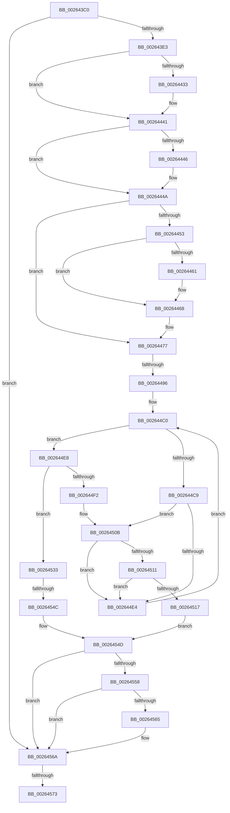

# MiPostInsertVad

- RVA: `0x002643C0`–`0x00264587` (길이 `455` bytes)
- VA: `0x00000001402643C0`
- 실행 섹션: `.text`
- PDB 이름 있음: `예`; PDB Function 태그: `아니요`
- unwind 정보 RVA: `0x000648C8`
- 디코드: `115`개 명령, `455/455` bytes 표시
- 미해석 바이트: `0` (있으면 어셈블리에 `.byte`로 보존)

> 이 문서는 커널 이미지의 기계어와 PDB 기호를 분석해 생성했습니다. 4번과 5번은 함수 원형과 자료형을 바이너리 사용 방식에서 추정한 C 해석이며 원본 소스 복구 결과는 아닙니다.

## 1. Dependencies

- 직접 호출 지점: **5**; 고유 호출 대상: **5**
- 직접 호출자로 확인된 함수: **2**
- RIP 상대 이미지 참조: **0**

### Outgoing calls
- `0x00264423` → [KeAbPreAcquire](../21/KeAbPreAcquire_function_00210230.md) (function, `0x00210230`)
- `0x0026443C` → [ExfAcquirePushLockExclusiveEx](../20/ExfAcquirePushLockExclusiveEx_function_0020FC90.md) (function, `0x0020FC90`)
- `0x00264505` → [KeBugCheckEx](../4F/KeBugCheckEx_function_004FD660.md) (function, `0x004FD660`)
- `0x0026452C` → [KiAbEntryFreeAndEnableInterrupts](KiAbEntryFreeAndEnableInterrupts_function_002622D0.md) (function, `0x002622D0`)
- `0x00264565` → [KiCheckForKernelApcDelivery](../2E/KiCheckForKernelApcDelivery_function_002E2C80.md) (function, `0x002E2C80`)

### Direct callers
- [MiInsertVad](MiInsertVad_function_00265540.md) at `0x002656AF`
- [MiPerformVadSplitting](../2A/MiPerformVadSplitting_function_002A5A80.md) at `0x002A5C57`
- [MiPerformVadSplitting](../2A/MiPerformVadSplitting_function_002A5A80.md) at `0x002A5D70`

### Static image references
- 디코드된 RIP-relative 메모리 참조가 없습니다.

## 2. Other-region calls and transfers

- 다른 실행 섹션으로 향하는 call: **0**
- call이 아닌 외부 분기/꼬리 이동: **3**
  - `0x00264490` → [sub_002648DA](Unknown_function_002648DA.md) (`tail-transfer`)
  - `0x00264546` → [sub_00264921](Unknown_function_00264921.md) (`tail-transfer`)
  - `0x0026456D` → [sub_00264797](Unknown_function_00264797.md) (`tail-transfer`)

## 3. Assembly (complete function range)

```asm
002643C0  48 89 5C 24 18                  mov qword ptr [rsp + 0x18], rbx
002643C5  55                              push rbp
002643C6  56                              push rsi
002643C7  57                              push rdi
002643C8  41 54                           push r12
002643CA  41 56                           push r14
002643CC  48 83 EC 30                     sub rsp, 0x30
002643D0  45 33 E4                        xor r12d, r12d
002643D3  49 8B F0                        mov rsi, r8
002643D6  F7 41 30 00 00 20 00            test dword ptr [rcx + 0x30], 0x200000
002643DD  0F 85 87 01 00 00               jne 0x14026456a
002643E3  65 48 8B 04 25 88 01 00 00      mov rax, qword ptr gs:[0x188]
002643EC  4C 8D 71 60                     lea r14, [rcx + 0x60]
002643F0  45 33 C0                        xor r8d, r8d
002643F3  48 8B 90 B8 00 00 00            mov rdx, qword ptr [rax + 0xb8]
002643FA  48 8B 41 48                     mov rax, qword ptr [rcx + 0x48]
002643FE  48 83 CA 01                     or rdx, 1
00264402  48 89 51 70                     mov qword ptr [rcx + 0x70], rdx
00264406  33 D2                           xor edx, edx
00264408  48 8B 28                        mov rbp, qword ptr [rax]
0026440B  65 48 8B 04 25 88 01 00 00      mov rax, qword ptr gs:[0x188]
00264414  48 8D 5D 68                     lea rbx, [rbp + 0x68]
00264418  66 FF 88 E6 01 00 00            dec word ptr [rax + 0x1e6]
0026441F  48 8B CB                        mov rcx, rbx
00264422  90                              nop
00264423  E8 08 BE FA FF                  call 0x140210230
00264428  F0 48 0F BA 2B 00               lock bts qword ptr [rbx], 0
0026442E  48 8B F8                        mov rdi, rax
00264431  73 0E                           jae 0x140264441
00264433  4C 8B C3                        mov r8, rbx
00264436  48 8B D0                        mov rdx, rax
00264439  48 8B CB                        mov rcx, rbx
0026443C  E8 4F B8 FA FF                  call 0x14020fc90
00264441  48 85 FF                        test rdi, rdi
00264444  74 04                           je 0x14026444a
00264446  C6 47 0A 01                     mov byte ptr [rdi + 0xa], 1
0026444A  F7 45 38 00 04 00 00            test dword ptr [rbp + 0x38], 0x400
00264451  75 24                           jne 0x140264477
00264453  48 8B 45 08                     mov rax, qword ptr [rbp + 8]
00264457  48 83 C5 08                     add rbp, 8
0026445B  48 39 68 08                     cmp qword ptr [rax + 8], rbp
0026445F  74 07                           je 0x140264468
00264461  B9 03 00 00 00                  mov ecx, 3
00264466  CD 29                           int 0x29
00264468  49 89 06                        mov qword ptr [r14], rax
0026446B  49 89 6E 08                     mov qword ptr [r14 + 8], rbp
0026446F  4C 89 70 08                     mov qword ptr [rax + 8], r14
00264473  4C 89 75 00                     mov qword ptr [rbp], r14
00264477  65 48 8B 3C 25 88 01 00 00      mov rdi, qword ptr gs:[0x188]
00264480  48 C7 C0 FF FF FF FF            mov rax, 0xffffffffffffffff
00264487  F0 48 0F C1 03                  lock xadd qword ptr [rbx], rax
0026448C  24 06                           and al, 6
0026448E  3C 02                           cmp al, 2
00264490  0F 84 44 04 00 00               je 0x1402648da
00264496  65 4C 8B 1C 25 88 01 00 00      mov r11, qword ptr gs:[0x188]
0026449F  FA                              cli
002644A0  4D 8B 83 70 04 00 00            mov r8, qword ptr [r11 + 0x470]
002644A7  4C 8B D3                        mov r10, rbx
002644AA  48 BD FC FF FF FF FF FF FF 7F   movabs rbp, 0x7ffffffffffffffc
002644B4  41 8B D4                        mov edx, r12d
002644B7  4C 23 D5                        and r10, rbp
002644BA  66 0F 1F 44 00 00               nop word ptr [rax + rax]
002644C0  41 0F B6 40 0C                  movzx eax, byte ptr [r8 + 0xc]
002644C5  3B D0                           cmp edx, eax
002644C7  73 1F                           jae 0x1402644e8
002644C9  8B C2                           mov eax, edx
002644CB  48 6B C8 58                     imul rcx, rax, 0x58
002644CF  48 83 C1 10                     add rcx, 0x10
002644D3  49 03 C8                        add rcx, r8
002644D6  4C 8B 09                        mov r9, qword ptr [rcx]
002644D9  49 8B C1                        mov rax, r9
002644DC  48 23 C5                        and rax, rbp
002644DF  49 3B C2                        cmp rax, r10
002644E2  74 27                           je 0x14026450b
002644E4  FF C2                           inc edx
002644E6  EB D8                           jmp 0x1402644c0
002644E8  41 8B 43 78                     mov eax, dword ptr [r11 + 0x78]
002644EC  0F BA E0 10                     bt eax, 0x10
002644F0  72 41                           jb 0x140264533
002644F2  45 33 C9                        xor r9d, r9d
002644F5  4C 89 64 24 20                  mov qword ptr [rsp + 0x20], r12
002644FA  4C 8B C3                        mov r8, rbx
002644FD  49 8B D3                        mov rdx, r11
00264500  B9 62 01 00 00                  mov ecx, 0x162
00264505  E8 56 91 29 00                  call 0x1404fd660
0026450A  CC                              int3
0026450B  44 38 61 0A                     cmp byte ptr [rcx + 0xa], r12b
0026450F  74 D3                           je 0x1402644e4
00264511  41 F6 C1 01                     test r9b, 1
00264515  75 CD                           jne 0x1402644e4
00264517  41 B9 01 00 00 00               mov r9d, 1
0026451D  44 88 61 0A                     mov byte ptr [rcx + 0xa], r12b
00264521  4C 8B C3                        mov r8, rbx
00264524  4C 89 64 24 20                  mov qword ptr [rsp + 0x20], r12
00264529  49 8B D3                        mov rdx, r11
0026452C  E8 9F DD FF FF                  call 0x1402622d0
00264531  EB 1A                           jmp 0x14026454d
00264533  65 48 8B 0C 25 20 00 00 00      mov rcx, qword ptr gs:[0x20]
0026453C  4C 8B 81 B8 8E 00 00            mov r8, qword ptr [rcx + 0x8eb8]
00264543  4D 85 C0                        test r8, r8
00264546  0F 85 D5 03 00 00               jne 0x140264921
0026454C  FB                              sti
0026454D  90                              nop
0026454E  66 83 87 E6 01 00 00 01         add word ptr [rdi + 0x1e6], 1
00264556  75 12                           jne 0x14026456a
00264558  48 8D 87 98 00 00 00            lea rax, [rdi + 0x98]
0026455F  90                              nop
00264560  48 39 00                        cmp qword ptr [rax], rax
00264563  74 05                           je 0x14026456a
00264565  E8 16 E7 07 00                  call 0x1402e2c80
0026456A  48 85 F6                        test rsi, rsi
0026456D  0F 84 24 02 00 00               je 0x140264797
00264573  65 48 8B 2C 25 88 01 00 00      mov rbp, qword ptr gs:[0x188]
0026457C  33 D2                           xor edx, edx
0026457E  65 48 8B 04 25 88 01 00 00      mov rax, qword ptr gs:[0x188]
```

## 4. C-style interpretation (structured pseudocode)

```c
__int64 __fastcall MiPostInsertVad(__int64 a1, __int64 a2, __int64 a3)
{
    __int64 result;
    __int64 v_r10;
    __int64 v_r12;
    __int64 v_rbp;
    __int64 v_rsp;
    unsigned __int64 v_stack_m38;
    unsigned __int64 v_stack_p18;

    v_stack_p18 = v_rbx;
    v_rsp = (v_rsp) - (48);
    v_r12 = 0;
    if (((*(unsigned int *)(a1 + 48)) & (0x200000ULL)) != 0) goto loc_0026456A;
    a3 = 0;
    a2 = (*(unsigned __int64 *)(*(unsigned __int64 *)(gs_base + (0 + 392)) + 184)) | (1);
    *(unsigned __int64 *)(a1 + 112) = a2;
    a2 = 0;
    result = KeAbPreAcquire(*(unsigned __int64 *)(*(unsigned __int64 *)(a1 + 72)) + 104, a2, a3, a4);
    if (!(condition_is_above_or_equal)) {
        a3 = *(unsigned __int64 *)(*(unsigned __int64 *)(a1 + 72)) + 104;
        a2 = result;
        a1 = *(unsigned __int64 *)(*(unsigned __int64 *)(a1 + 72)) + 104;
        result = ExfAcquirePushLockExclusiveEx(a1, a2, a3, a4);
    }
    if (result != 0) {
        *(unsigned __int8 *)(result + 10) = 1;
    }
    if (((*(unsigned int *)(*(unsigned __int64 *)(*(unsigned __int64 *)(a1 + 72)) + 56)) & (0x400ULL)) != 0) goto loc_00264477;
    v_rbp = (*(unsigned __int64 *)(*(unsigned __int64 *)(a1 + 72))) + (8);
    if ((*(unsigned __int64 *)(*(unsigned __int64 *)(*(unsigned __int64 *)(*(unsigned __int64 *)(a1 + 72)) + 8) + 8)) != v_rbp) {
        a1 = 3;
    }
    *(unsigned __int64 *)(a1 + 96) = *(unsigned __int64 *)(*(unsigned __int64 *)(*(unsigned __int64 *)(a1 + 72)) + 8);
    *(unsigned __int64 *)(a1 + 96 + 8) = v_rbp;
    *(unsigned __int64 *)(*(unsigned __int64 *)(*(unsigned __int64 *)(*(unsigned __int64 *)(a1 + 72)) + 8) + 8) = a1 + 96;
    *(unsigned __int64 *)(v_rbp) = a1 + 96;
loc_00264477:
    result = (unsigned __int8)((-1) & (6));
    v_r10 = (*(unsigned __int64 *)(*(unsigned __int64 *)(a1 + 72)) + 104) & (v_rbp);
loc_002644C0:
    if (0 >= ((unsigned int)(*(unsigned __int8 *)(*(unsigned __int64 *)(*(unsigned __int64 *)(gs_base + (0 + 392)) + 1136) + 12)))) goto loc_002644E8;
    a1 = (a1) * (0);
    a1 = (a1) + (16);
    a1 = (a1) + (*(unsigned __int64 *)(*(unsigned __int64 *)(gs_base + (0 + 392)) + 1136));
    result = (*(unsigned __int64 *)(a1)) & (v_rbp);
    if (result == v_r10) goto loc_0026450B;
loc_002644E4:
    a2 = (unsigned int)((0) + 1);
    goto loc_002644C0;
loc_002644E8:
    if (result < v_r10) goto loc_00264533;
    a4 = 0;
    v_stack_m38 = 0;
    result = KeBugCheckEx(354, *(unsigned __int64 *)(gs_base + (0 + 392)), *(unsigned __int64 *)(*(unsigned __int64 *)(a1 + 72)) + 104, a4);
loc_0026450B:
    if ((*(unsigned __int8 *)(354 + 10)) == 0) goto loc_002644E4;
    if (((0) & (1)) != 0) goto loc_002644E4;
    *(unsigned __int8 *)(354 + 10) = 0;
    v_stack_m38 = 0;
    result = KiAbEntryFreeAndEnableInterrupts(354, *(unsigned __int64 *)(gs_base + (0 + 392)), *(unsigned __int64 *)(*(unsigned __int64 *)(a1 + 72)) + 104, 1);
    goto loc_0026454D;
loc_00264533:
loc_0026454D:
    if (*(unsigned __int64 *)(*(unsigned __int64 *)(gs_base + (0 + 32)) + 36536) != 0) goto loc_0026456A;
    result = *(unsigned __int64 *)(gs_base + (0 + 392)) + 152;
    if ((*(unsigned __int64 *)(*(unsigned __int64 *)(gs_base + (0 + 392)) + 152)) != (*(unsigned __int64 *)(gs_base + (0 + 392)) + 152)) {
        result = KiCheckForKernelApcDelivery(*(unsigned __int64 *)(gs_base + (0 + 32)), *(unsigned __int64 *)(gs_base + (0 + 392)), *(unsigned __int64 *)(*(unsigned __int64 *)(gs_base + (0 + 32)) + 36536), 1);
    }
    a2 = 0;
    return *(unsigned __int64 *)(gs_base + (0 + 392));
}
```

## 5. (Beta) C Style

```c
int64_t MiPostInsertVad(void *Arg1, int64_t Arg2, int64_t Arg3)
{
    uint8_t *arg1 = (uint8_t *)Arg1;

    int64_t result;
    int64_t local_r10;
    int64_t local_r12;
    int64_t local_rbp;
    int64_t local_rsp;
    uint64_t v_stack_m38;
    uint64_t v_stack_p18;

    v_stack_p18 = local_rbx;
    local_rsp = (local_rsp) - (48);
    local_r12 = 0;
    if (((*(uint32_t *)(arg1 + 0x30)) & (0x200000ULL)) != 0) goto loc_0026456A;
    Arg3 = 0;
    Arg2 = (*(uint64_t *)(*(uint64_t *)(gs_base + (0 + 0x188)) + 0xB8)) | (1);
    *(uint64_t *)(arg1 + 0x70) = Arg2;
    Arg2 = 0;
    result = KeAbPreAcquire(*(uint64_t *)(*(uint64_t *)(arg1 + 0x48)) + 104, Arg2, Arg3, a4);
    if (!(condition_is_above_or_equal)) {
        Arg3 = *(uint64_t *)(*(uint64_t *)(arg1 + 0x48)) + 104;
        Arg2 = result;
        Arg1 = *(uint64_t *)(*(uint64_t *)(arg1 + 0x48)) + 104;
        result = ExfAcquirePushLockExclusiveEx(Arg1, Arg2, Arg3, a4);
    }
    if (result != 0) {
        *(uint8_t *)(result + 0xA) = 1;
    }
    if (((*(uint32_t *)(*(uint64_t *)(*(uint64_t *)(arg1 + 0x48)) + 0x38)) & (0x400ULL)) != 0) goto loc_00264477;
    local_rbp = (*(uint64_t *)(*(uint64_t *)(arg1 + 0x48))) + (8);
    if ((*(uint64_t *)(*(uint64_t *)(*(uint64_t *)(*(uint64_t *)(arg1 + 0x48)) + 0x8) + 0x8)) != local_rbp) {
        Arg1 = 3;
    }
    *(uint64_t *)(arg1 + 0x60) = *(uint64_t *)(*(uint64_t *)(*(uint64_t *)(arg1 + 0x48)) + 0x8);
    *(uint64_t *)(arg1 + 0x60 + 0x8) = local_rbp;
    *(void **)(*(uint64_t *)(*(uint64_t *)(*(uint64_t *)(arg1 + 0x48)) + 0x8) + 0x8) = Arg1 + 96;
    *(void **)(local_rbp) = Arg1 + 96;
loc_00264477:
    result = (uint8_t)((-1) & (6));
    local_r10 = (*(uint64_t *)(*(uint64_t *)(arg1 + 0x48)) + 104) & (local_rbp);
loc_002644C0:
    if (0 >= ((uint32_t)(*(uint8_t *)(*(uint64_t *)(*(uint64_t *)(gs_base + (0 + 0x188)) + 0x470) + 0xC)))) goto loc_002644E8;
    Arg1 = (Arg1) * (0);
    Arg1 = (Arg1) + (16);
    Arg1 = (Arg1) + (*(uint64_t *)(*(uint64_t *)(gs_base + (0 + 0x188)) + 0x470));
    result = (*(uint64_t *)(arg1)) & (local_rbp);
    if (result == local_r10) goto loc_0026450B;
loc_002644E4:
    Arg2 = (uint32_t)((0) + 1);
    goto loc_002644C0;
loc_002644E8:
    if (result < local_r10) goto loc_00264533;
    a4 = 0;
    v_stack_m38 = 0;
    result = KeBugCheckEx(354, *(uint64_t *)(gs_base + (0 + 0x188)), *(uint64_t *)(*(uint64_t *)(arg1 + 0x48)) + 104, a4);
loc_0026450B:
    if ((*(uint8_t *)(354 + 0xA)) == 0) goto loc_002644E4;
    if (((0) & (1)) != 0) goto loc_002644E4;
    *(uint8_t *)(354 + 0xA) = 0;
    v_stack_m38 = 0;
    result = KiAbEntryFreeAndEnableInterrupts(354, *(uint64_t *)(gs_base + (0 + 0x188)), *(uint64_t *)(*(uint64_t *)(arg1 + 0x48)) + 104, 1);
    goto loc_0026454D;
loc_00264533:
loc_0026454D:
    if (*(uint64_t *)(*(uint64_t *)(gs_base + (0 + 0x20)) + 0x8EB8) != 0) goto loc_0026456A;
    result = *(uint64_t *)(gs_base + (0 + 0x188)) + 152;
    if ((*(uint64_t *)(*(uint64_t *)(gs_base + (0 + 0x188)) + 0x98)) != (*(uint64_t *)(gs_base + (0 + 0x188)) + 152)) {
        result = KiCheckForKernelApcDelivery(*(uint64_t *)(gs_base + (0 + 0x20)), *(uint64_t *)(gs_base + (0 + 0x188)), *(uint64_t *)(*(uint64_t *)(gs_base + (0 + 0x20)) + 0x8EB8), 1);
    }
    Arg2 = 0;
    return *(uint64_t *)(gs_base + (0 + 0x188));
}
```

### 관측된 메모리 오프셋

구조체 형식이 확인되지 않은 접근은 인자 기준의 오프셋으로만 기록했습니다.

| 기준 인자 | 오프셋 표현 | 폭 (bit) | 접근 |
|---|---:|---:|---|
| `Arg1` | `+ 0x0` | `64` | `W` |
| `Arg1` | `+ 0x8` | `64` | `W` |
| `Arg1` | `+ 0x30` | `32` | `R` |
| `Arg1` | `+ 0x48` | `64` | `R` |
| `Arg1` | `+ 0x60` | `64` | `R` |
| `Arg1` | `+ 0x70` | `64` | `W` |

## 6. Execution-region graph

[열기: 2D/3D 그래프와 함수 탐색 컨트롤 패널](../../../control-panel.html?section=text&rva=0x002643C0&view=graph)

- 2D 그래프는 위에서 아래로 흐르고, 3D 그래프는 빈 공간을 드래그해 회전합니다. Shift+드래그는 이동, 휠은 확대·축소, 함수 노드 선택은 대상 보고서 이동입니다.

### Static fallback


