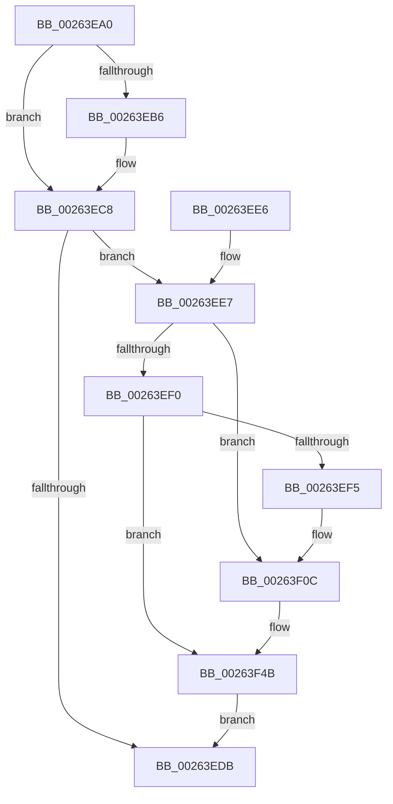

# ObDereferenceObjectDeferDeleteWithTag

- RVA: `0x00263EA0`–`0x00263F56` (길이 `182` bytes)
- VA: `0x0000000140263EA0`
- 실행 섹션: `.text`
- PDB 이름 있음: `예`; PDB Function 태그: `아니요`
- unwind 정보 RVA: `0x00064814`
- 디코드: `50`개 명령, `182/182` bytes 표시
- 미해석 바이트: `0` (있으면 어셈블리에 `.byte`로 보존)

> 이 문서는 커널 이미지의 기계어와 PDB 기호를 분석해 생성했습니다. 4번과 5번은 함수 원형과 자료형을 바이너리 사용 방식에서 추정한 C 해석이며 원본 소스 복구 결과는 아닙니다.

## 1. Dependencies

- 직접 호출 지점: **4**; 고유 호출 대상: **3**
- 직접 호출자로 확인된 함수: **42**
- RIP 상대 이미지 참조: **3**

### Outgoing calls
- `0x00263EC3` → [ObpPushStackInfo](../21/ObpPushStackInfo_function_002109E4.md) (function, `0x002109E4`)
- `0x00263F06` → [KeBugCheckEx](../4F/KeBugCheckEx_function_004FD660.md) (function, `0x004FD660`)
- `0x00263F45` → [KeBugCheckEx](../4F/KeBugCheckEx_function_004FD660.md) (function, `0x004FD660`)
- `0x00263F4F` → [ObpDeferObjectDeletion](../3A/ObpDeferObjectDeletion_function_003A2394.md) (function, `0x003A2394`)

### Direct callers
- [MiStoreFreeWriteSupport](../20/MiStoreFreeWriteSupport_function_00203A48.md) at `0x00203A66`
- [IopCompleteRequest](../20/IopCompleteRequest_function_0020AF50.md) at `0x0020B102`
- [IopCompleteRequest](../20/IopCompleteRequest_function_0020AF50.md) at `0x0020B1CA`
- [KiAbConvertWaiterToOwnerEntry](../21/KiAbConvertWaiterToOwnerEntry_function_00219430.md) at `0x00219A76`
- [sub_00221FB6](../22/Unknown_function_00221FB6.md) at `0x00222CA5`
- [sub_00221FB6](../22/Unknown_function_00221FB6.md) at `0x00222D09`
- [sub_00263D49](Unknown_function_00263D49.md) at `0x00263E44`
- [FsRtlpClearOwner](FsRtlpClearOwner_function_00265BE8.md) at `0x00265C0D`
- [IopBoostThreadCallback](IopBoostThreadCallback_function_00265C30.md) at `0x00265C59`
- [IopBoostThreadCallback](IopBoostThreadCallback_function_00265C30.md) at `0x00265C67`
- [IoPageReadEx](../29/IoPageReadEx_function_0029ABF0.md) at `0x0029B109`
- [sub_0029C0C9](../29/Unknown_function_0029C0C9.md) at `0x0029C0D1`
- [MiFinishHardFault](../2B/MiFinishHardFault_function_002B6F10.md) at `0x002B7259`
- [MiTrimSharedPageFromViews](../2E/MiTrimSharedPageFromViews_function_002E16F8.md) at `0x002E2240`
- [KiAbDeferredProcessingWorker](../30/KiAbDeferredProcessingWorker_function_0030DEB0.md) at `0x0030E76C`
- [KiAbDeferredProcessingWorker](../30/KiAbDeferredProcessingWorker_function_0030DEB0.md) at `0x0030E7D4`
- [MiCompleteProtoPteFault](../34/MiCompleteProtoPteFault_function_00345710.md) at `0x00346663`
- [MiQueuePageAccessLog](../34/MiQueuePageAccessLog_function_00348EB0.md) at `0x00348F8C`
- [CcUnmapAndPurge](../38/CcUnmapAndPurge_function_0038ADF0.md) at `0x0038AE9C`
- [sub_0038BBFB](../38/Unknown_function_0038BBFB.md) at `0x0038BC31`
- [sub_0038BBFB](../38/Unknown_function_0038BBFB.md) at `0x0038BCEF`
- [sub_0038BEEF](../38/Unknown_function_0038BEEF.md) at `0x0038C007`
- [sub_0038C58B](../38/Unknown_function_0038C58B.md) at `0x0038C694`
- [sub_0038C58B](../38/Unknown_function_0038C58B.md) at `0x0038C71A`
- [CcInitializeCacheMapInternal](../3C/CcInitializeCacheMapInternal_function_003CC720.md) at `0x003CD248`
- [CcInitializeCacheMapInternal](../3C/CcInitializeCacheMapInternal_function_003CC720.md) at `0x003CD2DD`
- [FsRtlpRequestExclusiveOplock](../3F/FsRtlpRequestExclusiveOplock_function_003F3800.md) at `0x003F3F71`
- [MiDereferenceControlAreaFile](../43/MiDereferenceControlAreaFile_function_004345E0.md) at `0x00434633`
- [CcChangeBackingFileObject](../45/CcChangeBackingFileObject_function_00457E5C.md) at `0x00457F9D`
- [MmChangeSectionBackingFile](../45/MmChangeSectionBackingFile_function_0045808C.md) at `0x00458120`
- [MiReturnCcAccessLog](../45/MiReturnCcAccessLog_function_0045D1F8.md) at `0x0045D250`
- [MmFreeAccessPfnBuffer](../47/MmFreeAccessPfnBuffer_function_004751BC.md) at `0x004751F4`
- [PspJobDelete](../4B/PspJobDelete_function_004BF8F0.md) at `0x004BFBBB`
- [KiMonitorCacheErrata](../5C/KiMonitorCacheErrata_function_005C4E90.md) at `0x005C4FD2`
- [PfpServiceMainThreadUnboost](../5C/PfpServiceMainThreadUnboost_function_005CDCB0.md) at `0x005CDD24`
- [SmTerminateStoreProcess](../60/SmTerminateStoreProcess_function_0060EB18.md) at `0x0060EB7E`
- [sub_006DB99C](../6D/Unknown_function_006DB99C.md) at `0x006DBA0F`
- [sub_006E5438](../6E/Unknown_function_006E5438.md) at `0x006E5483`
- [PspChargeProcessWakeCounter](../../page/88/PspChargeProcessWakeCounter_function_0088D2A0.md) at `0x0088D658`
- [sub_0089A903](../../page/89/Unknown_function_0089A903.md) at `0x0089AB64`
- [ObpLookupObjectName](../../page/89/ObpLookupObjectName_function_0089BE90.md) at `0x0089C6BD`
- [ObpLookupObjectName](../../page/89/ObpLookupObjectName_function_0089BE90.md) at `0x0089C884`
- [ObpLookupObjectName](../../page/89/ObpLookupObjectName_function_0089BE90.md) at `0x0089CDAD`
- [ObpLookupObjectName](../../page/89/ObpLookupObjectName_function_0089BE90.md) at `0x0089DD77`
- [PspProcessDelete](../../page/90/PspProcessDelete_function_00907B90.md) at `0x00907D4C`
- [VrpDestroyNamespaceNode](../../page/93/VrpDestroyNamespaceNode_function_00934A50.md) at `0x00934BA0`
- [ObpUnlockDirectory](../../page/99/ObpUnlockDirectory_function_0099F8A0.md) at `0x0099F8F8`
- [sub_009D619A](../../page/9D/Unknown_function_009D619A.md) at `0x009D61A2`
- [VrpFreeKeyContext](../../page/9F/VrpFreeKeyContext_function_009FEED4.md) at `0x009FEEEB`
- [MiObtainSectionForDriver](../../page/A2/MiObtainSectionForDriver_function_00A24494.md) at `0x00A2463A`
- [MiObtainSectionForDriver](../../page/A2/MiObtainSectionForDriver_function_00A24494.md) at `0x00A2471C`
- [MiObtainSectionForDriver](../../page/A2/MiObtainSectionForDriver_function_00A24494.md) at `0x00A24753`
- [MiDeleteTrimViewInfoList](../../page/A6/MiDeleteTrimViewInfoList_function_00A610A4.md) at `0x00A610CA`
- [MiUnloadSystemImage](../../page/AA/MiUnloadSystemImage_function_00AA2FD4.md) at `0x00AA3467`

### Static image references
- `0x00263EAA` → RVA `0x00FC5010` (`ALMOSTRO`; read)
- `0x00263F30` → RVA `0x00FC6E4C` (`ALMOSTRO`; read)
- `0x00263F3A` → RVA `0x00FC7800` (`ALMOSTRO`; read)

## 2. Other-region calls and transfers

- 다른 실행 섹션으로 향하는 call: **0**
- 별도 외부 분기/꼬리 이동을 확인하지 못했습니다.

## 3. Assembly (complete function range)

```asm
00263EA0  48 89 5C 24 08                  mov qword ptr [rsp + 8], rbx
00263EA5  57                              push rdi
00263EA6  48 83 EC 30                     sub rsp, 0x30
00263EAA  83 3D 5F 11 D6 00 00            cmp dword ptr [rip + 0xd6115f], 0
00263EB1  48 8B F9                        mov rdi, rcx
00263EB4  74 12                           je 0x140263ec8
00263EB6  44 8B CA                        mov r9d, edx
00263EB9  48 83 C1 D0                     add rcx, -0x30
00263EBD  33 D2                           xor edx, edx
00263EBF  44 8D 42 01                     lea r8d, [rdx + 1]
00263EC3  E8 1C CB FA FF                  call 0x1402109e4
00263EC8  48 C7 C0 FF FF FF FF            mov rax, 0xffffffffffffffff
00263ECF  F0 48 0F C1 47 D0               lock xadd qword ptr [rdi - 0x30], rax
00263ED5  48 83 E8 01                     sub rax, 1
00263ED9  7E 0C                           jle 0x140263ee7
00263EDB  48 8B 5C 24 40                  mov rbx, qword ptr [rsp + 0x40]
00263EE0  48 83 C4 30                     add rsp, 0x30
00263EE4  5F                              pop rdi
00263EE5  C3                              ret
00263EE6  CC                              int3
00263EE7  48 8B 4F D8                     mov rcx, qword ptr [rdi - 0x28]
00263EEB  48 85 C9                        test rcx, rcx
00263EEE  75 1C                           jne 0x140263f0c
00263EF0  48 85 C0                        test rax, rax
00263EF3  79 56                           jns 0x140263f4b
00263EF5  33 D2                           xor edx, edx
00263EF7  48 89 44 24 20                  mov qword ptr [rsp + 0x20], rax
00263EFC  44 8D 49 04                     lea r9d, [rcx + 4]
00263F00  4C 8B C7                        mov r8, rdi
00263F03  8D 4A 18                        lea ecx, [rdx + 0x18]
00263F06  E8 55 97 29 00                  call 0x1404fd660
00263F0B  CC                              int3
00263F0C  41 B9 03 00 00 00               mov r9d, 3
00263F12  48 89 4C 24 20                  mov qword ptr [rsp + 0x20], rcx
00263F17  48 8D 47 D0                     lea rax, [rdi - 0x30]
00263F1B  4C 8B C7                        mov r8, rdi
00263F1E  48 C1 E8 08                     shr rax, 8
00263F22  0F B6 D0                        movzx edx, al
00263F25  0F B6 47 E8                     movzx eax, byte ptr [rdi - 0x18]
00263F29  41 8D 49 15                     lea ecx, [r9 + 0x15]
00263F2D  48 33 D0                        xor rdx, rax
00263F30  0F B6 05 15 2F D6 00            movzx eax, byte ptr [rip + 0xd62f15]
00263F37  48 33 D0                        xor rdx, rax
00263F3A  48 8D 05 BF 38 D6 00            lea rax, [rip + 0xd638bf]
00263F41  48 8B 14 D0                     mov rdx, qword ptr [rax + rdx*8]
00263F45  E8 16 97 29 00                  call 0x1404fd660
00263F4A  CC                              int3
00263F4B  48 8D 4F D0                     lea rcx, [rdi - 0x30]
00263F4F  E8 40 E4 13 00                  call 0x1403a2394
00263F54  EB 85                           jmp 0x140263edb
```

## 4. C-style interpretation (structured pseudocode)

```c
__int64 __fastcall ObDereferenceObjectDeferDeleteWithTag(__int64 a1, int a2)
{
    __int64 result;
    __int64 v_rsp;
    unsigned __int64 v_stack_p20;
    unsigned __int64 v_stack_p8;

    v_stack_p8 = v_rbx;
    v_rsp = (v_rsp) - (48);
    if ((*(unsigned int *)(v_rip + 14029151)) != 0) {
        a4 = a2;
        a1 = (a1) + (-48);
        a2 = 0;
        a3 = a2 + 1;
        result = ObpPushStackInfo(a1, a2, a3, a4);
    }
    result = (-1) - (1);
    if (condition_is_less_or_equal) goto loc_00263EE7;
loc_00263EDB:
    v_rsp = (v_rsp) + (48);
    return result;
loc_00263EE7:
    if (*(unsigned __int64 *)(a1 - 40) != 0) goto loc_00263F0C;
    if (!sign_flag) goto loc_00263F4B;
    a2 = 0;
    v_stack_p20 = result;
    result = KeBugCheckEx(a2 + 24, a2, a1, *(unsigned __int64 *)(a1 - 40) + 4);
loc_00263F0C:
    v_stack_p20 = a2 + 24;
    result = (a1 - 48) >> (8);
    a2 = ((unsigned __int8)(result)) ^ (*(unsigned __int8 *)(a1 - 24));
    a2 = (a2) ^ (*(unsigned __int8 *)(v_rip + 14036757));
    result = KeBugCheckEx(3 + 21, *(unsigned __int64 *)(v_rip + 14039231 + a2 * 8), a1, 3);
loc_00263F4B:
    result = ObpDeferObjectDeletion(a1 - 48, *(unsigned __int64 *)(v_rip + 14039231 + a2 * 8), a1, 3);
    goto loc_00263EDB;
}
```

## 5. (Beta) C Style

```c
int64_t ObDereferenceObjectDeferDeleteWithTag(void *Arg1, int32_t Arg2)
{
    uint8_t *arg1 = (uint8_t *)Arg1;

    int64_t result;
    int64_t local_rsp;
    uint64_t v_stack_p20;
    uint64_t v_stack_p8;

    v_stack_p8 = local_rbx;
    local_rsp = (local_rsp) - (48);
    if ((*(uint32_t *)(v_rip + 0xD6115F)) != 0) {
        a4 = Arg2;
        Arg1 = (Arg1) + (-48);
        Arg2 = 0;
        a3 = Arg2 + 1;
        result = ObpPushStackInfo(Arg1, Arg2, a3, a4);
    }
    result = (-1) - (1);
    if (condition_is_less_or_equal) goto loc_00263EE7;
loc_00263EDB:
    local_rsp = (local_rsp) + (48);
    return result;
loc_00263EE7:
    if (*(uint64_t *)(arg1 - 0x28) != 0) goto loc_00263F0C;
    if (!sign_flag) goto loc_00263F4B;
    Arg2 = 0;
    v_stack_p20 = result;
    result = KeBugCheckEx(Arg2 + 24, Arg2, Arg1, *(uint64_t *)(arg1 - 0x28) + 4);
loc_00263F0C:
    v_stack_p20 = Arg2 + 24;
    result = (Arg1 - 48) >> (8);
    Arg2 = ((uint8_t)(result)) ^ (*(uint8_t *)(arg1 - 0x18));
    Arg2 = (Arg2) ^ (*(uint8_t *)(v_rip + 0xD62F15));
    result = KeBugCheckEx(3 + 21, *(uint64_t *)(v_rip + 0xD638BF + Arg2 * 8), Arg1, 3);
loc_00263F4B:
    result = ObpDeferObjectDeletion(Arg1 - 48, *(uint64_t *)(v_rip + 0xD638BF + Arg2 * 8), Arg1, 3);
    goto loc_00263EDB;
}
```

### 관측된 메모리 오프셋

구조체 형식이 확인되지 않은 접근은 인자 기준의 오프셋으로만 기록했습니다.

| 기준 인자 | 오프셋 표현 | 폭 (bit) | 접근 |
|---|---:|---:|---|
| `Arg1` | `- 0x30` | `64` | `R` |
| `Arg1` | `- 0x30` | `64` | `R/W` |
| `Arg1` | `- 0x28` | `64` | `R` |
| `Arg1` | `- 0x18` | `8` | `R` |

## 6. Execution-region graph

[열기: 2D/3D 그래프와 함수 탐색 컨트롤 패널](../../../control-panel.html?section=text&rva=0x00263EA0&view=graph)

- 2D 그래프는 위에서 아래로 흐르고, 3D 그래프는 빈 공간을 드래그해 회전합니다. Shift+드래그는 이동, 휠은 확대·축소, 함수 노드 선택은 대상 보고서 이동입니다.

### Static fallback


