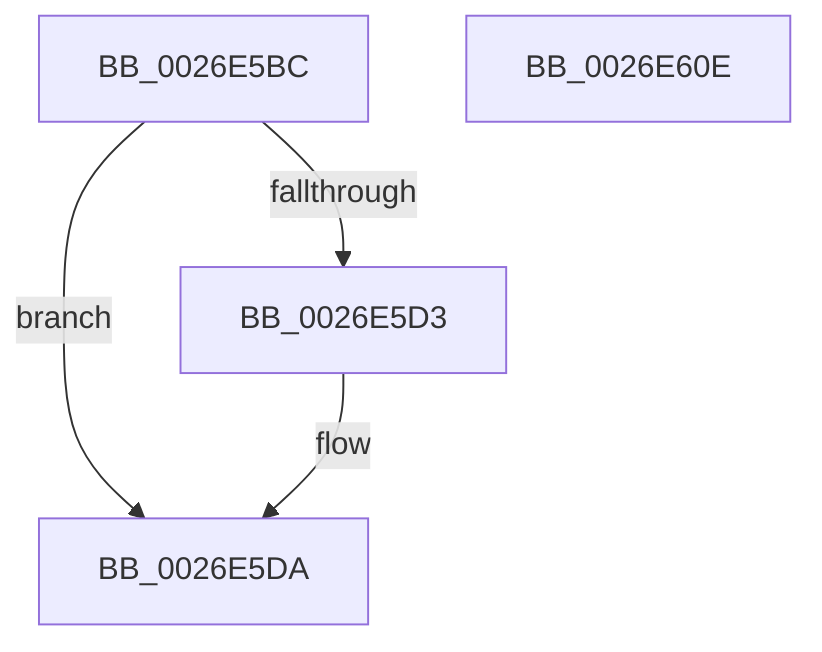

# PnpDeviceCompletionQueueAddCompletedRequest

- RVA: `0x0026E5BC`–`0x0026E60F` (길이 `83` bytes)
- VA: `0x000000014026E5BC`
- 실행 섹션: `.text`
- PDB 이름 있음: `예`; PDB Function 태그: `아니요`
- unwind 정보 RVA: `0x0005C788`
- 디코드: `23`개 명령, `83/83` bytes 표시
- 미해석 바이트: `0` (있으면 어셈블리에 `.byte`로 보존)

> 이 문서는 커널 이미지의 기계어와 PDB 기호를 분석해 생성했습니다. 4번과 5번은 함수 원형과 자료형을 바이너리 사용 방식에서 추정한 C 해석이며 원본 소스 복구 결과는 아닙니다.

## 1. Dependencies

- 직접 호출 지점: **1**; 고유 호출 대상: **1**
- 직접 호출자로 확인된 함수: **1**
- RIP 상대 이미지 참조: **4**

### Outgoing calls
- `0x0026E5FB` → [KeReleaseSemaphore](../39/KeReleaseSemaphore_function_00397080.md) (function, `0x00397080`)

### Direct callers
- [PnpDeviceCompletionQueueDispatchedEntryCompleted](PnpDeviceCompletionQueueDispatchedEntryCompleted_function_0026E778.md) at `0x0026E7BD`

### Static image references
- `0x0026E5C0` → RVA `0x00F8C320` (`.data`; read)
- `0x0026E5C7` → RVA `0x00F8C318` (`.data`; read)
- `0x0026E5E4` → RVA `0x00F8C328` (`.data`; read)
- `0x0026E5EE` → RVA `0x00F8C320` (`.data`; write)

## 2. Other-region calls and transfers

- 다른 실행 섹션으로 향하는 call: **0**
- 별도 외부 분기/꼬리 이동을 확인하지 못했습니다.

## 3. Assembly (complete function range)

```asm
0026E5BC  48 83 EC 28                     sub rsp, 0x28
0026E5C0  48 8B 05 59 DD D1 00            mov rax, qword ptr [rip + 0xd1dd59]
0026E5C7  48 8D 0D 4A DD D1 00            lea rcx, [rip + 0xd1dd4a]
0026E5CE  48 39 08                        cmp qword ptr [rax], rcx
0026E5D1  74 07                           je 0x14026e5da
0026E5D3  B9 03 00 00 00                  mov ecx, 3
0026E5D8  CD 29                           int 0x29
0026E5DA  48 89 0A                        mov qword ptr [rdx], rcx
0026E5DD  45 33 C9                        xor r9d, r9d
0026E5E0  48 89 42 08                     mov qword ptr [rdx + 8], rax
0026E5E4  48 8D 0D 3D DD D1 00            lea rcx, [rip + 0xd1dd3d]
0026E5EB  48 89 10                        mov qword ptr [rax], rdx
0026E5EE  48 89 15 2B DD D1 00            mov qword ptr [rip + 0xd1dd2b], rdx
0026E5F5  33 D2                           xor edx, edx
0026E5F7  45 8D 41 01                     lea r8d, [r9 + 1]
0026E5FB  E8 80 8A 12 00                  call 0x140397080
0026E600  33 C9                           xor ecx, ecx
0026E602  85 C0                           test eax, eax
0026E604  0F 94 C1                        sete cl
0026E607  8B C1                           mov eax, ecx
0026E609  48 83 C4 28                     add rsp, 0x28
0026E60D  C3                              ret
0026E60E  CC                              int3
```

## 4. C-style interpretation (structured pseudocode)

```c
__int64 __fastcall PnpDeviceCompletionQueueAddCompletedRequest(__int64 a1, __int64 a2, __int64 a3, int a4)
{
    __int64 result;
    __int64 v_rsp;

    v_rsp = (v_rsp) - (40);
    if ((*(unsigned __int64 *)(*(unsigned __int64 *)(v_rip + 13753689))) != (v_rip + 13753674)) {
        a1 = 3;
    }
    *(unsigned __int64 *)(a2) = a1;
    a4 = 0;
    *(unsigned __int64 *)(a2 + 8) = *(unsigned __int64 *)(v_rip + 13753689);
    *(unsigned __int64 *)(*(unsigned __int64 *)(v_rip + 13753689)) = a2;
    *(unsigned __int64 *)(v_rip + 13753643) = a2;
    a2 = 0;
    result = KeReleaseSemaphore(v_rip + 13753661, a2, a4 + 1, a4);
    a1 = 0;
    a1 = ((unsigned int)(result) == 0) ? 1 : 0;
    v_rsp = (v_rsp) + (40);
    return (unsigned int)((unsigned int)(a1));
}
```

## 5. (Beta) C Style

```c
int64_t PnpDeviceCompletionQueueAddCompletedRequest(int64_t Arg1, void *Arg2, int64_t Arg3, int32_t Arg4)
{
    uint8_t *arg2 = (uint8_t *)Arg2;

    int64_t result;
    int64_t local_rsp;

    local_rsp = (local_rsp) - (40);
    if ((*(uint64_t *)(*(uint64_t *)(v_rip + 0xD1DD59))) != (v_rip + 13753674)) {
        Arg1 = 3;
    }
    *(uint64_t *)(arg2) = Arg1;
    Arg4 = 0;
    *(uint64_t *)(arg2 + 0x8) = *(uint64_t *)(v_rip + 0xD1DD59);
    *(void **)(*(uint64_t *)(v_rip + 0xD1DD59)) = Arg2;
    *(void **)(v_rip + 0xD1DD2B) = Arg2;
    Arg2 = 0;
    result = KeReleaseSemaphore(v_rip + 13753661, Arg2, Arg4 + 1, Arg4);
    Arg1 = 0;
    Arg1 = ((uint32_t)(result) == 0) ? 1 : 0;
    local_rsp = (local_rsp) + (40);
    return (uint32_t)((uint32_t)(Arg1));
}
```

### 관측된 메모리 오프셋

구조체 형식이 확인되지 않은 접근은 인자 기준의 오프셋으로만 기록했습니다.

| 기준 인자 | 오프셋 표현 | 폭 (bit) | 접근 |
|---|---:|---:|---|
| `Arg2` | `+ 0x0` | `64` | `W` |
| `Arg2` | `+ 0x8` | `64` | `W` |

## 6. Execution-region graph

[열기: 2D/3D 그래프와 함수 탐색 컨트롤 패널](../../../control-panel.html?section=text&rva=0x0026E5BC&view=graph)

- 2D 그래프는 위에서 아래로 흐르고, 3D 그래프는 빈 공간을 드래그해 회전합니다. Shift+드래그는 이동, 휠은 확대·축소, 함수 노드 선택은 대상 보고서 이동입니다.

### Static fallback


