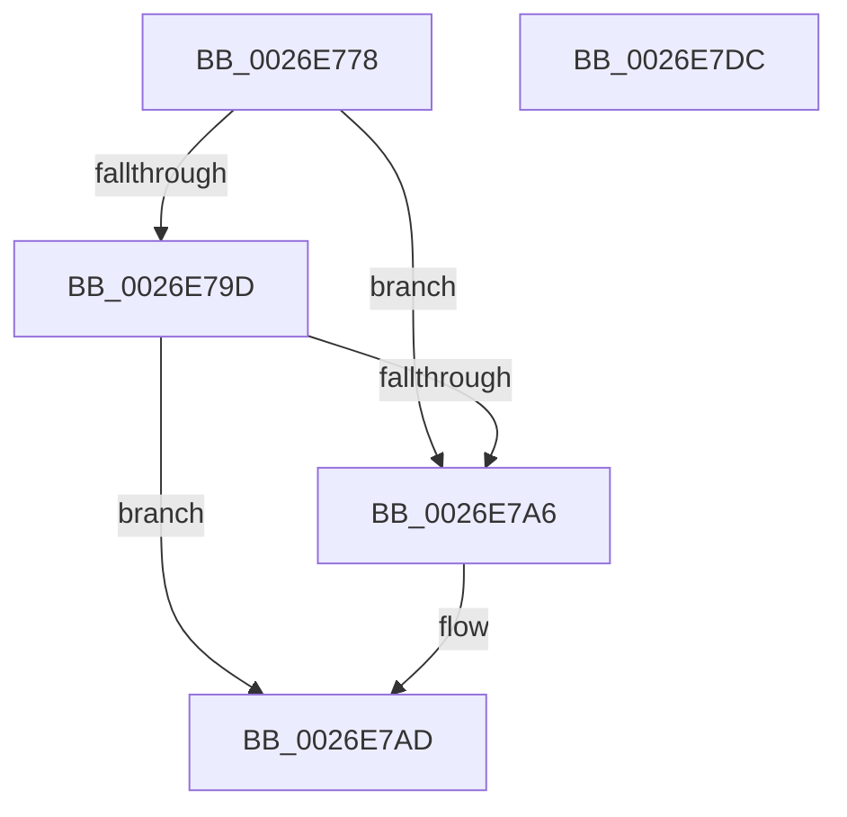

# PnpDeviceCompletionQueueDispatchedEntryCompleted

- RVA: `0x0026E778`–`0x0026E7DD` (길이 `101` bytes)
- VA: `0x000000014026E778`
- 실행 섹션: `.text`
- PDB 이름 있음: `예`; PDB Function 태그: `아니요`
- unwind 정보 RVA: `0x0005CAAC`
- 디코드: `28`개 명령, `101/101` bytes 표시
- 미해석 바이트: `0` (있으면 어셈블리에 `.byte`로 보존)

> 이 문서는 커널 이미지의 기계어와 PDB 기호를 분석해 생성했습니다. 4번과 5번은 함수 원형과 자료형을 바이너리 사용 방식에서 추정한 C 해석이며 원본 소스 복구 결과는 아닙니다.

## 1. Dependencies

- 직접 호출 지점: **3**; 고유 호출 대상: **3**
- 직접 호출자로 확인된 함수: **3**
- RIP 상대 이미지 참조: **2**

### Outgoing calls
- `0x0026E78C` → [KeAcquireSpinLockRaiseToDpc](../20/KeAcquireSpinLockRaiseToDpc_function_00208470.md) (function, `0x00208470`)
- `0x0026E7BD` → [PnpDeviceCompletionQueueAddCompletedRequest](PnpDeviceCompletionQueueAddCompletedRequest_function_0026E5BC.md) (function, `0x0026E5BC`)
- `0x0026E7CC` → [KeReleaseSpinLock](../39/KeReleaseSpinLock_function_00392BA0.md) (function, `0x00392BA0`)

### Direct callers
- [PnpDeviceCompletionRoutine](PnpDeviceCompletionRoutine_function_0026E6C0.md) at `0x0026E70A`
- [PiProcessNewDeviceNodeWorker](../../page/72/PiProcessNewDeviceNodeWorker_function_0072D4C0.md) at `0x0072D4E0`
- [PipEnumerateDevice](../../page/8F/PipEnumerateDevice_function_008F99E4.md) at `0x008F9B8D`

### Static image references
- `0x0026E782` → RVA `0x00F8C348` (`.data`; read)
- `0x0026E7B7` → RVA `0x00F8C310` (`.data`; read/write)

## 2. Other-region calls and transfers

- 다른 실행 섹션으로 향하는 call: **0**
- 별도 외부 분기/꼬리 이동을 확인하지 못했습니다.

## 3. Assembly (complete function range)

```asm
0026E778  48 89 5C 24 08                  mov qword ptr [rsp + 8], rbx
0026E77D  57                              push rdi
0026E77E  48 83 EC 20                     sub rsp, 0x20
0026E782  48 8D 0D BF DB D1 00            lea rcx, [rip + 0xd1dbbf]
0026E789  48 8B DA                        mov rbx, rdx
0026E78C  E8 DF 9C F9 FF                  call 0x140208470
0026E791  4C 8B 03                        mov r8, qword ptr [rbx]
0026E794  40 8A F8                        mov dil, al
0026E797  49 39 58 08                     cmp qword ptr [r8 + 8], rbx
0026E79B  75 09                           jne 0x14026e7a6
0026E79D  48 8B 53 08                     mov rdx, qword ptr [rbx + 8]
0026E7A1  48 39 1A                        cmp qword ptr [rdx], rbx
0026E7A4  74 07                           je 0x14026e7ad
0026E7A6  B9 03 00 00 00                  mov ecx, 3
0026E7AB  CD 29                           int 0x29
0026E7AD  4C 89 02                        mov qword ptr [rdx], r8
0026E7B0  49 89 50 08                     mov qword ptr [r8 + 8], rdx
0026E7B4  48 8B D3                        mov rdx, rbx
0026E7B7  FF 0D 53 DB D1 00               dec dword ptr [rip + 0xd1db53]
0026E7BD  E8 FA FD FF FF                  call 0x14026e5bc
0026E7C2  40 8A D7                        mov dl, dil
0026E7C5  48 8D 0D 7C DB D1 00            lea rcx, [rip + 0xd1db7c]
0026E7CC  E8 CF 43 12 00                  call 0x140392ba0
0026E7D1  48 8B 5C 24 30                  mov rbx, qword ptr [rsp + 0x30]
0026E7D6  48 83 C4 20                     add rsp, 0x20
0026E7DA  5F                              pop rdi
0026E7DB  C3                              ret
0026E7DC  CC                              int3
```

## 4. C-style interpretation (structured pseudocode)

```c
__int64 __fastcall PnpDeviceCompletionQueueDispatchedEntryCompleted(__int64 a1, __int64 a2)
{
    __int64 result;
    __int64 v_rsp;
    unsigned __int64 v_stack_p8;

    v_stack_p8 = v_rbx;
    v_rsp = (v_rsp) - (32);
    result = KeAcquireSpinLockRaiseToDpc(v_rip + 13753279, a2, a3, a4);
    if ((*(unsigned __int64 *)(*(unsigned __int64 *)(a2) + 8)) != a2) goto loc_0026E7A6;
    if ((*(unsigned __int64 *)(*(unsigned __int64 *)(a2 + 8))) != a2) {
        a1 = 3;
    }
    *(unsigned __int64 *)(*(unsigned __int64 *)(a2 + 8)) = *(unsigned __int64 *)(a2);
    *(unsigned __int64 *)(*(unsigned __int64 *)(a2) + 8) = *(unsigned __int64 *)(a2 + 8);
    result = PnpDeviceCompletionQueueAddCompletedRequest(a1, a2, *(unsigned __int64 *)(a2), a4);
    result = KeReleaseSpinLock(v_rip + 13753212, (unsigned __int8)((unsigned __int8)(result)), *(unsigned __int64 *)(a2), a4);
    v_rsp = (v_rsp) + (32);
    return result;
}
```

## 5. (Beta) C Style

```c
int64_t PnpDeviceCompletionQueueDispatchedEntryCompleted(int64_t Arg1, void *Arg2)
{
    uint8_t *arg2 = (uint8_t *)Arg2;

    int64_t result;
    int64_t local_rsp;
    uint64_t v_stack_p8;

    v_stack_p8 = local_rbx;
    local_rsp = (local_rsp) - (32);
    result = KeAcquireSpinLockRaiseToDpc(v_rip + 13753279, Arg2, a3, a4);
    if ((*(uint64_t *)(*(uint64_t *)(arg2) + 0x8)) != Arg2) goto loc_0026E7A6;
    if ((*(uint64_t *)(*(uint64_t *)(arg2 + 0x8))) != Arg2) {
        Arg1 = 3;
    }
    *(uint64_t *)(*(uint64_t *)(arg2 + 0x8)) = *(uint64_t *)(arg2);
    *(uint64_t *)(*(uint64_t *)(arg2) + 0x8) = *(uint64_t *)(arg2 + 0x8);
    result = PnpDeviceCompletionQueueAddCompletedRequest(Arg1, Arg2, *(uint64_t *)(arg2), a4);
    result = KeReleaseSpinLock(v_rip + 13753212, (uint8_t)((uint8_t)(result)), *(uint64_t *)(arg2), a4);
    local_rsp = (local_rsp) + (32);
    return result;
}
```

### 관측된 메모리 오프셋

구조체 형식이 확인되지 않은 접근은 인자 기준의 오프셋으로만 기록했습니다.

| 기준 인자 | 오프셋 표현 | 폭 (bit) | 접근 |
|---|---:|---:|---|
| `Arg2` | `+ 0x0` | `64` | `R` |
| `Arg2` | `+ 0x8` | `64` | `R` |

## 6. Execution-region graph

[열기: 2D/3D 그래프와 함수 탐색 컨트롤 패널](../../../control-panel.html?section=text&rva=0x0026E778&view=graph)

- 2D 그래프는 위에서 아래로 흐르고, 3D 그래프는 빈 공간을 드래그해 회전합니다. Shift+드래그는 이동, 휠은 확대·축소, 함수 노드 선택은 대상 보고서 이동입니다.

### Static fallback


