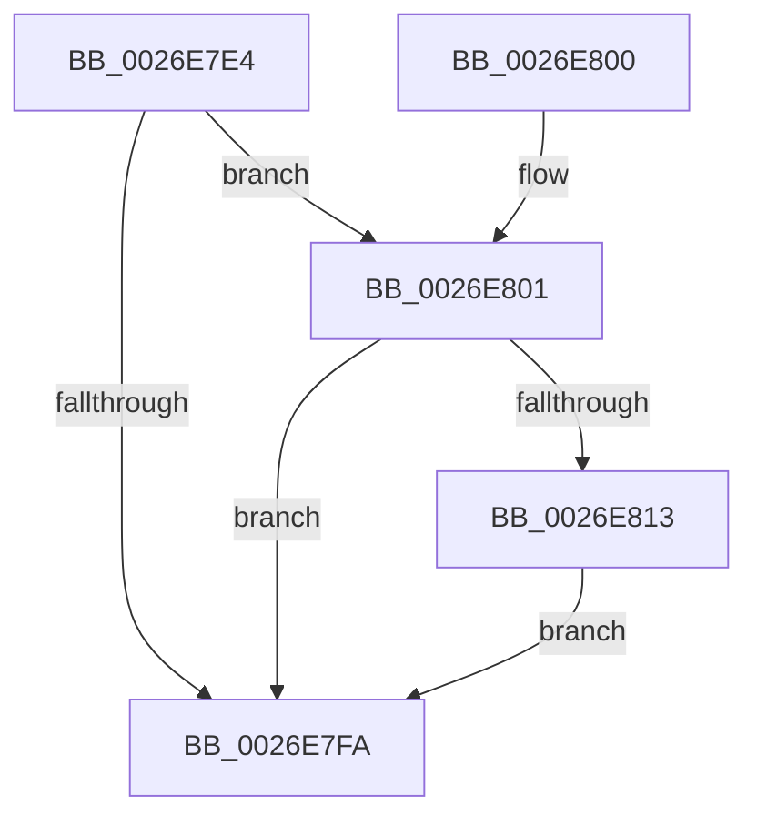

# PnpDeviceCompletionRequestDestroy

- RVA: `0x0026E7E4`–`0x0026E82D` (길이 `73` bytes)
- VA: `0x000000014026E7E4`
- 실행 섹션: `.text`
- PDB 이름 있음: `예`; PDB Function 태그: `아니요`
- unwind 정보 RVA: `0x0006575C`
- 디코드: `22`개 명령, `73/73` bytes 표시
- 미해석 바이트: `0` (있으면 어셈블리에 `.byte`로 보존)

> 이 문서는 커널 이미지의 기계어와 PDB 기호를 분석해 생성했습니다. 4번과 5번은 함수 원형과 자료형을 바이너리 사용 방식에서 추정한 C 해석이며 원본 소스 복구 결과는 아닙니다.

## 1. Dependencies

- 직접 호출 지점: **2**; 고유 호출 대상: **2**
- 직접 호출자로 확인된 함수: **2**
- RIP 상대 이미지 참조: **1**

### Outgoing calls
- `0x0026E809` → [IoAllocateWorkItem](IoAllocateWorkItem_function_0026E900.md) (function, `0x0026E900`)
- `0x0026E826` → [IoQueueWorkItemEx](../35/IoQueueWorkItemEx_function_00358140.md) (function, `0x00358140`)

### Direct callers
- [PnpDeviceCompletionRoutine](PnpDeviceCompletionRoutine_function_0026E6C0.md) at `0x0026E72F`
- [PnpDeviceCompletionProcessCompletedRequest](../../page/8F/PnpDeviceCompletionProcessCompletedRequest_function_008FB654.md) at `0x008FB6B8`

### Static image references
- `0x0026E816` → RVA `0x00471FC0` (`PnpDeviceCompletionRequestDestroyWorkItem`; read)

## 2. Other-region calls and transfers

- 다른 실행 섹션으로 향하는 call: **0**
- 별도 외부 분기/꼬리 이동을 확인하지 못했습니다.

## 3. Assembly (complete function range)

```asm
0026E7E4  40 53                           push rbx
0026E7E6  48 83 EC 20                     sub rsp, 0x20
0026E7EA  48 8B D9                        mov rbx, rcx
0026E7ED  83 C8 FF                        or eax, 0xffffffff
0026E7F0  F0 0F C1 41 38                  lock xadd dword ptr [rcx + 0x38], eax
0026E7F5  83 F8 01                        cmp eax, 1
0026E7F8  74 07                           je 0x14026e801
0026E7FA  48 83 C4 20                     add rsp, 0x20
0026E7FE  5B                              pop rbx
0026E7FF  C3                              ret
0026E800  CC                              int3
0026E801  48 8B 49 10                     mov rcx, qword ptr [rcx + 0x10]
0026E805  48 8B 49 20                     mov rcx, qword ptr [rcx + 0x20]
0026E809  E8 F2 00 00 00                  call 0x14026e900
0026E80E  48 85 C0                        test rax, rax
0026E811  74 E7                           je 0x14026e7fa
0026E813  4C 8B CB                        mov r9, rbx
0026E816  48 8D 15 A3 37 20 00            lea rdx, [rip + 0x2037a3]
0026E81D  41 B8 01 00 00 00               mov r8d, 1
0026E823  48 8B C8                        mov rcx, rax
0026E826  E8 15 99 0E 00                  call 0x140358140
0026E82B  EB CD                           jmp 0x14026e7fa
```

## 4. C-style interpretation (structured pseudocode)

```c
__int64 __fastcall PnpDeviceCompletionRequestDestroy(__int64 a1)
{
    __int64 result;
    __int64 v_rsp;

    v_rsp = (v_rsp) - (32);
    result = (unsigned int)((result) | (0xFFFFFFFFULL));
    if (((unsigned int)(result)) == 1) goto loc_0026E801;
loc_0026E7FA:
    v_rsp = (v_rsp) + (32);
    return result;
loc_0026E801:
    result = IoAllocateWorkItem(*(unsigned __int64 *)(*(unsigned __int64 *)(a1 + 16) + 32), a2, a3, a4);
    if (result == 0) goto loc_0026E7FA;
    result = IoQueueWorkItemEx(result, v_rip + 2111395, 1, a1);
    goto loc_0026E7FA;
}
```

## 5. (Beta) C Style

```c
int64_t PnpDeviceCompletionRequestDestroy(void *Arg1)
{
    uint8_t *arg1 = (uint8_t *)Arg1;

    int64_t result;
    int64_t local_rsp;

    local_rsp = (local_rsp) - (32);
    result = (uint32_t)((result) | (0xFFFFFFFFULL));
    if (((uint32_t)(result)) == 1) goto loc_0026E801;
loc_0026E7FA:
    local_rsp = (local_rsp) + (32);
    return result;
loc_0026E801:
    result = IoAllocateWorkItem(*(uint64_t *)(*(uint64_t *)(arg1 + 0x10) + 0x20), a2, a3, a4);
    if (result == 0) goto loc_0026E7FA;
    result = IoQueueWorkItemEx(result, v_rip + 2111395, 1, Arg1);
    goto loc_0026E7FA;
}
```

### 관측된 메모리 오프셋

구조체 형식이 확인되지 않은 접근은 인자 기준의 오프셋으로만 기록했습니다.

| 기준 인자 | 오프셋 표현 | 폭 (bit) | 접근 |
|---|---:|---:|---|
| `Arg1` | `+ 0x10` | `64` | `R` |
| `Arg1` | `+ 0x38` | `32` | `R/W` |

## 6. Execution-region graph

[열기: 2D/3D 그래프와 함수 탐색 컨트롤 패널](../../../control-panel.html?section=text&rva=0x0026E7E4&view=graph)

- 2D 그래프는 위에서 아래로 흐르고, 3D 그래프는 빈 공간을 드래그해 회전합니다. Shift+드래그는 이동, 휠은 확대·축소, 함수 노드 선택은 대상 보고서 이동입니다.

### Static fallback


