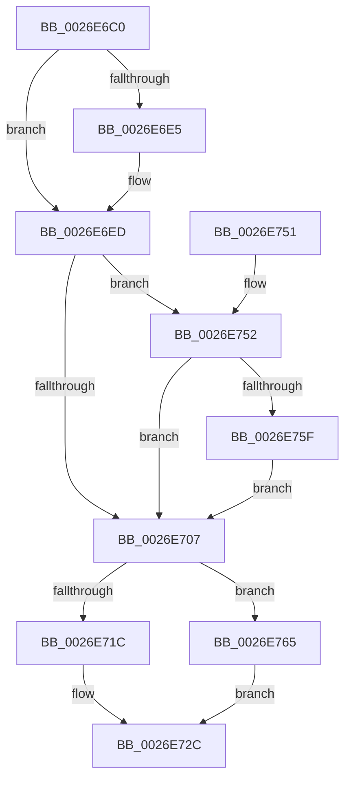

# PnpDeviceCompletionRoutine

- RVA: `0x0026E6C0`–`0x0026E772` (길이 `178` bytes)
- VA: `0x000000014026E6C0`
- 실행 섹션: `.text`
- PDB 이름 있음: `예`; PDB Function 태그: `아니요`
- unwind 정보 RVA: `0x00065748`
- 디코드: `48`개 명령, `178/178` bytes 표시
- 미해석 바이트: `0` (있으면 어셈블리에 `.byte`로 보존)

> 이 문서는 커널 이미지의 기계어와 PDB 기호를 분석해 생성했습니다. 4번과 5번은 함수 원형과 자료형을 바이너리 사용 방식에서 추정한 C 해석이며 원본 소스 복구 결과는 아닙니다.

## 1. Dependencies

- 직접 호출 지점: **6**; 고유 호출 대상: **6**
- 직접 호출자로 확인된 함수: **0**
- RIP 상대 이미지 참조: **1**

### Outgoing calls
- `0x0026E70A` → [PnpDeviceCompletionQueueDispatchedEntryCompleted](PnpDeviceCompletionQueueDispatchedEntryCompleted_function_0026E778.md) (function, `0x0026E778`)
- `0x0026E727` → [PnpDiagnosticTraceObject](PnpDiagnosticTraceObject_function_0026E834.md) (function, `0x0026E834`)
- `0x0026E72F` → [PnpDeviceCompletionRequestDestroy](PnpDeviceCompletionRequestDestroy_function_0026E7E4.md) (function, `0x0026E7E4`)
- `0x0026E737` → [IoFreeIrp](../24/IoFreeIrp_function_0024DF70.md) (function, `0x0024DF70`)
- `0x0026E755` → [IoFindDeviceThatFailedIrp](IoFindDeviceThatFailedIrp_function_0026E95C.md) (function, `0x0026E95C`)
- `0x0026E76B` → [PnpTraceStartDevice](PnpTraceStartDevice_function_0026E3F8.md) (function, `0x0026E3F8`)

### Direct callers
- 이 함수 시작 RVA로 연결되는 직접 call은 확인되지 않았습니다. 간접 호출은 완전히 역산할 수 없습니다.

### Static image references
- `0x0026E720` → RVA `0x00010828` (`.rdata`; read)

## 2. Other-region calls and transfers

- 다른 실행 섹션으로 향하는 call: **0**
- 별도 외부 분기/꼬리 이동을 확인하지 못했습니다.

## 3. Assembly (complete function range)

```asm
0026E6C0  48 89 5C 24 08                  mov qword ptr [rsp + 8], rbx
0026E6C5  48 89 74 24 10                  mov qword ptr [rsp + 0x10], rsi
0026E6CA  57                              push rdi
0026E6CB  48 83 EC 20                     sub rsp, 0x20
0026E6CF  49 8B 40 10                     mov rax, qword ptr [r8 + 0x10]
0026E6D3  33 FF                           xor edi, edi
0026E6D5  49 8B D8                        mov rbx, r8
0026E6D8  48 8B F2                        mov rsi, rdx
0026E6DB  48 89 78 48                     mov qword ptr [rax + 0x48], rdi
0026E6DF  40 38 7A 41                     cmp byte ptr [rdx + 0x41], dil
0026E6E3  74 08                           je 0x14026e6ed
0026E6E5  41 C7 40 24 01 00 00 00         mov dword ptr [r8 + 0x24], 1
0026E6ED  48 8B 42 38                     mov rax, qword ptr [rdx + 0x38]
0026E6F1  49 89 40 30                     mov qword ptr [r8 + 0x30], rax
0026E6F5  8B 42 30                        mov eax, dword ptr [rdx + 0x30]
0026E6F8  41 89 40 28                     mov dword ptr [r8 + 0x28], eax
0026E6FC  F0 41 FF 40 38                  lock inc dword ptr [r8 + 0x38]
0026E701  41 39 78 28                     cmp dword ptr [r8 + 0x28], edi
0026E705  7C 4B                           jl 0x14026e752
0026E707  48 8B D3                        mov rdx, rbx
0026E70A  E8 69 00 00 00                  call 0x14026e778
0026E70F  81 7B 20 0F 03 00 00            cmp dword ptr [rbx + 0x20], 0x30f
0026E716  48 8B 4B 10                     mov rcx, qword ptr [rbx + 0x10]
0026E71A  75 49                           jne 0x14026e765
0026E71C  48 8D 51 28                     lea rdx, [rcx + 0x28]
0026E720  48 8D 0D 01 21 DA FF            lea rcx, [rip - 0x25deff]
0026E727  E8 08 01 00 00                  call 0x14026e834
0026E72C  48 8B CB                        mov rcx, rbx
0026E72F  E8 B0 00 00 00                  call 0x14026e7e4
0026E734  48 8B CE                        mov rcx, rsi
0026E737  E8 34 F8 FD FF                  call 0x14024df70
0026E73C  48 8B 5C 24 30                  mov rbx, qword ptr [rsp + 0x30]
0026E741  B8 16 00 00 C0                  mov eax, 0xc0000016
0026E746  48 8B 74 24 38                  mov rsi, qword ptr [rsp + 0x38]
0026E74B  48 83 C4 20                     add rsp, 0x20
0026E74F  5F                              pop rdi
0026E750  C3                              ret
0026E751  CC                              int3
0026E752  48 8B CE                        mov rcx, rsi
0026E755  E8 02 02 00 00                  call 0x14026e95c
0026E75A  48 85 C0                        test rax, rax
0026E75D  74 A8                           je 0x14026e707
0026E75F  48 8B 78 08                     mov rdi, qword ptr [rax + 8]
0026E763  EB A2                           jmp 0x14026e707
0026E765  8B 53 28                        mov edx, dword ptr [rbx + 0x28]
0026E768  4C 8B C7                        mov r8, rdi
0026E76B  E8 88 FC FF FF                  call 0x14026e3f8
0026E770  EB BA                           jmp 0x14026e72c
```

## 4. C-style interpretation (structured pseudocode)

```c
__int64 __fastcall PnpDeviceCompletionRoutine(__int64 a1, __int64 a2, __int64 a3)
{
    __int64 result;
    __int64 v_rdi;
    __int64 v_rsp;
    unsigned __int64 v_stack_p10;
    unsigned __int64 v_stack_p8;

    v_stack_p8 = v_rbx;
    v_stack_p10 = v_rsi;
    v_rsp = (v_rsp) - (32);
    v_rdi = 0;
    *(unsigned __int64 *)(*(unsigned __int64 *)(a3 + 16) + 72) = 0;
    if ((*(unsigned __int8 *)(a2 + 65)) != 0) {
        *(unsigned int *)(a3 + 36) = 1;
    }
    *(unsigned __int64 *)(a3 + 48) = *(unsigned __int64 *)(a2 + 56);
    *(unsigned int *)(a3 + 40) = (unsigned int)((unsigned int)(*(unsigned int *)(a2 + 48)));
    if ((*(unsigned int *)(a3 + 40)) < 0) goto loc_0026E752;
loc_0026E707:
    result = PnpDeviceCompletionQueueDispatchedEntryCompleted(a1, a3, a3, a4);
    if ((*(unsigned int *)(a3 + 32)) != 783) goto loc_0026E765;
    result = PnpDiagnosticTraceObject(v_rip - 2481919, *(unsigned __int64 *)(a3 + 16) + 40, a3, a4);
loc_0026E72C:
    result = PnpDeviceCompletionRequestDestroy(a3, *(unsigned __int64 *)(a3 + 16) + 40, a3, a4);
    result = IoFreeIrp(a2, *(unsigned __int64 *)(a3 + 16) + 40, a3, a4);
    v_rsp = (v_rsp) + (32);
    return (unsigned int)(0xC0000016ULL);
loc_0026E752:
    result = IoFindDeviceThatFailedIrp(v_stack_p10, *(unsigned __int64 *)(a3 + 16) + 40, a3, a4);
    if (result == 0) goto loc_0026E707;
    goto loc_0026E707;
loc_0026E765:
    result = PnpTraceStartDevice(v_stack_p10, (unsigned int)(*(unsigned int *)(v_stack_p8 + 40)), *(unsigned __int64 *)(result + 8), a4);
    goto loc_0026E72C;
}
```

## 5. (Beta) C Style

```c
int64_t PnpDeviceCompletionRoutine(int64_t Arg1, void *Arg2, void *Arg3)
{
    uint8_t *arg2 = (uint8_t *)Arg2;
    uint8_t *arg3 = (uint8_t *)Arg3;

    int64_t result;
    int64_t local_rdi;
    int64_t local_rsp;
    uint64_t v_stack_p10;
    uint64_t v_stack_p8;

    v_stack_p8 = local_rbx;
    v_stack_p10 = local_rsi;
    local_rsp = (local_rsp) - (32);
    local_rdi = 0;
    *(uint64_t *)(*(uint64_t *)(arg3 + 0x10) + 0x48) = 0;
    if ((*(uint8_t *)(arg2 + 0x41)) != 0) {
        *(uint32_t *)(arg3 + 0x24) = 1;
    }
    *(uint64_t *)(arg3 + 0x30) = *(uint64_t *)(arg2 + 0x38);
    *(uint32_t *)(arg3 + 0x28) = (uint32_t)((uint32_t)(*(uint32_t *)(arg2 + 0x30)));
    if ((*(uint32_t *)(arg3 + 0x28)) < 0) goto loc_0026E752;
loc_0026E707:
    result = PnpDeviceCompletionQueueDispatchedEntryCompleted(Arg1, Arg3, Arg3, a4);
    if ((*(uint32_t *)(arg3 + 0x20)) != 783) goto loc_0026E765;
    result = PnpDiagnosticTraceObject(v_rip - 2481919, *(uint64_t *)(arg3 + 0x10) + 40, Arg3, a4);
loc_0026E72C:
    result = PnpDeviceCompletionRequestDestroy(Arg3, *(uint64_t *)(arg3 + 0x10) + 40, Arg3, a4);
    result = IoFreeIrp(Arg2, *(uint64_t *)(arg3 + 0x10) + 40, Arg3, a4);
    local_rsp = (local_rsp) + (32);
    return (uint32_t)(0xC0000016ULL);
loc_0026E752:
    result = IoFindDeviceThatFailedIrp(v_stack_p10, *(uint64_t *)(arg3 + 0x10) + 40, Arg3, a4);
    if (result == 0) goto loc_0026E707;
    goto loc_0026E707;
loc_0026E765:
    result = PnpTraceStartDevice(v_stack_p10, (uint32_t)(*(uint32_t *)(v_stack_p8 + 0x28)), *(uint64_t *)(result + 0x8), a4);
    goto loc_0026E72C;
}
```

### 관측된 메모리 오프셋

구조체 형식이 확인되지 않은 접근은 인자 기준의 오프셋으로만 기록했습니다.

| 기준 인자 | 오프셋 표현 | 폭 (bit) | 접근 |
|---|---:|---:|---|
| `Arg2` | `+ 0x30` | `32` | `R` |
| `Arg2` | `+ 0x38` | `64` | `R` |
| `Arg2` | `+ 0x41` | `8` | `R` |
| `Arg3` | `+ 0x10` | `64` | `R` |
| `Arg3` | `+ 0x20` | `32` | `R` |
| `Arg3` | `+ 0x24` | `32` | `W` |
| `Arg3` | `+ 0x28` | `32` | `R` |
| `Arg3` | `+ 0x28` | `32` | `W` |
| `Arg3` | `+ 0x30` | `64` | `W` |
| `Arg3` | `+ 0x38` | `32` | `R/W` |

## 6. Execution-region graph

[열기: 2D/3D 그래프와 함수 탐색 컨트롤 패널](../../../control-panel.html?section=text&rva=0x0026E6C0&view=graph)

- 2D 그래프는 위에서 아래로 흐르고, 3D 그래프는 빈 공간을 드래그해 회전합니다. Shift+드래그는 이동, 휠은 확대·축소, 함수 노드 선택은 대상 보고서 이동입니다.

### Static fallback


