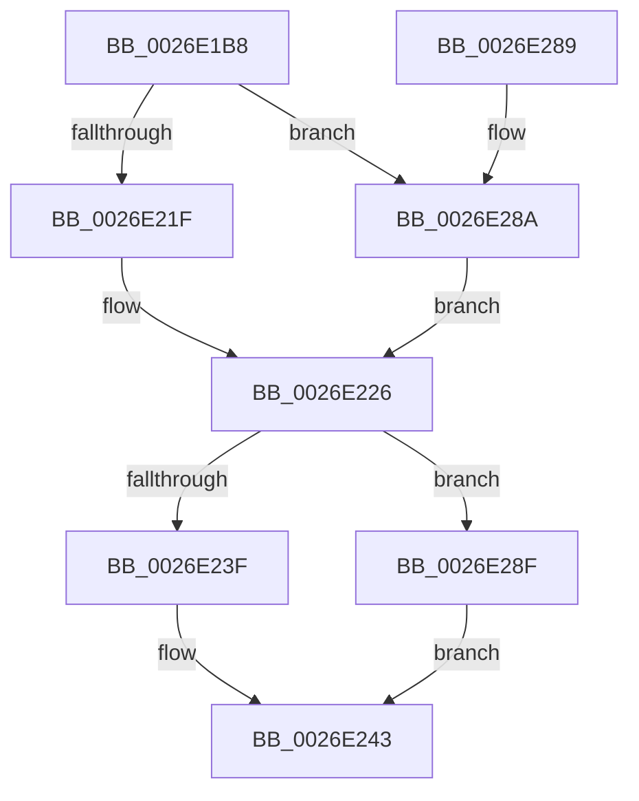

# PnpDiagnosticTraceDeviceOperation

- RVA: `0x0026E1B8`–`0x0026E294` (길이 `220` bytes)
- VA: `0x000000014026E1B8`
- 실행 섹션: `.text`
- PDB 이름 있음: `예`; PDB Function 태그: `아니요`
- unwind 정보 RVA: `0x000656E0`
- 디코드: `57`개 명령, `220/220` bytes 표시
- 미해석 바이트: `0` (있으면 어셈블리에 `.byte`로 보존)

> 이 문서는 커널 이미지의 기계어와 PDB 기호를 분석해 생성했습니다. 4번과 5번은 함수 원형과 자료형을 바이너리 사용 방식에서 추정한 C 해석이며 원본 소스 복구 결과는 아닙니다.

## 1. Dependencies

- 직접 호출 지점: **2**; 고유 호출 대상: **2**
- 직접 호출자로 확인된 함수: **4**
- RIP 상대 이미지 참조: **1**

### Outgoing calls
- `0x0026E26F` → [PnpDiagnosticTrace](PnpDiagnosticTrace_function_0026E384.md) (function, `0x0026E384`)
- `0x0026E27B` → [_security_check_cookie](../6A/_security_check_cookie_function_006AC640.md) (function, `0x006AC640`)

### Direct callers
- [PnpTraceStartDevice](PnpTraceStartDevice_function_0026E3F8.md) at `0x0026E42D`
- [PnpQueueQueryAndRemoveEvent](../../page/94/PnpQueueQueryAndRemoveEvent_function_0094FD2C.md) at `0x00950109`
- [IopUnloadDriver](../../page/AB/IopUnloadDriver_function_00ABF868.md) at `0x00ABFCCD`
- [sub_00B2C3E8](../../page/B2/Unknown_function_00B2C3E8.md) at `0x00B2C46E`

### Static image references
- `0x0026E1CA` → RVA `0x00E0A740` (`.data`; read)

## 2. Other-region calls and transfers

- 다른 실행 섹션으로 향하는 call: **0**
- 별도 외부 분기/꼬리 이동을 확인하지 못했습니다.

## 3. Assembly (complete function range)

```asm
0026E1B8  44 89 44 24 18                  mov dword ptr [rsp + 0x18], r8d
0026E1BD  55                              push rbp
0026E1BE  48 8D 6C 24 B1                  lea rbp, [rsp - 0x4f]
0026E1C3  48 81 EC A0 00 00 00            sub rsp, 0xa0
0026E1CA  48 8B 05 6F C5 B9 00            mov rax, qword ptr [rip + 0xb9c56f]
0026E1D1  48 33 C4                        xor rax, rsp
0026E1D4  48 89 45 3F                     mov qword ptr [rbp + 0x3f], rax
0026E1D8  45 33 C0                        xor r8d, r8d
0026E1DB  48 C7 45 E7 02 00 00 00         mov qword ptr [rbp - 0x19], 2
0026E1E3  4C 8B D1                        mov r10, rcx
0026E1E6  44 89 45 FB                     mov dword ptr [rbp - 5], r8d
0026E1EA  0F B7 0A                        movzx ecx, word ptr [rdx]
0026E1ED  0F B7 C1                        movzx eax, cx
0026E1F0  89 4D F7                        mov dword ptr [rbp - 9], ecx
0026E1F3  66 D1 E8                        shr ax, 1
0026E1F6  66 89 45 CF                     mov word ptr [rbp - 0x31], ax
0026E1FA  48 8D 45 CF                     lea rax, [rbp - 0x31]
0026E1FE  48 89 45 DF                     mov qword ptr [rbp - 0x21], rax
0026E202  48 8B 42 08                     mov rax, qword ptr [rdx + 8]
0026E206  48 89 45 EF                     mov qword ptr [rbp - 0x11], rax
0026E20A  48 8D 45 6F                     lea rax, [rbp + 0x6f]
0026E20E  48 89 45 FF                     mov qword ptr [rbp - 1], rax
0026E212  48 C7 45 07 04 00 00 00         mov qword ptr [rbp + 7], 4
0026E21A  4D 85 C9                        test r9, r9
0026E21D  74 6B                           je 0x14026e28a
0026E21F  41 0F B7 01                     movzx eax, word ptr [r9]
0026E223  66 D1 E8                        shr ax, 1
0026E226  66 89 45 D3                     mov word ptr [rbp - 0x2d], ax
0026E22A  48 8D 4D D3                     lea rcx, [rbp - 0x2d]
0026E22E  48 89 4D 0F                     mov qword ptr [rbp + 0xf], rcx
0026E232  48 C7 45 17 02 00 00 00         mov qword ptr [rbp + 0x17], 2
0026E23A  4D 85 C9                        test r9, r9
0026E23D  74 50                           je 0x14026e28f
0026E23F  49 8B 49 08                     mov rcx, qword ptr [r9 + 8]
0026E243  0F B7 C0                        movzx eax, ax
0026E246  BA 06 00 00 00                  mov edx, 6
0026E24B  03 C0                           add eax, eax
0026E24D  48 89 4D 1F                     mov qword ptr [rbp + 0x1f], rcx
0026E251  89 45 27                        mov dword ptr [rbp + 0x27], eax
0026E254  49 8B CA                        mov rcx, r10
0026E257  48 8D 45 7F                     lea rax, [rbp + 0x7f]
0026E25B  44 89 45 2B                     mov dword ptr [rbp + 0x2b], r8d
0026E25F  4C 8D 45 DF                     lea r8, [rbp - 0x21]
0026E263  48 89 45 2F                     mov qword ptr [rbp + 0x2f], rax
0026E267  48 C7 45 37 04 00 00 00         mov qword ptr [rbp + 0x37], 4
0026E26F  E8 10 01 00 00                  call 0x14026e384
0026E274  48 8B 4D 3F                     mov rcx, qword ptr [rbp + 0x3f]
0026E278  48 33 CC                        xor rcx, rsp
0026E27B  E8 C0 E3 43 00                  call 0x1406ac640
0026E280  48 81 C4 A0 00 00 00            add rsp, 0xa0
0026E287  5D                              pop rbp
0026E288  C3                              ret
0026E289  CC                              int3
0026E28A  41 8B C0                        mov eax, r8d
0026E28D  EB 97                           jmp 0x14026e226
0026E28F  49 8B C8                        mov rcx, r8
0026E292  EB AF                           jmp 0x14026e243
```

## 4. C-style interpretation (structured pseudocode)

```c
__int64 __fastcall PnpDiagnosticTraceDeviceOperation(__int64 a1, __int64 a2, int a3, __int64 a4, __int64 a5)
{
    __int64 result;
    __int64 v_rsp;
    unsigned __int64 v_stack_m18;
    unsigned __int64 v_stack_m20;
    unsigned __int64 v_stack_m28;
    unsigned int v_stack_m2C;
    unsigned int v_stack_m30;
    unsigned __int64 v_stack_m38;
    unsigned __int64 v_stack_m40;
    unsigned __int64 v_stack_m48;
    unsigned __int64 v_stack_m50;
    unsigned __int64 v_stack_m57;
    unsigned __int64 v_stack_m58;
    unsigned int v_stack_m5C;
    unsigned int v_stack_m60;
    unsigned __int64 v_stack_m68;
    unsigned __int64 v_stack_m70;
    unsigned __int64 v_stack_m78;
    unsigned __int16 v_stack_m84;
    unsigned __int16 v_stack_m88;
    unsigned int v_stack_p18;

    v_stack_p18 = a3;
    v_rsp = (v_rsp) - (160);
    result = (*(unsigned __int64 *)(v_rip + 12174703)) ^ (v_rsp);
    v_stack_m18 = result;
    a3 = 0;
    v_stack_m70 = 2;
    v_stack_m5C = 0;
    v_stack_m60 = (unsigned int)(*(unsigned __int16 *)(a2));
    result = (unsigned __int16)(((unsigned __int16)(*(unsigned __int16 *)(a2))) >> (1));
    v_stack_m88 = (unsigned __int16)(result);
    v_stack_m78 = v_stack_m88;
    v_stack_m68 = *(unsigned __int64 *)(a2 + 8);
    v_stack_m58 = v_stack_p18;
    v_stack_m50 = 4;
    if (a4 == 0) goto loc_0026E28A;
    result = (unsigned __int16)((*(unsigned __int16 *)(a4)) >> (1));
loc_0026E226:
    v_stack_m84 = (unsigned __int16)(result);
    v_stack_m48 = v_stack_m84;
    v_stack_m40 = 2;
    if (a4 == 0) goto loc_0026E28F;
loc_0026E243:
    result = (unsigned int)(((unsigned __int16)(result)) + ((unsigned int)((unsigned __int16)(result))));
    v_stack_m38 = *(unsigned __int64 *)(a4 + 8);
    v_stack_m30 = (unsigned int)(result);
    v_stack_m2C = 0;
    v_stack_m28 = a5;
    v_stack_m20 = 4;
    result = PnpDiagnosticTrace(a1, 6, v_stack_m78, a4);
    a1 = (v_stack_m18) ^ (v_rsp);
    result = _security_check_cookie(a1, 6, v_stack_m78, a4);
    v_rsp = (v_rsp) + (160);
    return result;
loc_0026E28A:
    goto loc_0026E226;
loc_0026E28F:
    goto loc_0026E243;
}
```

## 5. (Beta) C Style

```c
int64_t PnpDiagnosticTraceDeviceOperation(int64_t Arg1, void *Arg2, int32_t Arg3, int64_t Arg4, int64_t Arg5)
{
    uint8_t *arg2 = (uint8_t *)Arg2;

    int64_t result;
    int64_t local_rsp;
    uint64_t v_stack_m18;
    uint64_t v_stack_m20;
    uint64_t v_stack_m28;
    uint32_t v_stack_m2C;
    uint32_t v_stack_m30;
    uint64_t v_stack_m38;
    uint64_t v_stack_m40;
    uint64_t v_stack_m48;
    uint64_t v_stack_m50;
    uint64_t v_stack_m57;
    uint64_t v_stack_m58;
    uint32_t v_stack_m5C;
    uint32_t v_stack_m60;
    uint64_t v_stack_m68;
    uint64_t v_stack_m70;
    uint64_t v_stack_m78;
    uint16_t v_stack_m84;
    uint16_t v_stack_m88;
    uint32_t v_stack_p18;

    v_stack_p18 = Arg3;
    local_rsp = (local_rsp) - (160);
    result = (*(uint64_t *)(v_rip + 0xB9C56F)) ^ (local_rsp);
    v_stack_m18 = result;
    Arg3 = 0;
    v_stack_m70 = 2;
    v_stack_m5C = 0;
    v_stack_m60 = (uint32_t)(*(uint16_t *)(arg2));
    result = (uint16_t)(((uint16_t)(*(uint16_t *)(arg2))) >> (1));
    v_stack_m88 = (uint16_t)(result);
    v_stack_m78 = v_stack_m88;
    v_stack_m68 = *(uint64_t *)(arg2 + 0x8);
    v_stack_m58 = v_stack_p18;
    v_stack_m50 = 4;
    if (Arg4 == 0) goto loc_0026E28A;
    result = (uint16_t)((*(uint16_t *)(Arg4)) >> (1));
loc_0026E226:
    v_stack_m84 = (uint16_t)(result);
    v_stack_m48 = v_stack_m84;
    v_stack_m40 = 2;
    if (Arg4 == 0) goto loc_0026E28F;
loc_0026E243:
    result = (uint32_t)(((uint16_t)(result)) + ((uint32_t)((uint16_t)(result))));
    v_stack_m38 = *(uint64_t *)(Arg4 + 0x8);
    v_stack_m30 = (uint32_t)(result);
    v_stack_m2C = 0;
    v_stack_m28 = Arg5;
    v_stack_m20 = 4;
    result = PnpDiagnosticTrace(Arg1, 6, v_stack_m78, Arg4);
    Arg1 = (v_stack_m18) ^ (local_rsp);
    result = _security_check_cookie(Arg1, 6, v_stack_m78, Arg4);
    local_rsp = (local_rsp) + (160);
    return result;
loc_0026E28A:
    goto loc_0026E226;
loc_0026E28F:
    goto loc_0026E243;
}
```

### 관측된 메모리 오프셋

구조체 형식이 확인되지 않은 접근은 인자 기준의 오프셋으로만 기록했습니다.

| 기준 인자 | 오프셋 표현 | 폭 (bit) | 접근 |
|---|---:|---:|---|
| `Arg2` | `+ 0x0` | `16` | `R` |
| `Arg2` | `+ 0x8` | `64` | `R` |

## 6. Execution-region graph

[열기: 2D/3D 그래프와 함수 탐색 컨트롤 패널](../../../control-panel.html?section=text&rva=0x0026E1B8&view=graph)

- 2D 그래프는 위에서 아래로 흐르고, 3D 그래프는 빈 공간을 드래그해 회전합니다. Shift+드래그는 이동, 휠은 확대·축소, 함수 노드 선택은 대상 보고서 이동입니다.

### Static fallback


