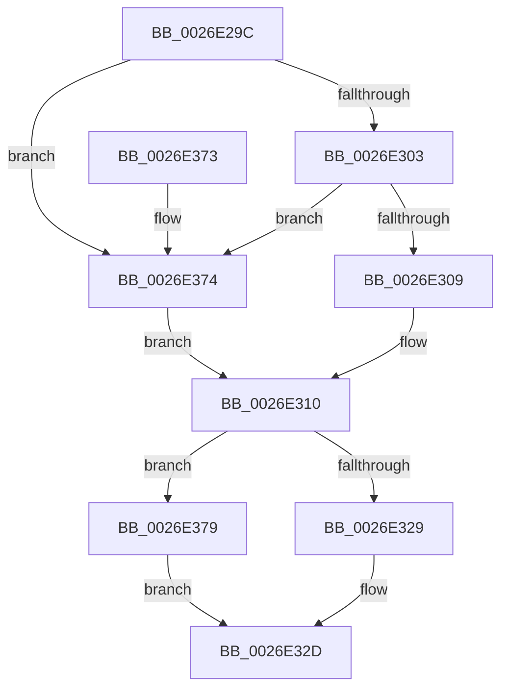

# PnpDiagnosticTraceDriverFullInfo

- RVA: `0x0026E29C`–`0x0026E37E` (길이 `226` bytes)
- VA: `0x000000014026E29C`
- 실행 섹션: `.text`
- PDB 이름 있음: `예`; PDB Function 태그: `아니요`
- unwind 정보 RVA: `0x000656E0`
- 디코드: `59`개 명령, `226/226` bytes 표시
- 미해석 바이트: `0` (있으면 어셈블리에 `.byte`로 보존)

> 이 문서는 커널 이미지의 기계어와 PDB 기호를 분석해 생성했습니다. 4번과 5번은 함수 원형과 자료형을 바이너리 사용 방식에서 추정한 C 해석이며 원본 소스 복구 결과는 아닙니다.

## 1. Dependencies

- 직접 호출 지점: **2**; 고유 호출 대상: **2**
- 직접 호출자로 확인된 함수: **1**
- RIP 상대 이미지 참조: **1**

### Outgoing calls
- `0x0026E359` → [PnpDiagnosticTrace](PnpDiagnosticTrace_function_0026E384.md) (function, `0x0026E384`)
- `0x0026E365` → [_security_check_cookie](../6A/_security_check_cookie_function_006AC640.md) (function, `0x006AC640`)

### Direct callers
- [IopUnloadDriver](../../page/AB/IopUnloadDriver_function_00ABF868.md) at `0x00ABFCA6`

### Static image references
- `0x0026E2AE` → RVA `0x00E0A740` (`.data`; read)

## 2. Other-region calls and transfers

- 다른 실행 섹션으로 향하는 call: **0**
- 별도 외부 분기/꼬리 이동을 확인하지 못했습니다.

## 3. Assembly (complete function range)

```asm
0026E29C  44 89 44 24 18                  mov dword ptr [rsp + 0x18], r8d
0026E2A1  55                              push rbp
0026E2A2  48 8D 6C 24 B1                  lea rbp, [rsp - 0x4f]
0026E2A7  48 81 EC A0 00 00 00            sub rsp, 0xa0
0026E2AE  48 8B 05 8B C4 B9 00            mov rax, qword ptr [rip + 0xb9c48b]
0026E2B5  48 33 C4                        xor rax, rsp
0026E2B8  48 89 45 3F                     mov qword ptr [rbp + 0x3f], rax
0026E2BC  45 33 C0                        xor r8d, r8d
0026E2BF  48 C7 45 E7 02 00 00 00         mov qword ptr [rbp - 0x19], 2
0026E2C7  4C 8B D1                        mov r10, rcx
0026E2CA  44 89 45 FB                     mov dword ptr [rbp - 5], r8d
0026E2CE  0F B7 0A                        movzx ecx, word ptr [rdx]
0026E2D1  0F B7 C1                        movzx eax, cx
0026E2D4  89 4D F7                        mov dword ptr [rbp - 9], ecx
0026E2D7  66 D1 E8                        shr ax, 1
0026E2DA  66 89 45 CF                     mov word ptr [rbp - 0x31], ax
0026E2DE  48 8D 45 CF                     lea rax, [rbp - 0x31]
0026E2E2  48 89 45 DF                     mov qword ptr [rbp - 0x21], rax
0026E2E6  48 8B 42 08                     mov rax, qword ptr [rdx + 8]
0026E2EA  48 89 45 EF                     mov qword ptr [rbp - 0x11], rax
0026E2EE  48 8D 45 6F                     lea rax, [rbp + 0x6f]
0026E2F2  48 89 45 FF                     mov qword ptr [rbp - 1], rax
0026E2F6  48 C7 45 07 04 00 00 00         mov qword ptr [rbp + 7], 4
0026E2FE  4D 85 C9                        test r9, r9
0026E301  74 71                           je 0x14026e374
0026E303  4D 39 41 08                     cmp qword ptr [r9 + 8], r8
0026E307  74 6B                           je 0x14026e374
0026E309  41 0F B7 09                     movzx ecx, word ptr [r9]
0026E30D  66 D1 E9                        shr cx, 1
0026E310  66 89 4D D3                     mov word ptr [rbp - 0x2d], cx
0026E314  48 8D 55 D3                     lea rdx, [rbp - 0x2d]
0026E318  48 89 55 0F                     mov qword ptr [rbp + 0xf], rdx
0026E31C  48 C7 45 17 02 00 00 00         mov qword ptr [rbp + 0x17], 2
0026E324  4D 85 C9                        test r9, r9
0026E327  74 50                           je 0x14026e379
0026E329  49 8B 51 08                     mov rdx, qword ptr [r9 + 8]
0026E32D  0F B7 C1                        movzx eax, cx
0026E330  49 8B CA                        mov rcx, r10
0026E333  03 C0                           add eax, eax
0026E335  48 89 55 1F                     mov qword ptr [rbp + 0x1f], rdx
0026E339  89 45 27                        mov dword ptr [rbp + 0x27], eax
0026E33C  BA 06 00 00 00                  mov edx, 6
0026E341  48 8D 45 7F                     lea rax, [rbp + 0x7f]
0026E345  44 89 45 2B                     mov dword ptr [rbp + 0x2b], r8d
0026E349  4C 8D 45 DF                     lea r8, [rbp - 0x21]
0026E34D  48 89 45 2F                     mov qword ptr [rbp + 0x2f], rax
0026E351  48 C7 45 37 04 00 00 00         mov qword ptr [rbp + 0x37], 4
0026E359  E8 26 00 00 00                  call 0x14026e384
0026E35E  48 8B 4D 3F                     mov rcx, qword ptr [rbp + 0x3f]
0026E362  48 33 CC                        xor rcx, rsp
0026E365  E8 D6 E2 43 00                  call 0x1406ac640
0026E36A  48 81 C4 A0 00 00 00            add rsp, 0xa0
0026E371  5D                              pop rbp
0026E372  C3                              ret
0026E373  CC                              int3
0026E374  41 8B C8                        mov ecx, r8d
0026E377  EB 97                           jmp 0x14026e310
0026E379  49 8B D0                        mov rdx, r8
0026E37C  EB AF                           jmp 0x14026e32d
```

## 4. C-style interpretation (structured pseudocode)

```c
__int64 __fastcall PnpDiagnosticTraceDriverFullInfo(__int64 a1, __int64 a2, int a3, __int64 a4, __int64 a5)
{
    __int64 result;
    __int64 v_rsp;
    unsigned __int64 v_stack_m18;
    unsigned __int64 v_stack_m20;
    unsigned __int64 v_stack_m28;
    unsigned int v_stack_m2C;
    unsigned int v_stack_m30;
    unsigned __int64 v_stack_m38;
    unsigned __int64 v_stack_m40;
    unsigned __int64 v_stack_m48;
    unsigned __int64 v_stack_m50;
    unsigned __int64 v_stack_m57;
    unsigned __int64 v_stack_m58;
    unsigned int v_stack_m5C;
    unsigned int v_stack_m60;
    unsigned __int64 v_stack_m68;
    unsigned __int64 v_stack_m70;
    unsigned __int64 v_stack_m78;
    unsigned __int16 v_stack_m84;
    unsigned __int16 v_stack_m88;
    unsigned int v_stack_p18;

    v_stack_p18 = a3;
    v_rsp = (v_rsp) - (160);
    result = (*(unsigned __int64 *)(v_rip + 12174475)) ^ (v_rsp);
    v_stack_m18 = result;
    a3 = 0;
    v_stack_m70 = 2;
    v_stack_m5C = 0;
    v_stack_m60 = (unsigned int)(*(unsigned __int16 *)(a2));
    result = (unsigned __int16)(((unsigned __int16)(*(unsigned __int16 *)(a2))) >> (1));
    v_stack_m88 = (unsigned __int16)(result);
    v_stack_m78 = v_stack_m88;
    v_stack_m68 = *(unsigned __int64 *)(a2 + 8);
    v_stack_m58 = v_stack_p18;
    v_stack_m50 = 4;
    if (a4 == 0) goto loc_0026E374;
    if ((*(unsigned __int64 *)(a4 + 8)) == 0) goto loc_0026E374;
    a1 = (unsigned __int16)((*(unsigned __int16 *)(a4)) >> (1));
loc_0026E310:
    v_stack_m84 = (unsigned __int16)(a1);
    v_stack_m48 = v_stack_m84;
    v_stack_m40 = 2;
    if (a4 == 0) goto loc_0026E379;
loc_0026E32D:
    result = (unsigned int)(((unsigned __int16)(a1)) + ((unsigned int)((unsigned __int16)(a1))));
    v_stack_m38 = *(unsigned __int64 *)(a4 + 8);
    v_stack_m30 = (unsigned int)(result);
    v_stack_m2C = 0;
    v_stack_m28 = a5;
    v_stack_m20 = 4;
    result = PnpDiagnosticTrace(a1, 6, v_stack_m78, a4);
    a1 = (v_stack_m18) ^ (v_rsp);
    result = _security_check_cookie(a1, 6, v_stack_m78, a4);
    v_rsp = (v_rsp) + (160);
    return result;
loc_0026E374:
    goto loc_0026E310;
loc_0026E379:
    goto loc_0026E32D;
}
```

## 5. (Beta) C Style

```c
int64_t PnpDiagnosticTraceDriverFullInfo(int64_t Arg1, void *Arg2, int32_t Arg3, int64_t Arg4, int64_t Arg5)
{
    uint8_t *arg2 = (uint8_t *)Arg2;

    int64_t result;
    int64_t local_rsp;
    uint64_t v_stack_m18;
    uint64_t v_stack_m20;
    uint64_t v_stack_m28;
    uint32_t v_stack_m2C;
    uint32_t v_stack_m30;
    uint64_t v_stack_m38;
    uint64_t v_stack_m40;
    uint64_t v_stack_m48;
    uint64_t v_stack_m50;
    uint64_t v_stack_m57;
    uint64_t v_stack_m58;
    uint32_t v_stack_m5C;
    uint32_t v_stack_m60;
    uint64_t v_stack_m68;
    uint64_t v_stack_m70;
    uint64_t v_stack_m78;
    uint16_t v_stack_m84;
    uint16_t v_stack_m88;
    uint32_t v_stack_p18;

    v_stack_p18 = Arg3;
    local_rsp = (local_rsp) - (160);
    result = (*(uint64_t *)(v_rip + 0xB9C48B)) ^ (local_rsp);
    v_stack_m18 = result;
    Arg3 = 0;
    v_stack_m70 = 2;
    v_stack_m5C = 0;
    v_stack_m60 = (uint32_t)(*(uint16_t *)(arg2));
    result = (uint16_t)(((uint16_t)(*(uint16_t *)(arg2))) >> (1));
    v_stack_m88 = (uint16_t)(result);
    v_stack_m78 = v_stack_m88;
    v_stack_m68 = *(uint64_t *)(arg2 + 0x8);
    v_stack_m58 = v_stack_p18;
    v_stack_m50 = 4;
    if (Arg4 == 0) goto loc_0026E374;
    if ((*(uint64_t *)(Arg4 + 0x8)) == 0) goto loc_0026E374;
    Arg1 = (uint16_t)((*(uint16_t *)(Arg4)) >> (1));
loc_0026E310:
    v_stack_m84 = (uint16_t)(Arg1);
    v_stack_m48 = v_stack_m84;
    v_stack_m40 = 2;
    if (Arg4 == 0) goto loc_0026E379;
loc_0026E32D:
    result = (uint32_t)(((uint16_t)(Arg1)) + ((uint32_t)((uint16_t)(Arg1))));
    v_stack_m38 = *(uint64_t *)(Arg4 + 0x8);
    v_stack_m30 = (uint32_t)(result);
    v_stack_m2C = 0;
    v_stack_m28 = Arg5;
    v_stack_m20 = 4;
    result = PnpDiagnosticTrace(Arg1, 6, v_stack_m78, Arg4);
    Arg1 = (v_stack_m18) ^ (local_rsp);
    result = _security_check_cookie(Arg1, 6, v_stack_m78, Arg4);
    local_rsp = (local_rsp) + (160);
    return result;
loc_0026E374:
    goto loc_0026E310;
loc_0026E379:
    goto loc_0026E32D;
}
```

### 관측된 메모리 오프셋

구조체 형식이 확인되지 않은 접근은 인자 기준의 오프셋으로만 기록했습니다.

| 기준 인자 | 오프셋 표현 | 폭 (bit) | 접근 |
|---|---:|---:|---|
| `Arg2` | `+ 0x0` | `16` | `R` |
| `Arg2` | `+ 0x8` | `64` | `R` |

## 6. Execution-region graph

[열기: 2D/3D 그래프와 함수 탐색 컨트롤 패널](../../../control-panel.html?section=text&rva=0x0026E29C&view=graph)

- 2D 그래프는 위에서 아래로 흐르고, 3D 그래프는 빈 공간을 드래그해 회전합니다. Shift+드래그는 이동, 휠은 확대·축소, 함수 노드 선택은 대상 보고서 이동입니다.

### Static fallback


