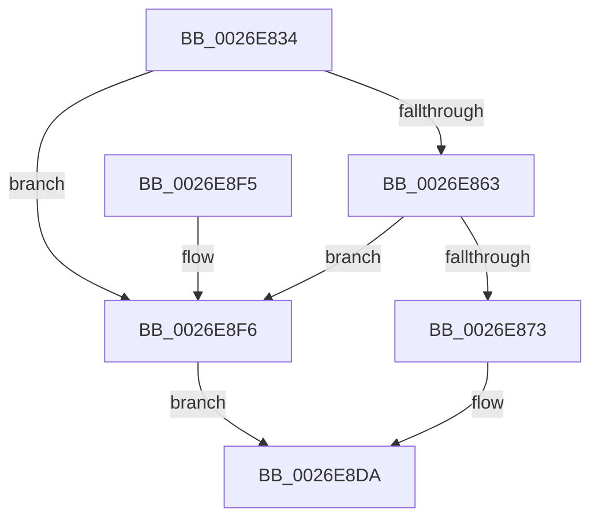

# PnpDiagnosticTraceObject

- RVA: `0x0026E834`–`0x0026E8FA` (길이 `198` bytes)
- VA: `0x000000014026E834`
- 실행 섹션: `.text`
- PDB 이름 있음: `예`; PDB Function 태그: `아니요`
- unwind 정보 RVA: `0x00065768`
- 디코드: `48`개 명령, `198/198` bytes 표시
- 미해석 바이트: `0` (있으면 어셈블리에 `.byte`로 보존)

> 이 문서는 커널 이미지의 기계어와 PDB 기호를 분석해 생성했습니다. 4번과 5번은 함수 원형과 자료형을 바이너리 사용 방식에서 추정한 C 해석이며 원본 소스 복구 결과는 아닙니다.

## 1. Dependencies

- 직접 호출 지점: **3**; 고유 호출 대상: **3**
- 직접 호출자로 확인된 함수: **13**
- RIP 상대 이미지 참조: **2**

### Outgoing calls
- `0x0026E866` → [EtwEventEnabled](../39/EtwEventEnabled_function_00392450.md) (function, `0x00392450`)
- `0x0026E8D5` → [EtwWriteEx](../25/EtwWriteEx_function_0025F0D0.md) (function, `0x0025F0D0`)
- `0x0026E8E2` → [_security_check_cookie](../6A/_security_check_cookie_function_006AC640.md) (function, `0x006AC640`)

### Direct callers
- [PnpDeviceCompletionRoutine](PnpDeviceCompletionRoutine_function_0026E6C0.md) at `0x0026E727`
- [PnpRebalance](../../page/73/PnpRebalance_function_0073F508.md) at `0x0073F59D`
- [PipEnumerateDevice](../../page/8F/PipEnumerateDevice_function_008F99E4.md) at `0x008F9A74`
- [PipEnumerateDevice](../../page/8F/PipEnumerateDevice_function_008F99E4.md) at `0x008F9AE3`
- [PipEnumerateDevice](../../page/8F/PipEnumerateDevice_function_008F99E4.md) at `0x008F9B48`
- [PipEnumerateDevice](../../page/8F/PipEnumerateDevice_function_008F99E4.md) at `0x008F9B71`
- [PipEnumerateDevice](../../page/8F/PipEnumerateDevice_function_008F99E4.md) at `0x008F9B85`
- [PnpStartDeviceNode](../../page/8F/PnpStartDeviceNode_function_008FE38C.md) at `0x008FE41D`
- [PnpStartDeviceNode](../../page/8F/PnpStartDeviceNode_function_008FE38C.md) at `0x008FE50E`
- [PnpStartDeviceNode](../../page/8F/PnpStartDeviceNode_function_008FE38C.md) at `0x008FE559`
- [PnpQueueQueryAndRemoveEvent](../../page/94/PnpQueueQueryAndRemoveEvent_function_0094FD2C.md) at `0x00950005`
- [PiDevCfgProcessDevice](../../page/97/PiDevCfgProcessDevice_function_00976D34.md) at `0x00976DDB`
- [IopLoadDriver](../../page/99/IopLoadDriver_function_00997B54.md) at `0x00997D23`
- [IopLoadDriver](../../page/99/IopLoadDriver_function_00997B54.md) at `0x0099822E`
- [PiDrvDbLoadNodeWorkerCallback](../../page/A9/PiDrvDbLoadNodeWorkerCallback_function_00A91D40.md) at `0x00A91D75`
- [PiDrvDbLoadNodeWorkerCallback](../../page/A9/PiDrvDbLoadNodeWorkerCallback_function_00A91D40.md) at `0x00A91D84`
- [PiDrvDbUnloadNodeWorkerCallback](../../page/AA/PiDrvDbUnloadNodeWorkerCallback_function_00AAE570.md) at `0x00AAE5D6`
- [PiDrvDbUnloadNodeWorkerCallback](../../page/AA/PiDrvDbUnloadNodeWorkerCallback_function_00AAE570.md) at `0x00AAE5F7`
- [IopUnloadDriver](../../page/AB/IopUnloadDriver_function_00ABF868.md) at `0x00ABF9C4`
- [PnpEarlyLaunchImageNotificationPostProcess](../../init/C3/PnpEarlyLaunchImageNotificationPostProcess_function_00C32C40.md) at `0x00C32C60`
- [PnpEarlyLaunchImageNotificationPreProcess](../../init/C3/PnpEarlyLaunchImageNotificationPreProcess_function_00C32D10.md) at `0x00C32DAD`
- [PnpInitializeBootStartDriver](../../init/C7/PnpInitializeBootStartDriver_function_00C760F0.md) at `0x00C761F0`

### Static image references
- `0x0026E83E` → RVA `0x00E0A740` (`.data`; read)
- `0x0026E853` → RVA `0x00E662D8` (`.data`; read)

## 2. Other-region calls and transfers

- 다른 실행 섹션으로 향하는 call: **0**
- 별도 외부 분기/꼬리 이동을 확인하지 못했습니다.

## 3. Assembly (complete function range)

```asm
0026E834  48 89 5C 24 10                  mov qword ptr [rsp + 0x10], rbx
0026E839  57                              push rdi
0026E83A  48 83 EC 70                     sub rsp, 0x70
0026E83E  48 8B 05 FB BE B9 00            mov rax, qword ptr [rip + 0xb9befb]
0026E845  48 33 C4                        xor rax, rsp
0026E848  48 89 44 24 68                  mov qword ptr [rsp + 0x68], rax
0026E84D  48 8B D9                        mov rbx, rcx
0026E850  48 8B FA                        mov rdi, rdx
0026E853  48 8B 0D 7E 7A BF 00            mov rcx, qword ptr [rip + 0xbf7a7e]
0026E85A  48 85 C9                        test rcx, rcx
0026E85D  0F 84 93 00 00 00               je 0x14026e8f6
0026E863  48 8B D3                        mov rdx, rbx
0026E866  E8 E5 3B 12 00                  call 0x140392450
0026E86B  84 C0                           test al, al
0026E86D  0F 84 83 00 00 00               je 0x14026e8f6
0026E873  0F B7 0F                        movzx ecx, word ptr [rdi]
0026E876  BA 02 00 00 00                  mov edx, 2
0026E87B  83 64 24 54 00                  and dword ptr [rsp + 0x54], 0
0026E880  0F B7 C1                        movzx eax, cx
0026E883  83 64 24 64 00                  and dword ptr [rsp + 0x64], 0
0026E888  45 33 C9                        xor r9d, r9d
0026E88B  66 D1 E8                        shr ax, 1
0026E88E  45 33 C0                        xor r8d, r8d
0026E891  66 89 44 24 40                  mov word ptr [rsp + 0x40], ax
0026E896  48 8D 44 24 40                  lea rax, [rsp + 0x40]
0026E89B  48 89 44 24 48                  mov qword ptr [rsp + 0x48], rax
0026E8A0  48 8B 47 08                     mov rax, qword ptr [rdi + 8]
0026E8A4  48 89 44 24 58                  mov qword ptr [rsp + 0x58], rax
0026E8A9  48 8D 44 24 48                  lea rax, [rsp + 0x48]
0026E8AE  48 89 44 24 38                  mov qword ptr [rsp + 0x38], rax
0026E8B3  89 54 24 30                     mov dword ptr [rsp + 0x30], edx
0026E8B7  48 83 64 24 28 00               and qword ptr [rsp + 0x28], 0
0026E8BD  48 83 64 24 20 00               and qword ptr [rsp + 0x20], 0
0026E8C3  89 54 24 50                     mov dword ptr [rsp + 0x50], edx
0026E8C7  48 8B D3                        mov rdx, rbx
0026E8CA  89 4C 24 60                     mov dword ptr [rsp + 0x60], ecx
0026E8CE  48 8B 0D 03 7A BF 00            mov rcx, qword ptr [rip + 0xbf7a03]
0026E8D5  E8 F6 07 FF FF                  call 0x14025f0d0
0026E8DA  48 8B 4C 24 68                  mov rcx, qword ptr [rsp + 0x68]
0026E8DF  48 33 CC                        xor rcx, rsp
0026E8E2  E8 59 DD 43 00                  call 0x1406ac640
0026E8E7  48 8B 9C 24 88 00 00 00         mov rbx, qword ptr [rsp + 0x88]
0026E8EF  48 83 C4 70                     add rsp, 0x70
0026E8F3  5F                              pop rdi
0026E8F4  C3                              ret
0026E8F5  CC                              int3
0026E8F6  33 C0                           xor eax, eax
0026E8F8  EB E0                           jmp 0x14026e8da
```

## 4. C-style interpretation (structured pseudocode)

```c
__int64 __fastcall PnpDiagnosticTraceObject(__int64 a1, __int64 a2, int a3, int a4)
{
    __int64 result;
    __int64 v_rsp;
    unsigned __int64 v_stack_m10;
    unsigned int v_stack_m14;
    unsigned int v_stack_m18;
    unsigned __int64 v_stack_m20;
    unsigned int v_stack_m24;
    unsigned int v_stack_m28;
    unsigned __int64 v_stack_m30;
    unsigned __int16 v_stack_m38;
    unsigned __int64 v_stack_m40;
    unsigned int v_stack_m48;
    unsigned __int64 v_stack_m50;
    unsigned __int64 v_stack_m58;
    unsigned __int64 v_stack_p10;

    v_stack_p10 = v_rbx;
    v_rsp = (v_rsp) - (112);
    result = (*(unsigned __int64 *)(v_rip + 12173051)) ^ (v_rsp);
    v_stack_m10 = result;
    if (*(unsigned __int64 *)(v_rip + 12548734) == 0) goto loc_0026E8F6;
    result = EtwEventEnabled(*(unsigned __int64 *)(v_rip + 12548734), a1, a3, a4);
    if ((unsigned __int8)(result) == 0) goto loc_0026E8F6;
    a4 = 0;
    result = (unsigned __int16)(((unsigned __int16)(*(unsigned __int16 *)(a2))) >> (1));
    a3 = 0;
    v_stack_m38 = (unsigned __int16)(result);
    v_stack_m30 = v_stack_m38;
    v_stack_m20 = *(unsigned __int64 *)(a2 + 8);
    v_stack_m40 = v_stack_m30;
    v_stack_m48 = 2;
    v_stack_m28 = 2;
    v_stack_m18 = (unsigned int)(*(unsigned __int16 *)(a2));
    result = EtwWriteEx(*(unsigned __int64 *)(v_rip + 12548611), a1, a3, a4);
loc_0026E8DA:
    a1 = (v_stack_m10) ^ (v_rsp);
    result = _security_check_cookie(a1, a1, a3, a4);
    v_rsp = (v_rsp) + (112);
    return result;
loc_0026E8F6:
    result = 0;
    goto loc_0026E8DA;
}
```

## 5. (Beta) C Style

```c
int64_t PnpDiagnosticTraceObject(int64_t Arg1, void *Arg2, int32_t Arg3, int32_t Arg4)
{
    uint8_t *arg2 = (uint8_t *)Arg2;

    int64_t result;
    int64_t local_rsp;
    uint64_t v_stack_m10;
    uint32_t v_stack_m14;
    uint32_t v_stack_m18;
    uint64_t v_stack_m20;
    uint32_t v_stack_m24;
    uint32_t v_stack_m28;
    uint64_t v_stack_m30;
    uint16_t v_stack_m38;
    uint64_t v_stack_m40;
    uint32_t v_stack_m48;
    uint64_t v_stack_m50;
    uint64_t v_stack_m58;
    uint64_t v_stack_p10;

    v_stack_p10 = local_rbx;
    local_rsp = (local_rsp) - (112);
    result = (*(uint64_t *)(v_rip + 0xB9BEFB)) ^ (local_rsp);
    v_stack_m10 = result;
    if (*(uint64_t *)(v_rip + 0xBF7A7E) == 0) goto loc_0026E8F6;
    result = EtwEventEnabled(*(uint64_t *)(v_rip + 0xBF7A7E), Arg1, Arg3, Arg4);
    if ((uint8_t)(result) == 0) goto loc_0026E8F6;
    Arg4 = 0;
    result = (uint16_t)(((uint16_t)(*(uint16_t *)(arg2))) >> (1));
    Arg3 = 0;
    v_stack_m38 = (uint16_t)(result);
    v_stack_m30 = v_stack_m38;
    v_stack_m20 = *(uint64_t *)(arg2 + 0x8);
    v_stack_m40 = v_stack_m30;
    v_stack_m48 = 2;
    v_stack_m28 = 2;
    v_stack_m18 = (uint32_t)(*(uint16_t *)(arg2));
    result = EtwWriteEx(*(uint64_t *)(v_rip + 0xBF7A03), Arg1, Arg3, Arg4);
loc_0026E8DA:
    Arg1 = (v_stack_m10) ^ (local_rsp);
    result = _security_check_cookie(Arg1, Arg1, Arg3, Arg4);
    local_rsp = (local_rsp) + (112);
    return result;
loc_0026E8F6:
    result = 0;
    goto loc_0026E8DA;
}
```

### 관측된 메모리 오프셋

구조체 형식이 확인되지 않은 접근은 인자 기준의 오프셋으로만 기록했습니다.

| 기준 인자 | 오프셋 표현 | 폭 (bit) | 접근 |
|---|---:|---:|---|
| `Arg2` | `+ 0x0` | `16` | `R` |
| `Arg2` | `+ 0x8` | `64` | `R` |

## 6. Execution-region graph

[열기: 2D/3D 그래프와 함수 탐색 컨트롤 패널](../../../control-panel.html?section=text&rva=0x0026E834&view=graph)

- 2D 그래프는 위에서 아래로 흐르고, 3D 그래프는 빈 공간을 드래그해 회전합니다. Shift+드래그는 이동, 휠은 확대·축소, 함수 노드 선택은 대상 보고서 이동입니다.

### Static fallback


