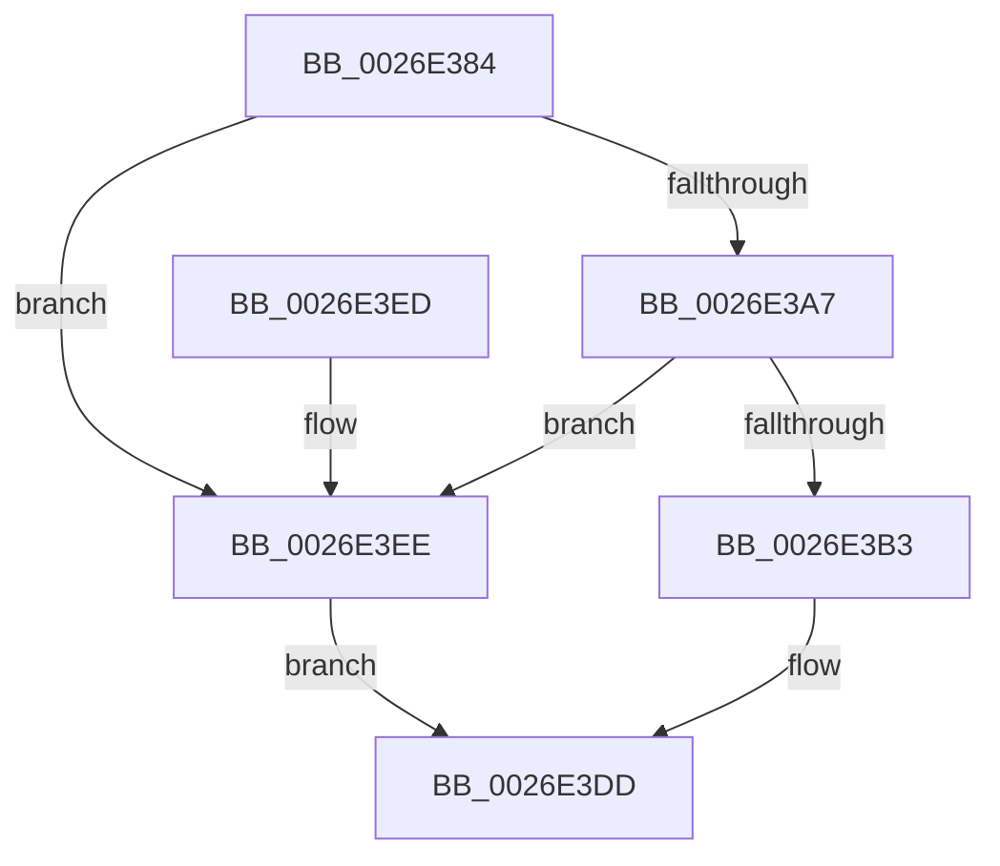

# PnpDiagnosticTrace

- RVA: `0x0026E384`–`0x0026E3F2` (길이 `110` bytes)
- VA: `0x000000014026E384`
- 실행 섹션: `.text`
- PDB 이름 있음: `예`; PDB Function 태그: `아니요`
- unwind 정보 RVA: `0x000656F8`
- 디코드: `31`개 명령, `110/110` bytes 표시
- 미해석 바이트: `0` (있으면 어셈블리에 `.byte`로 보존)

> 이 문서는 커널 이미지의 기계어와 PDB 기호를 분석해 생성했습니다. 4번과 5번은 함수 원형과 자료형을 바이너리 사용 방식에서 추정한 C 해석이며 원본 소스 복구 결과는 아닙니다.

## 1. Dependencies

- 직접 호출 지점: **2**; 고유 호출 대상: **2**
- 직접 호출자로 확인된 함수: **9**
- RIP 상대 이미지 참조: **1**

### Outgoing calls
- `0x0026E3AA` → [EtwEventEnabled](../39/EtwEventEnabled_function_00392450.md) (function, `0x00392450`)
- `0x0026E3D8` → [EtwWriteEx](../25/EtwWriteEx_function_0025F0D0.md) (function, `0x0025F0D0`)

### Direct callers
- [PnpDiagnosticTraceDeviceOperation](PnpDiagnosticTraceDeviceOperation_function_0026E1B8.md) at `0x0026E26F`
- [PnpDiagnosticTraceDriverFullInfo](PnpDiagnosticTraceDriverFullInfo_function_0026E29C.md) at `0x0026E359`
- [PnpCompleteSystemStartProcess](../5A/PnpCompleteSystemStartProcess_function_005A6F2C.md) at `0x005A6F3C`
- [PnpCompleteSystemStartProcess](../5A/PnpCompleteSystemStartProcess_function_005A6F2C.md) at `0x005A6F4D`
- [PnpCompleteSystemStartProcess](../5A/PnpCompleteSystemStartProcess_function_005A6F2C.md) at `0x005A6F65`
- [PnpCompleteSystemStartProcess](../5A/PnpCompleteSystemStartProcess_function_005A6F2C.md) at `0x005A6F9D`
- [PnpDiagnosticTraceAppVeto](../5A/PnpDiagnosticTraceAppVeto_function_005A86FC.md) at `0x005A8828`
- [PiProcessStartSystemDevices](../../page/72/PiProcessStartSystemDevices_function_0072D7D4.md) at `0x0072D7EF`
- [PiProcessStartSystemDevices](../../page/72/PiProcessStartSystemDevices_function_0072D7D4.md) at `0x0072D840`
- [IopCallBootDriverReinitializationRoutines](../../init/C2/IopCallBootDriverReinitializationRoutines_function_00C2D9F0.md) at `0x00C2DA09`
- [IopCallBootDriverReinitializationRoutines](../../init/C2/IopCallBootDriverReinitializationRoutines_function_00C2D9F0.md) at `0x00C2DA90`
- [IopInitializeBootDrivers](../../init/C2/IopInitializeBootDrivers_function_00C2E6F4.md) at `0x00C2E787`
- [IopInitializeBootDrivers](../../init/C2/IopInitializeBootDrivers_function_00C2E6F4.md) at `0x00C2F04E`
- [IopInitializePlugPlayServices](../../init/C2/IopInitializePlugPlayServices_function_00C2F298.md) at `0x00C2FFC9`
- [IopInitializeSystemDrivers](../../init/C7/IopInitializeSystemDrivers_function_00C73590.md) at `0x00C735CF`
- [IopInitializeSystemDrivers](../../init/C7/IopInitializeSystemDrivers_function_00C73590.md) at `0x00C737EA`

### Static image references
- `0x0026E399` → RVA `0x00E662D8` (`.data`; read)

## 2. Other-region calls and transfers

- 다른 실행 섹션으로 향하는 call: **0**
- 별도 외부 분기/꼬리 이동을 확인하지 못했습니다.

## 3. Assembly (complete function range)

```asm
0026E384  48 89 5C 24 08                  mov qword ptr [rsp + 8], rbx
0026E389  48 89 74 24 10                  mov qword ptr [rsp + 0x10], rsi
0026E38E  57                              push rdi
0026E38F  48 83 EC 40                     sub rsp, 0x40
0026E393  48 8B D9                        mov rbx, rcx
0026E396  49 8B F8                        mov rdi, r8
0026E399  48 8B 0D 38 7F BF 00            mov rcx, qword ptr [rip + 0xbf7f38]
0026E3A0  8B F2                           mov esi, edx
0026E3A2  48 85 C9                        test rcx, rcx
0026E3A5  74 47                           je 0x14026e3ee
0026E3A7  48 8B D3                        mov rdx, rbx
0026E3AA  E8 A1 40 12 00                  call 0x140392450
0026E3AF  84 C0                           test al, al
0026E3B1  74 3B                           je 0x14026e3ee
0026E3B3  48 8B 0D 1E 7F BF 00            mov rcx, qword ptr [rip + 0xbf7f1e]
0026E3BA  45 33 C9                        xor r9d, r9d
0026E3BD  48 89 7C 24 38                  mov qword ptr [rsp + 0x38], rdi
0026E3C2  45 33 C0                        xor r8d, r8d
0026E3C5  89 74 24 30                     mov dword ptr [rsp + 0x30], esi
0026E3C9  48 8B D3                        mov rdx, rbx
0026E3CC  48 83 64 24 28 00               and qword ptr [rsp + 0x28], 0
0026E3D2  48 83 64 24 20 00               and qword ptr [rsp + 0x20], 0
0026E3D8  E8 F3 0C FF FF                  call 0x14025f0d0
0026E3DD  48 8B 5C 24 50                  mov rbx, qword ptr [rsp + 0x50]
0026E3E2  48 8B 74 24 58                  mov rsi, qword ptr [rsp + 0x58]
0026E3E7  48 83 C4 40                     add rsp, 0x40
0026E3EB  5F                              pop rdi
0026E3EC  C3                              ret
0026E3ED  CC                              int3
0026E3EE  33 C0                           xor eax, eax
0026E3F0  EB EB                           jmp 0x14026e3dd
```

## 4. C-style interpretation (structured pseudocode)

```c
__int64 __fastcall PnpDiagnosticTrace(__int64 a1, int a2, __int64 a3, int a4)
{
    __int64 result;
    __int64 v_rsp;
    unsigned __int64 v_stack_m10;
    unsigned int v_stack_m18;
    unsigned __int64 v_stack_m20;
    unsigned __int64 v_stack_m28;
    unsigned __int64 v_stack_p10;
    unsigned __int64 v_stack_p8;

    v_stack_p8 = v_rbx;
    v_stack_p10 = v_rsi;
    v_rsp = (v_rsp) - (64);
    if (*(unsigned __int64 *)(v_rip + 12549944) == 0) goto loc_0026E3EE;
    result = EtwEventEnabled(*(unsigned __int64 *)(v_rip + 12549944), a1, a3, a4);
    if ((unsigned __int8)(result) == 0) goto loc_0026E3EE;
    a4 = 0;
    v_stack_m10 = a3;
    a3 = 0;
    v_stack_m18 = (unsigned int)((unsigned int)(a2));
    result = EtwWriteEx(*(unsigned __int64 *)(v_rip + 12549918), a1, a3, a4);
loc_0026E3DD:
    v_rsp = (v_rsp) + (64);
    return result;
loc_0026E3EE:
    result = 0;
    goto loc_0026E3DD;
}
```

## 5. (Beta) C Style

```c
int64_t PnpDiagnosticTrace(int64_t Arg1, int32_t Arg2, int64_t Arg3, int32_t Arg4)
{
    int64_t result;
    int64_t local_rsp;
    uint64_t v_stack_m10;
    uint32_t v_stack_m18;
    uint64_t v_stack_m20;
    uint64_t v_stack_m28;
    uint64_t v_stack_p10;
    uint64_t v_stack_p8;

    v_stack_p8 = local_rbx;
    v_stack_p10 = local_rsi;
    local_rsp = (local_rsp) - (64);
    if (*(uint64_t *)(v_rip + 0xBF7F38) == 0) goto loc_0026E3EE;
    result = EtwEventEnabled(*(uint64_t *)(v_rip + 0xBF7F38), Arg1, Arg3, Arg4);
    if ((uint8_t)(result) == 0) goto loc_0026E3EE;
    Arg4 = 0;
    v_stack_m10 = Arg3;
    Arg3 = 0;
    v_stack_m18 = (uint32_t)((uint32_t)(Arg2));
    result = EtwWriteEx(*(uint64_t *)(v_rip + 0xBF7F1E), Arg1, Arg3, Arg4);
loc_0026E3DD:
    local_rsp = (local_rsp) + (64);
    return result;
loc_0026E3EE:
    result = 0;
    goto loc_0026E3DD;
}
```

## 6. Execution-region graph

[열기: 2D/3D 그래프와 함수 탐색 컨트롤 패널](../../../control-panel.html?section=text&rva=0x0026E384&view=graph)

- 2D 그래프는 위에서 아래로 흐르고, 3D 그래프는 빈 공간을 드래그해 회전합니다. Shift+드래그는 이동, 휠은 확대·축소, 함수 노드 선택은 대상 보고서 이동입니다.

### Static fallback


