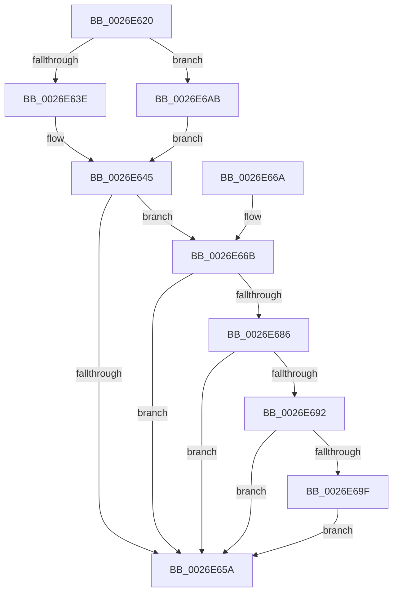

# PoFxNotifySurprisePowerOn

- RVA: `0x0026E620`–`0x0026E6AD` (길이 `141` bytes)
- VA: `0x000000014026E620`
- 실행 섹션: `.text`
- PDB 이름 있음: `예`; PDB Function 태그: `아니요`
- unwind 정보 RVA: `0x00065734`
- 디코드: `40`개 명령, `141/141` bytes 표시
- 미해석 바이트: `0` (있으면 어셈블리에 `.byte`로 보존)

> 이 문서는 커널 이미지의 기계어와 PDB 기호를 분석해 생성했습니다. 4번과 5번은 함수 원형과 자료형을 바이너리 사용 방식에서 추정한 C 해석이며 원본 소스 복구 결과는 아닙니다.

## 1. Dependencies

- 직접 호출 지점: **4**; 고유 호출 대상: **4**
- 직접 호출자로 확인된 함수: **1**
- RIP 상대 이미지 참조: **0**

### Outgoing calls
- `0x0026E64D` → [PopFxLockDevice](PopFxLockDevice_function_0026F950.md) (function, `0x0026F950`)
- `0x0026E66F` → [PopPepSurprisePowerOn](PopPepSurprisePowerOn_function_0026E480.md) (function, `0x0026E480`)
- `0x0026E67C` → [PopFxDereferenceDevice](../27/PopFxDereferenceDevice_function_0027038C.md) (function, `0x0027038C`)
- `0x0026E6A4` → [PopDirectedDripsStartDisengageTimer](../5D/PopDirectedDripsStartDisengageTimer_function_005D1230.md) (function, `0x005D1230`)

### Direct callers
- [DifPoFxNotifySurprisePowerOnWrapper](../63/DifPoFxNotifySurprisePowerOnWrapper_function_00639550.md) at `0x00639616`

### Static image references
- 디코드된 RIP-relative 메모리 참조가 없습니다.

## 2. Other-region calls and transfers

- 다른 실행 섹션으로 향하는 call: **0**
- 별도 외부 분기/꼬리 이동을 확인하지 못했습니다.

## 3. Assembly (complete function range)

```asm
0026E620  48 89 5C 24 08                  mov qword ptr [rsp + 8], rbx
0026E625  48 89 74 24 10                  mov qword ptr [rsp + 0x10], rsi
0026E62A  57                              push rdi
0026E62B  48 83 EC 20                     sub rsp, 0x20
0026E62F  48 8D 99 38 01 00 00            lea rbx, [rcx + 0x138]
0026E636  48 8B F9                        mov rdi, rcx
0026E639  48 85 C9                        test rcx, rcx
0026E63C  74 6D                           je 0x14026e6ab
0026E63E  48 8B 03                        mov rax, qword ptr [rbx]
0026E641  48 8B 48 28                     mov rcx, qword ptr [rax + 0x28]
0026E645  41 B0 01                        mov r8b, 1
0026E648  BA 01 00 00 00                  mov edx, 1
0026E64D  E8 FE 12 00 00                  call 0x14026f950
0026E652  48 8B F0                        mov rsi, rax
0026E655  48 85 C0                        test rax, rax
0026E658  75 11                           jne 0x14026e66b
0026E65A  48 8B 5C 24 30                  mov rbx, qword ptr [rsp + 0x30]
0026E65F  48 8B 74 24 38                  mov rsi, qword ptr [rsp + 0x38]
0026E664  48 83 C4 20                     add rsp, 0x20
0026E668  5F                              pop rdi
0026E669  C3                              ret
0026E66A  CC                              int3
0026E66B  48 8B 48 38                     mov rcx, qword ptr [rax + 0x38]
0026E66F  E8 0C FE FF FF                  call 0x14026e480
0026E674  BA 01 00 00 00                  mov edx, 1
0026E679  48 8B CE                        mov rcx, rsi
0026E67C  E8 0B 1D 00 00                  call 0x14027038c
0026E681  48 85 FF                        test rdi, rdi
0026E684  74 D4                           je 0x14026e65a
0026E686  48 8B 03                        mov rax, qword ptr [rbx]
0026E689  48 8B 40 28                     mov rax, qword ptr [rax + 0x28]
0026E68D  48 85 C0                        test rax, rax
0026E690  74 C8                           je 0x14026e65a
0026E692  8B 80 F8 02 00 00               mov eax, dword ptr [rax + 0x2f8]
0026E698  A9 00 00 03 00                  test eax, 0x30000
0026E69D  74 BB                           je 0x14026e65a
0026E69F  B9 01 00 00 00                  mov ecx, 1
0026E6A4  E8 87 2B 36 00                  call 0x1405d1230
0026E6A9  EB AF                           jmp 0x14026e65a
0026E6AB  EB 98                           jmp 0x14026e645
```

## 4. C-style interpretation (structured pseudocode)

```c
__int64 __fastcall PoFxNotifySurprisePowerOn(__int64 a1)
{
    __int64 result;
    __int64 v_rsp;
    unsigned __int64 v_stack_p10;
    unsigned __int64 v_stack_p8;

    v_stack_p8 = v_rbx;
    v_stack_p10 = v_rsi;
    v_rsp = (v_rsp) - (32);
    if (a1 == 0) goto loc_0026E6AB;
loc_0026E645:
    result = PopFxLockDevice(*(unsigned __int64 *)(*(unsigned __int64 *)(a1 + 312) + 40), 1, 1, a4);
    if (result != 0) goto loc_0026E66B;
loc_0026E65A:
    v_rsp = (v_rsp) + (32);
    return result;
loc_0026E66B:
    result = PopPepSurprisePowerOn(*(unsigned __int64 *)(result + 56), 1, 1, a4);
    result = PopFxDereferenceDevice(v_stack_p10, 1, 1, a4);
    if (a1 == 0) goto loc_0026E65A;
    if (*(unsigned __int64 *)(*(unsigned __int64 *)(v_stack_p8) + 40) == 0) goto loc_0026E65A;
    if ((((unsigned int)((unsigned int)(*(unsigned int *)(*(unsigned __int64 *)(*(unsigned __int64 *)(v_stack_p8) + 40) + 760)))) & (0x30000ULL)) == 0) goto loc_0026E65A;
    result = PopDirectedDripsStartDisengageTimer(1, 1, 1, a4);
    goto loc_0026E65A;
loc_0026E6AB:
    goto loc_0026E645;
}
```

## 5. (Beta) C Style

```c
int64_t PoFxNotifySurprisePowerOn(void *Arg1)
{
    uint8_t *arg1 = (uint8_t *)Arg1;

    int64_t result;
    int64_t local_rsp;
    uint64_t v_stack_p10;
    uint64_t v_stack_p8;

    v_stack_p8 = local_rbx;
    v_stack_p10 = local_rsi;
    local_rsp = (local_rsp) - (32);
    if (Arg1 == NULL) goto loc_0026E6AB;
loc_0026E645:
    result = PopFxLockDevice(*(uint64_t *)(*(uint64_t *)(arg1 + 0x138) + 0x28), 1, 1, a4);
    if (result != 0) goto loc_0026E66B;
loc_0026E65A:
    local_rsp = (local_rsp) + (32);
    return result;
loc_0026E66B:
    result = PopPepSurprisePowerOn(*(uint64_t *)(result + 0x38), 1, 1, a4);
    result = PopFxDereferenceDevice(v_stack_p10, 1, 1, a4);
    if (Arg1 == NULL) goto loc_0026E65A;
    if (*(uint64_t *)(*(uint64_t *)(v_stack_p8) + 0x28) == 0) goto loc_0026E65A;
    if ((((uint32_t)((uint32_t)(*(uint32_t *)(*(uint64_t *)(*(uint64_t *)(v_stack_p8) + 0x28) + 0x2F8)))) & (0x30000ULL)) == 0) goto loc_0026E65A;
    result = PopDirectedDripsStartDisengageTimer(1, 1, 1, a4);
    goto loc_0026E65A;
loc_0026E6AB:
    goto loc_0026E645;
}
```

### 관측된 메모리 오프셋

구조체 형식이 확인되지 않은 접근은 인자 기준의 오프셋으로만 기록했습니다.

| 기준 인자 | 오프셋 표현 | 폭 (bit) | 접근 |
|---|---:|---:|---|
| `Arg1` | `+ 0x0` | `64` | `R` |
| `Arg1` | `+ 0x138` | `64` | `R` |

## 6. Execution-region graph

[열기: 2D/3D 그래프와 함수 탐색 컨트롤 패널](../../../control-panel.html?section=text&rva=0x0026E620&view=graph)

- 2D 그래프는 위에서 아래로 흐르고, 3D 그래프는 빈 공간을 드래그해 회전합니다. Shift+드래그는 이동, 휠은 확대·축소, 함수 노드 선택은 대상 보고서 이동입니다.

### Static fallback


