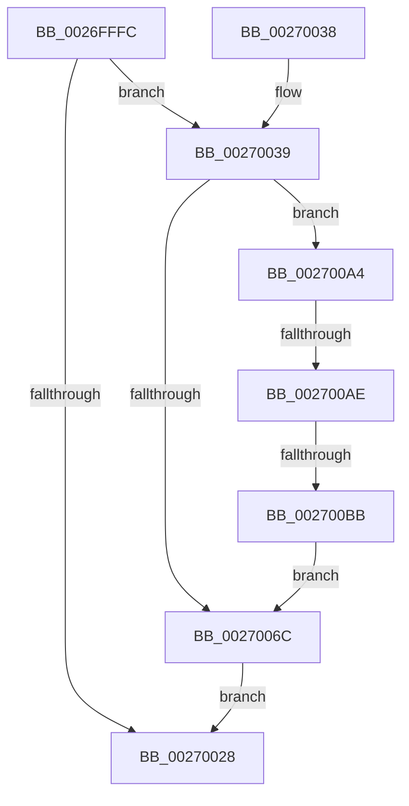

# PoRunDownDeviceObject

- RVA: `0x0026FFFC`–`0x002700CD` (길이 `209` bytes)
- VA: `0x000000014026FFFC`
- 실행 섹션: `.text`
- PDB 이름 있음: `예`; PDB Function 태그: `예`
- unwind 정보 RVA: `0x000659B0`
- 디코드: `51`개 명령, `209/209` bytes 표시
- 미해석 바이트: `0` (있으면 어셈블리에 `.byte`로 보존)

> 이 문서는 커널 이미지의 기계어와 PDB 기호를 분석해 생성했습니다. 4번과 5번은 함수 원형과 자료형을 바이너리 사용 방식에서 추정한 C 해석이며 원본 소스 복구 결과는 아닙니다.

## 1. Dependencies

- 직접 호출 지점: **8**; 고유 호출 대상: **8**
- 직접 호출자로 확인된 함수: **1**
- RIP 상대 이미지 참조: **3**

### Outgoing calls
- `0x0027001A` → [PoRegisterDeviceForIdleDetection](../27/PoRegisterDeviceForIdleDetection_function_002700E0.md) (function, `0x002700E0`)
- `0x00270040` → [MmLockPagableSectionByHandle](../../page/A4/MmLockPagableSectionByHandle_function_00A4D1E0.md) (function, `0x00A4D1E0`)
- `0x0027004C` → [ExAcquireFastMutex](../20/ExAcquireFastMutex_function_0020E5A0.md) (function, `0x0020E5A0`)
- `0x00270058` → [KeAcquireSpinLockRaiseToDpc](../20/KeAcquireSpinLockRaiseToDpc_function_00208470.md) (function, `0x00208470`)
- `0x00270076` → [ExFreePoolWithTag](../../poolcode/B8/ExFreePoolWithTag_function_00B82870.md) (function, `0x00B82870`)
- `0x00270085` → [KeReleaseSpinLock](../39/KeReleaseSpinLock_function_00392BA0.md) (function, `0x00392BA0`)
- `0x00270091` → [ExReleaseFastMutex](../25/ExReleaseFastMutex_function_002519C0.md) (function, `0x002519C0`)
- `0x0027009D` → [MmUnlockPagableImageSection](../2A/MmUnlockPagableImageSection_function_002A39F0.md) (function, `0x002A39F0`)

### Direct callers
- [IoDeleteDevice](IoDeleteDevice_function_0026FE90.md) at `0x0026FF10`

### Static image references
- `0x00270039` → RVA `0x00FC6C00` (`ALMOSTRO`; read)
- `0x00270045` → RVA `0x00F0CAA0` (`.data`; read)
- `0x00270051` → RVA `0x00F0CBA0` (`.data`; read)

## 2. Other-region calls and transfers

- 다른 실행 섹션으로 향하는 call: **2**
  - `0x00270040` → [MmLockPagableSectionByHandle](../../page/A4/MmLockPagableSectionByHandle_function_00A4D1E0.md) (`.text` → `PAGE`)
  - `0x00270076` → [ExFreePoolWithTag](../../poolcode/B8/ExFreePoolWithTag_function_00B82870.md) (`.text` → `POOLCODE`)
- call이 아닌 외부 분기/꼬리 이동: **2**
  - `0x002700A8` → [sub_006DA05C](../6D/Unknown_function_006DA05C.md) (`tail-transfer`)
  - `0x002700B5` → [sub_006DA05C](../6D/Unknown_function_006DA05C.md) (`tail-transfer`)

## 3. Assembly (complete function range)

```asm
0026FFFC  48 89 5C 24 08                  mov qword ptr [rsp + 8], rbx
00270001  48 89 74 24 10                  mov qword ptr [rsp + 0x10], rsi
00270006  57                              push rdi
00270007  48 83 EC 20                     sub rsp, 0x20
0027000B  48 8B B9 38 01 00 00            mov rdi, qword ptr [rcx + 0x138]
00270012  45 33 C9                        xor r9d, r9d
00270015  45 33 C0                        xor r8d, r8d
00270018  33 D2                           xor edx, edx
0027001A  E8 C1 00 00 00                  call 0x1402700e0
0027001F  48 8B 5F 18                     mov rbx, qword ptr [rdi + 0x18]
00270023  48 85 DB                        test rbx, rbx
00270026  75 11                           jne 0x140270039
00270028  48 8B 5C 24 30                  mov rbx, qword ptr [rsp + 0x30]
0027002D  48 8B 74 24 38                  mov rsi, qword ptr [rsp + 0x38]
00270032  48 83 C4 20                     add rsp, 0x20
00270036  5F                              pop rdi
00270037  C3                              ret
00270038  CC                              int3
00270039  48 8B 0D C0 6B D5 00            mov rcx, qword ptr [rip + 0xd56bc0]
00270040  E8 9B D1 7D 00                  call 0x140a4d1e0
00270045  48 8D 0D 54 CA C9 00            lea rcx, [rip + 0xc9ca54]
0027004C  E8 4F E5 F9 FF                  call 0x14020e5a0
00270051  48 8D 0D 48 CB C9 00            lea rcx, [rip + 0xc9cb48]
00270058  E8 13 84 F9 FF                  call 0x140208470
0027005D  48 8D 4B 50                     lea rcx, [rbx + 0x50]
00270061  40 8A F0                        mov sil, al
00270064  4C 8B 01                        mov r8, qword ptr [rcx]
00270067  4D 85 C0                        test r8, r8
0027006A  75 38                           jne 0x1402700a4
0027006C  48 83 67 18 00                  and qword ptr [rdi + 0x18], 0
00270071  33 D2                           xor edx, edx
00270073  48 8B CB                        mov rcx, rbx
00270076  E8 F5 27 91 00                  call 0x140b82870
0027007B  40 8A D6                        mov dl, sil
0027007E  48 8D 0D 1B CB C9 00            lea rcx, [rip + 0xc9cb1b]
00270085  E8 16 2B 12 00                  call 0x140392ba0
0027008A  48 8D 0D 0F CA C9 00            lea rcx, [rip + 0xc9ca0f]
00270091  E8 2A 19 FE FF                  call 0x1402519c0
00270096  48 8B 0D 63 6B D5 00            mov rcx, qword ptr [rip + 0xd56b63]
0027009D  E8 4E 39 03 00                  call 0x1402a39f0
002700A2  EB 84                           jmp 0x140270028
002700A4  49 39 48 08                     cmp qword ptr [r8 + 8], rcx
002700A8  0F 85 AE 9F 46 00               jne 0x1406da05c
002700AE  48 8B 51 08                     mov rdx, qword ptr [rcx + 8]
002700B2  48 39 0A                        cmp qword ptr [rdx], rcx
002700B5  0F 85 A1 9F 46 00               jne 0x1406da05c
002700BB  4C 89 02                        mov qword ptr [rdx], r8
002700BE  49 89 50 08                     mov qword ptr [r8 + 8], rdx
002700C2  48 83 21 00                     and qword ptr [rcx], 0
002700C6  48 83 63 58 00                  and qword ptr [rbx + 0x58], 0
002700CB  EB 9F                           jmp 0x14027006c
```

## 4. C-style interpretation (structured pseudocode)

```c
__int64 __fastcall PoRunDownDeviceObject(__int64 a1, int a2, int a3, int a4)
{
    __int64 result;
    __int64 v_rsp;
    unsigned __int64 v_stack_p10;
    unsigned __int64 v_stack_p8;

    v_stack_p8 = v_rbx;
    v_stack_p10 = v_rsi;
    v_rsp = (v_rsp) - (32);
    a4 = 0;
    a3 = 0;
    a2 = 0;
    result = PoRegisterDeviceForIdleDetection(a1, a2, a3, a4);
    if (*(unsigned __int64 *)(*(unsigned __int64 *)(a1 + 312) + 24) != 0) goto loc_00270039;
loc_00270028:
    v_rsp = (v_rsp) + (32);
    return result;
loc_00270039:
    result = MmLockPagableSectionByHandle(*(unsigned __int64 *)(v_rip + 13986752), a2, a3, a4);
    result = ExAcquireFastMutex(v_rip + 13224532, a2, a3, a4);
    result = KeAcquireSpinLockRaiseToDpc(v_rip + 13224776, a2, a3, a4);
    if (*(unsigned __int64 *)(v_stack_p8 + 80) != 0) goto loc_002700A4;
loc_0027006C:
    a2 = 0;
    result = ExFreePoolWithTag(v_stack_p8, a2, *(unsigned __int64 *)(v_stack_p8 + 80), a4);
    result = KeReleaseSpinLock(v_rip + 13224731, (unsigned __int8)((unsigned __int8)(result)), *(unsigned __int64 *)(v_stack_p8 + 80), a4);
    result = ExReleaseFastMutex(v_rip + 13224463, (unsigned __int8)((unsigned __int8)(result)), *(unsigned __int64 *)(v_stack_p8 + 80), a4);
    result = MmUnlockPagableImageSection(*(unsigned __int64 *)(v_rip + 13986659), (unsigned __int8)((unsigned __int8)(result)), *(unsigned __int64 *)(v_stack_p8 + 80), a4);
    goto loc_00270028;
loc_002700A4:
    *(unsigned __int64 *)(*(unsigned __int64 *)(*(unsigned __int64 *)(v_rip + 13986659) + 8)) = *(unsigned __int64 *)(v_stack_p8 + 80);
    *(unsigned __int64 *)(*(unsigned __int64 *)(v_stack_p8 + 80) + 8) = *(unsigned __int64 *)(*(unsigned __int64 *)(v_rip + 13986659) + 8);
    goto loc_0027006C;
}
```

## 5. (Beta) C Style

```c
int64_t PoRunDownDeviceObject(void *Arg1, int32_t Arg2, int32_t Arg3, int32_t Arg4)
{
    uint8_t *arg1 = (uint8_t *)Arg1;

    int64_t result;
    int64_t local_rsp;
    uint64_t v_stack_p10;
    uint64_t v_stack_p8;

    v_stack_p8 = local_rbx;
    v_stack_p10 = local_rsi;
    local_rsp = (local_rsp) - (32);
    Arg4 = 0;
    Arg3 = 0;
    Arg2 = 0;
    result = PoRegisterDeviceForIdleDetection(Arg1, Arg2, Arg3, Arg4);
    if (*(uint64_t *)(*(uint64_t *)(arg1 + 0x138) + 0x18) != 0) goto loc_00270039;
loc_00270028:
    local_rsp = (local_rsp) + (32);
    return result;
loc_00270039:
    result = MmLockPagableSectionByHandle(*(uint64_t *)(v_rip + 0xD56BC0), Arg2, Arg3, Arg4);
    result = ExAcquireFastMutex(v_rip + 13224532, Arg2, Arg3, Arg4);
    result = KeAcquireSpinLockRaiseToDpc(v_rip + 13224776, Arg2, Arg3, Arg4);
    if (*(uint64_t *)(v_stack_p8 + 0x50) != 0) goto loc_002700A4;
loc_0027006C:
    Arg2 = 0;
    result = ExFreePoolWithTag(v_stack_p8, Arg2, *(uint64_t *)(v_stack_p8 + 0x50), Arg4);
    result = KeReleaseSpinLock(v_rip + 13224731, (uint8_t)((uint8_t)(result)), *(uint64_t *)(v_stack_p8 + 0x50), Arg4);
    result = ExReleaseFastMutex(v_rip + 13224463, (uint8_t)((uint8_t)(result)), *(uint64_t *)(v_stack_p8 + 0x50), Arg4);
    result = MmUnlockPagableImageSection(*(uint64_t *)(v_rip + 0xD56B63), (uint8_t)((uint8_t)(result)), *(uint64_t *)(v_stack_p8 + 0x50), Arg4);
    goto loc_00270028;
loc_002700A4:
    *(uint64_t *)(*(uint64_t *)(*(uint64_t *)(v_rip + 0xD56B63) + 0x8)) = *(uint64_t *)(v_stack_p8 + 0x50);
    *(uint64_t *)(*(uint64_t *)(v_stack_p8 + 0x50) + 0x8) = *(uint64_t *)(*(uint64_t *)(v_rip + 0xD56B63) + 0x8);
    goto loc_0027006C;
}
```

### 관측된 메모리 오프셋

구조체 형식이 확인되지 않은 접근은 인자 기준의 오프셋으로만 기록했습니다.

| 기준 인자 | 오프셋 표현 | 폭 (bit) | 접근 |
|---|---:|---:|---|
| `Arg1` | `+ 0x138` | `64` | `R` |

## 6. Execution-region graph

[열기: 2D/3D 그래프와 함수 탐색 컨트롤 패널](../../../control-panel.html?section=text&rva=0x0026FFFC&view=graph)

- 2D 그래프는 위에서 아래로 흐르고, 3D 그래프는 빈 공간을 드래그해 회전합니다. Shift+드래그는 이동, 휠은 확대·축소, 함수 노드 선택은 대상 보고서 이동입니다.

### Static fallback


