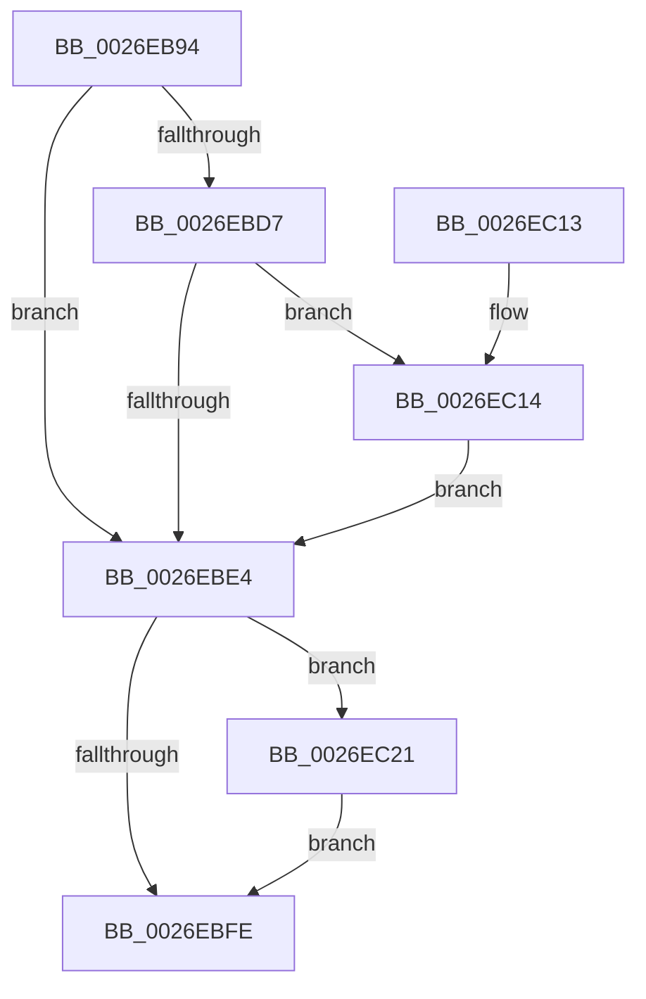

# PopCompleteIrpWatchdog

- RVA: `0x0026EB94`–`0x0026EC2B` (길이 `151` bytes)
- VA: `0x000000014026EB94`
- 실행 섹션: `.text`
- PDB 이름 있음: `예`; PDB Function 태그: `아니요`
- unwind 정보 RVA: `0x0005F944`
- 디코드: `38`개 명령, `151/151` bytes 표시
- 미해석 바이트: `0` (있으면 어셈블리에 `.byte`로 보존)

> 이 문서는 커널 이미지의 기계어와 PDB 기호를 분석해 생성했습니다. 4번과 5번은 함수 원형과 자료형을 바이너리 사용 방식에서 추정한 C 해석이며 원본 소스 복구 결과는 아닙니다.

## 1. Dependencies

- 직접 호출 지점: **4**; 고유 호출 대상: **4**
- 직접 호출자로 확인된 함수: **1**
- RIP 상대 이미지 참조: **0**

### Outgoing calls
- `0x0026EBC6` → [KeAcquireSpinLockRaiseToDpc](../20/KeAcquireSpinLockRaiseToDpc_function_00208470.md) (function, `0x00208470`)
- `0x0026EBDB` → [KeCancelTimer](../23/KeCancelTimer_function_002327E0.md) (function, `0x002327E0`)
- `0x0026EBF4` → [KeReleaseSpinLock](../39/KeReleaseSpinLock_function_00392BA0.md) (function, `0x00392BA0`)
- `0x0026EC24` → [PopIrpWatchdogBugcheck](../5C/PopIrpWatchdogBugcheck_function_005CE868.md) (function, `0x005CE868`)

### Direct callers
- [PopDequeueQuerySetIrp](PopDequeueQuerySetIrp_function_0026EC34.md) at `0x0026EC63`

### Static image references
- 디코드된 RIP-relative 메모리 참조가 없습니다.

## 2. Other-region calls and transfers

- 다른 실행 섹션으로 향하는 call: **0**
- 별도 외부 분기/꼬리 이동을 확인하지 못했습니다.

## 3. Assembly (complete function range)

```asm
0026EB94  48 89 5C 24 08                  mov qword ptr [rsp + 8], rbx
0026EB99  48 89 6C 24 10                  mov qword ptr [rsp + 0x10], rbp
0026EB9E  48 89 74 24 18                  mov qword ptr [rsp + 0x18], rsi
0026EBA3  57                              push rdi
0026EBA4  48 83 EC 20                     sub rsp, 0x20
0026EBA8  48 0F BE 41 42                  movsx rax, byte ptr [rcx + 0x42]
0026EBAD  40 32 FF                        xor dil, dil
0026EBB0  48 8D 14 C0                     lea rdx, [rax + rax*8]
0026EBB4  48 8B 9C D1 C8 00 00 00         mov rbx, qword ptr [rcx + rdx*8 + 0xc8]
0026EBBC  48 8D B3 20 01 00 00            lea rsi, [rbx + 0x120]
0026EBC3  48 8B CE                        mov rcx, rsi
0026EBC6  E8 A5 98 F9 FF                  call 0x140208470
0026EBCB  83 BB 28 01 00 00 01            cmp dword ptr [rbx + 0x128], 1
0026EBD2  40 8A E8                        mov bpl, al
0026EBD5  75 0D                           jne 0x14026ebe4
0026EBD7  48 8D 4B 38                     lea rcx, [rbx + 0x38]
0026EBDB  E8 00 3C FC FF                  call 0x1402327e0
0026EBE0  84 C0                           test al, al
0026EBE2  74 30                           je 0x14026ec14
0026EBE4  40 8A D5                        mov dl, bpl
0026EBE7  C7 83 28 01 00 00 02 00 00 00   mov dword ptr [rbx + 0x128], 2
0026EBF1  48 8B CE                        mov rcx, rsi
0026EBF4  E8 A7 3F 12 00                  call 0x140392ba0
0026EBF9  40 84 FF                        test dil, dil
0026EBFC  75 23                           jne 0x14026ec21
0026EBFE  48 8B 5C 24 30                  mov rbx, qword ptr [rsp + 0x30]
0026EC03  48 8B 6C 24 38                  mov rbp, qword ptr [rsp + 0x38]
0026EC08  48 8B 74 24 40                  mov rsi, qword ptr [rsp + 0x40]
0026EC0D  48 83 C4 20                     add rsp, 0x20
0026EC11  5F                              pop rdi
0026EC12  C3                              ret
0026EC13  CC                              int3
0026EC14  83 BB 28 01 00 00 01            cmp dword ptr [rbx + 0x128], 1
0026EC1B  40 0F 94 C7                     sete dil
0026EC1F  EB C3                           jmp 0x14026ebe4
0026EC21  48 8B CB                        mov rcx, rbx
0026EC24  E8 3F FC 35 00                  call 0x1405ce868
0026EC29  EB D3                           jmp 0x14026ebfe
```

## 4. C-style interpretation (structured pseudocode)

```c
__int64 __fastcall PopCompleteIrpWatchdog(__int64 a1)
{
    __int64 result;
    __int64 v_rdi;
    __int64 v_rsp;
    unsigned __int64 v_stack_p10;
    unsigned __int64 v_stack_p18;
    unsigned __int64 v_stack_p8;

    v_stack_p8 = v_rbx;
    v_stack_p10 = v_rbp;
    v_stack_p18 = v_rsi;
    v_rsp = (v_rsp) - (32);
    v_rdi = 0;
    result = KeAcquireSpinLockRaiseToDpc(*(unsigned __int64 *)(a1 + (__int8)(*(unsigned __int8 *)(a1 + 66)) + (__int8)(*(unsigned __int8 *)(a1 + 66)) * 8 * 8 + 200) + 288, (__int8)(*(unsigned __int8 *)(a1 + 66)) + (__int8)(*(unsigned __int8 *)(a1 + 66)) * 8, a3, a4);
    if ((*(unsigned int *)(*(unsigned __int64 *)(a1 + (__int8)(*(unsigned __int8 *)(a1 + 66)) + (__int8)(*(unsigned __int8 *)(a1 + 66)) * 8 * 8 + 200) + 296)) != 1) goto loc_0026EBE4;
    result = KeCancelTimer(*(unsigned __int64 *)(a1 + (__int8)(*(unsigned __int8 *)(a1 + 66)) + (__int8)(*(unsigned __int8 *)(a1 + 66)) * 8 * 8 + 200) + 56, (__int8)(*(unsigned __int8 *)(a1 + 66)) + (__int8)(*(unsigned __int8 *)(a1 + 66)) * 8, a3, a4);
    if ((unsigned __int8)(result) == 0) goto loc_0026EC14;
loc_0026EBE4:
    *(unsigned int *)(*(unsigned __int64 *)(a1 + (__int8)(*(unsigned __int8 *)(a1 + 66)) + (__int8)(*(unsigned __int8 *)(a1 + 66)) * 8 * 8 + 200) + 296) = 2;
    result = KeReleaseSpinLock(*(unsigned __int64 *)(a1 + (__int8)(*(unsigned __int8 *)(a1 + 66)) + (__int8)(*(unsigned __int8 *)(a1 + 66)) * 8 * 8 + 200) + 288, (unsigned __int8)((unsigned __int8)(result)), a3, a4);
    if (0 != 0) goto loc_0026EC21;
loc_0026EBFE:
    v_rsp = (v_rsp) + (32);
    return result;
loc_0026EC14:
    v_rdi = ((*(unsigned int *)(v_stack_p8 + 296)) == 1) ? 1 : 0;
    goto loc_0026EBE4;
loc_0026EC21:
    result = PopIrpWatchdogBugcheck(v_stack_p8, (unsigned __int8)((unsigned __int8)(result)), a3, a4);
    goto loc_0026EBFE;
}
```

## 5. (Beta) C Style

```c
int64_t PopCompleteIrpWatchdog(void *Arg1)
{
    uint8_t *arg1 = (uint8_t *)Arg1;

    int64_t result;
    int64_t local_rdi;
    int64_t local_rsp;
    uint64_t v_stack_p10;
    uint64_t v_stack_p18;
    uint64_t v_stack_p8;

    v_stack_p8 = local_rbx;
    v_stack_p10 = local_rbp;
    v_stack_p18 = local_rsi;
    local_rsp = (local_rsp) - (32);
    local_rdi = 0;
    result = KeAcquireSpinLockRaiseToDpc(*(uint64_t *)(arg1 + (int8_t)(*(uint8_t *)(arg1 + 0x42)) + (int8_t)(*(uint8_t *)(arg1 + 0x42)) * 8 * 8 + 0xC8) + 288, (int8_t)(*(uint8_t *)(arg1 + 0x42)) + (int8_t)(*(uint8_t *)(arg1 + 0x42)) * 8, a3, a4);
    if ((*(uint32_t *)(*(uint64_t *)(arg1 + (int8_t)(*(uint8_t *)(arg1 + 0x42)) + (int8_t)(*(uint8_t *)(arg1 + 0x42)) * 8 * 8 + 0xC8) + 0x128)) != 1) goto loc_0026EBE4;
    result = KeCancelTimer(*(uint64_t *)(arg1 + (int8_t)(*(uint8_t *)(arg1 + 0x42)) + (int8_t)(*(uint8_t *)(arg1 + 0x42)) * 8 * 8 + 0xC8) + 56, (int8_t)(*(uint8_t *)(arg1 + 0x42)) + (int8_t)(*(uint8_t *)(arg1 + 0x42)) * 8, a3, a4);
    if ((uint8_t)(result) == 0) goto loc_0026EC14;
loc_0026EBE4:
    *(uint32_t *)(*(uint64_t *)(arg1 + (int8_t)(*(uint8_t *)(arg1 + 0x42)) + (int8_t)(*(uint8_t *)(arg1 + 0x42)) * 8 * 8 + 0xC8) + 0x128) = 2;
    result = KeReleaseSpinLock(*(uint64_t *)(arg1 + (int8_t)(*(uint8_t *)(arg1 + 0x42)) + (int8_t)(*(uint8_t *)(arg1 + 0x42)) * 8 * 8 + 0xC8) + 288, (uint8_t)((uint8_t)(result)), a3, a4);
    if (0 != 0) goto loc_0026EC21;
loc_0026EBFE:
    local_rsp = (local_rsp) + (32);
    return result;
loc_0026EC14:
    local_rdi = ((*(uint32_t *)(v_stack_p8 + 0x128)) == 1) ? 1 : 0;
    goto loc_0026EBE4;
loc_0026EC21:
    result = PopIrpWatchdogBugcheck(v_stack_p8, (uint8_t)((uint8_t)(result)), a3, a4);
    goto loc_0026EBFE;
}
```

### 관측된 메모리 오프셋

구조체 형식이 확인되지 않은 접근은 인자 기준의 오프셋으로만 기록했습니다.

| 기준 인자 | 오프셋 표현 | 폭 (bit) | 접근 |
|---|---:|---:|---|
| `Arg1` | `+ 0x42` | `8` | `R` |
| `Arg1` | `+ 0xC8 + rdx*8` | `64` | `R` |

## 6. Execution-region graph

[열기: 2D/3D 그래프와 함수 탐색 컨트롤 패널](../../../control-panel.html?section=text&rva=0x0026EB94&view=graph)

- 2D 그래프는 위에서 아래로 흐르고, 3D 그래프는 빈 공간을 드래그해 회전합니다. Shift+드래그는 이동, 휠은 확대·축소, 함수 노드 선택은 대상 보고서 이동입니다.

### Static fallback


