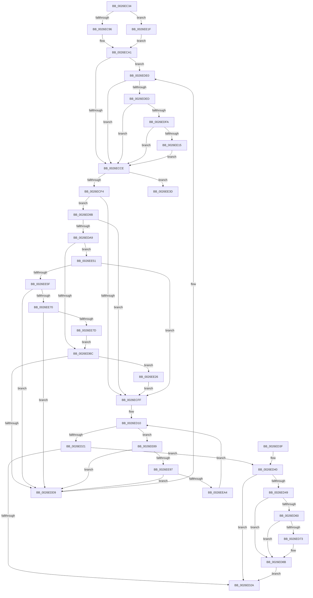

# PopDequeueQuerySetIrp

- RVA: `0x0026EC34`–`0x0026EEDF` (길이 `683` bytes)
- VA: `0x000000014026EC34`
- 실행 섹션: `.text`
- PDB 이름 있음: `예`; PDB Function 태그: `예`
- unwind 정보 RVA: `0x000657B8`
- 디코드: `146`개 명령, `683/683` bytes 표시
- 미해석 바이트: `0` (있으면 어셈블리에 `.byte`로 보존)

> 이 문서는 커널 이미지의 기계어와 PDB 기호를 분석해 생성했습니다. 4번과 5번은 함수 원형과 자료형을 바이너리 사용 방식에서 추정한 C 해석이며 원본 소스 복구 결과는 아닙니다.

## 1. Dependencies

- 직접 호출 지점: **12**; 고유 호출 대상: **12**
- 직접 호출자로 확인된 함수: **2**
- RIP 상대 이미지 참조: **12**

### Outgoing calls
- `0x0026EC5B` → [PopDiagTraceIrpFinish](PopDiagTraceIrpFinish_function_0026F2A8.md) (function, `0x0026F2A8`)
- `0x0026EC63` → [PopCompleteIrpWatchdog](PopCompleteIrpWatchdog_function_0026EB94.md) (function, `0x0026EB94`)
- `0x0026ECAC` → [KeAcquireInStackQueuedSpinLock](../27/KeAcquireInStackQueuedSpinLock_function_002757A0.md) (function, `0x002757A0`)
- `0x0026ED0B` → [KeReleaseInStackQueuedSpinLock](../34/KeReleaseInStackQueuedSpinLock_function_00342CE0.md) (function, `0x00342CE0`)
- `0x0026ED50` → [KeAcquireSpinLockRaiseToDpc](../20/KeAcquireSpinLockRaiseToDpc_function_00208470.md) (function, `0x00208470`)
- `0x0026ED65` → [PopDeepSleepClearDisengageReason](../39/PopDeepSleepClearDisengageReason_function_0039010C.md) (function, `0x0039010C`)
- `0x0026ED86` → [ExQueueWorkItem](../2F/ExQueueWorkItem_function_002F9520.md) (function, `0x002F9520`)
- `0x0026ED94` → [KeReleaseSpinLock](../39/KeReleaseSpinLock_function_00392BA0.md) (function, `0x00392BA0`)
- `0x0026EE15` → [PopDisableIrpWatchdog](../4A/PopDisableIrpWatchdog_function_004A95E8.md) (function, `0x004A95E8`)
- `0x0026EEC2` → [PopDiagTraceIrpStart](../47/PopDiagTraceIrpStart_function_0047CBBC.md) (function, `0x0047CBBC`)
- `0x0026EECA` → [PopEnableIrpWatchdog](../44/PopEnableIrpWatchdog_function_00447BFC.md) (function, `0x00447BFC`)
- `0x0026EED5` → [IofCallDriver](../29/IofCallDriver_function_0029B4B0.md) (function, `0x0029B4B0`)

### Direct callers
- [PopHandleDevicePowerIrpCompletion](PopHandleDevicePowerIrpCompletion_function_0026F030.md) at `0x0026F1CE`
- [PopSystemIrpCompletion](../../pagelk/B7/PopSystemIrpCompletion_function_00B70CC0.md) at `0x00B70E44`

### Static image references
- `0x0026ECA5` → RVA `0x00F0CA50` (`.data`; read)
- `0x0026ECC1` → RVA `0x00F0BD28` (`.data`; write)
- `0x0026ECE7` → RVA `0x00F0BCE8` (`.data`; read)
- `0x0026ECFF` → RVA `0x00F0BD28` (`.data`; read/write)
- `0x0026ED49` → RVA `0x00F0CA20` (`.data`; read)
- `0x0026ED55` → RVA `0x00F0BCDC` (`.data`; read/write)
- `0x0026ED6A` → RVA `0x00F0BCE0` (`.data`; read)
- `0x0026ED78` → RVA `0x00F0BCE0` (`.data`; write)
- `0x0026ED7F` → RVA `0x00F0CA00` (`.data`; read)
- `0x0026EE3D` → RVA `0x00F0BCE8` (`.data`; read/write)
- `0x0026EE45` → RVA `0x00F0CA30` (`.data`; read)
- `0x0026EE5F` → RVA `0x00F0BCE8` (`.data`; write)

## 2. Other-region calls and transfers

- 다른 실행 섹션으로 향하는 call: **0**
- call이 아닌 외부 분기/꼬리 이동: **1**
  - `0x0026EE4C` → [sub_006D9E24](../6D/Unknown_function_006D9E24.md) (`tail-transfer`)

## 3. Assembly (complete function range)

```asm
0026EC34  48 89 5C 24 08                  mov qword ptr [rsp + 8], rbx
0026EC39  48 89 74 24 10                  mov qword ptr [rsp + 0x10], rsi
0026EC3E  48 89 7C 24 18                  mov qword ptr [rsp + 0x18], rdi
0026EC43  55                              push rbp
0026EC44  48 8B EC                        mov rbp, rsp
0026EC47  48 83 EC 50                     sub rsp, 0x50
0026EC4B  0F 57 C0                        xorps xmm0, xmm0
0026EC4E  33 C0                           xor eax, eax
0026EC50  0F 11 45 E0                     movups xmmword ptr [rbp - 0x20], xmm0
0026EC54  48 89 45 F0                     mov qword ptr [rbp - 0x10], rax
0026EC58  48 8B F9                        mov rdi, rcx
0026EC5B  E8 48 06 00 00                  call 0x14026f2a8
0026EC60  48 8B CF                        mov rcx, rdi
0026EC63  E8 2C FF FF FF                  call 0x14026eb94
0026EC68  48 8D 45 D0                     lea rax, [rbp - 0x30]
0026EC6C  48 89 45 D8                     mov qword ptr [rbp - 0x28], rax
0026EC70  48 8D 45 D0                     lea rax, [rbp - 0x30]
0026EC74  48 89 45 D0                     mov qword ptr [rbp - 0x30], rax
0026EC78  48 0F BE 47 42                  movsx rax, byte ptr [rdi + 0x42]
0026EC7D  48 8D 0C C0                     lea rcx, [rax + rax*8]
0026EC81  48 8B B4 CF C8 00 00 00         mov rsi, qword ptr [rdi + rcx*8 + 0xc8]
0026EC89  48 8B 46 18                     mov rax, qword ptr [rsi + 0x18]
0026EC8D  48 85 C0                        test rax, rax
0026EC90  0F 84 89 01 00 00               je 0x14026ee1f
0026EC96  48 8B 80 38 01 00 00            mov rax, qword ptr [rax + 0x138]
0026EC9D  48 8B 58 28                     mov rbx, qword ptr [rax + 0x28]
0026ECA1  48 8D 55 E0                     lea rdx, [rbp - 0x20]
0026ECA5  48 8D 0D A4 DD C9 00            lea rcx, [rip + 0xc9dda4]
0026ECAC  E8 EF 6A 00 00                  call 0x1402757a0
0026ECB1  65 48 8B 04 25 88 01 00 00      mov rax, qword ptr gs:[0x188]
0026ECBA  83 BE BC 00 00 00 00            cmp dword ptr [rsi + 0xbc], 0
0026ECC1  48 89 05 60 D0 C9 00            mov qword ptr [rip + 0xc9d060], rax
0026ECC8  0F 84 12 01 00 00               je 0x14026ede0
0026ECCE  83 BE BC 00 00 00 01            cmp dword ptr [rsi + 0xbc], 1
0026ECD5  B8 18 01 00 00                  mov eax, 0x118
0026ECDA  44 8D 40 F0                     lea r8d, [rax - 0x10]
0026ECDE  44 0F 45 C0                     cmovne r8d, eax
0026ECE2  49 83 24 18 00                  and qword ptr [r8 + rbx], 0
0026ECE7  48 3B 3D FA CF C9 00            cmp rdi, qword ptr [rip + 0xc9cffa]
0026ECEE  0F 84 49 01 00 00               je 0x14026ee3d
0026ECF4  49 83 3C 18 00                  cmp qword ptr [r8 + rbx], 0
0026ECF9  0F 84 9C 00 00 00               je 0x14026ed9b
0026ECFF  48 83 25 21 D0 C9 00 00         and qword ptr [rip + 0xc9d021], 0
0026ED07  48 8D 4D E0                     lea rcx, [rbp - 0x20]
0026ED0B  E8 D0 3F 0D 00                  call 0x140342ce0
0026ED10  48 8B 7D D0                     mov rdi, qword ptr [rbp - 0x30]
0026ED14  48 8D 45 D0                     lea rax, [rbp - 0x30]
0026ED18  48 3B F8                        cmp rdi, rax
0026ED1B  0F 85 68 01 00 00               jne 0x14026ee89
0026ED21  80 BE B8 00 00 00 02            cmp byte ptr [rsi + 0xb8], 2
0026ED28  74 16                           je 0x14026ed40
0026ED2A  48 8B 5C 24 60                  mov rbx, qword ptr [rsp + 0x60]
0026ED2F  48 8B 74 24 68                  mov rsi, qword ptr [rsp + 0x68]
0026ED34  48 8B 7C 24 70                  mov rdi, qword ptr [rsp + 0x70]
0026ED39  48 83 C4 50                     add rsp, 0x50
0026ED3D  5D                              pop rbp
0026ED3E  C3                              ret
0026ED3F  CC                              int3
0026ED40  83 BE BC 00 00 00 01            cmp dword ptr [rsi + 0xbc], 1
0026ED47  75 E1                           jne 0x14026ed2a
0026ED49  48 8D 0D D0 DC C9 00            lea rcx, [rip + 0xc9dcd0]
0026ED50  E8 1B 97 F9 FF                  call 0x140208470
0026ED55  83 05 80 CF C9 00 FF            add dword ptr [rip + 0xc9cf80], -1
0026ED5C  8A D8                           mov bl, al
0026ED5E  75 2B                           jne 0x14026ed8b
0026ED60  B9 02 00 00 00                  mov ecx, 2
0026ED65  E8 A2 13 12 00                  call 0x14039010c
0026ED6A  80 3D 6F CF C9 00 00            cmp byte ptr [rip + 0xc9cf6f], 0
0026ED71  75 18                           jne 0x14026ed8b
0026ED73  BA 01 00 00 00                  mov edx, 1
0026ED78  C6 05 61 CF C9 00 01            mov byte ptr [rip + 0xc9cf61], 1
0026ED7F  48 8D 0D 7A DC C9 00            lea rcx, [rip + 0xc9dc7a]
0026ED86  E8 95 A7 08 00                  call 0x1402f9520
0026ED8B  8A D3                           mov dl, bl
0026ED8D  48 8D 0D 8C DC C9 00            lea rcx, [rip + 0xc9dc8c]
0026ED94  E8 07 3E 12 00                  call 0x140392ba0
0026ED99  EB 8F                           jmp 0x14026ed2a
0026ED9B  49 8B 4C 18 08                  mov rcx, qword ptr [r8 + rbx + 8]
0026EDA0  48 85 C9                        test rcx, rcx
0026EDA3  0F 84 56 FF FF FF               je 0x14026ecff
0026EDA9  48 8D 81 A8 00 00 00            lea rax, [rcx + 0xa8]
0026EDB0  48 8B 10                        mov rdx, qword ptr [rax]
0026EDB3  48 3B D0                        cmp rdx, rax
0026EDB6  0F 85 95 00 00 00               jne 0x14026ee51
0026EDBC  49 89 0C 18                     mov qword ptr [r8 + rbx], rcx
0026EDC0  48 8D 55 D0                     lea rdx, [rbp - 0x30]
0026EDC4  48 83 C1 78                     add rcx, 0x78
0026EDC8  48 8B 01                        mov rax, qword ptr [rcx]
0026EDCB  49 89 44 18 08                  mov qword ptr [r8 + rbx + 8], rax
0026EDD0  48 8B 45 D8                     mov rax, qword ptr [rbp - 0x28]
0026EDD4  48 39 10                        cmp qword ptr [rax], rdx
0026EDD7  74 4D                           je 0x14026ee26
0026EDD9  B9 03 00 00 00                  mov ecx, 3
0026EDDE  CD 29                           int 0x29
0026EDE0  80 BE B8 00 00 00 02            cmp byte ptr [rsi + 0xb8], 2
0026EDE7  0F 85 E1 FE FF FF               jne 0x14026ecce
0026EDED  83 BE C0 00 00 00 01            cmp dword ptr [rsi + 0xc0], 1
0026EDF4  0F 8E D4 FE FF FF               jle 0x14026ecce
0026EDFA  F0 81 8B 28 01 00 00 00 80 00 00  lock or dword ptr [rbx + 0x128], 0x8000
0026EE05  48 8B 8B 08 01 00 00            mov rcx, qword ptr [rbx + 0x108]
0026EE0C  48 85 C9                        test rcx, rcx
0026EE0F  0F 84 B9 FE FF FF               je 0x14026ecce
0026EE15  E8 CE A7 23 00                  call 0x1404a95e8
0026EE1A  E9 AF FE FF FF                  jmp 0x14026ecce
0026EE1F  33 DB                           xor ebx, ebx
0026EE21  E9 7B FE FF FF                  jmp 0x14026eca1
0026EE26  48 89 41 08                     mov qword ptr [rcx + 8], rax
0026EE2A  48 8D 55 D0                     lea rdx, [rbp - 0x30]
0026EE2E  48 89 11                        mov qword ptr [rcx], rdx
0026EE31  48 89 08                        mov qword ptr [rax], rcx
0026EE34  48 89 4D D8                     mov qword ptr [rbp - 0x28], rcx
0026EE38  E9 C2 FE FF FF                  jmp 0x14026ecff
0026EE3D  48 83 25 A3 CE C9 00 00         and qword ptr [rip + 0xc9cea3], 0
0026EE45  48 8B 15 E4 DB C9 00            mov rdx, qword ptr [rip + 0xc9dbe4]
0026EE4C  E9 D3 AF 46 00                  jmp 0x1406d9e24
0026EE51  48 83 3D 8F CE C9 00 00         cmp qword ptr [rip + 0xc9ce8f], 0
0026EE59  0F 85 A0 FE FF FF               jne 0x14026ecff
0026EE5F  48 89 0D 82 CE C9 00            mov qword ptr [rip + 0xc9ce82], rcx
0026EE66  48 39 42 08                     cmp qword ptr [rdx + 8], rax
0026EE6A  0F 85 69 FF FF FF               jne 0x14026edd9
0026EE70  4C 8B 48 08                     mov r9, qword ptr [rax + 8]
0026EE74  49 39 01                        cmp qword ptr [r9], rax
0026EE77  0F 85 5C FF FF FF               jne 0x14026edd9
0026EE7D  49 89 11                        mov qword ptr [r9], rdx
0026EE80  4C 89 4A 08                     mov qword ptr [rdx + 8], r9
0026EE84  E9 33 FF FF FF                  jmp 0x14026edbc
0026EE89  48 8D 45 D0                     lea rax, [rbp - 0x30]
0026EE8D  48 39 47 08                     cmp qword ptr [rdi + 8], rax
0026EE91  0F 85 42 FF FF FF               jne 0x14026edd9
0026EE97  48 8B 07                        mov rax, qword ptr [rdi]
0026EE9A  48 39 78 08                     cmp qword ptr [rax + 8], rdi
0026EE9E  0F 85 35 FF FF FF               jne 0x14026edd9
0026EEA4  48 89 45 D0                     mov qword ptr [rbp - 0x30], rax
0026EEA8  48 8D 4D D0                     lea rcx, [rbp - 0x30]
0026EEAC  48 89 48 08                     mov qword ptr [rax + 8], rcx
0026EEB0  48 83 C7 88                     add rdi, -0x78
0026EEB4  48 8B D7                        mov rdx, rdi
0026EEB7  48 8B 87 B8 00 00 00            mov rax, qword ptr [rdi + 0xb8]
0026EEBE  48 8B 58 E0                     mov rbx, qword ptr [rax - 0x20]
0026EEC2  E8 F5 DC 20 00                  call 0x14047cbbc
0026EEC7  48 8B CF                        mov rcx, rdi
0026EECA  E8 2D 8D 1D 00                  call 0x140447bfc
0026EECF  48 8B D7                        mov rdx, rdi
0026EED2  48 8B CB                        mov rcx, rbx
0026EED5  E8 D6 C5 02 00                  call 0x14029b4b0
0026EEDA  E9 31 FE FF FF                  jmp 0x14026ed10
```

## 4. C-style interpretation (structured pseudocode)

```c
__int64 __fastcall PopDequeueQuerySetIrp(__int64 a1)
{
    __int64 result;
    __int64 v_rbx;
    __int64 v_rdi;
    __int64 v_rsp;
    unsigned __int64 v_stack_m18;
    unsigned __int64 v_stack_m28;
    unsigned __int64 v_stack_m30;
    unsigned __int64 v_stack_m38;
    unsigned __int64 v_stack_p10;
    unsigned __int64 v_stack_p18;
    unsigned __int64 v_stack_p8;

    v_stack_p8 = v_rbx;
    v_stack_p10 = v_rsi;
    v_stack_p18 = v_rdi;
    v_rsp = (v_rsp) - (80);
    result = 0;
    v_stack_m28 = v_xmm0;
    v_stack_m18 = 0;
    result = PopDiagTraceIrpFinish(a1, a2, a3, a4);
    result = PopCompleteIrpWatchdog(a1, a2, a3, a4);
    v_stack_m30 = v_stack_m38;
    v_stack_m38 = v_stack_m38;
    if (*(unsigned __int64 *)(*(unsigned __int64 *)(a1 + (__int8)(*(unsigned __int8 *)(a1 + 66)) + (__int8)(*(unsigned __int8 *)(a1 + 66)) * 8 * 8 + 200) + 24) == 0) goto loc_0026EE1F;
loc_0026ECA1:
    result = KeAcquireInStackQueuedSpinLock(v_rip + 13229476, v_stack_m28, a3, a4);
    *(unsigned __int64 *)(v_rip + 13226080) = *(unsigned __int64 *)(gs_base + (0 + 392));
    if ((*(unsigned int *)(*(unsigned __int64 *)(a1 + (__int8)(*(unsigned __int8 *)(a1 + 66)) + (__int8)(*(unsigned __int8 *)(a1 + 66)) * 8 * 8 + 200) + 188)) == 0) goto loc_0026EDE0;
loc_0026ECCE:
    a3 = 280 - 16;
    if ((*(unsigned int *)(*(unsigned __int64 *)(a1 + (__int8)(*(unsigned __int8 *)(a1 + 66)) + (__int8)(*(unsigned __int8 *)(a1 + 66)) * 8 * 8 + 200) + 188)) != 1) { a3 = 280; }
    if (a1 == (*(unsigned __int64 *)(v_rip + 13225978))) goto loc_0026EE3D;
    if ((*(unsigned __int64 *)(a3 + *(unsigned __int64 *)(*(unsigned __int64 *)(*(unsigned __int64 *)(*(unsigned __int64 *)(a1 + (__int8)(*(unsigned __int8 *)(a1 + 66)) + (__int8)(*(unsigned __int8 *)(a1 + 66)) * 8 * 8 + 200) + 24) + 312) + 40) * 1)) == 0) goto loc_0026ED9B;
loc_0026ECFF:
    result = KeReleaseInStackQueuedSpinLock(v_stack_m28, v_stack_m28, a3, a4);
loc_0026ED10:
    if (v_stack_m38 != v_stack_m38) goto loc_0026EE89;
    if ((*(unsigned __int8 *)(*(unsigned __int64 *)(a1 + (__int8)(*(unsigned __int8 *)(a1 + 66)) + (__int8)(*(unsigned __int8 *)(a1 + 66)) * 8 * 8 + 200) + 184)) == 2) goto loc_0026ED40;
loc_0026ED2A:
    v_rsp = (v_rsp) + (80);
    return v_stack_m38;
loc_0026ED40:
    if ((*(unsigned int *)(v_stack_p10 + 188)) != 1) goto loc_0026ED2A;
    result = KeAcquireSpinLockRaiseToDpc(v_rip + 13229264, v_stack_m28, a3, a4);
    if ((*(unsigned int *)(v_stack_p10 + 188)) != 1) goto loc_0026ED8B;
    result = PopDeepSleepClearDisengageReason(2, v_stack_m28, a3, a4);
    if ((*(unsigned __int8 *)(v_rip + 13225839)) == 0) {
        a2 = 1;
        *(unsigned __int8 *)(v_rip + 13225825) = 1;
        a1 = v_rip + 13229178;
        result = ExQueueWorkItem(a1, a2, a3, a4);
    }
    result = KeReleaseSpinLock(v_rip + 13229196, (unsigned __int8)((unsigned __int8)(result)), a3, a4);
    goto loc_0026ED2A;
loc_0026ED9B:
    if (*(unsigned __int64 *)(a3 + (unsigned __int8)(result) * 1 + 8) == 0) goto loc_0026ECFF;
    if ((*(unsigned __int64 *)(*(unsigned __int64 *)(a3 + (unsigned __int8)(result) * 1 + 8) + 168)) != (*(unsigned __int64 *)(a3 + (unsigned __int8)(result) * 1 + 8) + 168)) goto loc_0026EE51;
loc_0026EDBC:
    *(unsigned __int64 *)(a3 + (unsigned __int8)(result) * 1) = *(unsigned __int64 *)(a3 + (unsigned __int8)(result) * 1 + 8);
    a1 = (*(unsigned __int64 *)(a3 + (unsigned __int8)(result) * 1 + 8)) + (120);
    *(unsigned __int64 *)(a3 + (unsigned __int8)(result) * 1 + 8) = *(unsigned __int64 *)(a1);
    if ((*(unsigned __int64 *)(v_stack_m30)) == v_stack_m38) goto loc_0026EE26;
loc_0026EDD9:
loc_0026EDE0:
    if ((*(unsigned __int8 *)(v_stack_p10 + 184)) != 2) goto loc_0026ECCE;
    if ((*(unsigned int *)(v_stack_p10 + 192)) <= 1) goto loc_0026ECCE;
    if (*(unsigned __int64 *)((unsigned __int8)(result) + 264) == 0) goto loc_0026ECCE;
    result = PopDisableIrpWatchdog(*(unsigned __int64 *)((unsigned __int8)(result) + 264), v_stack_m38, a3, a4);
    goto loc_0026ECCE;
loc_0026EE1F:
    v_rbx = 0;
    goto loc_0026ECA1;
loc_0026EE26:
    *(unsigned __int64 *)(*(unsigned __int64 *)((unsigned __int8)(result) + 264) + 8) = result;
    *(unsigned __int64 *)(*(unsigned __int64 *)((unsigned __int8)(result) + 264)) = v_stack_m38;
    *(unsigned __int64 *)(result) = *(unsigned __int64 *)((unsigned __int8)(result) + 264);
    v_stack_m30 = *(unsigned __int64 *)((unsigned __int8)(result) + 264);
    goto loc_0026ECFF;
loc_0026EE3D:
loc_0026EE51:
    if ((*(unsigned __int64 *)(v_rip + 13225615)) != 0) goto loc_0026ECFF;
    *(unsigned __int64 *)(v_rip + 13225602) = *(unsigned __int64 *)((unsigned __int8)(result) + 264);
    if ((*(unsigned __int64 *)(*(unsigned __int64 *)(v_rip + 13229028) + 8)) != result) goto loc_0026EDD9;
    if ((*(unsigned __int64 *)(*(unsigned __int64 *)(result + 8))) != result) goto loc_0026EDD9;
    *(unsigned __int64 *)(*(unsigned __int64 *)(result + 8)) = *(unsigned __int64 *)(v_rip + 13229028);
    *(unsigned __int64 *)(*(unsigned __int64 *)(v_rip + 13229028) + 8) = *(unsigned __int64 *)(result + 8);
    goto loc_0026EDBC;
loc_0026EE89:
    if ((*(unsigned __int64 *)(v_stack_p18 + 8)) != v_stack_m38) goto loc_0026EDD9;
    if ((*(unsigned __int64 *)(*(unsigned __int64 *)(v_stack_p18) + 8)) != v_stack_p18) goto loc_0026EDD9;
    v_stack_m38 = *(unsigned __int64 *)(v_stack_p18);
    *(unsigned __int64 *)(*(unsigned __int64 *)(v_stack_p18) + 8) = v_stack_m38;
    v_rdi = (v_stack_p18) + (-120);
    result = PopDiagTraceIrpStart(v_stack_m38, v_rdi, a3, *(unsigned __int64 *)(result + 8));
    result = PopEnableIrpWatchdog(v_rdi, v_rdi, a3, *(unsigned __int64 *)(result + 8));
    result = IofCallDriver(*(unsigned __int64 *)(*(unsigned __int64 *)(v_rdi + 184) - 32), v_rdi, a3, *(unsigned __int64 *)(result + 8));
    goto loc_0026ED10;
}
```

## 5. (Beta) C Style

```c
int64_t PopDequeueQuerySetIrp(void *Arg1)
{
    uint8_t *arg1 = (uint8_t *)Arg1;

    int64_t result;
    int64_t local_rbx;
    int64_t local_rdi;
    int64_t local_rsp;
    uint64_t v_stack_m18;
    uint64_t v_stack_m28;
    uint64_t v_stack_m30;
    uint64_t v_stack_m38;
    uint64_t v_stack_p10;
    uint64_t v_stack_p18;
    uint64_t v_stack_p8;

    v_stack_p8 = local_rbx;
    v_stack_p10 = local_rsi;
    v_stack_p18 = local_rdi;
    local_rsp = (local_rsp) - (80);
    result = 0;
    v_stack_m28 = v_xmm0;
    v_stack_m18 = 0;
    result = PopDiagTraceIrpFinish(Arg1, a2, a3, a4);
    result = PopCompleteIrpWatchdog(Arg1, a2, a3, a4);
    v_stack_m30 = v_stack_m38;
    v_stack_m38 = v_stack_m38;
    if (*(uint64_t *)(*(uint64_t *)(arg1 + (int8_t)(*(uint8_t *)(arg1 + 0x42)) + (int8_t)(*(uint8_t *)(arg1 + 0x42)) * 8 * 8 + 0xC8) + 0x18) == 0) goto loc_0026EE1F;
loc_0026ECA1:
    result = KeAcquireInStackQueuedSpinLock(v_rip + 13229476, v_stack_m28, a3, a4);
    *(uint64_t *)(v_rip + 0xC9D060) = *(uint64_t *)(gs_base + (0 + 0x188));
    if ((*(uint32_t *)(*(uint64_t *)(arg1 + (int8_t)(*(uint8_t *)(arg1 + 0x42)) + (int8_t)(*(uint8_t *)(arg1 + 0x42)) * 8 * 8 + 0xC8) + 0xBC)) == 0) goto loc_0026EDE0;
loc_0026ECCE:
    a3 = 280 - 16;
    if ((*(uint32_t *)(*(uint64_t *)(arg1 + (int8_t)(*(uint8_t *)(arg1 + 0x42)) + (int8_t)(*(uint8_t *)(arg1 + 0x42)) * 8 * 8 + 0xC8) + 0xBC)) != 1) { a3 = 280; }
    if (Arg1 == (*(uint64_t *)(v_rip + 0xC9CFFA))) goto loc_0026EE3D;
    if ((*(uint64_t *)(a3 + *(uint64_t *)(*(uint64_t *)(*(uint64_t *)(*(uint64_t *)(arg1 + (int8_t)(*(uint8_t *)(arg1 + 0x42)) + (int8_t)(*(uint8_t *)(arg1 + 0x42)) * 8 * 8 + 0xC8) + 0x18) + 0x138) + 0x28) * 1)) == 0) goto loc_0026ED9B;
loc_0026ECFF:
    result = KeReleaseInStackQueuedSpinLock(v_stack_m28, v_stack_m28, a3, a4);
loc_0026ED10:
    if (v_stack_m38 != v_stack_m38) goto loc_0026EE89;
    if ((*(uint8_t *)(*(uint64_t *)(arg1 + (int8_t)(*(uint8_t *)(arg1 + 0x42)) + (int8_t)(*(uint8_t *)(arg1 + 0x42)) * 8 * 8 + 0xC8) + 0xB8)) == 2) goto loc_0026ED40;
loc_0026ED2A:
    local_rsp = (local_rsp) + (80);
    return v_stack_m38;
loc_0026ED40:
    if ((*(uint32_t *)(v_stack_p10 + 0xBC)) != 1) goto loc_0026ED2A;
    result = KeAcquireSpinLockRaiseToDpc(v_rip + 13229264, v_stack_m28, a3, a4);
    if ((*(uint32_t *)(v_stack_p10 + 0xBC)) != 1) goto loc_0026ED8B;
    result = PopDeepSleepClearDisengageReason(2, v_stack_m28, a3, a4);
    if ((*(uint8_t *)(v_rip + 0xC9CF6F)) == 0) {
        a2 = 1;
        *(uint8_t *)(v_rip + 0xC9CF61) = 1;
        Arg1 = v_rip + 13229178;
        result = ExQueueWorkItem(Arg1, a2, a3, a4);
    }
    result = KeReleaseSpinLock(v_rip + 13229196, (uint8_t)((uint8_t)(result)), a3, a4);
    goto loc_0026ED2A;
loc_0026ED9B:
    if (*(uint64_t *)(a3 + (uint8_t)(result) * 1 + 0x8) == 0) goto loc_0026ECFF;
    if ((*(uint64_t *)(*(uint64_t *)(a3 + (uint8_t)(result) * 1 + 0x8) + 0xA8)) != (*(uint64_t *)(a3 + (uint8_t)(result) * 1 + 0x8) + 168)) goto loc_0026EE51;
loc_0026EDBC:
    *(uint64_t *)(a3 + (uint8_t)(result) * 1) = *(uint64_t *)(a3 + (uint8_t)(result) * 1 + 0x8);
    Arg1 = (*(uint64_t *)(a3 + (uint8_t)(result) * 1 + 0x8)) + (120);
    *(uint64_t *)(a3 + (uint8_t)(result) * 1 + 0x8) = *(uint64_t *)(arg1);
    if ((*(uint64_t *)(v_stack_m30)) == v_stack_m38) goto loc_0026EE26;
loc_0026EDD9:
loc_0026EDE0:
    if ((*(uint8_t *)(v_stack_p10 + 0xB8)) != 2) goto loc_0026ECCE;
    if ((*(uint32_t *)(v_stack_p10 + 0xC0)) <= 1) goto loc_0026ECCE;
    if (*(uint64_t *)((uint8_t)(result) + 0x108) == 0) goto loc_0026ECCE;
    result = PopDisableIrpWatchdog(*(uint64_t *)((uint8_t)(result) + 0x108), v_stack_m38, a3, a4);
    goto loc_0026ECCE;
loc_0026EE1F:
    local_rbx = 0;
    goto loc_0026ECA1;
loc_0026EE26:
    *(uint64_t *)(*(uint64_t *)((uint8_t)(result) + 0x108) + 0x8) = result;
    *(uint64_t *)(*(uint64_t *)((uint8_t)(result) + 0x108)) = v_stack_m38;
    *(uint64_t *)(result) = *(uint64_t *)((uint8_t)(result) + 0x108);
    v_stack_m30 = *(uint64_t *)((uint8_t)(result) + 0x108);
    goto loc_0026ECFF;
loc_0026EE3D:
loc_0026EE51:
    if ((*(uint64_t *)(v_rip + 0xC9CE8F)) != 0) goto loc_0026ECFF;
    *(uint64_t *)(v_rip + 0xC9CE82) = *(uint64_t *)((uint8_t)(result) + 0x108);
    if ((*(uint64_t *)(*(uint64_t *)(v_rip + 0xC9DBE4) + 0x8)) != result) goto loc_0026EDD9;
    if ((*(uint64_t *)(*(uint64_t *)(result + 0x8))) != result) goto loc_0026EDD9;
    *(uint64_t *)(*(uint64_t *)(result + 0x8)) = *(uint64_t *)(v_rip + 0xC9DBE4);
    *(uint64_t *)(*(uint64_t *)(v_rip + 0xC9DBE4) + 0x8) = *(uint64_t *)(result + 0x8);
    goto loc_0026EDBC;
loc_0026EE89:
    if ((*(uint64_t *)(v_stack_p18 + 0x8)) != v_stack_m38) goto loc_0026EDD9;
    if ((*(uint64_t *)(*(uint64_t *)(v_stack_p18) + 0x8)) != v_stack_p18) goto loc_0026EDD9;
    v_stack_m38 = *(uint64_t *)(v_stack_p18);
    *(uint64_t *)(*(uint64_t *)(v_stack_p18) + 0x8) = v_stack_m38;
    local_rdi = (v_stack_p18) + (-120);
    result = PopDiagTraceIrpStart(v_stack_m38, local_rdi, a3, *(uint64_t *)(result + 0x8));
    result = PopEnableIrpWatchdog(local_rdi, local_rdi, a3, *(uint64_t *)(result + 0x8));
    result = IofCallDriver(*(uint64_t *)(*(uint64_t *)(local_rdi + 0xB8) - 0x20), local_rdi, a3, *(uint64_t *)(result + 0x8));
    goto loc_0026ED10;
}
```

### 관측된 메모리 오프셋

구조체 형식이 확인되지 않은 접근은 인자 기준의 오프셋으로만 기록했습니다.

| 기준 인자 | 오프셋 표현 | 폭 (bit) | 접근 |
|---|---:|---:|---|
| `Arg1` | `+ 0x42` | `8` | `R` |
| `Arg1` | `+ 0xC8 + rcx*8` | `64` | `R` |

## 6. Execution-region graph

[열기: 2D/3D 그래프와 함수 탐색 컨트롤 패널](../../../control-panel.html?section=text&rva=0x0026EC34&view=graph)

- 2D 그래프는 위에서 아래로 흐르고, 3D 그래프는 빈 공간을 드래그해 회전합니다. Shift+드래그는 이동, 휠은 확대·축소, 함수 노드 선택은 대상 보고서 이동입니다.

### Static fallback


