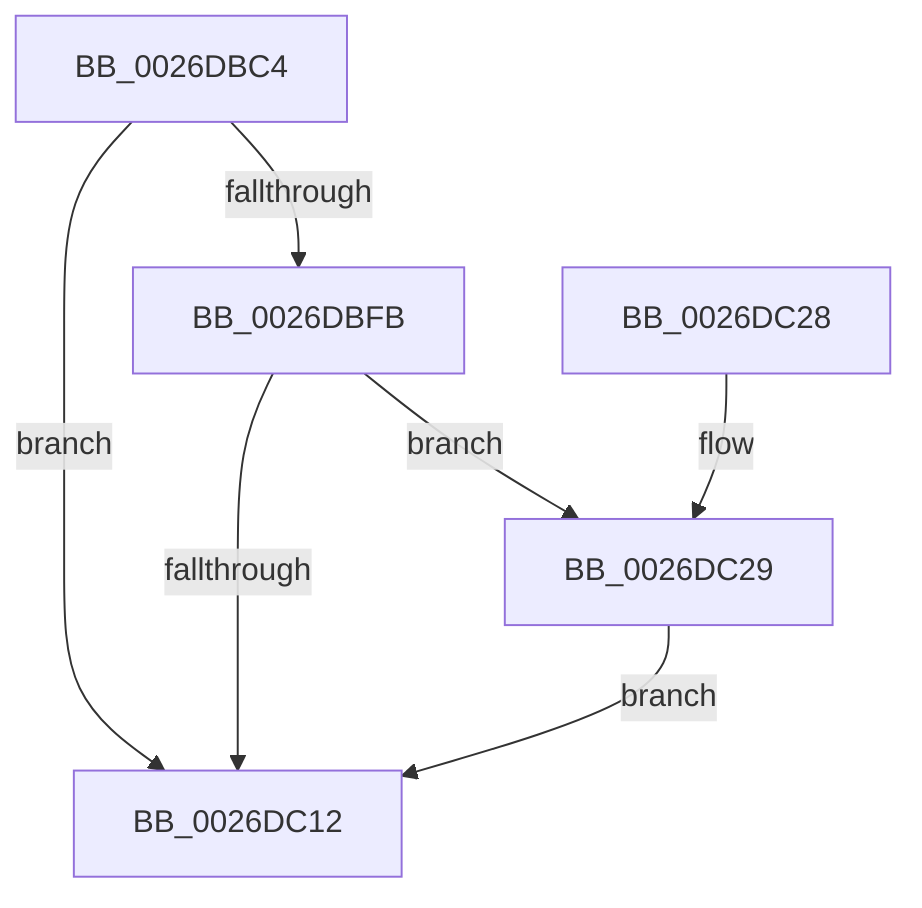

# PopDiagTraceFxDevicePowerState

- RVA: `0x0026DBC4`–`0x0026DC9A` (길이 `214` bytes)
- VA: `0x000000014026DBC4`
- 실행 섹션: `.text`
- PDB 이름 있음: `예`; PDB Function 태그: `아니요`
- unwind 정보 RVA: `0x000656A0`
- 디코드: `46`개 명령, `214/214` bytes 표시
- 미해석 바이트: `0` (있으면 어셈블리에 `.byte`로 보존)

> 이 문서는 커널 이미지의 기계어와 PDB 기호를 분석해 생성했습니다. 4번과 5번은 함수 원형과 자료형을 바이너리 사용 방식에서 추정한 C 해석이며 원본 소스 복구 결과는 아닙니다.

## 1. Dependencies

- 직접 호출 지점: **4**; 고유 호출 대상: **4**
- 직접 호출자로 확인된 함수: **2**
- RIP 상대 이미지 참조: **4**

### Outgoing calls
- `0x0026DBED` → [PopFxAddLogEntry](../39/PopFxAddLogEntry_function_00390B94.md) (function, `0x00390B94`)
- `0x0026DC09` → [EtwEventEnabled](../39/EtwEventEnabled_function_00392450.md) (function, `0x00392450`)
- `0x0026DC1A` → [_security_check_cookie](../6A/_security_check_cookie_function_006AC640.md) (function, `0x006AC640`)
- `0x0026DC90` → [EtwWriteEx](../25/EtwWriteEx_function_0025F0D0.md) (function, `0x0025F0D0`)

### Direct callers
- [PopFxHandleReportDevicePoweredOn](PopFxHandleReportDevicePoweredOn_function_0026D980.md) at `0x0026DA48`
- [PopHandleDevicePowerIrpCompletion](PopHandleDevicePowerIrpCompletion_function_0026F030.md) at `0x0026F19E`

### Static image references
- `0x0026DBCD` → RVA `0x00E0A740` (`.data`; read)
- `0x0026DBF2` → RVA `0x00E67858` (`.data`; read)
- `0x0026DBFB` → RVA `0x00F0B408` (`.data`; read)
- `0x0026DC02` → RVA `0x00010818` (`.rdata`; read)

## 2. Other-region calls and transfers

- 다른 실행 섹션으로 향하는 call: **0**
- 별도 외부 분기/꼬리 이동을 확인하지 못했습니다.

## 3. Assembly (complete function range)

```asm
0026DBC4  40 53                           push rbx
0026DBC6  48 81 EC 80 00 00 00            sub rsp, 0x80
0026DBCD  48 8B 05 6C CB B9 00            mov rax, qword ptr [rip + 0xb9cb6c]
0026DBD4  48 33 C4                        xor rax, rsp
0026DBD7  48 89 44 24 70                  mov qword ptr [rsp + 0x70], rax
0026DBDC  48 63 DA                        movsxd rbx, edx
0026DBDF  33 D2                           xor edx, edx
0026DBE1  4C 8B CB                        mov r9, rbx
0026DBE4  48 89 4C 24 48                  mov qword ptr [rsp + 0x48], rcx
0026DBE9  44 8D 42 06                     lea r8d, [rdx + 6]
0026DBED  E8 A2 2F 12 00                  call 0x140390b94
0026DBF2  80 3D 5F 9C BF 00 00            cmp byte ptr [rip + 0xbf9c5f], 0
0026DBF9  74 17                           je 0x14026dc12
0026DBFB  48 8B 0D 06 D8 C9 00            mov rcx, qword ptr [rip + 0xc9d806]
0026DC02  48 8D 15 0F 2C DA FF            lea rdx, [rip - 0x25d3f1]
0026DC09  E8 42 48 12 00                  call 0x140392450
0026DC0E  84 C0                           test al, al
0026DC10  75 17                           jne 0x14026dc29
0026DC12  48 8B 4C 24 70                  mov rcx, qword ptr [rsp + 0x70]
0026DC17  48 33 CC                        xor rcx, rsp
0026DC1A  E8 21 EA 43 00                  call 0x1406ac640
0026DC1F  48 81 C4 80 00 00 00            add rsp, 0x80
0026DC26  5B                              pop rbx
0026DC27  C3                              ret
0026DC28  CC                              int3
0026DC29  83 64 24 5C 00                  and dword ptr [rsp + 0x5c], 0
0026DC2E  48 8D 44 24 48                  lea rax, [rsp + 0x48]
0026DC33  83 64 24 6C 00                  and dword ptr [rsp + 0x6c], 0
0026DC38  48 8D 15 D9 2B DA FF            lea rdx, [rip - 0x25d427]
0026DC3F  48 8B 0D C2 D7 C9 00            mov rcx, qword ptr [rip + 0xc9d7c2]
0026DC46  41 B9 01 00 00 00               mov r9d, 1
0026DC4C  48 89 44 24 50                  mov qword ptr [rsp + 0x50], rax
0026DC51  41 2A D9                        sub bl, r9b
0026DC54  48 8D 44 24 40                  lea rax, [rsp + 0x40]
0026DC59  88 5C 24 40                     mov byte ptr [rsp + 0x40], bl
0026DC5D  48 89 44 24 60                  mov qword ptr [rsp + 0x60], rax
0026DC62  45 33 C0                        xor r8d, r8d
0026DC65  48 8D 44 24 50                  lea rax, [rsp + 0x50]
0026DC6A  C7 44 24 58 08 00 00 00         mov dword ptr [rsp + 0x58], 8
0026DC72  48 89 44 24 38                  mov qword ptr [rsp + 0x38], rax
0026DC77  C7 44 24 30 02 00 00 00         mov dword ptr [rsp + 0x30], 2
0026DC7F  48 83 64 24 28 00               and qword ptr [rsp + 0x28], 0
0026DC85  48 83 64 24 20 00               and qword ptr [rsp + 0x20], 0
0026DC8B  44 89 4C 24 68                  mov dword ptr [rsp + 0x68], r9d
0026DC90  E8 3B 14 FF FF                  call 0x14025f0d0
0026DC95  E9 78 FF FF FF                  jmp 0x14026dc12
```

## 4. C-style interpretation (structured pseudocode)

```c
__int64 __fastcall PopDiagTraceFxDevicePowerState(__int64 a1, int a2)
{
    __int64 result;
    __int64 v_rbx;
    __int64 v_rsp;
    unsigned __int64 v_stack_m18;
    unsigned __int64 v_stack_m40;
    unsigned __int64 v_stack_p20;
    unsigned __int64 v_stack_p28;
    unsigned int v_stack_p30;
    unsigned __int64 v_stack_p38;
    unsigned __int64 v_stack_p40;
    unsigned __int64 v_stack_p48;
    unsigned __int64 v_stack_p50;
    unsigned int v_stack_p58;
    unsigned int v_stack_p5C;
    unsigned __int64 v_stack_p60;
    unsigned int v_stack_p68;
    unsigned int v_stack_p6C;

    v_rsp = (v_rsp) - (128);
    result = (*(unsigned __int64 *)(v_rip + 12176236)) ^ (v_rsp);
    v_stack_m18 = result;
    a2 = 0;
    v_stack_m40 = a1;
    result = PopFxAddLogEntry(a1, a2, a2 + 6, (int)(a2));
    if ((*(unsigned __int8 *)(v_rip + 12557407)) == 0) goto loc_0026DC12;
    result = EtwEventEnabled(*(unsigned __int64 *)(v_rip + 13228038), v_rip - 2479089, a2 + 6, (int)(a2));
    if ((unsigned __int8)(result) != 0) goto loc_0026DC29;
loc_0026DC12:
    a1 = (v_stack_m18) ^ (v_rsp);
    result = _security_check_cookie(a1, v_rip - 2479089, a2 + 6, (int)(a2));
    v_rsp = (v_rsp) + (128);
    return result;
loc_0026DC29:
    v_stack_p50 = v_stack_p48;
    v_rbx = (unsigned __int8)(((int)(a2)) - (1));
    v_stack_p40 = (unsigned __int8)(v_rbx);
    v_stack_p60 = v_stack_p40;
    a3 = 0;
    v_stack_p58 = 8;
    v_stack_p38 = v_stack_p50;
    v_stack_p30 = 2;
    v_stack_p68 = 1;
    result = EtwWriteEx(*(unsigned __int64 *)(v_rip + 13227970), v_rip - 2479143, a3, 1);
    goto loc_0026DC12;
}
```

## 5. (Beta) C Style

```c
int64_t PopDiagTraceFxDevicePowerState(int64_t Arg1, int32_t Arg2)
{
    int64_t result;
    int64_t local_rbx;
    int64_t local_rsp;
    uint64_t v_stack_m18;
    uint64_t v_stack_m40;
    uint64_t v_stack_p20;
    uint64_t v_stack_p28;
    uint32_t v_stack_p30;
    uint64_t v_stack_p38;
    uint64_t v_stack_p40;
    uint64_t v_stack_p48;
    uint64_t v_stack_p50;
    uint32_t v_stack_p58;
    uint32_t v_stack_p5C;
    uint64_t v_stack_p60;
    uint32_t v_stack_p68;
    uint32_t v_stack_p6C;

    local_rsp = (local_rsp) - (128);
    result = (*(uint64_t *)(v_rip + 0xB9CB6C)) ^ (local_rsp);
    v_stack_m18 = result;
    Arg2 = 0;
    v_stack_m40 = Arg1;
    result = PopFxAddLogEntry(Arg1, Arg2, Arg2 + 6, (int32_t)(Arg2));
    if ((*(uint8_t *)(v_rip + 0xBF9C5F)) == 0) goto loc_0026DC12;
    result = EtwEventEnabled(*(uint64_t *)(v_rip + 0xC9D806), v_rip - 2479089, Arg2 + 6, (int32_t)(Arg2));
    if ((uint8_t)(result) != 0) goto loc_0026DC29;
loc_0026DC12:
    Arg1 = (v_stack_m18) ^ (local_rsp);
    result = _security_check_cookie(Arg1, v_rip - 2479089, Arg2 + 6, (int32_t)(Arg2));
    local_rsp = (local_rsp) + (128);
    return result;
loc_0026DC29:
    v_stack_p50 = v_stack_p48;
    local_rbx = (uint8_t)(((int32_t)(Arg2)) - (1));
    v_stack_p40 = (uint8_t)(local_rbx);
    v_stack_p60 = v_stack_p40;
    a3 = 0;
    v_stack_p58 = 8;
    v_stack_p38 = v_stack_p50;
    v_stack_p30 = 2;
    v_stack_p68 = 1;
    result = EtwWriteEx(*(uint64_t *)(v_rip + 0xC9D7C2), v_rip - 2479143, a3, 1);
    goto loc_0026DC12;
}
```

## 6. Execution-region graph

[열기: 2D/3D 그래프와 함수 탐색 컨트롤 패널](../../../control-panel.html?section=text&rva=0x0026DBC4&view=graph)

- 2D 그래프는 위에서 아래로 흐르고, 3D 그래프는 빈 공간을 드래그해 회전합니다. Shift+드래그는 이동, 휠은 확대·축소, 함수 노드 선택은 대상 보고서 이동입니다.

### Static fallback


