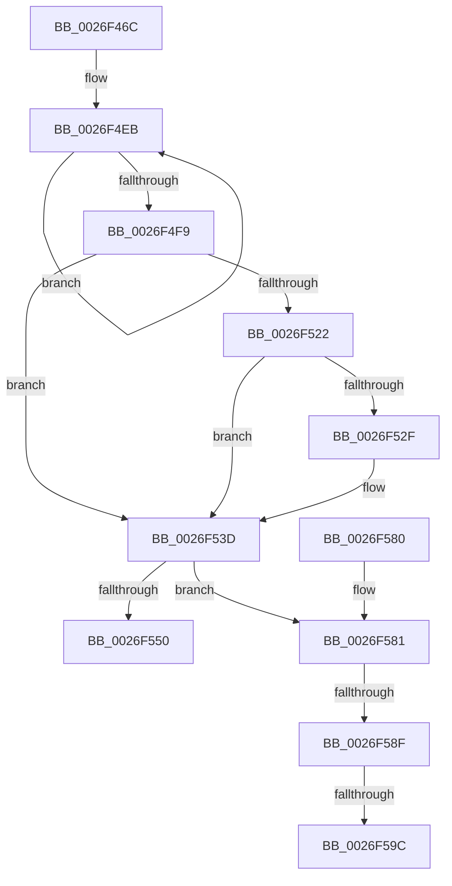

# PopDiagTraceIrpFinishTelemetry

- RVA: `0x0026F46C`–`0x0026F5C2` (길이 `342` bytes)
- VA: `0x000000014026F46C`
- 실행 섹션: `.text`
- PDB 이름 있음: `예`; PDB Function 태그: `예`
- unwind 정보 RVA: `0x00065848`
- 디코드: `85`개 명령, `342/342` bytes 표시
- 미해석 바이트: `0` (있으면 어셈블리에 `.byte`로 보존)

> 이 문서는 커널 이미지의 기계어와 PDB 기호를 분석해 생성했습니다. 4번과 5번은 함수 원형과 자료형을 바이너리 사용 방식에서 추정한 C 해석이며 원본 소스 복구 결과는 아닙니다.

## 1. Dependencies

- 직접 호출 지점: **5**; 고유 호출 대상: **5**
- 직접 호출자로 확인된 함수: **1**
- RIP 상대 이미지 참조: **2**

### Outgoing calls
- `0x0026F4CF` → [KeAcquireSpinLockRaiseToDpc](../20/KeAcquireSpinLockRaiseToDpc_function_00208470.md) (function, `0x00208470`)
- `0x0026F543` → [KeReleaseSpinLock](../39/KeReleaseSpinLock_function_00392BA0.md) (function, `0x00392BA0`)
- `0x0026F55A` → [_security_check_cookie](../6A/_security_check_cookie_function_006AC640.md) (function, `0x006AC640`)
- `0x0026F59F` → [IoFindDeviceThatFailedIrp](IoFindDeviceThatFailedIrp_function_0026E95C.md) (function, `0x0026E95C`)
- `0x0026F5AB` → [PopDiagGetDriverName](../47/PopDiagGetDriverName_function_0047FDB4.md) (function, `0x0047FDB4`)

### Direct callers
- [PopDiagTraceIrpFinish](PopDiagTraceIrpFinish_function_0026F2A8.md) at `0x0026F2D2`

### Static image references
- `0x0026F492` → RVA `0x00E0A740` (`.data`; read)
- `0x0026F4A8` → RVA `0x006C8EC0` (` ?? ::FNODOBFM::`string'`; read)

## 2. Other-region calls and transfers

- 다른 실행 섹션으로 향하는 call: **0**
- call이 아닌 외부 분기/꼬리 이동: **3**
  - `0x0026F589` → [sub_006D9F1A](../6D/Unknown_function_006D9F1A.md) (`tail-transfer`)
  - `0x0026F596` → [sub_006D9F1A](../6D/Unknown_function_006D9F1A.md) (`tail-transfer`)
  - `0x0026F5BD` → [sub_006D9F1A](../6D/Unknown_function_006D9F1A.md) (`tail-transfer`)

## 3. Assembly (complete function range)

```asm
0026F46C  48 8B C4                        mov rax, rsp
0026F46F  48 89 58 10                     mov qword ptr [rax + 0x10], rbx
0026F473  48 89 70 18                     mov qword ptr [rax + 0x18], rsi
0026F477  48 89 78 20                     mov qword ptr [rax + 0x20], rdi
0026F47B  55                              push rbp
0026F47C  41 54                           push r12
0026F47E  41 55                           push r13
0026F480  41 56                           push r14
0026F482  41 57                           push r15
0026F484  48 8D A8 38 FF FF FF            lea rbp, [rax - 0xc8]
0026F48B  48 81 EC A0 01 00 00            sub rsp, 0x1a0
0026F492  48 8B 05 A7 B2 B9 00            mov rax, qword ptr [rip + 0xb9b2a7]
0026F499  48 33 C4                        xor rax, rsp
0026F49C  48 89 85 90 00 00 00            mov qword ptr [rbp + 0x90], rax
0026F4A3  48 0F BE 41 42                  movsx rax, byte ptr [rcx + 0x42]
0026F4A8  4C 8D 2D 11 9A 45 00            lea r13, [rip + 0x459a11]
0026F4AF  48 8B F1                        mov rsi, rcx
0026F4B2  48 8D 0C C0                     lea rcx, [rax + rax*8]
0026F4B6  48 8B 9C CE C8 00 00 00         mov rbx, qword ptr [rsi + rcx*8 + 0xc8]
0026F4BE  8B 46 30                        mov eax, dword ptr [rsi + 0x30]
0026F4C1  89 44 24 30                     mov dword ptr [rsp + 0x30], eax
0026F4C5  4C 8D A3 20 01 00 00            lea r12, [rbx + 0x120]
0026F4CC  49 8B CC                        mov rcx, r12
0026F4CF  E8 9C 8F F9 FF                  call 0x140208470
0026F4D4  44 8A C8                        mov r9b, al
0026F4D7  49 B8 08 00 00 00 80 F7 FF FF   movabs r8, 0xfffff78000000008
0026F4E1  48 B8 B0 03 00 00 80 F7 FF FF   movabs rax, 0xfffff780000003b0
0026F4EB  48 8B 10                        mov rdx, qword ptr [rax]
0026F4EE  4D 8B 30                        mov r14, qword ptr [r8]
0026F4F1  48 8B 08                        mov rcx, qword ptr [rax]
0026F4F4  48 3B D1                        cmp rdx, rcx
0026F4F7  75 F2                           jne 0x14026f4eb
0026F4F9  4C 8B 43 30                     mov r8, qword ptr [rbx + 0x30]
0026F4FD  4C 2B F2                        sub r14, rdx
0026F500  49 8B CE                        mov rcx, r14
0026F503  48 B8 4B 59 86 38 D6 C5 6D 34   movabs rax, 0x346dc5d63886594b
0026F50D  49 2B C8                        sub rcx, r8
0026F510  40 32 FF                        xor dil, dil
0026F513  48 F7 E1                        mul rcx
0026F516  4C 8B FA                        mov r15, rdx
0026F519  49 C1 EF 0B                     shr r15, 0xb
0026F51D  4D 85 C0                        test r8, r8
0026F520  74 1B                           je 0x14026f53d
0026F522  B8 01 00 00 00                  mov eax, 1
0026F527  39 83 28 01 00 00               cmp dword ptr [rbx + 0x128], eax
0026F52D  75 0E                           jne 0x14026f53d
0026F52F  41 81 FF 88 13 00 00            cmp r15d, 0x1388
0026F536  40 0F B6 FF                     movzx edi, dil
0026F53A  0F 43 F8                        cmovae edi, eax
0026F53D  41 8A D1                        mov dl, r9b
0026F540  49 8B CC                        mov rcx, r12
0026F543  E8 58 36 12 00                  call 0x140392ba0
0026F548  45 33 E4                        xor r12d, r12d
0026F54B  40 84 FF                        test dil, dil
0026F54E  75 31                           jne 0x14026f581
0026F550  48 8B 8D 90 00 00 00            mov rcx, qword ptr [rbp + 0x90]
0026F557  48 33 CC                        xor rcx, rsp
0026F55A  E8 E1 D0 43 00                  call 0x1406ac640
0026F55F  4C 8D 9C 24 A0 01 00 00         lea r11, [rsp + 0x1a0]
0026F567  49 8B 5B 38                     mov rbx, qword ptr [r11 + 0x38]
0026F56B  49 8B 73 40                     mov rsi, qword ptr [r11 + 0x40]
0026F56F  49 8B 7B 48                     mov rdi, qword ptr [r11 + 0x48]
0026F573  49 8B E3                        mov rsp, r11
0026F576  41 5F                           pop r15
0026F578  41 5E                           pop r14
0026F57A  41 5D                           pop r13
0026F57C  41 5C                           pop r12
0026F57E  5D                              pop rbp
0026F57F  C3                              ret
0026F580  CC                              int3
0026F581  44 8B 5C 24 30                  mov r11d, dword ptr [rsp + 0x30]
0026F586  45 85 DB                        test r11d, r11d
0026F589  0F 89 8B A9 46 00               jns 0x1406d9f1a
0026F58F  44 39 A3 BC 00 00 00            cmp dword ptr [rbx + 0xbc], r12d
0026F596  0F 85 7E A9 46 00               jne 0x1406d9f1a
0026F59C  48 8B CE                        mov rcx, rsi
0026F59F  E8 B8 F3 FF FF                  call 0x14026e95c
0026F5A4  48 8B C8                        mov rcx, rax
0026F5A7  48 8D 55 10                     lea rdx, [rbp + 0x10]
0026F5AB  E8 04 08 21 00                  call 0x14047fdb4
0026F5B0  85 C0                           test eax, eax
0026F5B2  48 8D 4D 10                     lea rcx, [rbp + 0x10]
0026F5B6  49 0F 48 CD                     cmovs rcx, r13
0026F5BA  4C 8B E9                        mov r13, rcx
0026F5BD  E9 58 A9 46 00                  jmp 0x1406d9f1a
```

## 4. C-style interpretation (structured pseudocode)

```c
__int64 __fastcall PopDiagTraceIrpFinishTelemetry(__int64 a1)
{
    __int64 result;
    __int64 v_r12;
    __int64 v_r14;
    __int64 v_r15;
    __int64 v_rdi;
    __int64 v_rsp;
    unsigned int v_stack_m170;
    unsigned int v_stack_m198;
    unsigned __int64 v_stack_m28;

    *(unsigned __int64 *)(v_rsp + 16) = v_rbx;
    *(unsigned __int64 *)(v_rsp + 24) = v_rsi;
    *(unsigned __int64 *)(v_rsp + 32) = v_rdi;
    v_rsp = (v_rsp) - (416);
    result = (*(unsigned __int64 *)(v_rip + 12169895)) ^ (v_rsp);
    *(unsigned __int64 *)(v_rsp - 200 + 144) = result;
    v_stack_m198 = (unsigned int)((unsigned int)(*(unsigned int *)(a1 + 48)));
    result = KeAcquireSpinLockRaiseToDpc(*(unsigned __int64 *)(a1 + (__int8)(*(unsigned __int8 *)(a1 + 66)) + (__int8)(*(unsigned __int8 *)(a1 + 66)) * 8 * 8 + 200) + 288, a2, a3, a4);
loc_0026F4EB:
    if ((*(unsigned __int64 *)(result)) != (*(unsigned __int64 *)(result))) goto loc_0026F4EB;
    v_r14 = (*(unsigned __int64 *)(a3)) - (*(unsigned __int64 *)(result));
    a1 = (v_r14) - (*(unsigned __int64 *)(*(unsigned __int64 *)(a1 + (__int8)(*(unsigned __int8 *)(a1 + 66)) + (__int8)(*(unsigned __int8 *)(a1 + 66)) * 8 * 8 + 200) + 48));
    v_rdi = 0;
    v_r15 = (*(unsigned __int64 *)(result)) >> (11);
    if (*(unsigned __int64 *)(*(unsigned __int64 *)(a1 + (__int8)(*(unsigned __int8 *)(a1 + 66)) + (__int8)(*(unsigned __int8 *)(a1 + 66)) * 8 * 8 + 200) + 48) == 0) goto loc_0026F53D;
    if ((*(unsigned int *)(*(unsigned __int64 *)(a1 + (__int8)(*(unsigned __int8 *)(a1 + 66)) + (__int8)(*(unsigned __int8 *)(a1 + 66)) * 8 * 8 + 200) + 296)) == 1) {
        v_rdi = 0;
        if (((unsigned int)(v_r15)) >= 0x1388ULL) { v_rdi = 1; }
    }
    result = KeReleaseSpinLock(*(unsigned __int64 *)(a1 + (__int8)(*(unsigned __int8 *)(a1 + 66)) + (__int8)(*(unsigned __int8 *)(a1 + 66)) * 8 * 8 + 200) + 288, (unsigned __int8)((unsigned __int8)(result)), *(unsigned __int64 *)(*(unsigned __int64 *)(a1 + (__int8)(*(unsigned __int8 *)(a1 + 66)) + (__int8)(*(unsigned __int8 *)(a1 + 66)) * 8 * 8 + 200) + 48), (unsigned __int8)(result));
    v_r12 = 0;
    if ((unsigned __int8)(v_rdi) != 0) goto loc_0026F581;
    a1 = (*(unsigned __int64 *)(v_rsp - 200 + 144)) ^ (v_rsp);
    result = _security_check_cookie(a1, (unsigned __int8)((unsigned __int8)(result)), *(unsigned __int64 *)(*(unsigned __int64 *)(a1 + (__int8)(*(unsigned __int8 *)(a1 + 66)) + (__int8)(*(unsigned __int8 *)(a1 + 66)) * 8 * 8 + 200) + 48), (unsigned __int8)(result));
    return result;
loc_0026F581:
    result = IoFindDeviceThatFailedIrp(*(unsigned __int64 *)(v_stack_m28 + 64), (unsigned __int8)((unsigned __int8)(result)), *(unsigned __int64 *)(*(unsigned __int64 *)(a1 + (__int8)(*(unsigned __int8 *)(a1 + 66)) + (__int8)(*(unsigned __int8 *)(a1 + 66)) * 8 * 8 + 200) + 48), (unsigned __int8)(result));
    result = PopDiagGetDriverName(result, v_rsp - 200 + 16, *(unsigned __int64 *)(*(unsigned __int64 *)(a1 + (__int8)(*(unsigned __int8 *)(a1 + 66)) + (__int8)(*(unsigned __int8 *)(a1 + 66)) * 8 * 8 + 200) + 48), (unsigned __int8)(result));
    a1 = v_rsp - 200 + 16;
    if (sign_flag) { a1 = v_rip + 4561425; }
}
```

## 5. (Beta) C Style

```c
int64_t PopDiagTraceIrpFinishTelemetry(void *Arg1)
{
    uint8_t *arg1 = (uint8_t *)Arg1;

    int64_t result;
    int64_t local_r12;
    int64_t local_r14;
    int64_t local_r15;
    int64_t local_rdi;
    int64_t local_rsp;
    uint32_t v_stack_m170;
    uint32_t v_stack_m198;
    uint64_t v_stack_m28;

    *(uint64_t *)(local_rsp + 0x10) = local_rbx;
    *(uint64_t *)(local_rsp + 0x18) = local_rsi;
    *(uint64_t *)(local_rsp + 0x20) = local_rdi;
    local_rsp = (local_rsp) - (416);
    result = (*(uint64_t *)(v_rip + 0xB9B2A7)) ^ (local_rsp);
    *(uint64_t *)(local_rsp - 0xC8 + 0x90) = result;
    v_stack_m198 = (uint32_t)((uint32_t)(*(uint32_t *)(arg1 + 0x30)));
    result = KeAcquireSpinLockRaiseToDpc(*(uint64_t *)(arg1 + (int8_t)(*(uint8_t *)(arg1 + 0x42)) + (int8_t)(*(uint8_t *)(arg1 + 0x42)) * 8 * 8 + 0xC8) + 288, a2, a3, a4);
loc_0026F4EB:
    if ((*(uint64_t *)(result)) != (*(uint64_t *)(result))) goto loc_0026F4EB;
    local_r14 = (*(uint64_t *)(a3)) - (*(uint64_t *)(result));
    Arg1 = (local_r14) - (*(uint64_t *)(*(uint64_t *)(arg1 + (int8_t)(*(uint8_t *)(arg1 + 0x42)) + (int8_t)(*(uint8_t *)(arg1 + 0x42)) * 8 * 8 + 0xC8) + 0x30));
    local_rdi = 0;
    local_r15 = (*(uint64_t *)(result)) >> (11);
    if (*(uint64_t *)(*(uint64_t *)(arg1 + (int8_t)(*(uint8_t *)(arg1 + 0x42)) + (int8_t)(*(uint8_t *)(arg1 + 0x42)) * 8 * 8 + 0xC8) + 0x30) == 0) goto loc_0026F53D;
    if ((*(uint32_t *)(*(uint64_t *)(arg1 + (int8_t)(*(uint8_t *)(arg1 + 0x42)) + (int8_t)(*(uint8_t *)(arg1 + 0x42)) * 8 * 8 + 0xC8) + 0x128)) == 1) {
        local_rdi = 0;
        if (((uint32_t)(local_r15)) >= 0x1388ULL) { local_rdi = 1; }
    }
    result = KeReleaseSpinLock(*(uint64_t *)(arg1 + (int8_t)(*(uint8_t *)(arg1 + 0x42)) + (int8_t)(*(uint8_t *)(arg1 + 0x42)) * 8 * 8 + 0xC8) + 288, (uint8_t)((uint8_t)(result)), *(uint64_t *)(*(uint64_t *)(arg1 + (int8_t)(*(uint8_t *)(arg1 + 0x42)) + (int8_t)(*(uint8_t *)(arg1 + 0x42)) * 8 * 8 + 0xC8) + 0x30), (uint8_t)(result));
    local_r12 = 0;
    if ((uint8_t)(local_rdi) != 0) goto loc_0026F581;
    Arg1 = (*(uint64_t *)(local_rsp - 0xC8 + 0x90)) ^ (local_rsp);
    result = _security_check_cookie(Arg1, (uint8_t)((uint8_t)(result)), *(uint64_t *)(*(uint64_t *)(arg1 + (int8_t)(*(uint8_t *)(arg1 + 0x42)) + (int8_t)(*(uint8_t *)(arg1 + 0x42)) * 8 * 8 + 0xC8) + 0x30), (uint8_t)(result));
    return result;
loc_0026F581:
    result = IoFindDeviceThatFailedIrp(*(uint64_t *)(v_stack_m28 + 0x40), (uint8_t)((uint8_t)(result)), *(uint64_t *)(*(uint64_t *)(arg1 + (int8_t)(*(uint8_t *)(arg1 + 0x42)) + (int8_t)(*(uint8_t *)(arg1 + 0x42)) * 8 * 8 + 0xC8) + 0x30), (uint8_t)(result));
    result = PopDiagGetDriverName(result, local_rsp - 200 + 16, *(uint64_t *)(*(uint64_t *)(arg1 + (int8_t)(*(uint8_t *)(arg1 + 0x42)) + (int8_t)(*(uint8_t *)(arg1 + 0x42)) * 8 * 8 + 0xC8) + 0x30), (uint8_t)(result));
    Arg1 = local_rsp - 200 + 16;
    if (sign_flag) { Arg1 = v_rip + 4561425; }
}
```

### 관측된 메모리 오프셋

구조체 형식이 확인되지 않은 접근은 인자 기준의 오프셋으로만 기록했습니다.

| 기준 인자 | 오프셋 표현 | 폭 (bit) | 접근 |
|---|---:|---:|---|
| `Arg1` | `+ 0x30` | `32` | `R` |
| `Arg1` | `+ 0x42` | `8` | `R` |
| `Arg1` | `+ 0xC8 + rcx*8` | `64` | `R` |

## 6. Execution-region graph

[열기: 2D/3D 그래프와 함수 탐색 컨트롤 패널](../../../control-panel.html?section=text&rva=0x0026F46C&view=graph)

- 2D 그래프는 위에서 아래로 흐르고, 3D 그래프는 빈 공간을 드래그해 회전합니다. Shift+드래그는 이동, 휠은 확대·축소, 함수 노드 선택은 대상 보고서 이동입니다.

### Static fallback


