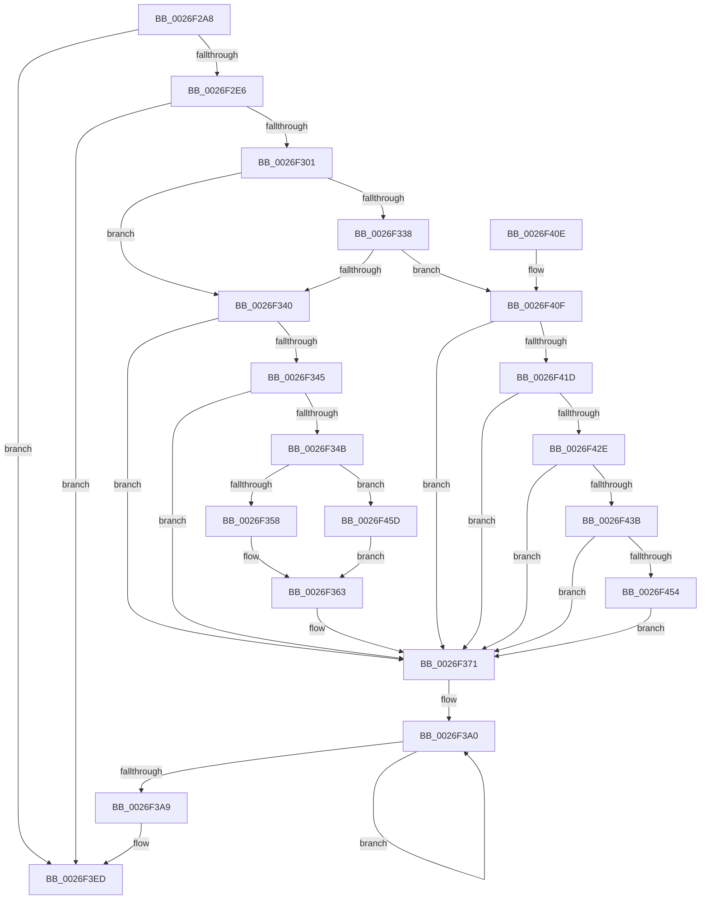

# PopDiagTraceIrpFinish

- RVA: `0x0026F2A8`–`0x0026F465` (길이 `445` bytes)
- VA: `0x000000014026F2A8`
- 실행 섹션: `.text`
- PDB 이름 있음: `예`; PDB Function 태그: `아니요`
- unwind 정보 RVA: `0x00065828`
- 디코드: `98`개 명령, `445/445` bytes 표시
- 미해석 바이트: `0` (있으면 어셈블리에 `.byte`로 보존)

> 이 문서는 커널 이미지의 기계어와 PDB 기호를 분석해 생성했습니다. 4번과 5번은 함수 원형과 자료형을 바이너리 사용 방식에서 추정한 C 해석이며 원본 소스 복구 결과는 아닙니다.

## 1. Dependencies

- 직접 호출 지점: **7**; 고유 호출 대상: **7**
- 직접 호출자로 확인된 함수: **2**
- RIP 상대 이미지 참조: **5**

### Outgoing calls
- `0x0026F2D2` → [PopDiagTraceIrpFinishTelemetry](PopDiagTraceIrpFinishTelemetry_function_0026F46C.md) (function, `0x0026F46C`)
- `0x0026F2F4` → [EtwEventEnabled](../39/EtwEventEnabled_function_00392450.md) (function, `0x00392450`)
- `0x0026F36C` → [PopFxAddLogEntry](../39/PopFxAddLogEntry_function_00390B94.md) (function, `0x00390B94`)
- `0x0026F3E8` → [EtwWriteEx](../25/EtwWriteEx_function_0025F0D0.md) (function, `0x0025F0D0`)
- `0x0026F3F4` → [_security_check_cookie](../6A/_security_check_cookie_function_006AC640.md) (function, `0x006AC640`)
- `0x0026F40F` → [IoFindDeviceThatFailedIrp](IoFindDeviceThatFailedIrp_function_0026E95C.md) (function, `0x0026E95C`)
- `0x0026F447` → [RtlStringCbCopyNW](../39/RtlStringCbCopyNW_function_003905E8.md) (function, `0x003905E8`)

### Direct callers
- [PopDequeueQuerySetIrp](PopDequeueQuerySetIrp_function_0026EC34.md) at `0x0026EC5B`
- [PopRequestCompletion](PopRequestCompletion_function_0026EEF0.md) at `0x0026EF99`

### Static image references
- `0x0026F2BF` → RVA `0x00E0A740` (`.data`; read)
- `0x0026F2D9` → RVA `0x00E67858` (`.data`; read)
- `0x0026F2E6` → RVA `0x00F0B408` (`.data`; read)
- `0x0026F2ED` → RVA `0x00010838` (`.rdata`; read)
- `0x0026F306` → RVA `0x006C8EC0` (` ?? ::FNODOBFM::`string'`; read)

## 2. Other-region calls and transfers

- 다른 실행 섹션으로 향하는 call: **0**
- 별도 외부 분기/꼬리 이동을 확인하지 못했습니다.

## 3. Assembly (complete function range)

```asm
0026F2A8  48 89 5C 24 10                  mov qword ptr [rsp + 0x10], rbx
0026F2AD  48 89 7C 24 18                  mov qword ptr [rsp + 0x18], rdi
0026F2B2  55                              push rbp
0026F2B3  48 8D 6C 24 F0                  lea rbp, [rsp - 0x10]
0026F2B8  48 81 EC 10 01 00 00            sub rsp, 0x110
0026F2BF  48 8B 05 7A B4 B9 00            mov rax, qword ptr [rip + 0xb9b47a]
0026F2C6  48 33 C4                        xor rax, rsp
0026F2C9  48 89 45 00                     mov qword ptr [rbp], rax
0026F2CD  48 89 4C 24 48                  mov qword ptr [rsp + 0x48], rcx
0026F2D2  E8 95 01 00 00                  call 0x14026f46c
0026F2D7  33 FF                           xor edi, edi
0026F2D9  40 38 3D 78 85 BF 00            cmp byte ptr [rip + 0xbf8578], dil
0026F2E0  0F 84 07 01 00 00               je 0x14026f3ed
0026F2E6  48 8B 0D 1B C1 C9 00            mov rcx, qword ptr [rip + 0xc9c11b]
0026F2ED  48 8D 15 44 15 DA FF            lea rdx, [rip - 0x25eabc]
0026F2F4  E8 57 31 12 00                  call 0x140392450
0026F2F9  84 C0                           test al, al
0026F2FB  0F 84 EC 00 00 00               je 0x14026f3ed
0026F301  48 8B 4C 24 48                  mov rcx, qword ptr [rsp + 0x48]
0026F306  48 8D 1D B3 9B 45 00            lea rbx, [rip + 0x459bb3]
0026F30D  48 0F BE 41 42                  movsx rax, byte ptr [rcx + 0x42]
0026F312  48 8D 14 C0                     lea rdx, [rax + rax*8]
0026F316  4C 8B 84 D1 C8 00 00 00         mov r8, qword ptr [rcx + rdx*8 + 0xc8]
0026F31E  48 63 51 30                     movsxd rdx, dword ptr [rcx + 0x30]
0026F322  89 54 24 40                     mov dword ptr [rsp + 0x40], edx
0026F326  45 8A 88 B8 00 00 00            mov r9b, byte ptr [r8 + 0xb8]
0026F32D  41 8B 80 BC 00 00 00            mov eax, dword ptr [r8 + 0xbc]
0026F334  85 D2                           test edx, edx
0026F336  79 08                           jns 0x14026f340
0026F338  85 C0                           test eax, eax
0026F33A  0F 84 CF 00 00 00               je 0x14026f40f
0026F340  83 F8 01                        cmp eax, 1
0026F343  75 2C                           jne 0x14026f371
0026F345  41 80 F9 02                     cmp r9b, 2
0026F349  75 26                           jne 0x14026f371
0026F34B  49 8B 40 18                     mov rax, qword ptr [r8 + 0x18]
0026F34F  48 85 C0                        test rax, rax
0026F352  0F 84 05 01 00 00               je 0x14026f45d
0026F358  48 8B 80 38 01 00 00            mov rax, qword ptr [rax + 0x138]
0026F35F  48 8B 48 28                     mov rcx, qword ptr [rax + 0x28]
0026F363  4C 8B CA                        mov r9, rdx
0026F366  33 D2                           xor edx, edx
0026F368  44 8D 42 17                     lea r8d, [rdx + 0x17]
0026F36C  E8 23 18 12 00                  call 0x140390b94
0026F371  48 8D 44 24 48                  lea rax, [rsp + 0x48]
0026F376  48 C7 44 24 58 08 00 00 00      mov qword ptr [rsp + 0x58], 8
0026F37F  48 89 44 24 50                  mov qword ptr [rsp + 0x50], rax
0026F384  48 8D 44 24 40                  lea rax, [rsp + 0x40]
0026F389  48 89 44 24 60                  mov qword ptr [rsp + 0x60], rax
0026F38E  48 83 C8 FF                     or rax, 0xffffffffffffffff
0026F392  48 C7 44 24 68 04 00 00 00      mov qword ptr [rsp + 0x68], 4
0026F39B  48 89 5C 24 70                  mov qword ptr [rsp + 0x70], rbx
0026F3A0  48 FF C0                        inc rax
0026F3A3  66 39 3C 43                     cmp word ptr [rbx + rax*2], di
0026F3A7  75 F7                           jne 0x14026f3a0
0026F3A9  48 8B 0D 58 C0 C9 00            mov rcx, qword ptr [rip + 0xc9c058]
0026F3B0  8D 04 45 02 00 00 00            lea eax, [rax*2 + 2]
0026F3B7  89 44 24 78                     mov dword ptr [rsp + 0x78], eax
0026F3BB  48 8D 15 76 14 DA FF            lea rdx, [rip - 0x25eb8a]
0026F3C2  48 8D 44 24 50                  lea rax, [rsp + 0x50]
0026F3C7  89 7C 24 7C                     mov dword ptr [rsp + 0x7c], edi
0026F3CB  48 89 44 24 38                  mov qword ptr [rsp + 0x38], rax
0026F3D0  45 33 C9                        xor r9d, r9d
0026F3D3  C7 44 24 30 03 00 00 00         mov dword ptr [rsp + 0x30], 3
0026F3DB  45 33 C0                        xor r8d, r8d
0026F3DE  48 89 7C 24 28                  mov qword ptr [rsp + 0x28], rdi
0026F3E3  48 89 7C 24 20                  mov qword ptr [rsp + 0x20], rdi
0026F3E8  E8 E3 FC FE FF                  call 0x14025f0d0
0026F3ED  48 8B 4D 00                     mov rcx, qword ptr [rbp]
0026F3F1  48 33 CC                        xor rcx, rsp
0026F3F4  E8 47 D2 43 00                  call 0x1406ac640
0026F3F9  4C 8D 9C 24 10 01 00 00         lea r11, [rsp + 0x110]
0026F401  49 8B 5B 18                     mov rbx, qword ptr [r11 + 0x18]
0026F405  49 8B 7B 20                     mov rdi, qword ptr [r11 + 0x20]
0026F409  49 8B E3                        mov rsp, r11
0026F40C  5D                              pop rbp
0026F40D  C3                              ret
0026F40E  CC                              int3
0026F40F  E8 48 F5 FF FF                  call 0x14026e95c
0026F414  48 85 C0                        test rax, rax
0026F417  0F 84 54 FF FF FF               je 0x14026f371
0026F41D  48 8B 40 08                     mov rax, qword ptr [rax + 8]
0026F421  4C 8B 40 40                     mov r8, qword ptr [rax + 0x40]
0026F425  4D 85 C0                        test r8, r8
0026F428  0F 84 43 FF FF FF               je 0x14026f371
0026F42E  0F B7 48 38                     movzx ecx, word ptr [rax + 0x38]
0026F432  66 85 C9                        test cx, cx
0026F435  0F 84 36 FF FF FF               je 0x14026f371
0026F43B  44 8B C9                        mov r9d, ecx
0026F43E  BA 80 00 00 00                  mov edx, 0x80
0026F443  48 8D 4D 80                     lea rcx, [rbp - 0x80]
0026F447  E8 9C 11 12 00                  call 0x1403905e8
0026F44C  85 C0                           test eax, eax
0026F44E  0F 88 1D FF FF FF               js 0x14026f371
0026F454  48 8D 5D 80                     lea rbx, [rbp - 0x80]
0026F458  E9 14 FF FF FF                  jmp 0x14026f371
0026F45D  48 8B CF                        mov rcx, rdi
0026F460  E9 FE FE FF FF                  jmp 0x14026f363
```

## 4. C-style interpretation (structured pseudocode)

```c
__int64 __fastcall PopDiagTraceIrpFinish(__int64 a1)
{
    __int64 result;
    __int64 v_rdi;
    __int64 v_rsp;
    unsigned __int64 v_stack_m18;
    unsigned __int64 v_stack_m8;
    unsigned __int64 v_stack_m98;
    unsigned int v_stack_m9C;
    unsigned int v_stack_mA0;
    unsigned __int64 v_stack_mA8;
    unsigned __int64 v_stack_mB0;
    unsigned __int64 v_stack_mB8;
    unsigned __int64 v_stack_mC0;
    unsigned __int64 v_stack_mC8;
    unsigned __int64 v_stack_mD0;
    unsigned int v_stack_mD8;
    unsigned __int64 v_stack_mE0;
    unsigned int v_stack_mE8;
    unsigned __int64 v_stack_mF0;
    unsigned __int64 v_stack_mF8;
    unsigned __int64 v_stack_p10;
    unsigned __int64 v_stack_p18;

    v_stack_p10 = v_rbx;
    v_stack_p18 = v_rdi;
    v_rsp = (v_rsp) - (272);
    result = (*(unsigned __int64 *)(v_rip + 12170362)) ^ (v_rsp);
    v_stack_m18 = result;
    v_stack_mD0 = a1;
    result = PopDiagTraceIrpFinishTelemetry(a1, a2, a3, a4);
    v_rdi = 0;
    if ((*(unsigned __int8 *)(v_rip + 12551544)) == 0) goto loc_0026F3ED;
    result = EtwEventEnabled(*(unsigned __int64 *)(v_rip + 13222171), v_rip - 2484924, a3, a4);
    if ((unsigned __int8)(result) == 0) goto loc_0026F3ED;
    v_stack_mD8 = (unsigned int)((int)(*(unsigned int *)(v_stack_mD0 + 48)));
    if (!sign_flag) goto loc_0026F340;
    if ((unsigned int)((unsigned int)(*(unsigned int *)(*(unsigned __int64 *)(v_stack_mD0 + (__int8)(*(unsigned __int8 *)(v_stack_mD0 + 66)) + (__int8)(*(unsigned __int8 *)(v_stack_mD0 + 66)) * 8 * 8 + 200) + 188))) == 0) goto loc_0026F40F;
loc_0026F340:
    if (((unsigned int)((unsigned int)(*(unsigned int *)(*(unsigned __int64 *)(v_stack_mD0 + (__int8)(*(unsigned __int8 *)(v_stack_mD0 + 66)) + (__int8)(*(unsigned __int8 *)(v_stack_mD0 + 66)) * 8 * 8 + 200) + 188)))) != 1) goto loc_0026F371;
    if (((unsigned __int8)(*(unsigned __int8 *)(*(unsigned __int64 *)(v_stack_mD0 + (__int8)(*(unsigned __int8 *)(v_stack_mD0 + 66)) + (__int8)(*(unsigned __int8 *)(v_stack_mD0 + 66)) * 8 * 8 + 200) + 184))) != 2) goto loc_0026F371;
    if (*(unsigned __int64 *)(*(unsigned __int64 *)(v_stack_mD0 + (__int8)(*(unsigned __int8 *)(v_stack_mD0 + 66)) + (__int8)(*(unsigned __int8 *)(v_stack_mD0 + 66)) * 8 * 8 + 200) + 24) == 0) goto loc_0026F45D;
loc_0026F363:
    a2 = 0;
    result = PopFxAddLogEntry(*(unsigned __int64 *)(*(unsigned __int64 *)(*(unsigned __int64 *)(*(unsigned __int64 *)(v_stack_mD0 + (__int8)(*(unsigned __int8 *)(v_stack_mD0 + 66)) + (__int8)(*(unsigned __int8 *)(v_stack_mD0 + 66)) * 8 * 8 + 200) + 24) + 312) + 40), a2, a2 + 23, (int)(*(unsigned int *)(v_stack_mD0 + 48)));
loc_0026F371:
    v_stack_mC0 = 8;
    v_stack_mC8 = v_stack_mD0;
    v_stack_mB8 = v_stack_mD8;
    result = (v_stack_mD8) | (-1);
    v_stack_mB0 = 4;
    v_stack_mA8 = v_rip + 4561843;
loc_0026F3A0:
    result = (result) + 1;
    if ((*(unsigned __int16 *)(v_rip + 4561843 + result * 2)) != 0) goto loc_0026F3A0;
    v_stack_mA0 = (unsigned int)(result * 2 + 2);
    v_stack_m9C = 0;
    v_stack_mE0 = v_stack_mC8;
    a4 = 0;
    v_stack_mE8 = 3;
    a3 = 0;
    v_stack_mF0 = 0;
    v_stack_mF8 = 0;
    result = EtwWriteEx(*(unsigned __int64 *)(v_rip + 13221976), v_rip - 2485130, a3, a4);
loc_0026F3ED:
    a1 = (v_stack_m18) ^ (v_rsp);
    result = _security_check_cookie(a1, v_rip - 2485130, a3, a4);
    return result;
loc_0026F40F:
    result = IoFindDeviceThatFailedIrp(a1, v_rip - 2485130, a3, a4);
    if (result == 0) goto loc_0026F371;
    if (*(unsigned __int64 *)(*(unsigned __int64 *)(result + 8) + 64) == 0) goto loc_0026F371;
    if ((unsigned __int16)(*(unsigned __int16 *)(*(unsigned __int64 *)(result + 8) + 56)) == 0) goto loc_0026F371;
    result = RtlStringCbCopyNW(v_stack_m98, 128, *(unsigned __int64 *)(*(unsigned __int64 *)(result + 8) + 64), (unsigned int)((unsigned int)(*(unsigned __int16 *)(*(unsigned __int64 *)(result + 8) + 56))));
    if (sign_flag) goto loc_0026F371;
    goto loc_0026F371;
loc_0026F45D:
    goto loc_0026F363;
}
```

## 5. (Beta) C Style

```c
int64_t PopDiagTraceIrpFinish(int64_t Arg1)
{
    int64_t result;
    int64_t local_rdi;
    int64_t local_rsp;
    uint64_t v_stack_m18;
    uint64_t v_stack_m8;
    uint64_t v_stack_m98;
    uint32_t v_stack_m9C;
    uint32_t v_stack_mA0;
    uint64_t v_stack_mA8;
    uint64_t v_stack_mB0;
    uint64_t v_stack_mB8;
    uint64_t v_stack_mC0;
    uint64_t v_stack_mC8;
    uint64_t v_stack_mD0;
    uint32_t v_stack_mD8;
    uint64_t v_stack_mE0;
    uint32_t v_stack_mE8;
    uint64_t v_stack_mF0;
    uint64_t v_stack_mF8;
    uint64_t v_stack_p10;
    uint64_t v_stack_p18;

    v_stack_p10 = local_rbx;
    v_stack_p18 = local_rdi;
    local_rsp = (local_rsp) - (272);
    result = (*(uint64_t *)(v_rip + 0xB9B47A)) ^ (local_rsp);
    v_stack_m18 = result;
    v_stack_mD0 = Arg1;
    result = PopDiagTraceIrpFinishTelemetry(Arg1, a2, a3, a4);
    local_rdi = 0;
    if ((*(uint8_t *)(v_rip + 0xBF8578)) == 0) goto loc_0026F3ED;
    result = EtwEventEnabled(*(uint64_t *)(v_rip + 0xC9C11B), v_rip - 2484924, a3, a4);
    if ((uint8_t)(result) == 0) goto loc_0026F3ED;
    v_stack_mD8 = (uint32_t)((int32_t)(*(uint32_t *)(v_stack_mD0 + 0x30)));
    if (!sign_flag) goto loc_0026F340;
    if ((uint32_t)((uint32_t)(*(uint32_t *)(*(uint64_t *)(v_stack_mD0 + (int8_t)(*(uint8_t *)(v_stack_mD0 + 0x42)) + (int8_t)(*(uint8_t *)(v_stack_mD0 + 0x42)) * 8 * 8 + 0xC8) + 0xBC))) == 0) goto loc_0026F40F;
loc_0026F340:
    if (((uint32_t)((uint32_t)(*(uint32_t *)(*(uint64_t *)(v_stack_mD0 + (int8_t)(*(uint8_t *)(v_stack_mD0 + 0x42)) + (int8_t)(*(uint8_t *)(v_stack_mD0 + 0x42)) * 8 * 8 + 0xC8) + 0xBC)))) != 1) goto loc_0026F371;
    if (((uint8_t)(*(uint8_t *)(*(uint64_t *)(v_stack_mD0 + (int8_t)(*(uint8_t *)(v_stack_mD0 + 0x42)) + (int8_t)(*(uint8_t *)(v_stack_mD0 + 0x42)) * 8 * 8 + 0xC8) + 0xB8))) != 2) goto loc_0026F371;
    if (*(uint64_t *)(*(uint64_t *)(v_stack_mD0 + (int8_t)(*(uint8_t *)(v_stack_mD0 + 0x42)) + (int8_t)(*(uint8_t *)(v_stack_mD0 + 0x42)) * 8 * 8 + 0xC8) + 0x18) == 0) goto loc_0026F45D;
loc_0026F363:
    a2 = 0;
    result = PopFxAddLogEntry(*(uint64_t *)(*(uint64_t *)(*(uint64_t *)(*(uint64_t *)(v_stack_mD0 + (int8_t)(*(uint8_t *)(v_stack_mD0 + 0x42)) + (int8_t)(*(uint8_t *)(v_stack_mD0 + 0x42)) * 8 * 8 + 0xC8) + 0x18) + 0x138) + 0x28), a2, a2 + 23, (int32_t)(*(uint32_t *)(v_stack_mD0 + 0x30)));
loc_0026F371:
    v_stack_mC0 = 8;
    v_stack_mC8 = v_stack_mD0;
    v_stack_mB8 = v_stack_mD8;
    result = (v_stack_mD8) | (-1);
    v_stack_mB0 = 4;
    v_stack_mA8 = v_rip + 4561843;
loc_0026F3A0:
    result = (result) + 1;
    if ((*(uint16_t *)(v_rip + 0x459BB3 + result * 2)) != 0) goto loc_0026F3A0;
    v_stack_mA0 = (uint32_t)(result * 2 + 2);
    v_stack_m9C = 0;
    v_stack_mE0 = v_stack_mC8;
    a4 = 0;
    v_stack_mE8 = 3;
    a3 = 0;
    v_stack_mF0 = 0;
    v_stack_mF8 = 0;
    result = EtwWriteEx(*(uint64_t *)(v_rip + 0xC9C058), v_rip - 2485130, a3, a4);
loc_0026F3ED:
    Arg1 = (v_stack_m18) ^ (local_rsp);
    result = _security_check_cookie(Arg1, v_rip - 2485130, a3, a4);
    return result;
loc_0026F40F:
    result = IoFindDeviceThatFailedIrp(Arg1, v_rip - 2485130, a3, a4);
    if (result == 0) goto loc_0026F371;
    if (*(uint64_t *)(*(uint64_t *)(result + 0x8) + 0x40) == 0) goto loc_0026F371;
    if ((uint16_t)(*(uint16_t *)(*(uint64_t *)(result + 0x8) + 0x38)) == 0) goto loc_0026F371;
    result = RtlStringCbCopyNW(v_stack_m98, 128, *(uint64_t *)(*(uint64_t *)(result + 0x8) + 0x40), (uint32_t)((uint32_t)(*(uint16_t *)(*(uint64_t *)(result + 0x8) + 0x38))));
    if (sign_flag) goto loc_0026F371;
    goto loc_0026F371;
loc_0026F45D:
    goto loc_0026F363;
}
```

## 6. Execution-region graph

[열기: 2D/3D 그래프와 함수 탐색 컨트롤 패널](../../../control-panel.html?section=text&rva=0x0026F2A8&view=graph)

- 2D 그래프는 위에서 아래로 흐르고, 3D 그래프는 빈 공간을 드래그해 회전합니다. Shift+드래그는 이동, 휠은 확대·축소, 함수 노드 선택은 대상 보고서 이동입니다.

### Static fallback


