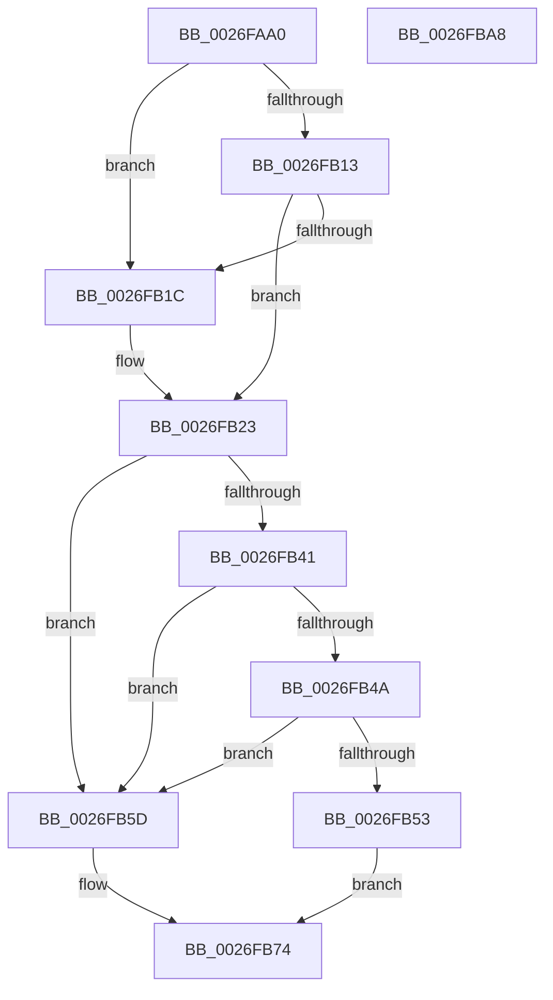

# PopFreeIrp

- RVA: `0x0026FAA0`–`0x0026FBA9` (길이 `265` bytes)
- VA: `0x000000014026FAA0`
- 실행 섹션: `.text`
- PDB 이름 있음: `예`; PDB Function 태그: `아니요`
- unwind 정보 RVA: `0x00060130`
- 디코드: `65`개 명령, `265/265` bytes 표시
- 미해석 바이트: `0` (있으면 어셈블리에 `.byte`로 보존)

> 이 문서는 커널 이미지의 기계어와 PDB 기호를 분석해 생성했습니다. 4번과 5번은 함수 원형과 자료형을 바이너리 사용 방식에서 추정한 C 해석이며 원본 소스 복구 결과는 아닙니다.

## 1. Dependencies

- 직접 호출 지점: **7**; 고유 호출 대상: **6**
- 직접 호출자로 확인된 함수: **3**
- RIP 상대 이미지 참조: **4**

### Outgoing calls
- `0x0026FAF5` → [KeAcquireInStackQueuedSpinLock](../27/KeAcquireInStackQueuedSpinLock_function_002757A0.md) (function, `0x002757A0`)
- `0x0026FB37` → [KeReleaseInStackQueuedSpinLock](../34/KeReleaseInStackQueuedSpinLock_function_00342CE0.md) (function, `0x00342CE0`)
- `0x0026FB56` → [PopFxReleasePowerIrp](../27/PopFxReleasePowerIrp_function_00270274.md) (function, `0x00270274`)
- `0x0026FB67` → [ExFreeToNPagedLookasideList](../38/ExFreeToNPagedLookasideList_function_0038D9D0.md) (function, `0x0038D9D0`)
- `0x0026FB6F` → [IoFreeIrp](../24/IoFreeIrp_function_0024DF70.md) (function, `0x0024DF70`)
- `0x0026FB7E` → [ObfDereferenceObjectWithTag](../2F/ObfDereferenceObjectWithTag_function_002F78E0.md) (function, `0x002F78E0`)
- `0x0026FB88` → [ObfDereferenceObjectWithTag](../2F/ObfDereferenceObjectWithTag_function_002F78E0.md) (function, `0x002F78E0`)

### Direct callers
- [PopRequestCompletion](PopRequestCompletion_function_0026EEF0.md) at `0x0026F011`
- [PopHandleDevicePowerIrpCompletion](PopHandleDevicePowerIrpCompletion_function_0026F030.md) at `0x0026F1D6`
- [PopSystemIrpCompletion](../../pagelk/B7/PopSystemIrpCompletion_function_00B70CC0.md) at `0x00B70E4C`

### Static image references
- `0x0026FADF` → RVA `0x00F0CA50` (`.data`; read)
- `0x0026FB06` → RVA `0x00F0BD28` (`.data`; write)
- `0x0026FB23` → RVA `0x00F0BD28` (`.data`; read/write)
- `0x0026FB60` → RVA `0x00E27640` (`.data`; read)

## 2. Other-region calls and transfers

- 다른 실행 섹션으로 향하는 call: **0**
- 별도 외부 분기/꼬리 이동을 확인하지 못했습니다.

## 3. Assembly (complete function range)

```asm
0026FAA0  4C 8B DC                        mov r11, rsp
0026FAA3  49 89 5B 08                     mov qword ptr [r11 + 8], rbx
0026FAA7  49 89 6B 10                     mov qword ptr [r11 + 0x10], rbp
0026FAAB  49 89 73 18                     mov qword ptr [r11 + 0x18], rsi
0026FAAF  49 89 7B 20                     mov qword ptr [r11 + 0x20], rdi
0026FAB3  41 56                           push r14
0026FAB5  48 83 EC 40                     sub rsp, 0x40
0026FAB9  33 C0                           xor eax, eax
0026FABB  0F 57 C0                        xorps xmm0, xmm0
0026FABE  0F 11 44 24 20                  movups xmmword ptr [rsp + 0x20], xmm0
0026FAC3  49 89 43 E8                     mov qword ptr [r11 - 0x18], rax
0026FAC7  48 8B F1                        mov rsi, rcx
0026FACA  48 0F BE 41 42                  movsx rax, byte ptr [rcx + 0x42]
0026FACF  48 8D 14 C0                     lea rdx, [rax + rax*8]
0026FAD3  48 8B 9C D1 C8 00 00 00         mov rbx, qword ptr [rcx + rdx*8 + 0xc8]
0026FADB  49 8D 53 D8                     lea rdx, [r11 - 0x28]
0026FADF  48 8D 0D 6A CF C9 00            lea rcx, [rip + 0xc9cf6a]
0026FAE6  48 8B BB C8 00 00 00            mov rdi, qword ptr [rbx + 0xc8]
0026FAED  48 8B 6B 20                     mov rbp, qword ptr [rbx + 0x20]
0026FAF1  4C 8B 73 18                     mov r14, qword ptr [rbx + 0x18]
0026FAF5  E8 A6 5C 00 00                  call 0x1402757a0
0026FAFA  65 48 8B 04 25 88 01 00 00      mov rax, qword ptr gs:[0x188]
0026FB03  48 8B 0B                        mov rcx, qword ptr [rbx]
0026FB06  48 89 05 1B C2 C9 00            mov qword ptr [rip + 0xc9c21b], rax
0026FB0D  48 39 59 08                     cmp qword ptr [rcx + 8], rbx
0026FB11  75 09                           jne 0x14026fb1c
0026FB13  48 8B 43 08                     mov rax, qword ptr [rbx + 8]
0026FB17  48 39 18                        cmp qword ptr [rax], rbx
0026FB1A  74 07                           je 0x14026fb23
0026FB1C  B9 03 00 00 00                  mov ecx, 3
0026FB21  CD 29                           int 0x29
0026FB23  48 83 25 FD C1 C9 00 00         and qword ptr [rip + 0xc9c1fd], 0
0026FB2B  48 89 08                        mov qword ptr [rax], rcx
0026FB2E  48 89 41 08                     mov qword ptr [rcx + 8], rax
0026FB32  48 8D 4C 24 20                  lea rcx, [rsp + 0x20]
0026FB37  E8 A4 31 0D 00                  call 0x140342ce0
0026FB3C  48 85 FF                        test rdi, rdi
0026FB3F  74 1C                           je 0x14026fb5d
0026FB41  80 BB B8 00 00 00 02            cmp byte ptr [rbx + 0xb8], 2
0026FB48  75 13                           jne 0x14026fb5d
0026FB4A  83 BB BC 00 00 00 01            cmp dword ptr [rbx + 0xbc], 1
0026FB51  75 0A                           jne 0x14026fb5d
0026FB53  48 8B CF                        mov rcx, rdi
0026FB56  E8 19 07 00 00                  call 0x140270274
0026FB5B  EB 17                           jmp 0x14026fb74
0026FB5D  48 8B D3                        mov rdx, rbx
0026FB60  48 8D 0D D9 7A BB 00            lea rcx, [rip + 0xbb7ad9]
0026FB67  E8 64 DE 11 00                  call 0x14038d9d0
0026FB6C  48 8B CE                        mov rcx, rsi
0026FB6F  E8 FC E3 FD FF                  call 0x14024df70
0026FB74  BB 50 6F 49 72                  mov ebx, 0x72496f50
0026FB79  48 8B CD                        mov rcx, rbp
0026FB7C  8B D3                           mov edx, ebx
0026FB7E  E8 5D 7D 08 00                  call 0x1402f78e0
0026FB83  8B D3                           mov edx, ebx
0026FB85  49 8B CE                        mov rcx, r14
0026FB88  E8 53 7D 08 00                  call 0x1402f78e0
0026FB8D  48 8B 5C 24 50                  mov rbx, qword ptr [rsp + 0x50]
0026FB92  48 8B 6C 24 58                  mov rbp, qword ptr [rsp + 0x58]
0026FB97  48 8B 74 24 60                  mov rsi, qword ptr [rsp + 0x60]
0026FB9C  48 8B 7C 24 68                  mov rdi, qword ptr [rsp + 0x68]
0026FBA1  48 83 C4 40                     add rsp, 0x40
0026FBA5  41 5E                           pop r14
0026FBA7  C3                              ret
0026FBA8  CC                              int3
```

## 4. C-style interpretation (structured pseudocode)

```c
__int64 __fastcall PopFreeIrp(__int64 a1)
{
    __int64 result;
    __int64 v_rsp;
    unsigned __int64 v_stack_m28;
    unsigned __int64 v_stack_p10;
    unsigned __int64 v_stack_p18;
    unsigned __int64 v_stack_p20;
    unsigned __int64 v_stack_p8;

    *(unsigned __int64 *)(v_rsp + 8) = v_rbx;
    *(unsigned __int64 *)(v_rsp + 16) = v_rbp;
    *(unsigned __int64 *)(v_rsp + 24) = v_rsi;
    *(unsigned __int64 *)(v_rsp + 32) = v_rdi;
    v_rsp = (v_rsp) - (64);
    result = 0;
    v_stack_m28 = v_xmm0;
    *(unsigned __int64 *)(v_rsp - 24) = 0;
    result = KeAcquireInStackQueuedSpinLock(v_rip + 13225834, v_rsp - 40, a3, a4);
    *(unsigned __int64 *)(v_rip + 13222427) = *(unsigned __int64 *)(gs_base + (0 + 392));
    if ((*(unsigned __int64 *)(*(unsigned __int64 *)(*(unsigned __int64 *)(a1 + (__int8)(*(unsigned __int8 *)(a1 + 66)) + (__int8)(*(unsigned __int8 *)(a1 + 66)) * 8 * 8 + 200)) + 8)) != (*(unsigned __int64 *)(a1 + (__int8)(*(unsigned __int8 *)(a1 + 66)) + (__int8)(*(unsigned __int8 *)(a1 + 66)) * 8 * 8 + 200))) goto loc_0026FB1C;
    if ((*(unsigned __int64 *)(*(unsigned __int64 *)(*(unsigned __int64 *)(a1 + (__int8)(*(unsigned __int8 *)(a1 + 66)) + (__int8)(*(unsigned __int8 *)(a1 + 66)) * 8 * 8 + 200) + 8))) != (*(unsigned __int64 *)(a1 + (__int8)(*(unsigned __int8 *)(a1 + 66)) + (__int8)(*(unsigned __int8 *)(a1 + 66)) * 8 * 8 + 200))) {
        a1 = 3;
    }
    *(unsigned __int64 *)(*(unsigned __int64 *)(*(unsigned __int64 *)(a1 + (__int8)(*(unsigned __int8 *)(a1 + 66)) + (__int8)(*(unsigned __int8 *)(a1 + 66)) * 8 * 8 + 200) + 8)) = a1;
    *(unsigned __int64 *)(a1 + 8) = *(unsigned __int64 *)(*(unsigned __int64 *)(a1 + (__int8)(*(unsigned __int8 *)(a1 + 66)) + (__int8)(*(unsigned __int8 *)(a1 + 66)) * 8 * 8 + 200) + 8);
    result = KeReleaseInStackQueuedSpinLock(v_stack_m28, v_rsp - 40, a3, a4);
    if (*(unsigned __int64 *)(*(unsigned __int64 *)(a1 + (__int8)(*(unsigned __int8 *)(a1 + 66)) + (__int8)(*(unsigned __int8 *)(a1 + 66)) * 8 * 8 + 200) + 200) == 0) goto loc_0026FB5D;
    if ((*(unsigned __int8 *)(*(unsigned __int64 *)(a1 + (__int8)(*(unsigned __int8 *)(a1 + 66)) + (__int8)(*(unsigned __int8 *)(a1 + 66)) * 8 * 8 + 200) + 184)) != 2) goto loc_0026FB5D;
    if ((*(unsigned int *)(*(unsigned __int64 *)(a1 + (__int8)(*(unsigned __int8 *)(a1 + 66)) + (__int8)(*(unsigned __int8 *)(a1 + 66)) * 8 * 8 + 200) + 188)) != 1) goto loc_0026FB5D;
    result = PopFxReleasePowerIrp(*(unsigned __int64 *)(*(unsigned __int64 *)(a1 + (__int8)(*(unsigned __int8 *)(a1 + 66)) + (__int8)(*(unsigned __int8 *)(a1 + 66)) * 8 * 8 + 200) + 200), v_rsp - 40, a3, a4);
    goto loc_0026FB74;
loc_0026FB5D:
    result = ExFreeToNPagedLookasideList(v_rip + 12286681, *(unsigned __int64 *)(a1 + (__int8)(*(unsigned __int8 *)(a1 + 66)) + (__int8)(*(unsigned __int8 *)(a1 + 66)) * 8 * 8 + 200), a3, a4);
    result = IoFreeIrp(a1, *(unsigned __int64 *)(a1 + (__int8)(*(unsigned __int8 *)(a1 + 66)) + (__int8)(*(unsigned __int8 *)(a1 + 66)) * 8 * 8 + 200), a3, a4);
loc_0026FB74:
    result = ObfDereferenceObjectWithTag(*(unsigned __int64 *)(*(unsigned __int64 *)(a1 + (__int8)(*(unsigned __int8 *)(a1 + 66)) + (__int8)(*(unsigned __int8 *)(a1 + 66)) * 8 * 8 + 200) + 32), (unsigned int)((unsigned int)((unsigned int)(0x72496F50ULL))), a3, a4);
    result = ObfDereferenceObjectWithTag(*(unsigned __int64 *)(*(unsigned __int64 *)(a1 + (__int8)(*(unsigned __int8 *)(a1 + 66)) + (__int8)(*(unsigned __int8 *)(a1 + 66)) * 8 * 8 + 200) + 24), (unsigned int)((unsigned int)((unsigned int)(0x72496F50ULL))), a3, a4);
    v_rsp = (v_rsp) + (64);
    return result;
}
```

## 5. (Beta) C Style

```c
int64_t PopFreeIrp(void *Arg1)
{
    uint8_t *arg1 = (uint8_t *)Arg1;

    int64_t result;
    int64_t local_rsp;
    uint64_t v_stack_m28;
    uint64_t v_stack_p10;
    uint64_t v_stack_p18;
    uint64_t v_stack_p20;
    uint64_t v_stack_p8;

    *(uint64_t *)(local_rsp + 0x8) = local_rbx;
    *(uint64_t *)(local_rsp + 0x10) = local_rbp;
    *(uint64_t *)(local_rsp + 0x18) = local_rsi;
    *(uint64_t *)(local_rsp + 0x20) = local_rdi;
    local_rsp = (local_rsp) - (64);
    result = 0;
    v_stack_m28 = v_xmm0;
    *(uint64_t *)(local_rsp - 0x18) = 0;
    result = KeAcquireInStackQueuedSpinLock(v_rip + 13225834, local_rsp - 40, a3, a4);
    *(uint64_t *)(v_rip + 0xC9C21B) = *(uint64_t *)(gs_base + (0 + 0x188));
    if ((*(uint64_t *)(*(uint64_t *)(*(uint64_t *)(arg1 + (int8_t)(*(uint8_t *)(arg1 + 0x42)) + (int8_t)(*(uint8_t *)(arg1 + 0x42)) * 8 * 8 + 0xC8)) + 0x8)) != (*(uint64_t *)(arg1 + (int8_t)(*(uint8_t *)(arg1 + 0x42)) + (int8_t)(*(uint8_t *)(arg1 + 0x42)) * 8 * 8 + 0xC8))) goto loc_0026FB1C;
    if ((*(uint64_t *)(*(uint64_t *)(*(uint64_t *)(arg1 + (int8_t)(*(uint8_t *)(arg1 + 0x42)) + (int8_t)(*(uint8_t *)(arg1 + 0x42)) * 8 * 8 + 0xC8) + 0x8))) != (*(uint64_t *)(arg1 + (int8_t)(*(uint8_t *)(arg1 + 0x42)) + (int8_t)(*(uint8_t *)(arg1 + 0x42)) * 8 * 8 + 0xC8))) {
        Arg1 = 3;
    }
    *(void **)(*(uint64_t *)(*(uint64_t *)(arg1 + (int8_t)(*(uint8_t *)(arg1 + 0x42)) + (int8_t)(*(uint8_t *)(arg1 + 0x42)) * 8 * 8 + 0xC8) + 0x8)) = Arg1;
    *(uint64_t *)(arg1 + 0x8) = *(uint64_t *)(*(uint64_t *)(arg1 + (int8_t)(*(uint8_t *)(arg1 + 0x42)) + (int8_t)(*(uint8_t *)(arg1 + 0x42)) * 8 * 8 + 0xC8) + 0x8);
    result = KeReleaseInStackQueuedSpinLock(v_stack_m28, local_rsp - 40, a3, a4);
    if (*(uint64_t *)(*(uint64_t *)(arg1 + (int8_t)(*(uint8_t *)(arg1 + 0x42)) + (int8_t)(*(uint8_t *)(arg1 + 0x42)) * 8 * 8 + 0xC8) + 0xC8) == 0) goto loc_0026FB5D;
    if ((*(uint8_t *)(*(uint64_t *)(arg1 + (int8_t)(*(uint8_t *)(arg1 + 0x42)) + (int8_t)(*(uint8_t *)(arg1 + 0x42)) * 8 * 8 + 0xC8) + 0xB8)) != 2) goto loc_0026FB5D;
    if ((*(uint32_t *)(*(uint64_t *)(arg1 + (int8_t)(*(uint8_t *)(arg1 + 0x42)) + (int8_t)(*(uint8_t *)(arg1 + 0x42)) * 8 * 8 + 0xC8) + 0xBC)) != 1) goto loc_0026FB5D;
    result = PopFxReleasePowerIrp(*(uint64_t *)(*(uint64_t *)(arg1 + (int8_t)(*(uint8_t *)(arg1 + 0x42)) + (int8_t)(*(uint8_t *)(arg1 + 0x42)) * 8 * 8 + 0xC8) + 0xC8), local_rsp - 40, a3, a4);
    goto loc_0026FB74;
loc_0026FB5D:
    result = ExFreeToNPagedLookasideList(v_rip + 12286681, *(uint64_t *)(arg1 + (int8_t)(*(uint8_t *)(arg1 + 0x42)) + (int8_t)(*(uint8_t *)(arg1 + 0x42)) * 8 * 8 + 0xC8), a3, a4);
    result = IoFreeIrp(Arg1, *(uint64_t *)(arg1 + (int8_t)(*(uint8_t *)(arg1 + 0x42)) + (int8_t)(*(uint8_t *)(arg1 + 0x42)) * 8 * 8 + 0xC8), a3, a4);
loc_0026FB74:
    result = ObfDereferenceObjectWithTag(*(uint64_t *)(*(uint64_t *)(arg1 + (int8_t)(*(uint8_t *)(arg1 + 0x42)) + (int8_t)(*(uint8_t *)(arg1 + 0x42)) * 8 * 8 + 0xC8) + 0x20), (uint32_t)((uint32_t)((uint32_t)(0x72496F50ULL))), a3, a4);
    result = ObfDereferenceObjectWithTag(*(uint64_t *)(*(uint64_t *)(arg1 + (int8_t)(*(uint8_t *)(arg1 + 0x42)) + (int8_t)(*(uint8_t *)(arg1 + 0x42)) * 8 * 8 + 0xC8) + 0x18), (uint32_t)((uint32_t)((uint32_t)(0x72496F50ULL))), a3, a4);
    local_rsp = (local_rsp) + (64);
    return result;
}
```

### 관측된 메모리 오프셋

구조체 형식이 확인되지 않은 접근은 인자 기준의 오프셋으로만 기록했습니다.

| 기준 인자 | 오프셋 표현 | 폭 (bit) | 접근 |
|---|---:|---:|---|
| `Arg1` | `+ 0x42` | `8` | `R` |
| `Arg1` | `+ 0xC8 + rdx*8` | `64` | `R` |

## 6. Execution-region graph

[열기: 2D/3D 그래프와 함수 탐색 컨트롤 패널](../../../control-panel.html?section=text&rva=0x0026FAA0&view=graph)

- 2D 그래프는 위에서 아래로 흐르고, 3D 그래프는 빈 공간을 드래그해 회전합니다. Shift+드래그는 이동, 휠은 확대·축소, 함수 노드 선택은 대상 보고서 이동입니다.

### Static fallback


