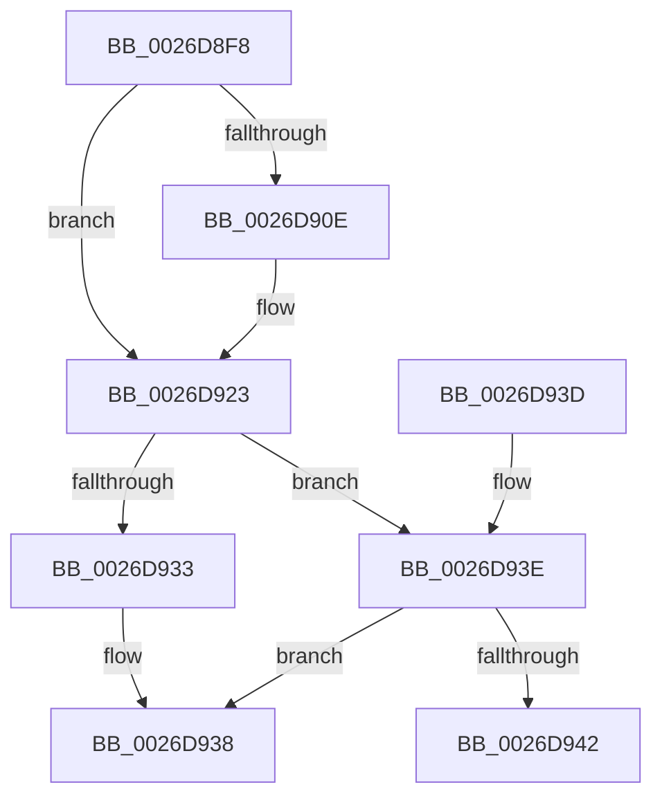

# PopFxDerefAndCompleteDirectedPowerTransition

- RVA: `0x0026D8F8`–`0x0026D957` (길이 `95` bytes)
- VA: `0x000000014026D8F8`
- 실행 섹션: `.text`
- PDB 이름 있음: `예`; PDB Function 태그: `아니요`
- unwind 정보 RVA: `0x0005E0D8`
- 디코드: `28`개 명령, `95/95` bytes 표시
- 미해석 바이트: `0` (있으면 어셈블리에 `.byte`로 보존)

> 이 문서는 커널 이미지의 기계어와 PDB 기호를 분석해 생성했습니다. 4번과 5번은 함수 원형과 자료형을 바이너리 사용 방식에서 추정한 C 해석이며 원본 소스 복구 결과는 아닙니다.

## 1. Dependencies

- 직접 호출 지점: **3**; 고유 호출 대상: **2**
- 직접 호출자로 확인된 함수: **3**
- RIP 상대 이미지 참조: **0**

### Outgoing calls
- `0x0026D91D` → [PopFxBugCheck](../2B/PopFxBugCheck_function_002BFC6C.md) (function, `0x002BFC6C`)
- `0x0026D933` → [PopFxCompleteDirectedPowerTransition](../4F/PopFxCompleteDirectedPowerTransition_function_004FB330.md) (function, `0x004FB330`)
- `0x0026D951` → [PopFxBugCheck](../2B/PopFxBugCheck_function_002BFC6C.md) (function, `0x002BFC6C`)

### Direct callers
- [PopFxHandleReportDevicePoweredOn](PopFxHandleReportDevicePoweredOn_function_0026D980.md) at `0x0026DB8F`
- [PoFxCompleteDirectedPowerDown](../5D/PoFxCompleteDirectedPowerDown_function_005D1A10.md) at `0x005D1A16`
- [sub_006D9EE6](../6D/Unknown_function_006D9EE6.md) at `0x006D9F0F`

### Static image references
- 디코드된 RIP-relative 메모리 참조가 없습니다.

## 2. Other-region calls and transfers

- 다른 실행 섹션으로 향하는 call: **0**
- 별도 외부 분기/꼬리 이동을 확인하지 못했습니다.

## 3. Assembly (complete function range)

```asm
0026D8F8  48 83 EC 28                     sub rsp, 0x28
0026D8FC  45 33 C0                        xor r8d, r8d
0026D8FF  33 C0                           xor eax, eax
0026D901  F0 44 0F B1 81 60 03 00 00      lock cmpxchg dword ptr [rcx + 0x360], r8d
0026D90A  A8 20                           test al, 0x20
0026D90C  75 15                           jne 0x14026d923
0026D90E  45 33 C9                        xor r9d, r9d
0026D911  4C 8B C1                        mov r8, rcx
0026D914  B9 10 09 00 00                  mov ecx, 0x910
0026D919  41 8D 51 01                     lea edx, [r9 + 1]
0026D91D  E8 4A 23 05 00                  call 0x1402bfc6c
0026D922  CC                              int3
0026D923  83 C8 FF                        or eax, 0xffffffff
0026D926  F0 0F C1 81 B0 04 00 00         lock xadd dword ptr [rcx + 0x4b0], eax
0026D92E  83 E8 01                        sub eax, 1
0026D931  75 0B                           jne 0x14026d93e
0026D933  E8 F8 D9 28 00                  call 0x1404fb330
0026D938  48 83 C4 28                     add rsp, 0x28
0026D93C  C3                              ret
0026D93D  CC                              int3
0026D93E  85 C0                           test eax, eax
0026D940  79 F6                           jns 0x14026d938
0026D942  45 33 C9                        xor r9d, r9d
0026D945  4C 8B C1                        mov r8, rcx
0026D948  B9 10 09 00 00                  mov ecx, 0x910
0026D94D  41 8D 51 02                     lea edx, [r9 + 2]
0026D951  E8 16 23 05 00                  call 0x1402bfc6c
0026D956  CC                              int3
```

## 4. C-style interpretation (structured pseudocode)

```c
__int64 __fastcall PopFxDerefAndCompleteDirectedPowerTransition(__int64 a1, __int64 a2, int a3, int a4)
{
    __int64 result;
    __int64 v_rsp;

    v_rsp = (v_rsp) - (40);
    a3 = 0;
    result = 0;
    if (((0) & (32)) == 0) {
        a4 = 0;
        a3 = a1;
        a1 = 0x910ULL;
        a2 = a4 + 1;
        result = PopFxBugCheck(a1, a2, a3, a4);
    }
    result = (unsigned int)((result) | (0xFFFFFFFFULL));
    result = (unsigned int)((result) - (1));
    if (condition_is_not_equal) goto loc_0026D93E;
    result = PopFxCompleteDirectedPowerTransition(a1, a2, a3, a4);
loc_0026D938:
    v_rsp = (v_rsp) + (40);
    return result;
loc_0026D93E:
    if (!sign_flag) goto loc_0026D938;
    a4 = 0;
    result = PopFxBugCheck((unsigned int)(0x910ULL), a4 + 2, a1, a4);
    return result;
}
```

## 5. (Beta) C Style

```c
int64_t PopFxDerefAndCompleteDirectedPowerTransition(void *Arg1, int64_t Arg2, int32_t Arg3, int32_t Arg4)
{
    uint8_t *arg1 = (uint8_t *)Arg1;

    int64_t result;
    int64_t local_rsp;

    local_rsp = (local_rsp) - (40);
    Arg3 = 0;
    result = 0;
    if (((0) & (32)) == 0) {
        Arg4 = 0;
        Arg3 = Arg1;
        Arg1 = 0x910ULL;
        Arg2 = Arg4 + 1;
        result = PopFxBugCheck(Arg1, Arg2, Arg3, Arg4);
    }
    result = (uint32_t)((result) | (0xFFFFFFFFULL));
    result = (uint32_t)((result) - (1));
    if (condition_is_not_equal) goto loc_0026D93E;
    result = PopFxCompleteDirectedPowerTransition(Arg1, Arg2, Arg3, Arg4);
loc_0026D938:
    local_rsp = (local_rsp) + (40);
    return result;
loc_0026D93E:
    if (!sign_flag) goto loc_0026D938;
    Arg4 = 0;
    result = PopFxBugCheck((uint32_t)(0x910ULL), Arg4 + 2, Arg1, Arg4);
    return result;
}
```

### 관측된 메모리 오프셋

구조체 형식이 확인되지 않은 접근은 인자 기준의 오프셋으로만 기록했습니다.

| 기준 인자 | 오프셋 표현 | 폭 (bit) | 접근 |
|---|---:|---:|---|
| `Arg1` | `+ 0x360` | `32` | `R` |

## 6. Execution-region graph

[열기: 2D/3D 그래프와 함수 탐색 컨트롤 패널](../../../control-panel.html?section=text&rva=0x0026D8F8&view=graph)

- 2D 그래프는 위에서 아래로 흐르고, 3D 그래프는 빈 공간을 드래그해 회전합니다. Shift+드래그는 이동, 휠은 확대·축소, 함수 노드 선택은 대상 보고서 이동입니다.

### Static fallback


