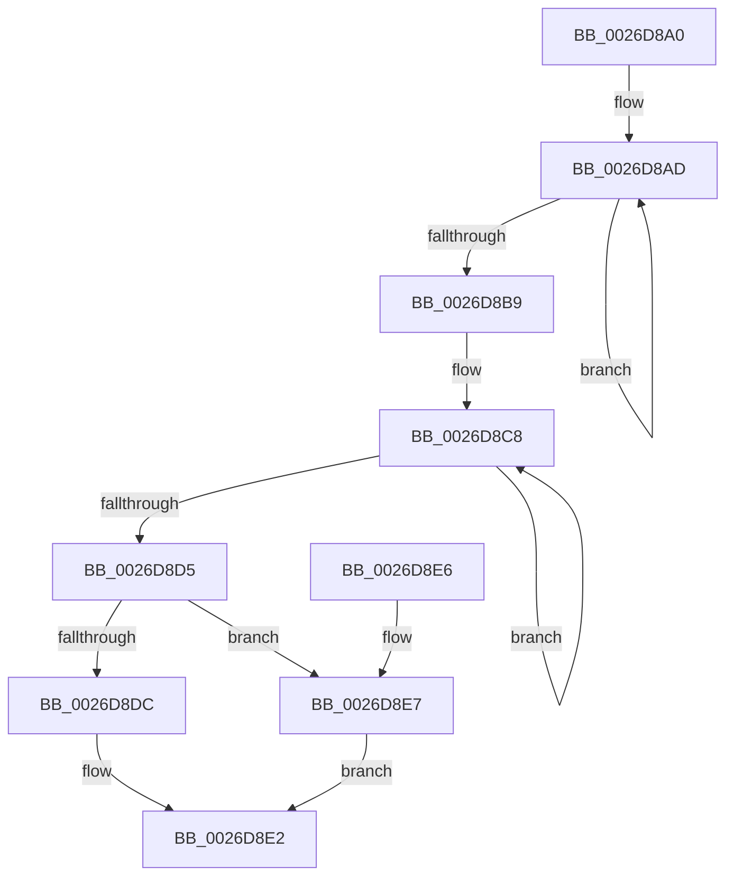

# PopFxGetDeviceDStateReason

- RVA: `0x0026D8A0`–`0x0026D8EF` (길이 `79` bytes)
- VA: `0x000000014026D8A0`
- 실행 섹션: `.text`
- PDB 이름 있음: `예`; PDB Function 태그: `아니요`
- unwind 정보 RVA: `0x000DB714`
- 디코드: `26`개 명령, `79/79` bytes 표시
- 미해석 바이트: `0` (있으면 어셈블리에 `.byte`로 보존)

> 이 문서는 커널 이미지의 기계어와 PDB 기호를 분석해 생성했습니다. 4번과 5번은 함수 원형과 자료형을 바이너리 사용 방식에서 추정한 C 해석이며 원본 소스 복구 결과는 아닙니다.

## 1. Dependencies

- 직접 호출 지점: **0**; 고유 호출 대상: **0**
- 직접 호출자로 확인된 함수: **3**
- RIP 상대 이미지 참조: **0**

### Outgoing calls
- 직접 디코드된 call 명령이 없습니다.

### Direct callers
- [PopIrpWorker](PopIrpWorker_function_0026D410.md) at `0x0026D696`
- [PopFxHandleReportDevicePoweredOn](PopFxHandleReportDevicePoweredOn_function_0026D980.md) at `0x0026DA27`
- [PopRequestPowerIrp](../27/PopRequestPowerIrp_function_00270ED4.md) at `0x00271102`

### Static image references
- 디코드된 RIP-relative 메모리 참조가 없습니다.

## 2. Other-region calls and transfers

- 다른 실행 섹션으로 향하는 call: **0**
- 별도 외부 분기/꼬리 이동을 확인하지 못했습니다.

## 3. Assembly (complete function range)

```asm
0026D8A0  4C 8B C9                        mov r9, rcx
0026D8A3  0F 0D 49 20                     prefetchw byte ptr [rcx + 0x20]
0026D8A7  8B 41 20                        mov eax, dword ptr [rcx + 0x20]
0026D8AA  45 33 C0                        xor r8d, r8d
0026D8AD  8B D0                           mov edx, eax
0026D8AF  41 0B D0                        or edx, r8d
0026D8B2  F0 0F B1 51 20                  lock cmpxchg dword ptr [rcx + 0x20], edx
0026D8B7  75 F4                           jne 0x14026d8ad
0026D8B9  8B D0                           mov edx, eax
0026D8BB  81 E2 00 20 00 00               and edx, 0x2000
0026D8C1  0F 0D 49 20                     prefetchw byte ptr [rcx + 0x20]
0026D8C5  8B 41 20                        mov eax, dword ptr [rcx + 0x20]
0026D8C8  8B C8                           mov ecx, eax
0026D8CA  41 0B C8                        or ecx, r8d
0026D8CD  F0 41 0F B1 49 20               lock cmpxchg dword ptr [r9 + 0x20], ecx
0026D8D3  75 F3                           jne 0x14026d8c8
0026D8D5  83 E0 01                        and eax, 1
0026D8D8  85 D2                           test edx, edx
0026D8DA  75 0B                           jne 0x14026d8e7
0026D8DC  84 C0                           test al, al
0026D8DE  41 0F 95 C0                     setne r8b
0026D8E2  41 8B C0                        mov eax, r8d
0026D8E5  C3                              ret
0026D8E6  CC                              int3
0026D8E7  41 B8 02 00 00 00               mov r8d, 2
0026D8ED  EB F3                           jmp 0x14026d8e2
```

## 4. C-style interpretation (structured pseudocode)

```c
__int64 __fastcall PopFxGetDeviceDStateReason(__int64 a1, __int64 a2, int a3)
{
    __int64 result;

    a3 = 0;
loc_0026D8AD:
    a2 = (unsigned int)(((unsigned int)((unsigned int)((unsigned int)(*(unsigned int *)(a1 + 32))))) | (0));
    if (condition_is_not_equal) goto loc_0026D8AD;
    a2 = (unsigned int)(((unsigned int)((unsigned int)((unsigned int)(*(unsigned int *)(a1 + 32))))) & (0x2000ULL));
loc_0026D8C8:
    a1 = (unsigned int)(((unsigned int)((unsigned int)((unsigned int)(*(unsigned int *)(a1 + 32))))) | (0));
    if (condition_is_not_equal) goto loc_0026D8C8;
    result = (unsigned int)(((unsigned int)(*(unsigned int *)(a1 + 32))) & (1));
    if ((unsigned int)(a2) != 0) goto loc_0026D8E7;
    a3 = ((unsigned __int8)(result) != 0) ? 1 : 0;
loc_0026D8E2:
    return (unsigned int)(a3);
loc_0026D8E7:
    goto loc_0026D8E2;
}
```

## 5. (Beta) C Style

```c
int64_t PopFxGetDeviceDStateReason(void *Arg1, int64_t Arg2, int32_t Arg3)
{
    uint8_t *arg1 = (uint8_t *)Arg1;

    int64_t result;

    Arg3 = 0;
loc_0026D8AD:
    Arg2 = (uint32_t)(((uint32_t)((uint32_t)((uint32_t)(*(uint32_t *)(arg1 + 0x20))))) | (0));
    if (condition_is_not_equal) goto loc_0026D8AD;
    Arg2 = (uint32_t)(((uint32_t)((uint32_t)((uint32_t)(*(uint32_t *)(arg1 + 0x20))))) & (0x2000ULL));
loc_0026D8C8:
    Arg1 = (uint32_t)(((uint32_t)((uint32_t)((uint32_t)(*(uint32_t *)(arg1 + 0x20))))) | (0));
    if (condition_is_not_equal) goto loc_0026D8C8;
    result = (uint32_t)(((uint32_t)(*(uint32_t *)(arg1 + 0x20))) & (1));
    if ((uint32_t)(Arg2) != 0) goto loc_0026D8E7;
    Arg3 = ((uint8_t)(result) != 0) ? 1 : 0;
loc_0026D8E2:
    return (uint32_t)(Arg3);
loc_0026D8E7:
    goto loc_0026D8E2;
}
```

### 관측된 메모리 오프셋

구조체 형식이 확인되지 않은 접근은 인자 기준의 오프셋으로만 기록했습니다.

| 기준 인자 | 오프셋 표현 | 폭 (bit) | 접근 |
|---|---:|---:|---|
| `Arg1` | `+ 0x20` | `8` | `R` |
| `Arg1` | `+ 0x20` | `32` | `R` |

## 6. Execution-region graph

[열기: 2D/3D 그래프와 함수 탐색 컨트롤 패널](../../../control-panel.html?section=text&rva=0x0026D8A0&view=graph)

- 2D 그래프는 위에서 아래로 흐르고, 3D 그래프는 빈 공간을 드래그해 회전합니다. Shift+드래그는 이동, 휠은 확대·축소, 함수 노드 선택은 대상 보고서 이동입니다.

### Static fallback


