# PopFxHandleReportDevicePoweredOn

- RVA: `0x0026D980`–`0x0026DBBD` (길이 `573` bytes)
- VA: `0x000000014026D980`
- 실행 섹션: `.text`
- PDB 이름 있음: `예`; PDB Function 태그: `아니요`
- unwind 정보 RVA: `0x0005FEF8`
- 디코드: `159`개 명령, `573/573` bytes 표시
- 미해석 바이트: `0` (있으면 어셈블리에 `.byte`로 보존)

> 이 문서는 커널 이미지의 기계어와 PDB 기호를 분석해 생성했습니다. 4번과 5번은 함수 원형과 자료형을 바이너리 사용 방식에서 추정한 C 해석이며 원본 소스 복구 결과는 아닙니다.

## 1. Dependencies

- 직접 호출 지점: **17**; 고유 호출 대상: **15**
- 직접 호출자로 확인된 함수: **2**
- RIP 상대 이미지 참조: **3**

### Outgoing calls
- `0x0026D9CC` → [ExTryQueueWorkItem](../39/ExTryQueueWorkItem_function_00397FF0.md) (function, `0x00397FF0`)
- `0x0026D9EE` → [ExInterlockedInsertTailList](../38/ExInterlockedInsertTailList_function_00386700.md) (function, `0x00386700`)
- `0x0026DA03` → [KeReleaseSemaphore](../39/KeReleaseSemaphore_function_00397080.md) (function, `0x00397080`)
- `0x0026DA27` → [PopFxGetDeviceDStateReason](PopFxGetDeviceDStateReason_function_0026D8A0.md) (function, `0x0026D8A0`)
- `0x0026DA3B` → [PopPepDeviceDState](../2B/PopPepDeviceDState_function_002BFE70.md) (function, `0x002BFE70`)
- `0x0026DA48` → [PopDiagTraceFxDevicePowerState](PopDiagTraceFxDevicePowerState_function_0026DBC4.md) (function, `0x0026DBC4`)
- `0x0026DA51` → [ExAcquireSpinLockExclusive](../24/ExAcquireSpinLockExclusive_function_00248690.md) (function, `0x00248690`)
- `0x0026DA83` → [PopFxBugCheck](../2B/PopFxBugCheck_function_002BFC6C.md) (function, `0x002BFC6C`)
- `0x0026DA89` → [Feature_Sx_PEP_Notification_Synchronization__private_IsEnabledNoReportingNoInline](../4F/Feature_Sx_PEP_Notification_Synchronization__private_IsEnabledNoReportingNoInline_function_004F4E70.md) (function, `0x004F4E70`)
- `0x0026DAEA` → [PoFxIdleComponent](../2C/PoFxIdleComponent_function_002C01A0.md) (function, `0x002C01A0`)
- `0x0026DB03` → [Feature_Sx_PEP_Notification_Synchronization__private_IsEnabledNoReportingNoInline](../4F/Feature_Sx_PEP_Notification_Synchronization__private_IsEnabledNoReportingNoInline_function_004F4E70.md) (function, `0x004F4E70`)
- `0x0026DB38` → [ExReleaseSpinLockExclusive](../2C/ExReleaseSpinLockExclusive_function_002C0EF0.md) (function, `0x002C0EF0`)
- `0x0026DB3D` → [Feature_Sx_PEP_Notification_Synchronization__private_IsEnabledNoReportingNoInline](../4F/Feature_Sx_PEP_Notification_Synchronization__private_IsEnabledNoReportingNoInline_function_004F4E70.md) (function, `0x004F4E70`)
- `0x0026DB61` → [PopSystemIrpCompletion](../../pagelk/B7/PopSystemIrpCompletion_function_00B70CC0.md) (function, `0x00B70CC0`)
- `0x0026DB6B` → [PopFxNotifyPendingSIrpReady](../4F/PopFxNotifyPendingSIrpReady_function_004F5918.md) (function, `0x004F5918`)
- `0x0026DB8F` → [PopFxDerefAndCompleteDirectedPowerTransition](PopFxDerefAndCompleteDirectedPowerTransition_function_0026D8F8.md) (function, `0x0026D8F8`)
- `0x0026DB98` → [PopFxCompleteDevicePowerRequired](../39/PopFxCompleteDevicePowerRequired_function_003908AC.md) (function, `0x003908AC`)

### Direct callers
- [PoFxReportDevicePoweredOn](PoFxReportDevicePoweredOn_function_0026D960.md) at `0x0026D964`
- [DifPoFxReportDevicePoweredOnWrapper](../63/DifPoFxReportDevicePoweredOnWrapper_function_00639A00.md) at `0x00639AC6`

### Static image references
- `0x0026D9D9` → RVA `0x00F0E2A8` (`.data`; read)
- `0x0026D9E7` → RVA `0x00F0E2B0` (`.data`; read)
- `0x0026D9F6` → RVA `0x00F0E2C0` (`.data`; read)

## 2. Other-region calls and transfers

- 다른 실행 섹션으로 향하는 call: **1**
  - `0x0026DB61` → [PopSystemIrpCompletion](../../pagelk/B7/PopSystemIrpCompletion_function_00B70CC0.md) (`.text` → `PAGELK`)
- 별도 외부 분기/꼬리 이동을 확인하지 못했습니다.

## 3. Assembly (complete function range)

```asm
0026D980  48 8B C4                        mov rax, rsp
0026D983  48 89 58 08                     mov qword ptr [rax + 8], rbx
0026D987  48 89 68 10                     mov qword ptr [rax + 0x10], rbp
0026D98B  48 89 70 18                     mov qword ptr [rax + 0x18], rsi
0026D98F  48 89 78 20                     mov qword ptr [rax + 0x20], rdi
0026D993  41 54                           push r12
0026D995  41 56                           push r14
0026D997  41 57                           push r15
0026D999  48 83 EC 20                     sub rsp, 0x20
0026D99D  48 8B 69 30                     mov rbp, qword ptr [rcx + 0x30]
0026D9A1  48 8B D9                        mov rbx, rcx
0026D9A4  44 0F 20 C0                     mov rax, cr8
0026D9A8  84 C0                           test al, al
0026D9AA  74 61                           je 0x14026da0d
0026D9AC  0F 0D 49 20                     prefetchw byte ptr [rcx + 0x20]
0026D9B0  8B 41 20                        mov eax, dword ptr [rcx + 0x20]
0026D9B3  8B C8                           mov ecx, eax
0026D9B5  F0 0F B1 4B 20                  lock cmpxchg dword ptr [rbx + 0x20], ecx
0026D9BA  75 F7                           jne 0x14026d9b3
0026D9BC  A8 02                           test al, 2
0026D9BE  74 4D                           je 0x14026da0d
0026D9C0  BA 30 00 00 00                  mov edx, 0x30
0026D9C5  48 8D 8B E0 04 00 00            lea rcx, [rbx + 0x4e0]
0026D9CC  E8 1F A6 12 00                  call 0x140397ff0
0026D9D1  84 C0                           test al, al
0026D9D3  0F 85 C4 01 00 00               jne 0x14026db9d
0026D9D9  4C 8D 05 C8 08 CA 00            lea r8, [rip + 0xca08c8]
0026D9E0  48 8D 93 E0 04 00 00            lea rdx, [rbx + 0x4e0]
0026D9E7  48 8D 0D C2 08 CA 00            lea rcx, [rip + 0xca08c2]
0026D9EE  E8 0D 8D 11 00                  call 0x140386700
0026D9F3  45 33 C9                        xor r9d, r9d
0026D9F6  48 8D 0D C3 08 CA 00            lea rcx, [rip + 0xca08c3]
0026D9FD  33 D2                           xor edx, edx
0026D9FF  45 8D 41 01                     lea r8d, [r9 + 1]
0026DA03  E8 78 96 12 00                  call 0x140397080
0026DA08  E9 90 01 00 00                  jmp 0x14026db9d
0026DA0D  0F 0D 4B 20                     prefetchw byte ptr [rbx + 0x20]
0026DA11  8B 43 20                        mov eax, dword ptr [rbx + 0x20]
0026DA14  8B C8                           mov ecx, eax
0026DA16  83 E1 FD                        and ecx, 0xfffffffd
0026DA19  F0 0F B1 4B 20                  lock cmpxchg dword ptr [rbx + 0x20], ecx
0026DA1E  75 F4                           jne 0x14026da14
0026DA20  A8 02                           test al, 2
0026DA22  74 29                           je 0x14026da4d
0026DA24  48 8B CB                        mov rcx, rbx
0026DA27  E8 74 FE FF FF                  call 0x14026d8a0
0026DA2C  48 8B 4B 38                     mov rcx, qword ptr [rbx + 0x38]
0026DA30  44 8B C8                        mov r9d, eax
0026DA33  41 B0 01                        mov r8b, 1
0026DA36  BA 01 00 00 00                  mov edx, 1
0026DA3B  E8 30 24 05 00                  call 0x1402bfe70
0026DA40  BA 01 00 00 00                  mov edx, 1
0026DA45  48 8B CD                        mov rcx, rbp
0026DA48  E8 77 01 00 00                  call 0x14026dbc4
0026DA4D  48 8D 4D 58                     lea rcx, [rbp + 0x58]
0026DA51  E8 3A AC FD FF                  call 0x140248690
0026DA56  33 FF                           xor edi, edi
0026DA58  33 F6                           xor esi, esi
0026DA5A  87 7D 7C                        xchg dword ptr [rbp + 0x7c], edi
0026DA5D  44 8A E0                        mov r12b, al
0026DA60  85 FF                           test edi, edi
0026DA62  0F 8E C9 00 00 00               jle 0x14026db31
0026DA68  48 8B 4B 30                     mov rcx, qword ptr [rbx + 0x30]
0026DA6C  44 8B 71 78                     mov r14d, dword ptr [rcx + 0x78]
0026DA70  41 3B FE                        cmp edi, r14d
0026DA73  7E 14                           jle 0x14026da89
0026DA75  4C 63 C7                        movsxd r8, edi
0026DA78  45 33 C9                        xor r9d, r9d
0026DA7B  48 8B D5                        mov rdx, rbp
0026DA7E  B9 02 06 00 00                  mov ecx, 0x602
0026DA83  E8 E4 21 05 00                  call 0x1402bfc6c
0026DA88  CC                              int3
0026DA89  E8 E2 73 28 00                  call 0x1404f4e70
0026DA8E  F7 D8                           neg eax
0026DA90  1B C9                           sbb ecx, ecx
0026DA92  81 E1 00 08 00 00               and ecx, 0x800
0026DA98  81 C1 FE F7 FF FF               add ecx, 0xfffff7fe
0026DA9E  F0 21 4B 20                     lock and dword ptr [rbx + 0x20], ecx
0026DAA2  48 8B 43 30                     mov rax, qword ptr [rbx + 0x30]
0026DAA6  44 2B F7                        sub r14d, edi
0026DAA9  44 89 70 78                     mov dword ptr [rax + 0x78], r14d
0026DAAD  48 8B 53 30                     mov rdx, qword ptr [rbx + 0x30]
0026DAB1  0F 0D 8A 28 01 00 00            prefetchw byte ptr [rdx + 0x128]
0026DAB8  8B 82 28 01 00 00               mov eax, dword ptr [rdx + 0x128]
0026DABE  8B C8                           mov ecx, eax
0026DAC0  F0 0F B1 8A 28 01 00 00         lock cmpxchg dword ptr [rdx + 0x128], ecx
0026DAC8  75 F4                           jne 0x14026dabe
0026DACA  A8 04                           test al, 4
0026DACC  74 35                           je 0x14026db03
0026DACE  8B 83 64 03 00 00               mov eax, dword ptr [rbx + 0x364]
0026DAD4  44 8B FF                        mov r15d, edi
0026DAD7  45 33 F6                        xor r14d, r14d
0026DADA  85 C0                           test eax, eax
0026DADC  74 1F                           je 0x14026dafd
0026DADE  41 B8 02 00 00 00               mov r8d, 2
0026DAE4  41 8B D6                        mov edx, r14d
0026DAE7  48 8B CB                        mov rcx, rbx
0026DAEA  E8 B1 26 05 00                  call 0x1402c01a0
0026DAEF  8B 83 64 03 00 00               mov eax, dword ptr [rbx + 0x364]
0026DAF5  41 FF C6                        inc r14d
0026DAF8  44 3B F0                        cmp r14d, eax
0026DAFB  72 E1                           jb 0x14026dade
0026DAFD  49 83 EF 01                     sub r15, 1
0026DB01  75 D4                           jne 0x14026dad7
0026DB03  E8 68 73 28 00                  call 0x1404f4e70
0026DB08  85 C0                           test eax, eax
0026DB0A  75 25                           jne 0x14026db31
0026DB0C  0F 0D 4B 20                     prefetchw byte ptr [rbx + 0x20]
0026DB10  8B 43 20                        mov eax, dword ptr [rbx + 0x20]
0026DB13  8B C8                           mov ecx, eax
0026DB15  0F BA F1 0A                     btr ecx, 0xa
0026DB19  F0 0F B1 4B 20                  lock cmpxchg dword ptr [rbx + 0x20], ecx
0026DB1E  75 F3                           jne 0x14026db13
0026DB20  0F BA E0 0A                     bt eax, 0xa
0026DB24  73 0B                           jae 0x14026db31
0026DB26  48 8B 43 30                     mov rax, qword ptr [rbx + 0x30]
0026DB2A  48 8B B0 18 01 00 00            mov rsi, qword ptr [rax + 0x118]
0026DB31  48 8D 4D 58                     lea rcx, [rbp + 0x58]
0026DB35  41 8A D4                        mov dl, r12b
0026DB38  E8 B3 33 05 00                  call 0x1402c0ef0
0026DB3D  E8 2E 73 28 00                  call 0x1404f4e70
0026DB42  85 C0                           test eax, eax
0026DB44  75 22                           jne 0x14026db68
0026DB46  48 85 F6                        test rsi, rsi
0026DB49  74 25                           je 0x14026db70
0026DB4B  48 0F BE 46 42                  movsx rax, byte ptr [rsi + 0x42]
0026DB50  48 8B D6                        mov rdx, rsi
0026DB53  33 C9                           xor ecx, ecx
0026DB55  4C 8D 04 C0                     lea r8, [rax + rax*8]
0026DB59  4E 8B 84 C6 C8 00 00 00         mov r8, qword ptr [rsi + r8*8 + 0xc8]
0026DB61  E8 5A 31 90 00                  call 0x140b70cc0
0026DB66  EB 08                           jmp 0x14026db70
0026DB68  48 8B CB                        mov rcx, rbx
0026DB6B  E8 A8 7D 28 00                  call 0x1404f5918
0026DB70  85 FF                           test edi, edi
0026DB72  75 29                           jne 0x14026db9d
0026DB74  0F 0D 4B 20                     prefetchw byte ptr [rbx + 0x20]
0026DB78  8B 43 20                        mov eax, dword ptr [rbx + 0x20]
0026DB7B  8B C8                           mov ecx, eax
0026DB7D  F0 0F B1 4B 20                  lock cmpxchg dword ptr [rbx + 0x20], ecx
0026DB82  75 F7                           jne 0x14026db7b
0026DB84  48 8B CB                        mov rcx, rbx
0026DB87  0F BA E0 0D                     bt eax, 0xd
0026DB8B  73 09                           jae 0x14026db96
0026DB8D  33 D2                           xor edx, edx
0026DB8F  E8 64 FD FF FF                  call 0x14026d8f8
0026DB94  EB 07                           jmp 0x14026db9d
0026DB96  33 D2                           xor edx, edx
0026DB98  E8 0F 2D 12 00                  call 0x1403908ac
0026DB9D  48 8B 5C 24 40                  mov rbx, qword ptr [rsp + 0x40]
0026DBA2  48 8B 6C 24 48                  mov rbp, qword ptr [rsp + 0x48]
0026DBA7  48 8B 74 24 50                  mov rsi, qword ptr [rsp + 0x50]
0026DBAC  48 8B 7C 24 58                  mov rdi, qword ptr [rsp + 0x58]
0026DBB1  48 83 C4 20                     add rsp, 0x20
0026DBB5  41 5F                           pop r15
0026DBB7  41 5E                           pop r14
0026DBB9  41 5C                           pop r12
0026DBBB  C3                              ret
0026DBBC  CC                              int3
```

## 4. C-style interpretation (structured pseudocode)

```c
__int64 __fastcall PopFxHandleReportDevicePoweredOn(__int64 a1, __int64 a2, __int64 a3, int a4)
{
    __int64 result;
    __int64 v_r14;
    __int64 v_r15;
    __int64 v_rdi;
    __int64 v_rsi;
    __int64 v_rsp;
    unsigned __int64 v_stack_p10;
    unsigned __int64 v_stack_p18;
    unsigned __int64 v_stack_p20;
    unsigned __int64 v_stack_p8;

    *(unsigned __int64 *)(v_rsp + 8) = v_rbx;
    *(unsigned __int64 *)(v_rsp + 16) = v_rbp;
    *(unsigned __int64 *)(v_rsp + 24) = v_rsi;
    *(unsigned __int64 *)(v_rsp + 32) = v_rdi;
    v_rsp = (v_rsp) - (32);
    if ((unsigned __int8)(v_cr8) == 0) goto loc_0026DA0D;
loc_0026D9B3:
    if ((unsigned __int8)(v_cr8) != 0) goto loc_0026D9B3;
    if ((((unsigned __int8)((unsigned int)(*(unsigned int *)(a1 + 32)))) & (2)) == 0) goto loc_0026DA0D;
    result = ExTryQueueWorkItem(a1 + 1248, 48, a3, a4);
    if ((unsigned __int8)(result) != 0) goto loc_0026DB9D;
    result = ExInterlockedInsertTailList(v_rip + 13240514, a1 + 1248, v_rip + 13240520, a4);
    a4 = 0;
    a2 = 0;
    result = KeReleaseSemaphore(v_rip + 13240515, a2, a4 + 1, a4);
    goto loc_0026DB9D;
loc_0026DA0D:
loc_0026DA14:
    a1 = (unsigned int)(((unsigned int)((unsigned int)((unsigned int)(*(unsigned int *)(a1 + 32))))) & (0xFFFFFFFDULL));
    if (condition_is_not_equal) goto loc_0026DA14;
    result = (unsigned int)(*(unsigned int *)(a1 + 32));
    if ((((unsigned __int8)((unsigned int)(*(unsigned int *)(a1 + 32)))) & (2)) != 0) {
        a1 = a1;
        result = PopFxGetDeviceDStateReason(a1, a2, a4 + 1, a4);
        a1 = *(unsigned __int64 *)(a1 + 56);
        a4 = (unsigned int)(result);
        a3 = 1;
        a2 = 1;
        result = PopPepDeviceDState(a1, a2, a3, a4);
        a2 = 1;
        a1 = *(unsigned __int64 *)(a1 + 48);
        result = PopDiagTraceFxDevicePowerState(a1, a2, a3, a4);
    }
    result = ExAcquireSpinLockExclusive(*(unsigned __int64 *)(a1 + 48) + 88, a2, a3, a4);
    v_rdi = 0;
    v_rsi = 0;
    if (condition_is_less_or_equal) goto loc_0026DB31;
    if (0 >= = ((unsigned int)((unsigned int)(*(unsigned int *)(*(unsigned __int64 *)(a1 + 48) + 120))))) {
        a3 = (int)(0);
        a4 = 0;
        a2 = *(unsigned __int64 *)(a1 + 48);
        a1 = 0x602ULL;
        result = PopFxBugCheck(a1, a2, a3, a4);
    }
    result = Feature_Sx_PEP_Notification_Synchronization__private_IsEnabledNoReportingNoInline(a1, a2, a3, a4);
    result = (unsigned int)(-(result));
    a1 = (unsigned int)((a1) & (0x800ULL));
    a1 = (unsigned int)((a1) + (0xFFFFF7FEULL));
    v_r14 = (unsigned int)(((unsigned int)(*(unsigned int *)(*(unsigned __int64 *)(a1 + 48) + 120))) - (0));
    *(unsigned int *)(*(unsigned __int64 *)(a1 + 48) + 120) = (unsigned int)(v_r14);
loc_0026DABE:
    if (condition_is_not_equal) goto loc_0026DABE;
    if ((((unsigned __int8)((unsigned int)(*(unsigned int *)(*(unsigned __int64 *)(a1 + 48) + 296)))) & (4)) == 0) goto loc_0026DB03;
loc_0026DAD7:
    v_r14 = 0;
    if ((unsigned int)((unsigned int)(*(unsigned int *)(a1 + 868))) == 0) goto loc_0026DAFD;
loc_0026DADE:
    result = PoFxIdleComponent(a1, 0, 2, a4);
    v_r14 = (unsigned int)((v_r14) + 1);
    if (((unsigned int)(v_r14)) < ((unsigned int)((unsigned int)(*(unsigned int *)(a1 + 868))))) goto loc_0026DADE;
loc_0026DAFD:
    v_r15 = (0) - (1);
    if (condition_is_not_equal) goto loc_0026DAD7;
loc_0026DB03:
    result = Feature_Sx_PEP_Notification_Synchronization__private_IsEnabledNoReportingNoInline(a1, 0, 2, a4);
    if ((unsigned int)(result) != 0) goto loc_0026DB31;
loc_0026DB13:
    if ((unsigned int)(result) != 0) goto loc_0026DB13;
    result = (unsigned int)(*(unsigned int *)(a1 + 32));
    if (!(condition_is_above_or_equal)) {
        result = *(unsigned __int64 *)(a1 + 48);
        v_rsi = *(unsigned __int64 *)(result + 280);
    }
    result = ExReleaseSpinLockExclusive(*(unsigned __int64 *)(a1 + 48) + 88, (unsigned __int8)((unsigned __int8)(result)), 2, a4);
    result = Feature_Sx_PEP_Notification_Synchronization__private_IsEnabledNoReportingNoInline(*(unsigned __int64 *)(a1 + 48) + 88, (unsigned __int8)((unsigned __int8)(result)), 2, a4);
    if ((unsigned int)(result) != 0) goto loc_0026DB68;
    if (v_rsi == 0) goto loc_0026DB70;
    a1 = 0;
    result = PopSystemIrpCompletion(a1, v_rsi, *(unsigned __int64 *)(v_rsi + (__int8)(*(unsigned __int8 *)(v_rsi + 66)) + (__int8)(*(unsigned __int8 *)(v_rsi + 66)) * 8 * 8 + 200), a4);
    goto loc_0026DB70;
loc_0026DB68:
    result = PopFxNotifyPendingSIrpReady(0, v_rsi, *(unsigned __int64 *)(v_rsi + (__int8)(*(unsigned __int8 *)(v_rsi + 66)) + (__int8)(*(unsigned __int8 *)(v_rsi + 66)) * 8 * 8 + 200), a4);
loc_0026DB70:
    if (0 != 0) goto loc_0026DB9D;
loc_0026DB7B:
    if (0 != 0) goto loc_0026DB7B;
    if (condition_is_above_or_equal) goto loc_0026DB96;
    a2 = 0;
    result = PopFxDerefAndCompleteDirectedPowerTransition(0, a2, *(unsigned __int64 *)(v_rsi + (__int8)(*(unsigned __int8 *)(v_rsi + 66)) + (__int8)(*(unsigned __int8 *)(v_rsi + 66)) * 8 * 8 + 200), a4);
    goto loc_0026DB9D;
loc_0026DB96:
    a2 = 0;
    result = PopFxCompleteDevicePowerRequired(0, a2, *(unsigned __int64 *)(v_rsi + (__int8)(*(unsigned __int8 *)(v_rsi + 66)) + (__int8)(*(unsigned __int8 *)(v_rsi + 66)) * 8 * 8 + 200), a4);
loc_0026DB9D:
    v_rsp = (v_rsp) + (32);
    return result;
}
```

## 5. (Beta) C Style

```c
int64_t PopFxHandleReportDevicePoweredOn(void *Arg1, int64_t Arg2, int64_t Arg3, int32_t Arg4)
{
    uint8_t *arg1 = (uint8_t *)Arg1;

    int64_t result;
    int64_t local_r14;
    int64_t local_r15;
    int64_t local_rdi;
    int64_t local_rsi;
    int64_t local_rsp;
    uint64_t v_stack_p10;
    uint64_t v_stack_p18;
    uint64_t v_stack_p20;
    uint64_t v_stack_p8;

    *(uint64_t *)(local_rsp + 0x8) = local_rbx;
    *(uint64_t *)(local_rsp + 0x10) = local_rbp;
    *(uint64_t *)(local_rsp + 0x18) = local_rsi;
    *(uint64_t *)(local_rsp + 0x20) = local_rdi;
    local_rsp = (local_rsp) - (32);
    if ((uint8_t)(v_cr8) == 0) goto loc_0026DA0D;
loc_0026D9B3:
    if ((uint8_t)(v_cr8) != 0) goto loc_0026D9B3;
    if ((((uint8_t)((uint32_t)(*(uint32_t *)(arg1 + 0x20)))) & (2)) == 0) goto loc_0026DA0D;
    result = ExTryQueueWorkItem(Arg1 + 1248, 48, Arg3, Arg4);
    if ((uint8_t)(result) != 0) goto loc_0026DB9D;
    result = ExInterlockedInsertTailList(v_rip + 13240514, Arg1 + 1248, v_rip + 13240520, Arg4);
    Arg4 = 0;
    Arg2 = 0;
    result = KeReleaseSemaphore(v_rip + 13240515, Arg2, Arg4 + 1, Arg4);
    goto loc_0026DB9D;
loc_0026DA0D:
loc_0026DA14:
    Arg1 = (uint32_t)(((uint32_t)((uint32_t)((uint32_t)(*(uint32_t *)(arg1 + 0x20))))) & (0xFFFFFFFDULL));
    if (condition_is_not_equal) goto loc_0026DA14;
    result = (uint32_t)(*(uint32_t *)(arg1 + 0x20));
    if ((((uint8_t)((uint32_t)(*(uint32_t *)(arg1 + 0x20)))) & (2)) != 0) {
        Arg1 = Arg1;
        result = PopFxGetDeviceDStateReason(Arg1, Arg2, Arg4 + 1, Arg4);
        Arg1 = *(uint64_t *)(arg1 + 0x38);
        Arg4 = (uint32_t)(result);
        Arg3 = 1;
        Arg2 = 1;
        result = PopPepDeviceDState(Arg1, Arg2, Arg3, Arg4);
        Arg2 = 1;
        Arg1 = *(uint64_t *)(arg1 + 0x30);
        result = PopDiagTraceFxDevicePowerState(Arg1, Arg2, Arg3, Arg4);
    }
    result = ExAcquireSpinLockExclusive(*(uint64_t *)(arg1 + 0x30) + 88, Arg2, Arg3, Arg4);
    local_rdi = 0;
    local_rsi = 0;
    if (condition_is_less_or_equal) goto loc_0026DB31;
    if (0 >= = ((uint32_t)((uint32_t)(*(uint32_t *)(*(uint64_t *)(arg1 + 0x30) + 0x78))))) {
        Arg3 = (int32_t)(0);
        Arg4 = 0;
        Arg2 = *(uint64_t *)(arg1 + 0x30);
        Arg1 = 0x602ULL;
        result = PopFxBugCheck(Arg1, Arg2, Arg3, Arg4);
    }
    result = Feature_Sx_PEP_Notification_Synchronization__private_IsEnabledNoReportingNoInline(Arg1, Arg2, Arg3, Arg4);
    result = (uint32_t)(-(result));
    Arg1 = (uint32_t)((Arg1) & (0x800ULL));
    Arg1 = (uint32_t)((Arg1) + (0xFFFFF7FEULL));
    local_r14 = (uint32_t)(((uint32_t)(*(uint32_t *)(*(uint64_t *)(arg1 + 0x30) + 0x78))) - (0));
    *(uint32_t *)(*(uint64_t *)(arg1 + 0x30) + 0x78) = (uint32_t)(local_r14);
loc_0026DABE:
    if (condition_is_not_equal) goto loc_0026DABE;
    if ((((uint8_t)((uint32_t)(*(uint32_t *)(*(uint64_t *)(arg1 + 0x30) + 0x128)))) & (4)) == 0) goto loc_0026DB03;
loc_0026DAD7:
    local_r14 = 0;
    if ((uint32_t)((uint32_t)(*(uint32_t *)(arg1 + 0x364))) == 0) goto loc_0026DAFD;
loc_0026DADE:
    result = PoFxIdleComponent(Arg1, 0, 2, Arg4);
    local_r14 = (uint32_t)((local_r14) + 1);
    if (((uint32_t)(local_r14)) < ((uint32_t)((uint32_t)(*(uint32_t *)(arg1 + 0x364))))) goto loc_0026DADE;
loc_0026DAFD:
    local_r15 = (0) - (1);
    if (condition_is_not_equal) goto loc_0026DAD7;
loc_0026DB03:
    result = Feature_Sx_PEP_Notification_Synchronization__private_IsEnabledNoReportingNoInline(Arg1, 0, 2, Arg4);
    if ((uint32_t)(result) != 0) goto loc_0026DB31;
loc_0026DB13:
    if ((uint32_t)(result) != 0) goto loc_0026DB13;
    result = (uint32_t)(*(uint32_t *)(arg1 + 0x20));
    if (!(condition_is_above_or_equal)) {
        result = *(uint64_t *)(arg1 + 0x30);
        local_rsi = *(uint64_t *)(result + 0x118);
    }
    result = ExReleaseSpinLockExclusive(*(uint64_t *)(arg1 + 0x30) + 88, (uint8_t)((uint8_t)(result)), 2, Arg4);
    result = Feature_Sx_PEP_Notification_Synchronization__private_IsEnabledNoReportingNoInline(*(uint64_t *)(arg1 + 0x30) + 88, (uint8_t)((uint8_t)(result)), 2, Arg4);
    if ((uint32_t)(result) != 0) goto loc_0026DB68;
    if (local_rsi == 0) goto loc_0026DB70;
    Arg1 = 0;
    result = PopSystemIrpCompletion(Arg1, local_rsi, *(uint64_t *)(local_rsi + (int8_t)(*(uint8_t *)(local_rsi + 0x42)) + (int8_t)(*(uint8_t *)(local_rsi + 0x42)) * 8 * 8 + 0xC8), Arg4);
    goto loc_0026DB70;
loc_0026DB68:
    result = PopFxNotifyPendingSIrpReady(0, local_rsi, *(uint64_t *)(local_rsi + (int8_t)(*(uint8_t *)(local_rsi + 0x42)) + (int8_t)(*(uint8_t *)(local_rsi + 0x42)) * 8 * 8 + 0xC8), Arg4);
loc_0026DB70:
    if (0 != 0) goto loc_0026DB9D;
loc_0026DB7B:
    if (0 != 0) goto loc_0026DB7B;
    if (condition_is_above_or_equal) goto loc_0026DB96;
    Arg2 = 0;
    result = PopFxDerefAndCompleteDirectedPowerTransition(0, Arg2, *(uint64_t *)(local_rsi + (int8_t)(*(uint8_t *)(local_rsi + 0x42)) + (int8_t)(*(uint8_t *)(local_rsi + 0x42)) * 8 * 8 + 0xC8), Arg4);
    goto loc_0026DB9D;
loc_0026DB96:
    Arg2 = 0;
    result = PopFxCompleteDevicePowerRequired(0, Arg2, *(uint64_t *)(local_rsi + (int8_t)(*(uint8_t *)(local_rsi + 0x42)) + (int8_t)(*(uint8_t *)(local_rsi + 0x42)) * 8 * 8 + 0xC8), Arg4);
loc_0026DB9D:
    local_rsp = (local_rsp) + (32);
    return result;
}
```

### 관측된 메모리 오프셋

구조체 형식이 확인되지 않은 접근은 인자 기준의 오프셋으로만 기록했습니다.

| 기준 인자 | 오프셋 표현 | 폭 (bit) | 접근 |
|---|---:|---:|---|
| `Arg1` | `+ 0x20` | `8` | `R` |
| `Arg1` | `+ 0x20` | `32` | `R` |
| `Arg1` | `+ 0x20` | `32` | `R/W` |
| `Arg1` | `+ 0x30` | `64` | `R` |
| `Arg1` | `+ 0x38` | `64` | `R` |
| `Arg1` | `+ 0x364` | `32` | `R` |
| `Arg1` | `+ 0x4E0` | `64` | `R` |

## 6. Execution-region graph

[열기: 2D/3D 그래프와 함수 탐색 컨트롤 패널](../../../control-panel.html?section=text&rva=0x0026D980&view=graph)

- 2D 그래프는 위에서 아래로 흐르고, 3D 그래프는 빈 공간을 드래그해 회전합니다. Shift+드래그는 이동, 휠은 확대·축소, 함수 노드 선택은 대상 보고서 이동입니다.

### Static fallback

```mermaid
flowchart TD
  bb_0026D980[BB_0026D980]
  bb_0026D9AC[BB_0026D9AC]
  bb_0026D9B3[BB_0026D9B3]
  bb_0026D9BC[BB_0026D9BC]
  bb_0026D9C0[BB_0026D9C0]
  bb_0026D9D9[BB_0026D9D9]
  bb_0026DA0D[BB_0026DA0D]
  bb_0026DA14[BB_0026DA14]
  bb_0026DA20[BB_0026DA20]
  bb_0026DA24[BB_0026DA24]
  bb_0026DA4D[BB_0026DA4D]
  bb_0026DA68[BB_0026DA68]
  bb_0026DA75[BB_0026DA75]
  bb_0026DA89[BB_0026DA89]
  bb_0026DABE[BB_0026DABE]
  bb_0026DACA[BB_0026DACA]
  bb_0026DACE[BB_0026DACE]
  bb_0026DAD7[BB_0026DAD7]
  bb_0026DADE[BB_0026DADE]
  bb_0026DAFD[BB_0026DAFD]
  bb_0026DB03[BB_0026DB03]
  bb_0026DB0C[BB_0026DB0C]
  bb_0026DB13[BB_0026DB13]
  bb_0026DB20[BB_0026DB20]
  bb_0026DB26[BB_0026DB26]
  bb_0026DB31[BB_0026DB31]
  bb_0026DB46[BB_0026DB46]
  bb_0026DB4B[BB_0026DB4B]
  bb_0026DB68[BB_0026DB68]
  bb_0026DB70[BB_0026DB70]
  bb_0026DB74[BB_0026DB74]
  bb_0026DB7B[BB_0026DB7B]
  bb_0026DB84[BB_0026DB84]
  bb_0026DB8D[BB_0026DB8D]
  bb_0026DB96[BB_0026DB96]
  bb_0026DB9D[BB_0026DB9D]
  bb_0026DBBC[BB_0026DBBC]
  bb_0026D980 -->|branch| bb_0026DA0D
  bb_0026D980 -->|fallthrough| bb_0026D9AC
  bb_0026D9AC -->|flow| bb_0026D9B3
  bb_0026D9B3 -->|branch| bb_0026D9B3
  bb_0026D9B3 -->|fallthrough| bb_0026D9BC
  bb_0026D9BC -->|branch| bb_0026DA0D
  bb_0026D9BC -->|fallthrough| bb_0026D9C0
  bb_0026D9C0 -->|branch| bb_0026DB9D
  bb_0026D9C0 -->|fallthrough| bb_0026D9D9
  bb_0026D9D9 -->|branch| bb_0026DB9D
  bb_0026DA0D -->|flow| bb_0026DA14
  bb_0026DA14 -->|branch| bb_0026DA14
  bb_0026DA14 -->|fallthrough| bb_0026DA20
  bb_0026DA20 -->|branch| bb_0026DA4D
  bb_0026DA20 -->|fallthrough| bb_0026DA24
  bb_0026DA24 -->|flow| bb_0026DA4D
  bb_0026DA4D -->|branch| bb_0026DB31
  bb_0026DA4D -->|fallthrough| bb_0026DA68
  bb_0026DA68 -->|branch| bb_0026DA89
  bb_0026DA68 -->|fallthrough| bb_0026DA75
  bb_0026DA75 -->|flow| bb_0026DA89
  bb_0026DA89 -->|flow| bb_0026DABE
  bb_0026DABE -->|branch| bb_0026DABE
  bb_0026DABE -->|fallthrough| bb_0026DACA
  bb_0026DACA -->|branch| bb_0026DB03
  bb_0026DACA -->|fallthrough| bb_0026DACE
  bb_0026DACE -->|flow| bb_0026DAD7
  bb_0026DAD7 -->|branch| bb_0026DAFD
  bb_0026DAD7 -->|fallthrough| bb_0026DADE
  bb_0026DADE -->|branch| bb_0026DADE
  bb_0026DADE -->|fallthrough| bb_0026DAFD
  bb_0026DAFD -->|branch| bb_0026DAD7
  bb_0026DAFD -->|fallthrough| bb_0026DB03
  bb_0026DB03 -->|branch| bb_0026DB31
  bb_0026DB03 -->|fallthrough| bb_0026DB0C
  bb_0026DB0C -->|flow| bb_0026DB13
  bb_0026DB13 -->|branch| bb_0026DB13
  bb_0026DB13 -->|fallthrough| bb_0026DB20
  bb_0026DB20 -->|branch| bb_0026DB31
  bb_0026DB20 -->|fallthrough| bb_0026DB26
  bb_0026DB26 -->|flow| bb_0026DB31
  bb_0026DB31 -->|branch| bb_0026DB68
  bb_0026DB31 -->|fallthrough| bb_0026DB46
  bb_0026DB46 -->|branch| bb_0026DB70
  bb_0026DB46 -->|fallthrough| bb_0026DB4B
  bb_0026DB4B -->|branch| bb_0026DB70
  bb_0026DB68 -->|flow| bb_0026DB70
  bb_0026DB70 -->|branch| bb_0026DB9D
  bb_0026DB70 -->|fallthrough| bb_0026DB74
  bb_0026DB74 -->|flow| bb_0026DB7B
  bb_0026DB7B -->|branch| bb_0026DB7B
  bb_0026DB7B -->|fallthrough| bb_0026DB84
  bb_0026DB84 -->|branch| bb_0026DB96
  bb_0026DB84 -->|fallthrough| bb_0026DB8D
  bb_0026DB8D -->|branch| bb_0026DB9D
  bb_0026DB96 -->|flow| bb_0026DB9D
```


