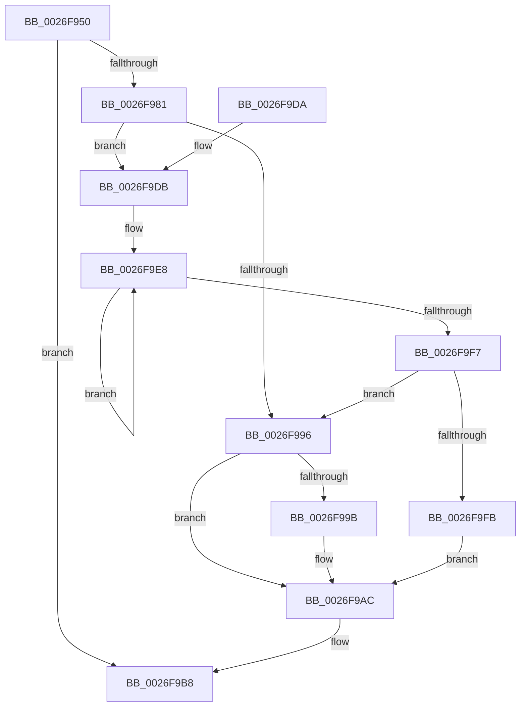

# PopFxLockDevice

- RVA: `0x0026F950`–`0x0026FA00` (길이 `176` bytes)
- VA: `0x000000014026F950`
- 실행 섹션: `.text`
- PDB 이름 있음: `예`; PDB Function 태그: `아니요`
- unwind 정보 RVA: `0x00065924`
- 디코드: `53`개 명령, `176/176` bytes 표시
- 미해석 바이트: `0` (있으면 어셈블리에 `.byte`로 보존)

> 이 문서는 커널 이미지의 기계어와 PDB 기호를 분석해 생성했습니다. 4번과 5번은 함수 원형과 자료형을 바이너리 사용 방식에서 추정한 C 해석이며 원본 소스 복구 결과는 아닙니다.

## 1. Dependencies

- 직접 호출 지점: **3**; 고유 호출 대상: **3**
- 직접 호출자로 확인된 함수: **4**
- RIP 상대 이미지 참조: **0**

### Outgoing calls
- `0x0026F985` → [ExAcquireSpinLockShared](../24/ExAcquireSpinLockShared_function_0024DCE0.md) (function, `0x0024DCE0`)
- `0x0026F9A1` → [PopFxTryReferenceDevice](../2C/PopFxTryReferenceDevice_function_002C0628.md) (function, `0x002C0628`)
- `0x0026F9B3` → [ExReleaseSpinLockShared](../2F/ExReleaseSpinLockShared_function_002F0EF0.md) (function, `0x002F0EF0`)

### Direct callers
- [PoFxNotifySurprisePowerOn](PoFxNotifySurprisePowerOn_function_0026E620.md) at `0x0026E64D`
- [PopAllocateIrp](../27/PopAllocateIrp_function_0027116C.md) at `0x002713F6`
- [PopFxUnregisterDeviceOrWait](../../page/A8/PopFxUnregisterDeviceOrWait_function_00A8AD00.md) at `0x00A8AD46`
- [PopSystemIrpCompletion](../../pagelk/B7/PopSystemIrpCompletion_function_00B70CC0.md) at `0x00B70D72`

### Static image references
- 디코드된 RIP-relative 메모리 참조가 없습니다.

## 2. Other-region calls and transfers

- 다른 실행 섹션으로 향하는 call: **0**
- 별도 외부 분기/꼬리 이동을 확인하지 못했습니다.

## 3. Assembly (complete function range)

```asm
0026F950  48 8B C4                        mov rax, rsp
0026F953  48 89 58 08                     mov qword ptr [rax + 8], rbx
0026F957  48 89 68 10                     mov qword ptr [rax + 0x10], rbp
0026F95B  48 89 70 18                     mov qword ptr [rax + 0x18], rsi
0026F95F  48 89 78 20                     mov qword ptr [rax + 0x20], rdi
0026F963  41 54                           push r12
0026F965  41 56                           push r14
0026F967  41 57                           push r15
0026F969  48 83 EC 20                     sub rsp, 0x20
0026F96D  45 33 E4                        xor r12d, r12d
0026F970  41 8A E8                        mov bpl, r8b
0026F973  44 8B FA                        mov r15d, edx
0026F976  48 8B F9                        mov rdi, rcx
0026F979  41 8B DC                        mov ebx, r12d
0026F97C  48 85 C9                        test rcx, rcx
0026F97F  74 37                           je 0x14026f9b8
0026F981  48 83 C1 58                     add rcx, 0x58
0026F985  E8 56 E3 FD FF                  call 0x14024dce0
0026F98A  48 8B 5F 50                     mov rbx, qword ptr [rdi + 0x50]
0026F98E  44 8A F0                        mov r14b, al
0026F991  40 84 ED                        test bpl, bpl
0026F994  75 45                           jne 0x14026f9db
0026F996  48 85 DB                        test rbx, rbx
0026F999  74 11                           je 0x14026f9ac
0026F99B  41 8B D7                        mov edx, r15d
0026F99E  48 8B CB                        mov rcx, rbx
0026F9A1  E8 82 0C 05 00                  call 0x1402c0628
0026F9A6  85 C0                           test eax, eax
0026F9A8  49 0F 48 DC                     cmovs rbx, r12
0026F9AC  41 8A D6                        mov dl, r14b
0026F9AF  48 8D 4F 58                     lea rcx, [rdi + 0x58]
0026F9B3  E8 38 15 08 00                  call 0x1402f0ef0
0026F9B8  48 8B 6C 24 48                  mov rbp, qword ptr [rsp + 0x48]
0026F9BD  48 8B C3                        mov rax, rbx
0026F9C0  48 8B 5C 24 40                  mov rbx, qword ptr [rsp + 0x40]
0026F9C5  48 8B 74 24 50                  mov rsi, qword ptr [rsp + 0x50]
0026F9CA  48 8B 7C 24 58                  mov rdi, qword ptr [rsp + 0x58]
0026F9CF  48 83 C4 20                     add rsp, 0x20
0026F9D3  41 5F                           pop r15
0026F9D5  41 5E                           pop r14
0026F9D7  41 5C                           pop r12
0026F9D9  C3                              ret
0026F9DA  CC                              int3
0026F9DB  0F 0D 8F 28 01 00 00            prefetchw byte ptr [rdi + 0x128]
0026F9E2  8B 87 28 01 00 00               mov eax, dword ptr [rdi + 0x128]
0026F9E8  8B C8                           mov ecx, eax
0026F9EA  41 0B CC                        or ecx, r12d
0026F9ED  F0 0F B1 8F 28 01 00 00         lock cmpxchg dword ptr [rdi + 0x128], ecx
0026F9F5  75 F1                           jne 0x14026f9e8
0026F9F7  A8 04                           test al, 4
0026F9F9  75 9B                           jne 0x14026f996
0026F9FB  49 8B DC                        mov rbx, r12
0026F9FE  EB AC                           jmp 0x14026f9ac
```

## 4. C-style interpretation (structured pseudocode)

```c
__int64 __fastcall PopFxLockDevice(__int64 a1, int a2, unsigned __int8 a3)
{
    __int64 result;
    __int64 v_r12;
    __int64 v_rbx;
    __int64 v_rsp;
    unsigned __int64 v_stack_p10;
    unsigned __int64 v_stack_p18;
    unsigned __int64 v_stack_p20;
    unsigned __int64 v_stack_p8;

    *(unsigned __int64 *)(v_rsp + 8) = v_rbx;
    *(unsigned __int64 *)(v_rsp + 16) = v_rbp;
    *(unsigned __int64 *)(v_rsp + 24) = v_rsi;
    *(unsigned __int64 *)(v_rsp + 32) = v_rdi;
    v_rsp = (v_rsp) - (32);
    v_r12 = 0;
    if (a1 == 0) goto loc_0026F9B8;
    a1 = (a1) + (88);
    result = ExAcquireSpinLockShared(a1, a2, a3, a4);
    if (a3 != 0) goto loc_0026F9DB;
loc_0026F996:
    v_rbx = *(unsigned __int64 *)(a1 + 80);
    if (*(unsigned __int64 *)(a1 + 80) != 0) {
        a2 = (unsigned int)((unsigned int)(a2));
        a1 = *(unsigned __int64 *)(a1 + 80);
        result = PopFxTryReferenceDevice(a1, a2, a3, a4);
        v_rbx = *(unsigned __int64 *)(a1 + 80);
        if (sign_flag) { v_rbx = 0; }
    }
    result = ExReleaseSpinLockShared(a1 + 88, (unsigned __int8)((unsigned __int8)(result)), a3, a4);
loc_0026F9B8:
    v_rsp = (v_rsp) + (32);
    return v_rbx;
loc_0026F9DB:
loc_0026F9E8:
    a1 = (unsigned int)(((unsigned int)((unsigned int)((unsigned int)(*(unsigned int *)(v_stack_p20 + 296))))) | (0));
    if (condition_is_not_equal) goto loc_0026F9E8;
    if ((((unsigned __int8)((unsigned int)(*(unsigned int *)(v_stack_p20 + 296)))) & (4)) != 0) goto loc_0026F996;
    goto loc_0026F9AC;
}
```

## 5. (Beta) C Style

```c
int64_t PopFxLockDevice(void *Arg1, int32_t Arg2, uint8_t Arg3)
{
    uint8_t *arg1 = (uint8_t *)Arg1;

    int64_t result;
    int64_t local_r12;
    int64_t local_rbx;
    int64_t local_rsp;
    uint64_t v_stack_p10;
    uint64_t v_stack_p18;
    uint64_t v_stack_p20;
    uint64_t v_stack_p8;

    *(uint64_t *)(local_rsp + 0x8) = local_rbx;
    *(uint64_t *)(local_rsp + 0x10) = local_rbp;
    *(uint64_t *)(local_rsp + 0x18) = local_rsi;
    *(uint64_t *)(local_rsp + 0x20) = local_rdi;
    local_rsp = (local_rsp) - (32);
    local_r12 = 0;
    if (Arg1 == NULL) goto loc_0026F9B8;
    Arg1 = (Arg1) + (88);
    result = ExAcquireSpinLockShared(Arg1, Arg2, Arg3, a4);
    if (Arg3 != 0) goto loc_0026F9DB;
loc_0026F996:
    local_rbx = *(uint64_t *)(arg1 + 0x50);
    if (*(uint64_t *)(arg1 + 0x50) != 0) {
        Arg2 = (uint32_t)((uint32_t)(Arg2));
        Arg1 = *(uint64_t *)(arg1 + 0x50);
        result = PopFxTryReferenceDevice(Arg1, Arg2, Arg3, a4);
        local_rbx = *(uint64_t *)(arg1 + 0x50);
        if (sign_flag) { local_rbx = 0; }
    }
    result = ExReleaseSpinLockShared(Arg1 + 88, (uint8_t)((uint8_t)(result)), Arg3, a4);
loc_0026F9B8:
    local_rsp = (local_rsp) + (32);
    return local_rbx;
loc_0026F9DB:
loc_0026F9E8:
    Arg1 = (uint32_t)(((uint32_t)((uint32_t)((uint32_t)(*(uint32_t *)(v_stack_p20 + 0x128))))) | (0));
    if (condition_is_not_equal) goto loc_0026F9E8;
    if ((((uint8_t)((uint32_t)(*(uint32_t *)(v_stack_p20 + 0x128)))) & (4)) != 0) goto loc_0026F996;
    goto loc_0026F9AC;
}
```

### 관측된 메모리 오프셋

구조체 형식이 확인되지 않은 접근은 인자 기준의 오프셋으로만 기록했습니다.

| 기준 인자 | 오프셋 표현 | 폭 (bit) | 접근 |
|---|---:|---:|---|
| `Arg1` | `+ 0x50` | `64` | `R` |
| `Arg1` | `+ 0x58` | `64` | `R` |
| `Arg1` | `+ 0x128` | `8` | `R` |
| `Arg1` | `+ 0x128` | `32` | `R` |

## 6. Execution-region graph

[열기: 2D/3D 그래프와 함수 탐색 컨트롤 패널](../../../control-panel.html?section=text&rva=0x0026F950&view=graph)

- 2D 그래프는 위에서 아래로 흐르고, 3D 그래프는 빈 공간을 드래그해 회전합니다. Shift+드래그는 이동, 휠은 확대·축소, 함수 노드 선택은 대상 보고서 이동입니다.

### Static fallback


