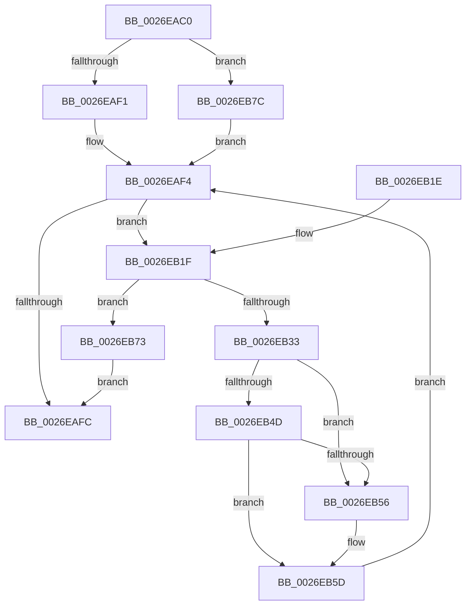

# PopFxNextParentRelationSafe

- RVA: `0x0026EAC0`–`0x0026EB8E` (길이 `206` bytes)
- VA: `0x000000014026EAC0`
- 실행 섹션: `.text`
- PDB 이름 있음: `예`; PDB Function 태그: `아니요`
- unwind 정보 RVA: `0x00065798`
- 디코드: `61`개 명령, `206/206` bytes 표시
- 미해석 바이트: `0` (있으면 어셈블리에 `.byte`로 보존)

> 이 문서는 커널 이미지의 기계어와 PDB 기호를 분석해 생성했습니다. 4번과 5번은 함수 원형과 자료형을 바이너리 사용 방식에서 추정한 C 해석이며 원본 소스 복구 결과는 아닙니다.

## 1. Dependencies

- 직접 호출 지점: **4**; 고유 호출 대상: **3**
- 직접 호출자로 확인된 함수: **6**
- RIP 상대 이미지 참조: **0**

### Outgoing calls
- `0x0026EB27` → [KeAcquireSpinLockAtDpcLevel](../20/KeAcquireSpinLockAtDpcLevel_function_00208430.md) (function, `0x00208430`)
- `0x0026EB37` → [KxReleaseSpinLock](../20/KxReleaseSpinLock_function_00206670.md) (function, `0x00206670`)
- `0x0026EB6C` → [ExFreePoolWithTag](../../poolcode/B8/ExFreePoolWithTag_function_00B82870.md) (function, `0x00B82870`)
- `0x0026EB80` → [KxReleaseSpinLock](../20/KxReleaseSpinLock_function_00206670.md) (function, `0x00206670`)

### Direct callers
- [PopFxNotifyPostDIrpCompletion](PopFxNotifyPostDIrpCompletion_function_0026EA18.md) at `0x0026EA5D`
- [PopFxNotifyPreDIrpIssue](PopFxNotifyPreDIrpIssue_function_0026FD40.md) at `0x0026FE0E`
- [PoFxRemoveComponentRelation](../5D/PoFxRemoveComponentRelation_function_005D1C90.md) at `0x005D1DD5`
- [PoFxRemoveDeviceRelation](../5D/PoFxRemoveDeviceRelation_function_005D1EF0.md) at `0x005D2004`
- [PopFxComponentRelationsCleanup](../5D/PopFxComponentRelationsCleanup_function_005D221C.md) at `0x005D231C`
- [PopFxDeviceRelationsCleanup](../5D/PopFxDeviceRelationsCleanup_function_005D2660.md) at `0x005D269B`

### Static image references
- 디코드된 RIP-relative 메모리 참조가 없습니다.

## 2. Other-region calls and transfers

- 다른 실행 섹션으로 향하는 call: **1**
  - `0x0026EB6C` → [ExFreePoolWithTag](../../poolcode/B8/ExFreePoolWithTag_function_00B82870.md) (`.text` → `POOLCODE`)
- 별도 외부 분기/꼬리 이동을 확인하지 못했습니다.

## 3. Assembly (complete function range)

```asm
0026EAC0  48 8B C4                        mov rax, rsp
0026EAC3  48 89 58 08                     mov qword ptr [rax + 8], rbx
0026EAC7  48 89 68 10                     mov qword ptr [rax + 0x10], rbp
0026EACB  48 89 70 18                     mov qword ptr [rax + 0x18], rsi
0026EACF  48 89 78 20                     mov qword ptr [rax + 0x20], rdi
0026EAD3  41 54                           push r12
0026EAD5  41 56                           push r14
0026EAD7  41 57                           push r15
0026EAD9  48 83 EC 20                     sub rsp, 0x20
0026EADD  33 F6                           xor esi, esi
0026EADF  4D 8B E0                        mov r12, r8
0026EAE2  48 8B DA                        mov rbx, rdx
0026EAE5  48 8B E9                        mov rbp, rcx
0026EAE8  48 85 D2                        test rdx, rdx
0026EAEB  0F 85 8B 00 00 00               jne 0x14026eb7c
0026EAF1  4C 8B F1                        mov r14, rcx
0026EAF4  49 8B 1E                        mov rbx, qword ptr [r14]
0026EAF7  48 3B DD                        cmp rbx, rbp
0026EAFA  75 23                           jne 0x14026eb1f
0026EAFC  48 8B 5C 24 40                  mov rbx, qword ptr [rsp + 0x40]
0026EB01  40 8A C6                        mov al, sil
0026EB04  48 8B 74 24 50                  mov rsi, qword ptr [rsp + 0x50]
0026EB09  48 8B 6C 24 48                  mov rbp, qword ptr [rsp + 0x48]
0026EB0E  48 8B 7C 24 58                  mov rdi, qword ptr [rsp + 0x58]
0026EB13  48 83 C4 20                     add rsp, 0x20
0026EB17  41 5F                           pop r15
0026EB19  41 5E                           pop r14
0026EB1B  41 5C                           pop r12
0026EB1D  C3                              ret
0026EB1E  CC                              int3
0026EB1F  48 8D 7B C8                     lea rdi, [rbx - 0x38]
0026EB23  48 8D 4F 08                     lea rcx, [rdi + 8]
0026EB27  E8 04 99 F9 FF                  call 0x140208430
0026EB2C  8B 47 10                        mov eax, dword ptr [rdi + 0x10]
0026EB2F  A8 04                           test al, 4
0026EB31  75 40                           jne 0x14026eb73
0026EB33  48 8D 4F 08                     lea rcx, [rdi + 8]
0026EB37  E8 34 7B F9 FF                  call 0x140206670
0026EB3C  83 67 10 F7                     and dword ptr [rdi + 0x10], 0xfffffff7
0026EB40  48 89 77 30                     mov qword ptr [rdi + 0x30], rsi
0026EB44  48 8B 0B                        mov rcx, qword ptr [rbx]
0026EB47  48 39 59 08                     cmp qword ptr [rcx + 8], rbx
0026EB4B  75 09                           jne 0x14026eb56
0026EB4D  48 8B 43 08                     mov rax, qword ptr [rbx + 8]
0026EB51  48 39 18                        cmp qword ptr [rax], rbx
0026EB54  74 07                           je 0x14026eb5d
0026EB56  B9 03 00 00 00                  mov ecx, 3
0026EB5B  CD 29                           int 0x29
0026EB5D  48 89 08                        mov qword ptr [rax], rcx
0026EB60  BA 50 46 58 4D                  mov edx, 0x4d584650
0026EB65  48 89 41 08                     mov qword ptr [rcx + 8], rax
0026EB69  48 8B CF                        mov rcx, rdi
0026EB6C  E8 FF 3C 91 00                  call 0x140b82870
0026EB71  EB 81                           jmp 0x14026eaf4
0026EB73  49 89 3C 24                     mov qword ptr [r12], rdi
0026EB77  40 B6 01                        mov sil, 1
0026EB7A  EB 80                           jmp 0x14026eafc
0026EB7C  48 8D 4A 08                     lea rcx, [rdx + 8]
0026EB80  E8 EB 7A F9 FF                  call 0x140206670
0026EB85  4C 8D 73 38                     lea r14, [rbx + 0x38]
0026EB89  E9 66 FF FF FF                  jmp 0x14026eaf4
```

## 4. C-style interpretation (structured pseudocode)

```c
__int64 __fastcall PopFxNextParentRelationSafe(__int64 a1, __int64 a2, __int64 a3)
{
    __int64 result;
    __int64 v_rsi;
    __int64 v_rsp;
    unsigned __int64 v_stack_p10;
    unsigned __int64 v_stack_p18;
    unsigned __int64 v_stack_p20;
    unsigned __int64 v_stack_p8;

    *(unsigned __int64 *)(v_rsp + 8) = v_rbx;
    *(unsigned __int64 *)(v_rsp + 16) = v_rbp;
    *(unsigned __int64 *)(v_rsp + 24) = v_rsi;
    *(unsigned __int64 *)(v_rsp + 32) = v_rdi;
    v_rsp = (v_rsp) - (32);
    v_rsi = 0;
    if (a2 != 0) goto loc_0026EB7C;
loc_0026EAF4:
    if ((*(unsigned __int64 *)(a1)) != a1) goto loc_0026EB1F;
loc_0026EAFC:
    v_rsp = (v_rsp) + (32);
    return 0;
loc_0026EB1F:
    result = KeAcquireSpinLockAtDpcLevel(v_stack_p8 - 56 + 8, a2, a3, a4);
    if ((((unsigned __int8)((unsigned int)(*(unsigned int *)(v_stack_p8 - 56 + 16)))) & (4)) != 0) goto loc_0026EB73;
    result = KxReleaseSpinLock(v_stack_p8 - 56 + 8, a2, a3, a4);
    *(unsigned __int64 *)(v_stack_p8 - 56 + 48) = v_stack_p18;
    if ((*(unsigned __int64 *)(*(unsigned __int64 *)(v_stack_p8) + 8)) != v_stack_p8) goto loc_0026EB56;
    if ((*(unsigned __int64 *)(*(unsigned __int64 *)(v_stack_p8 + 8))) != v_stack_p8) {
        a1 = 3;
    }
    *(unsigned __int64 *)(*(unsigned __int64 *)(v_stack_p8 + 8)) = a1;
    *(unsigned __int64 *)(a1 + 8) = *(unsigned __int64 *)(v_stack_p8 + 8);
    result = ExFreePoolWithTag(v_stack_p8 - 56, (unsigned int)(0x4D584650ULL), a3, a4);
    goto loc_0026EAF4;
loc_0026EB73:
    *(unsigned __int64 *)(a3) = v_stack_p8 - 56;
    goto loc_0026EAFC;
loc_0026EB7C:
    result = KxReleaseSpinLock((unsigned int)(0x4D584650ULL) + 8, (unsigned int)(0x4D584650ULL), a3, a4);
    goto loc_0026EAF4;
}
```

## 5. (Beta) C Style

```c
int64_t PopFxNextParentRelationSafe(int64_t Arg1, void *Arg2, void *Arg3)
{
    uint8_t *arg2 = (uint8_t *)Arg2;
    uint8_t *arg3 = (uint8_t *)Arg3;

    int64_t result;
    int64_t local_rsi;
    int64_t local_rsp;
    uint64_t v_stack_p10;
    uint64_t v_stack_p18;
    uint64_t v_stack_p20;
    uint64_t v_stack_p8;

    *(uint64_t *)(local_rsp + 0x8) = local_rbx;
    *(uint64_t *)(local_rsp + 0x10) = local_rbp;
    *(uint64_t *)(local_rsp + 0x18) = local_rsi;
    *(uint64_t *)(local_rsp + 0x20) = local_rdi;
    local_rsp = (local_rsp) - (32);
    local_rsi = 0;
    if (Arg2 != NULL) goto loc_0026EB7C;
loc_0026EAF4:
    if ((*(uint64_t *)(Arg1)) != Arg1) goto loc_0026EB1F;
loc_0026EAFC:
    local_rsp = (local_rsp) + (32);
    return 0;
loc_0026EB1F:
    result = KeAcquireSpinLockAtDpcLevel(v_stack_p8 - 56 + 8, Arg2, Arg3, a4);
    if ((((uint8_t)((uint32_t)(*(uint32_t *)(v_stack_p8 - 0x38 + 0x10)))) & (4)) != 0) goto loc_0026EB73;
    result = KxReleaseSpinLock(v_stack_p8 - 56 + 8, Arg2, Arg3, a4);
    *(uint64_t *)(v_stack_p8 - 0x38 + 0x30) = v_stack_p18;
    if ((*(uint64_t *)(*(uint64_t *)(v_stack_p8) + 0x8)) != v_stack_p8) goto loc_0026EB56;
    if ((*(uint64_t *)(*(uint64_t *)(v_stack_p8 + 0x8))) != v_stack_p8) {
        Arg1 = 3;
    }
    *(uint64_t *)(*(uint64_t *)(v_stack_p8 + 0x8)) = Arg1;
    *(uint64_t *)(Arg1 + 0x8) = *(uint64_t *)(v_stack_p8 + 0x8);
    result = ExFreePoolWithTag(v_stack_p8 - 56, (uint32_t)(0x4D584650ULL), Arg3, a4);
    goto loc_0026EAF4;
loc_0026EB73:
    *(uint64_t *)(arg3) = v_stack_p8 - 56;
    goto loc_0026EAFC;
loc_0026EB7C:
    result = KxReleaseSpinLock((uint32_t)(0x4D584650ULL) + 8, (uint32_t)(0x4D584650ULL), Arg3, a4);
    goto loc_0026EAF4;
}
```

### 관측된 메모리 오프셋

구조체 형식이 확인되지 않은 접근은 인자 기준의 오프셋으로만 기록했습니다.

| 기준 인자 | 오프셋 표현 | 폭 (bit) | 접근 |
|---|---:|---:|---|
| `Arg2` | `+ 0x38` | `64` | `R` |
| `Arg3` | `+ 0x0` | `64` | `W` |

## 6. Execution-region graph

[열기: 2D/3D 그래프와 함수 탐색 컨트롤 패널](../../../control-panel.html?section=text&rva=0x0026EAC0&view=graph)

- 2D 그래프는 위에서 아래로 흐르고, 3D 그래프는 빈 공간을 드래그해 회전합니다. Shift+드래그는 이동, 휠은 확대·축소, 함수 노드 선택은 대상 보고서 이동입니다.

### Static fallback


