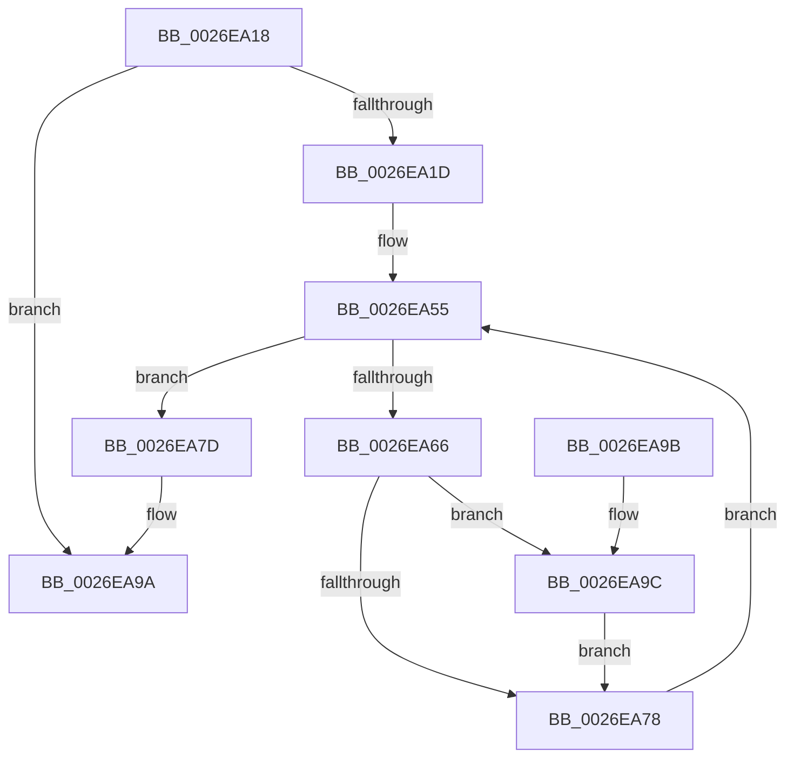

# PopFxNotifyPostDIrpCompletion

- RVA: `0x0026EA18`–`0x0026EAB9` (길이 `161` bytes)
- VA: `0x000000014026EA18`
- 실행 섹션: `.text`
- PDB 이름 있음: `예`; PDB Function 태그: `아니요`
- unwind 정보 RVA: `0x00065780`
- 디코드: `49`개 명령, `161/161` bytes 표시
- 미해석 바이트: `0` (있으면 어셈블리에 `.byte`로 보존)

> 이 문서는 커널 이미지의 기계어와 PDB 기호를 분석해 생성했습니다. 4번과 5번은 함수 원형과 자료형을 바이너리 사용 방식에서 추정한 C 해석이며 원본 소스 복구 결과는 아닙니다.

## 1. Dependencies

- 직접 호출 지점: **4**; 고유 호출 대상: **4**
- 직접 호출자로 확인된 함수: **1**
- RIP 상대 이미지 참조: **0**

### Outgoing calls
- `0x0026EA3E` → [KeAcquireSpinLockRaiseToDpc](../20/KeAcquireSpinLockRaiseToDpc_function_00208470.md) (function, `0x00208470`)
- `0x0026EA5D` → [PopFxNextParentRelationSafe](PopFxNextParentRelationSafe_function_0026EAC0.md) (function, `0x0026EAC0`)
- `0x0026EA83` → [KeReleaseSpinLock](../39/KeReleaseSpinLock_function_00392BA0.md) (function, `0x00392BA0`)
- `0x0026EAAE` → [PopFxIdleComponent](../2C/PopFxIdleComponent_function_002C01D8.md) (function, `0x002C01D8`)

### Direct callers
- [PopHandleDevicePowerIrpCompletion](PopHandleDevicePowerIrpCompletion_function_0026F030.md) at `0x0026F1C6`

### Static image references
- 디코드된 RIP-relative 메모리 참조가 없습니다.

## 2. Other-region calls and transfers

- 다른 실행 섹션으로 향하는 call: **0**
- 별도 외부 분기/꼬리 이동을 확인하지 못했습니다.

## 3. Assembly (complete function range)

```asm
0026EA18  83 FA 01                        cmp edx, 1
0026EA1B  74 7D                           je 0x14026ea9a
0026EA1D  48 89 5C 24 08                  mov qword ptr [rsp + 8], rbx
0026EA22  48 89 6C 24 10                  mov qword ptr [rsp + 0x10], rbp
0026EA27  56                              push rsi
0026EA28  57                              push rdi
0026EA29  41 56                           push r14
0026EA2B  48 83 EC 20                     sub rsp, 0x20
0026EA2F  48 8D B1 00 05 00 00            lea rsi, [rcx + 0x500]
0026EA36  48 8B D9                        mov rbx, rcx
0026EA39  48 8B CE                        mov rcx, rsi
0026EA3C  8B FA                           mov edi, edx
0026EA3E  E8 2D 9A F9 FF                  call 0x140208470
0026EA43  48 83 64 24 50 00               and qword ptr [rsp + 0x50], 0
0026EA49  4C 8D B3 18 05 00 00            lea r14, [rbx + 0x518]
0026EA50  33 D2                           xor edx, edx
0026EA52  40 8A E8                        mov bpl, al
0026EA55  4C 8D 44 24 50                  lea r8, [rsp + 0x50]
0026EA5A  49 8B CE                        mov rcx, r14
0026EA5D  E8 5E 00 00 00                  call 0x14026eac0
0026EA62  84 C0                           test al, al
0026EA64  74 17                           je 0x14026ea7d
0026EA66  48 8B 5C 24 50                  mov rbx, qword ptr [rsp + 0x50]
0026EA6B  8B 43 10                        mov eax, dword ptr [rbx + 0x10]
0026EA6E  C1 E8 04                        shr eax, 4
0026EA71  83 E0 03                        and eax, 3
0026EA74  3B F8                           cmp edi, eax
0026EA76  7D 24                           jge 0x14026ea9c
0026EA78  48 8B D3                        mov rdx, rbx
0026EA7B  EB D8                           jmp 0x14026ea55
0026EA7D  40 8A D5                        mov dl, bpl
0026EA80  48 8B CE                        mov rcx, rsi
0026EA83  E8 18 41 12 00                  call 0x140392ba0
0026EA88  48 8B 5C 24 40                  mov rbx, qword ptr [rsp + 0x40]
0026EA8D  48 8B 6C 24 48                  mov rbp, qword ptr [rsp + 0x48]
0026EA92  48 83 C4 20                     add rsp, 0x20
0026EA96  41 5E                           pop r14
0026EA98  5F                              pop rdi
0026EA99  5E                              pop rsi
0026EA9A  C3                              ret
0026EA9B  CC                              int3
0026EA9C  48 8B 4B 18                     mov rcx, qword ptr [rbx + 0x18]
0026EAA0  45 33 C9                        xor r9d, r9d
0026EAA3  8B 51 10                        mov edx, dword ptr [rcx + 0x10]
0026EAA6  45 8D 41 02                     lea r8d, [r9 + 2]
0026EAAA  48 8B 49 50                     mov rcx, qword ptr [rcx + 0x50]
0026EAAE  E8 25 17 05 00                  call 0x1402c01d8
0026EAB3  83 63 10 FD                     and dword ptr [rbx + 0x10], 0xfffffffd
0026EAB7  EB BF                           jmp 0x14026ea78
```

## 4. C-style interpretation (structured pseudocode)

```c
__int64 __fastcall PopFxNotifyPostDIrpCompletion(__int64 a1, int a2, __int64 a3, int a4)
{
    __int64 result;
    __int64 v_rsp;
    unsigned __int64 v_stack_p10;
    unsigned __int64 v_stack_p18;
    unsigned __int64 v_stack_p8;

    if (a2 == 1) goto loc_0026EA9A;
    v_stack_p8 = v_rbx;
    v_stack_p10 = v_rbp;
    v_rsp = (v_rsp) - (32);
    result = KeAcquireSpinLockRaiseToDpc(a1 + 1280, a2, a3, a4);
    a2 = 0;
loc_0026EA55:
    result = PopFxNextParentRelationSafe(a1 + 1304, a2, v_stack_p18, a4);
    if ((unsigned __int8)(result) == 0) goto loc_0026EA7D;
    result = (unsigned int)(((unsigned int)(*(unsigned int *)(v_stack_p18 + 16))) >> (4));
    result = (unsigned int)((result) & (3));
    if (((unsigned int)((unsigned int)(a2))) >= ((unsigned int)(result))) goto loc_0026EA9C;
loc_0026EA78:
    goto loc_0026EA55;
loc_0026EA7D:
    result = KeReleaseSpinLock(a1 + 1280, (unsigned __int8)((unsigned __int8)(result)), v_stack_p18, a4);
    v_rsp = (v_rsp) + (32);
loc_0026EA9A:
    return result;
loc_0026EA9C:
    a4 = 0;
    result = PopFxIdleComponent(*(unsigned __int64 *)(*(unsigned __int64 *)(v_stack_p8 + 24) + 80), (unsigned int)(*(unsigned int *)(*(unsigned __int64 *)(v_stack_p8 + 24) + 16)), a4 + 2, a4);
    goto loc_0026EA78;
}
```

## 5. (Beta) C Style

```c
int64_t PopFxNotifyPostDIrpCompletion(void *Arg1, int32_t Arg2, int64_t Arg3, int32_t Arg4)
{
    uint8_t *arg1 = (uint8_t *)Arg1;

    int64_t result;
    int64_t local_rsp;
    uint64_t v_stack_p10;
    uint64_t v_stack_p18;
    uint64_t v_stack_p8;

    if (Arg2 == 1) goto loc_0026EA9A;
    v_stack_p8 = local_rbx;
    v_stack_p10 = local_rbp;
    local_rsp = (local_rsp) - (32);
    result = KeAcquireSpinLockRaiseToDpc(Arg1 + 1280, Arg2, Arg3, Arg4);
    Arg2 = 0;
loc_0026EA55:
    result = PopFxNextParentRelationSafe(Arg1 + 1304, Arg2, v_stack_p18, Arg4);
    if ((uint8_t)(result) == 0) goto loc_0026EA7D;
    result = (uint32_t)(((uint32_t)(*(uint32_t *)(v_stack_p18 + 0x10))) >> (4));
    result = (uint32_t)((result) & (3));
    if (((uint32_t)((uint32_t)(Arg2))) >= ((uint32_t)(result))) goto loc_0026EA9C;
loc_0026EA78:
    goto loc_0026EA55;
loc_0026EA7D:
    result = KeReleaseSpinLock(Arg1 + 1280, (uint8_t)((uint8_t)(result)), v_stack_p18, Arg4);
    local_rsp = (local_rsp) + (32);
loc_0026EA9A:
    return result;
loc_0026EA9C:
    Arg4 = 0;
    result = PopFxIdleComponent(*(uint64_t *)(*(uint64_t *)(v_stack_p8 + 0x18) + 0x50), (uint32_t)(*(uint32_t *)(*(uint64_t *)(v_stack_p8 + 0x18) + 0x10)), Arg4 + 2, Arg4);
    goto loc_0026EA78;
}
```

### 관측된 메모리 오프셋

구조체 형식이 확인되지 않은 접근은 인자 기준의 오프셋으로만 기록했습니다.

| 기준 인자 | 오프셋 표현 | 폭 (bit) | 접근 |
|---|---:|---:|---|
| `Arg1` | `+ 0x500` | `64` | `R` |
| `Arg1` | `+ 0x518` | `64` | `R` |

## 6. Execution-region graph

[열기: 2D/3D 그래프와 함수 탐색 컨트롤 패널](../../../control-panel.html?section=text&rva=0x0026EA18&view=graph)

- 2D 그래프는 위에서 아래로 흐르고, 3D 그래프는 빈 공간을 드래그해 회전합니다. Shift+드래그는 이동, 휠은 확대·축소, 함수 노드 선택은 대상 보고서 이동입니다.

### Static fallback


