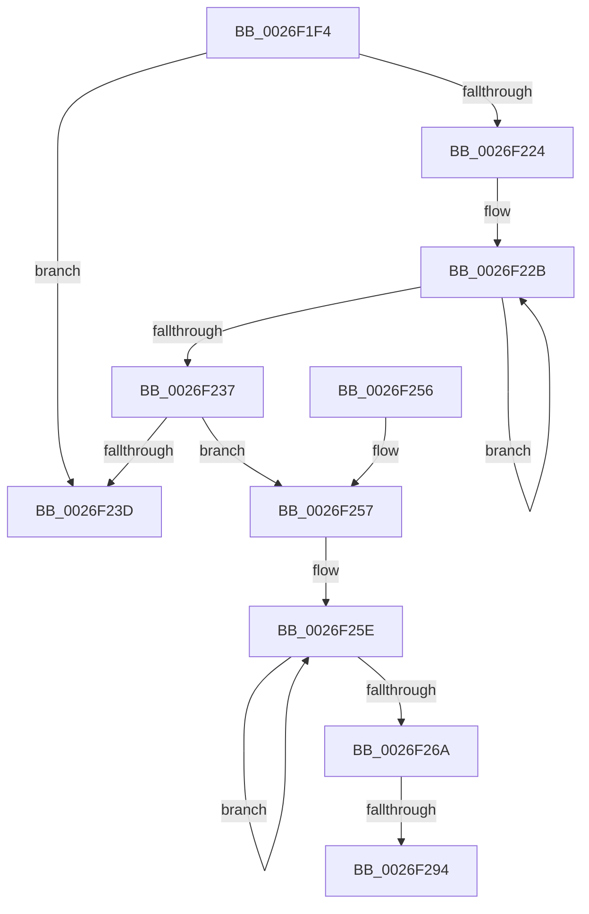

# PopFxNotifyPreDIrpCompletion

- RVA: `0x0026F1F4`–`0x0026F29F` (길이 `171` bytes)
- VA: `0x000000014026F1F4`
- 실행 섹션: `.text`
- PDB 이름 있음: `예`; PDB Function 태그: `예`
- unwind 정보 RVA: `0x000657FC`
- 디코드: `50`개 명령, `171/171` bytes 표시
- 미해석 바이트: `0` (있으면 어셈블리에 `.byte`로 보존)

> 이 문서는 커널 이미지의 기계어와 PDB 기호를 분석해 생성했습니다. 4번과 5번은 함수 원형과 자료형을 바이너리 사용 방식에서 추정한 C 해석이며 원본 소스 복구 결과는 아닙니다.

## 1. Dependencies

- 직접 호출 지점: **1**; 고유 호출 대상: **1**
- 직접 호출자로 확인된 함수: **1**
- RIP 상대 이미지 참조: **0**

### Outgoing calls
- `0x0026F27D` → [KeAcquireSpinLockRaiseToDpc](../20/KeAcquireSpinLockRaiseToDpc_function_00208470.md) (function, `0x00208470`)

### Direct callers
- [PopRequestCompletion](PopRequestCompletion_function_0026EEF0.md) at `0x0026EF8F`

### Static image references
- 디코드된 RIP-relative 메모리 참조가 없습니다.

## 2. Other-region calls and transfers

- 다른 실행 섹션으로 향하는 call: **0**
- call이 아닌 외부 분기/꼬리 이동: **2**
  - `0x0026F28E` → [sub_006D9EE6](../6D/Unknown_function_006D9EE6.md) (`tail-transfer`)
  - `0x0026F29A` → [sub_006D9EE6](../6D/Unknown_function_006D9EE6.md) (`tail-transfer`)

## 3. Assembly (complete function range)

```asm
0026F1F4  48 89 5C 24 08                  mov qword ptr [rsp + 8], rbx
0026F1F9  48 89 6C 24 10                  mov qword ptr [rsp + 0x10], rbp
0026F1FE  48 89 74 24 18                  mov qword ptr [rsp + 0x18], rsi
0026F203  57                              push rdi
0026F204  41 56                           push r14
0026F206  41 57                           push r15
0026F208  48 83 EC 20                     sub rsp, 0x20
0026F20C  45 33 FF                        xor r15d, r15d
0026F20F  45 8B F0                        mov r14d, r8d
0026F212  33 C0                           xor eax, eax
0026F214  48 8B D9                        mov rbx, rcx
0026F217  F0 44 0F B1 B9 60 03 00 00      lock cmpxchg dword ptr [rcx + 0x360], r15d
0026F220  A8 20                           test al, 0x20
0026F222  74 19                           je 0x14026f23d
0026F224  0F 0D 49 20                     prefetchw byte ptr [rcx + 0x20]
0026F228  8B 41 20                        mov eax, dword ptr [rcx + 0x20]
0026F22B  8B C8                           mov ecx, eax
0026F22D  41 0B CF                        or ecx, r15d
0026F230  F0 0F B1 4B 20                  lock cmpxchg dword ptr [rbx + 0x20], ecx
0026F235  75 F4                           jne 0x14026f22b
0026F237  0F BA E0 0D                     bt eax, 0xd
0026F23B  72 1A                           jb 0x14026f257
0026F23D  48 8B 5C 24 40                  mov rbx, qword ptr [rsp + 0x40]
0026F242  48 8B 6C 24 48                  mov rbp, qword ptr [rsp + 0x48]
0026F247  48 8B 74 24 50                  mov rsi, qword ptr [rsp + 0x50]
0026F24C  48 83 C4 20                     add rsp, 0x20
0026F250  41 5F                           pop r15
0026F252  41 5E                           pop r14
0026F254  5F                              pop rdi
0026F255  C3                              ret
0026F256  CC                              int3
0026F257  0F 0D 4B 20                     prefetchw byte ptr [rbx + 0x20]
0026F25B  8B 43 20                        mov eax, dword ptr [rbx + 0x20]
0026F25E  8B C8                           mov ecx, eax
0026F260  41 0B CF                        or ecx, r15d
0026F263  F0 0F B1 4B 20                  lock cmpxchg dword ptr [rbx + 0x20], ecx
0026F268  75 F4                           jne 0x14026f25e
0026F26A  8B F8                           mov edi, eax
0026F26C  48 8D AB A8 04 00 00            lea rbp, [rbx + 0x4a8]
0026F273  C1 EF 0C                        shr edi, 0xc
0026F276  48 8B CD                        mov rcx, rbp
0026F279  40 80 E7 01                     and dil, 1
0026F27D  E8 EE 91 F9 FF                  call 0x140208470
0026F282  8B 93 C4 04 00 00               mov edx, dword ptr [rbx + 0x4c4]
0026F288  41 8A F7                        mov sil, r15b
0026F28B  F6 C2 01                        test dl, 1
0026F28E  0F 84 52 AC 46 00               je 0x1406d9ee6
0026F294  40 B6 01                        mov sil, 1
0026F297  83 E2 FE                        and edx, 0xfffffffe
0026F29A  E9 47 AC 46 00                  jmp 0x1406d9ee6
```

## 4. C-style interpretation (structured pseudocode)

```c
__int64 __fastcall PopFxNotifyPreDIrpCompletion(__int64 a1, __int64 a2, int a3)
{
    __int64 result;
    __int64 v_r15;
    __int64 v_rdi;
    __int64 v_rsp;
    unsigned __int64 v_stack_p10;
    unsigned __int64 v_stack_p18;
    unsigned __int64 v_stack_p8;

    v_stack_p8 = v_rbx;
    v_stack_p10 = v_rbp;
    v_stack_p18 = v_rsi;
    v_rsp = (v_rsp) - (32);
    v_r15 = 0;
    result = 0;
    if (((0) & (32)) == 0) goto loc_0026F23D;
loc_0026F22B:
    a1 = (unsigned int)(((unsigned int)((unsigned int)((unsigned int)(*(unsigned int *)(a1 + 32))))) | (0));
    if (condition_is_not_equal) goto loc_0026F22B;
    if (condition_is_below) goto loc_0026F257;
loc_0026F23D:
    v_rsp = (v_rsp) + (32);
    return (unsigned int)(*(unsigned int *)(a1 + 32));
loc_0026F257:
loc_0026F25E:
    a1 = (unsigned int)(((unsigned int)((unsigned int)((unsigned int)(*(unsigned int *)(v_stack_p8 + 32))))) | (0));
    if (condition_is_not_equal) goto loc_0026F25E;
    v_rdi = (unsigned int)(((unsigned int)((unsigned int)((unsigned int)(*(unsigned int *)(v_stack_p8 + 32))))) >> (12));
    v_rdi = (unsigned __int8)((v_rdi) & (1));
    result = KeAcquireSpinLockRaiseToDpc(v_stack_p8 + 1192, a2, a3, a4);
    a2 = (unsigned int)(((unsigned int)(*(unsigned int *)(v_stack_p8 + 1220))) & (0xFFFFFFFEULL));
}
```

## 5. (Beta) C Style

```c
int64_t PopFxNotifyPreDIrpCompletion(void *Arg1, int64_t Arg2, int32_t Arg3)
{
    uint8_t *arg1 = (uint8_t *)Arg1;

    int64_t result;
    int64_t local_r15;
    int64_t local_rdi;
    int64_t local_rsp;
    uint64_t v_stack_p10;
    uint64_t v_stack_p18;
    uint64_t v_stack_p8;

    v_stack_p8 = local_rbx;
    v_stack_p10 = local_rbp;
    v_stack_p18 = local_rsi;
    local_rsp = (local_rsp) - (32);
    local_r15 = 0;
    result = 0;
    if (((0) & (32)) == 0) goto loc_0026F23D;
loc_0026F22B:
    Arg1 = (uint32_t)(((uint32_t)((uint32_t)((uint32_t)(*(uint32_t *)(arg1 + 0x20))))) | (0));
    if (condition_is_not_equal) goto loc_0026F22B;
    if (condition_is_below) goto loc_0026F257;
loc_0026F23D:
    local_rsp = (local_rsp) + (32);
    return (uint32_t)(*(uint32_t *)(arg1 + 0x20));
loc_0026F257:
loc_0026F25E:
    Arg1 = (uint32_t)(((uint32_t)((uint32_t)((uint32_t)(*(uint32_t *)(v_stack_p8 + 0x20))))) | (0));
    if (condition_is_not_equal) goto loc_0026F25E;
    local_rdi = (uint32_t)(((uint32_t)((uint32_t)((uint32_t)(*(uint32_t *)(v_stack_p8 + 0x20))))) >> (12));
    local_rdi = (uint8_t)((local_rdi) & (1));
    result = KeAcquireSpinLockRaiseToDpc(v_stack_p8 + 1192, Arg2, Arg3, a4);
    Arg2 = (uint32_t)(((uint32_t)(*(uint32_t *)(v_stack_p8 + 0x4C4))) & (0xFFFFFFFEULL));
}
```

### 관측된 메모리 오프셋

구조체 형식이 확인되지 않은 접근은 인자 기준의 오프셋으로만 기록했습니다.

| 기준 인자 | 오프셋 표현 | 폭 (bit) | 접근 |
|---|---:|---:|---|
| `Arg1` | `+ 0x20` | `8` | `R` |
| `Arg1` | `+ 0x20` | `32` | `R` |
| `Arg1` | `+ 0x360` | `32` | `R` |
| `Arg1` | `+ 0x4A8` | `64` | `R` |
| `Arg1` | `+ 0x4C4` | `32` | `R` |

## 6. Execution-region graph

[열기: 2D/3D 그래프와 함수 탐색 컨트롤 패널](../../../control-panel.html?section=text&rva=0x0026F1F4&view=graph)

- 2D 그래프는 위에서 아래로 흐르고, 3D 그래프는 빈 공간을 드래그해 회전합니다. Shift+드래그는 이동, 휠은 확대·축소, 함수 노드 선택은 대상 보고서 이동입니다.

### Static fallback


