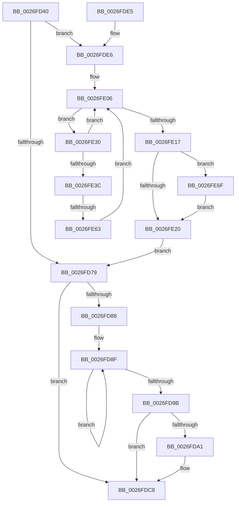

# PopFxNotifyPreDIrpIssue

- RVA: `0x0026FD40`–`0x0026FE7B` (길이 `315` bytes)
- VA: `0x000000014026FD40`
- 실행 섹션: `.text`
- PDB 이름 있음: `예`; PDB Function 태그: `예`
- unwind 정보 RVA: `0x00065970`
- 디코드: `86`개 명령, `315/315` bytes 표시
- 미해석 바이트: `0` (있으면 어셈블리에 `.byte`로 보존)

> 이 문서는 커널 이미지의 기계어와 PDB 기호를 분석해 생성했습니다. 4번과 5번은 함수 원형과 자료형을 바이너리 사용 방식에서 추정한 C 해석이며 원본 소스 복구 결과는 아닙니다.

## 1. Dependencies

- 직접 호출 지점: **6**; 고유 호출 대상: **4**
- 직접 호출자로 확인된 함수: **1**
- RIP 상대 이미지 참조: **0**

### Outgoing calls
- `0x0026FDAB` → [KeAcquireSpinLockRaiseToDpc](../20/KeAcquireSpinLockRaiseToDpc_function_00208470.md) (function, `0x00208470`)
- `0x0026FDC3` → [KeReleaseSpinLock](../39/KeReleaseSpinLock_function_00392BA0.md) (function, `0x00392BA0`)
- `0x0026FDF0` → [KeAcquireSpinLockRaiseToDpc](../20/KeAcquireSpinLockRaiseToDpc_function_00208470.md) (function, `0x00208470`)
- `0x0026FE0E` → [PopFxNextParentRelationSafe](PopFxNextParentRelationSafe_function_0026EAC0.md) (function, `0x0026EAC0`)
- `0x0026FE26` → [KeReleaseSpinLock](../39/KeReleaseSpinLock_function_00392BA0.md) (function, `0x00392BA0`)
- `0x0026FE4E` → [PopFxActivateComponent](../2D/PopFxActivateComponent_function_002D9DBC.md) (function, `0x002D9DBC`)

### Direct callers
- [PopRequestPowerIrp](../27/PopRequestPowerIrp_function_00270ED4.md) at `0x00271004`

### Static image references
- 디코드된 RIP-relative 메모리 참조가 없습니다.

## 2. Other-region calls and transfers

- 다른 실행 섹션으로 향하는 call: **0**
- call이 아닌 외부 분기/꼬리 이동: **1**
  - `0x0026FE5D` → [sub_006DA052](../6D/Unknown_function_006DA052.md) (`tail-transfer`)

## 3. Assembly (complete function range)

```asm
0026FD40  48 89 5C 24 10                  mov qword ptr [rsp + 0x10], rbx
0026FD45  48 89 6C 24 18                  mov qword ptr [rsp + 0x18], rbp
0026FD4A  56                              push rsi
0026FD4B  57                              push rdi
0026FD4C  41 54                           push r12
0026FD4E  41 56                           push r14
0026FD50  41 57                           push r15
0026FD52  48 83 EC 20                     sub rsp, 0x20
0026FD56  48 0F BE 42 42                  movsx rax, byte ptr [rdx + 0x42]
0026FD5B  45 33 E4                        xor r12d, r12d
0026FD5E  48 8B F2                        mov rsi, rdx
0026FD61  48 8B F9                        mov rdi, rcx
0026FD64  4C 8D 04 C0                     lea r8, [rax + rax*8]
0026FD68  4A 8B 84 C2 C8 00 00 00         mov rax, qword ptr [rdx + r8*8 + 0xc8]
0026FD70  83 B8 C0 00 00 00 01            cmp dword ptr [rax + 0xc0], 1
0026FD77  74 6D                           je 0x14026fde6
0026FD79  33 C0                           xor eax, eax
0026FD7B  F0 44 0F B1 A7 60 03 00 00      lock cmpxchg dword ptr [rdi + 0x360], r12d
0026FD84  A8 20                           test al, 0x20
0026FD86  74 40                           je 0x14026fdc8
0026FD88  0F 0D 4F 20                     prefetchw byte ptr [rdi + 0x20]
0026FD8C  8B 47 20                        mov eax, dword ptr [rdi + 0x20]
0026FD8F  8B C8                           mov ecx, eax
0026FD91  41 0B CC                        or ecx, r12d
0026FD94  F0 0F B1 4F 20                  lock cmpxchg dword ptr [rdi + 0x20], ecx
0026FD99  75 F4                           jne 0x14026fd8f
0026FD9B  0F BA E0 0D                     bt eax, 0xd
0026FD9F  73 27                           jae 0x14026fdc8
0026FDA1  48 8D 9F A8 04 00 00            lea rbx, [rdi + 0x4a8]
0026FDA8  48 8B CB                        mov rcx, rbx
0026FDAB  E8 C0 86 F9 FF                  call 0x140208470
0026FDB0  83 8F C4 04 00 00 01            or dword ptr [rdi + 0x4c4], 1
0026FDB7  F0 FF 87 B0 04 00 00            lock inc dword ptr [rdi + 0x4b0]
0026FDBE  8A D0                           mov dl, al
0026FDC0  48 8B CB                        mov rcx, rbx
0026FDC3  E8 D8 2D 12 00                  call 0x140392ba0
0026FDC8  48 8B 5C 24 58                  mov rbx, qword ptr [rsp + 0x58]
0026FDCD  48 85 F6                        test rsi, rsi
0026FDD0  48 8B 6C 24 60                  mov rbp, qword ptr [rsp + 0x60]
0026FDD5  0F 95 C0                        setne al
0026FDD8  48 83 C4 20                     add rsp, 0x20
0026FDDC  41 5F                           pop r15
0026FDDE  41 5E                           pop r14
0026FDE0  41 5C                           pop r12
0026FDE2  5F                              pop rdi
0026FDE3  5E                              pop rsi
0026FDE4  C3                              ret
0026FDE5  CC                              int3
0026FDE6  48 8D A9 00 05 00 00            lea rbp, [rcx + 0x500]
0026FDED  48 8B CD                        mov rcx, rbp
0026FDF0  E8 7B 86 F9 FF                  call 0x140208470
0026FDF5  44 8A F8                        mov r15b, al
0026FDF8  4C 89 64 24 50                  mov qword ptr [rsp + 0x50], r12
0026FDFD  33 D2                           xor edx, edx
0026FDFF  4C 8D B7 18 05 00 00            lea r14, [rdi + 0x518]
0026FE06  4C 8D 44 24 50                  lea r8, [rsp + 0x50]
0026FE0B  49 8B CE                        mov rcx, r14
0026FE0E  E8 AD EC FF FF                  call 0x14026eac0
0026FE13  84 C0                           test al, al
0026FE15  75 19                           jne 0x14026fe30
0026FE17  44 39 A7 08 05 00 00            cmp dword ptr [rdi + 0x508], r12d
0026FE1E  75 4F                           jne 0x14026fe6f
0026FE20  41 8A D7                        mov dl, r15b
0026FE23  48 8B CD                        mov rcx, rbp
0026FE26  E8 75 2D 12 00                  call 0x140392ba0
0026FE2B  E9 49 FF FF FF                  jmp 0x14026fd79
0026FE30  48 8B 54 24 50                  mov rdx, qword ptr [rsp + 0x50]
0026FE35  8B 42 10                        mov eax, dword ptr [rdx + 0x10]
0026FE38  A8 02                           test al, 2
0026FE3A  75 CA                           jne 0x14026fe06
0026FE3C  48 8B 5A 18                     mov rbx, qword ptr [rdx + 0x18]
0026FE40  45 33 C9                        xor r9d, r9d
0026FE43  48 8B D3                        mov rdx, rbx
0026FE46  48 8B 4B 50                     mov rcx, qword ptr [rbx + 0x50]
0026FE4A  45 8D 41 0A                     lea r8d, [r9 + 0xa]
0026FE4E  E8 69 9F 06 00                  call 0x1402d9dbc
0026FE53  8B 43 58                        mov eax, dword ptr [rbx + 0x58]
0026FE56  48 8B 54 24 50                  mov rdx, qword ptr [rsp + 0x50]
0026FE5B  85 C0                           test eax, eax
0026FE5D  0F 88 EF A1 46 00               js 0x1406da052
0026FE63  83 4A 10 01                     or dword ptr [rdx + 0x10], 1
0026FE67  FF 87 08 05 00 00               inc dword ptr [rdi + 0x508]
0026FE6D  EB 97                           jmp 0x14026fe06
0026FE6F  48 89 B7 10 05 00 00            mov qword ptr [rdi + 0x510], rsi
0026FE76  49 8B F4                        mov rsi, r12
0026FE79  EB A5                           jmp 0x14026fe20
```

## 4. C-style interpretation (structured pseudocode)

```c
__int64 __fastcall PopFxNotifyPreDIrpIssue(__int64 a1, __int64 a2, __int64 a3, int a4)
{
    __int64 result;
    __int64 v_r12;
    __int64 v_rbx;
    __int64 v_rsp;
    unsigned __int64 v_stack_p10;
    unsigned __int64 v_stack_p18;
    unsigned __int64 v_stack_p50;

    v_stack_p10 = v_rbx;
    v_stack_p18 = v_rbp;
    v_rsp = (v_rsp) - (32);
    v_r12 = 0;
    if ((*(unsigned int *)(*(unsigned __int64 *)(a2 + (__int8)(*(unsigned __int8 *)(a2 + 66)) + (__int8)(*(unsigned __int8 *)(a2 + 66)) * 8 * 8 + 200) + 192)) == 1) goto loc_0026FDE6;
loc_0026FD79:
    result = 0;
    if (((0) & (32)) == 0) goto loc_0026FDC8;
loc_0026FD8F:
    a1 = (unsigned int)(((unsigned int)((unsigned int)((unsigned int)(*(unsigned int *)(a1 + 32))))) | (0));
    if (condition_is_not_equal) goto loc_0026FD8F;
    result = (unsigned int)(*(unsigned int *)(a1 + 32));
    if (!(condition_is_above_or_equal)) {
        v_rbx = a1 + 1192;
        a1 = v_rbx;
        result = KeAcquireSpinLockRaiseToDpc(a1, a2, (__int8)(*(unsigned __int8 *)(a2 + 66)) + (__int8)(*(unsigned __int8 *)(a2 + 66)) * 8, a4);
        a2 = (unsigned __int8)(result);
        a1 = v_rbx;
        result = KeReleaseSpinLock(a1, a2, (__int8)(*(unsigned __int8 *)(a2 + 66)) + (__int8)(*(unsigned __int8 *)(a2 + 66)) * 8, a4);
    }
    result = (a2 != 0) ? 1 : 0;
    v_rsp = (v_rsp) + (32);
    return result;
loc_0026FDE6:
    result = KeAcquireSpinLockRaiseToDpc(a1 + 1280, a2, (__int8)(*(unsigned __int8 *)(a2 + 66)) + (__int8)(*(unsigned __int8 *)(a2 + 66)) * 8, a4);
    v_stack_p50 = 0;
    a2 = 0;
loc_0026FE06:
    result = PopFxNextParentRelationSafe(a1 + 1304, a2, v_stack_p50, a4);
    if ((unsigned __int8)(result) != 0) goto loc_0026FE30;
    if ((*(unsigned int *)(a1 + 1288)) != 0) goto loc_0026FE6F;
loc_0026FE20:
    result = KeReleaseSpinLock(a1 + 1280, (unsigned __int8)((unsigned __int8)(result)), v_stack_p50, a4);
    goto loc_0026FD79;
loc_0026FE30:
    if ((((unsigned __int8)((unsigned int)(*(unsigned int *)(v_stack_p50 + 16)))) & (2)) != 0) goto loc_0026FE06;
    a4 = 0;
    result = PopFxActivateComponent(*(unsigned __int64 *)(*(unsigned __int64 *)(v_stack_p50 + 24) + 80), *(unsigned __int64 *)(v_stack_p50 + 24), a4 + 10, a4);
    goto loc_0026FE06;
loc_0026FE6F:
    *(unsigned __int64 *)(a1 + 1296) = 0;
    goto loc_0026FE20;
}
```

## 5. (Beta) C Style

```c
int64_t PopFxNotifyPreDIrpIssue(void *Arg1, void *Arg2, int64_t Arg3, int32_t Arg4)
{
    uint8_t *arg1 = (uint8_t *)Arg1;
    uint8_t *arg2 = (uint8_t *)Arg2;

    int64_t result;
    int64_t local_r12;
    int64_t local_rbx;
    int64_t local_rsp;
    uint64_t v_stack_p10;
    uint64_t v_stack_p18;
    uint64_t v_stack_p50;

    v_stack_p10 = local_rbx;
    v_stack_p18 = local_rbp;
    local_rsp = (local_rsp) - (32);
    local_r12 = 0;
    if ((*(uint32_t *)(*(uint64_t *)(arg2 + (int8_t)(*(uint8_t *)(arg2 + 0x42)) + (int8_t)(*(uint8_t *)(arg2 + 0x42)) * 8 * 8 + 0xC8) + 0xC0)) == 1) goto loc_0026FDE6;
loc_0026FD79:
    result = 0;
    if (((0) & (32)) == 0) goto loc_0026FDC8;
loc_0026FD8F:
    Arg1 = (uint32_t)(((uint32_t)((uint32_t)((uint32_t)(*(uint32_t *)(arg1 + 0x20))))) | (0));
    if (condition_is_not_equal) goto loc_0026FD8F;
    result = (uint32_t)(*(uint32_t *)(arg1 + 0x20));
    if (!(condition_is_above_or_equal)) {
        local_rbx = Arg1 + 1192;
        Arg1 = local_rbx;
        result = KeAcquireSpinLockRaiseToDpc(Arg1, Arg2, (int8_t)(*(uint8_t *)(arg2 + 0x42)) + (int8_t)(*(uint8_t *)(arg2 + 0x42)) * 8, Arg4);
        Arg2 = (uint8_t)(result);
        Arg1 = local_rbx;
        result = KeReleaseSpinLock(Arg1, Arg2, (int8_t)(*(uint8_t *)(arg2 + 0x42)) + (int8_t)(*(uint8_t *)(arg2 + 0x42)) * 8, Arg4);
    }
    result = (Arg2 != NULL) ? 1 : 0;
    local_rsp = (local_rsp) + (32);
    return result;
loc_0026FDE6:
    result = KeAcquireSpinLockRaiseToDpc(Arg1 + 1280, Arg2, (int8_t)(*(uint8_t *)(arg2 + 0x42)) + (int8_t)(*(uint8_t *)(arg2 + 0x42)) * 8, Arg4);
    v_stack_p50 = 0;
    Arg2 = 0;
loc_0026FE06:
    result = PopFxNextParentRelationSafe(Arg1 + 1304, Arg2, v_stack_p50, Arg4);
    if ((uint8_t)(result) != 0) goto loc_0026FE30;
    if ((*(uint32_t *)(arg1 + 0x508)) != 0) goto loc_0026FE6F;
loc_0026FE20:
    result = KeReleaseSpinLock(Arg1 + 1280, (uint8_t)((uint8_t)(result)), v_stack_p50, Arg4);
    goto loc_0026FD79;
loc_0026FE30:
    if ((((uint8_t)((uint32_t)(*(uint32_t *)(v_stack_p50 + 0x10)))) & (2)) != 0) goto loc_0026FE06;
    Arg4 = 0;
    result = PopFxActivateComponent(*(uint64_t *)(*(uint64_t *)(v_stack_p50 + 0x18) + 0x50), *(uint64_t *)(v_stack_p50 + 0x18), Arg4 + 10, Arg4);
    goto loc_0026FE06;
loc_0026FE6F:
    *(uint64_t *)(arg1 + 0x510) = 0;
    goto loc_0026FE20;
}
```

### 관측된 메모리 오프셋

구조체 형식이 확인되지 않은 접근은 인자 기준의 오프셋으로만 기록했습니다.

| 기준 인자 | 오프셋 표현 | 폭 (bit) | 접근 |
|---|---:|---:|---|
| `Arg1` | `+ 0x20` | `8` | `R` |
| `Arg1` | `+ 0x20` | `32` | `R` |
| `Arg1` | `+ 0x360` | `32` | `R` |
| `Arg1` | `+ 0x4A8` | `64` | `R` |
| `Arg1` | `+ 0x4B0` | `32` | `R/W` |
| `Arg1` | `+ 0x4C4` | `32` | `R/W` |
| `Arg1` | `+ 0x500` | `64` | `R` |
| `Arg1` | `+ 0x508` | `32` | `R` |
| `Arg1` | `+ 0x508` | `32` | `R/W` |
| `Arg1` | `+ 0x510` | `64` | `W` |
| `Arg1` | `+ 0x518` | `64` | `R` |
| `Arg2` | `+ 0x42` | `8` | `R` |
| `Arg2` | `+ 0xC8 + r8*8` | `64` | `R` |

## 6. Execution-region graph

[열기: 2D/3D 그래프와 함수 탐색 컨트롤 패널](../../../control-panel.html?section=text&rva=0x0026FD40&view=graph)

- 2D 그래프는 위에서 아래로 흐르고, 3D 그래프는 빈 공간을 드래그해 회전합니다. Shift+드래그는 이동, 휠은 확대·축소, 함수 노드 선택은 대상 보고서 이동입니다.

### Static fallback


