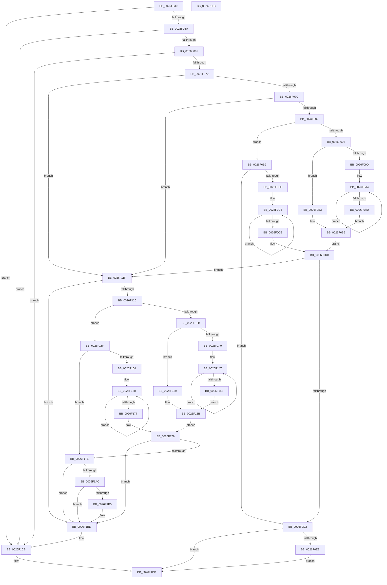

# PopHandleDevicePowerIrpCompletion

- RVA: `0x0026F030`–`0x0026F1EC` (길이 `444` bytes)
- VA: `0x000000014026F030`
- 실행 섹션: `.text`
- PDB 이름 있음: `예`; PDB Function 태그: `아니요`
- unwind 정보 RVA: `0x00060BC4`
- 디코드: `117`개 명령, `444/444` bytes 표시
- 미해석 바이트: `0` (있으면 어셈블리에 `.byte`로 보존)

> 이 문서는 커널 이미지의 기계어와 PDB 기호를 분석해 생성했습니다. 4번과 5번은 함수 원형과 자료형을 바이너리 사용 방식에서 추정한 C 해석이며 원본 소스 복구 결과는 아닙니다.

## 1. Dependencies

- 직접 호출 지점: **12**; 고유 호출 대상: **10**
- 직접 호출자로 확인된 함수: **1**
- RIP 상대 이미지 참조: **3**

### Outgoing calls
- `0x0026F089` → [Feature_Sx_PEP_Notification_Synchronization__private_IsEnabledNoReportingNoInline](../4F/Feature_Sx_PEP_Notification_Synchronization__private_IsEnabledNoReportingNoInline_function_004F4E70.md) (function, `0x004F4E70`)
- `0x0026F0DE` → [ExTryQueueWorkItem](../39/ExTryQueueWorkItem_function_00397FF0.md) (function, `0x00397FF0`)
- `0x0026F100` → [ExInterlockedInsertTailList](../38/ExInterlockedInsertTailList_function_00386700.md) (function, `0x00386700`)
- `0x0026F115` → [KeReleaseSemaphore](../39/KeReleaseSemaphore_function_00397080.md) (function, `0x00397080`)
- `0x0026F12C` → [Feature_Sx_PEP_Notification_Synchronization__private_IsEnabledNoReportingNoInline](../4F/Feature_Sx_PEP_Notification_Synchronization__private_IsEnabledNoReportingNoInline_function_004F4E70.md) (function, `0x004F4E70`)
- `0x0026F18F` → [PopPepDeviceDState](../2B/PopPepDeviceDState_function_002BFE70.md) (function, `0x002BFE70`)
- `0x0026F19E` → [PopDiagTraceFxDevicePowerState](PopDiagTraceFxDevicePowerState_function_0026DBC4.md) (function, `0x0026DBC4`)
- `0x0026F1A3` → [Feature_Sx_PEP_Notification_Synchronization__private_IsEnabledNoReportingNoInline](../4F/Feature_Sx_PEP_Notification_Synchronization__private_IsEnabledNoReportingNoInline_function_004F4E70.md) (function, `0x004F4E70`)
- `0x0026F1B8` → [PopFxNotifyPendingSIrpReady](../4F/PopFxNotifyPendingSIrpReady_function_004F5918.md) (function, `0x004F5918`)
- `0x0026F1C6` → [PopFxNotifyPostDIrpCompletion](PopFxNotifyPostDIrpCompletion_function_0026EA18.md) (function, `0x0026EA18`)
- `0x0026F1CE` → [PopDequeueQuerySetIrp](PopDequeueQuerySetIrp_function_0026EC34.md) (function, `0x0026EC34`)
- `0x0026F1D6` → [PopFreeIrp](PopFreeIrp_function_0026FAA0.md) (function, `0x0026FAA0`)

### Direct callers
- [PopRequestCompletion](PopRequestCompletion_function_0026EEF0.md) at `0x0026EF5C`

### Static image references
- `0x0026F0EB` → RVA `0x00F0E2A8` (`.data`; read)
- `0x0026F0F9` → RVA `0x00F0E2B0` (`.data`; read)
- `0x0026F108` → RVA `0x00F0E2C0` (`.data`; read)

## 2. Other-region calls and transfers

- 다른 실행 섹션으로 향하는 call: **0**
- 별도 외부 분기/꼬리 이동을 확인하지 못했습니다.

## 3. Assembly (complete function range)

```asm
0026F030  48 89 5C 24 08                  mov qword ptr [rsp + 8], rbx
0026F035  48 89 74 24 10                  mov qword ptr [rsp + 0x10], rsi
0026F03A  57                              push rdi
0026F03B  48 83 EC 20                     sub rsp, 0x20
0026F03F  80 B9 B8 00 00 00 02            cmp byte ptr [rcx + 0xb8], 2
0026F046  48 8B F9                        mov rdi, rcx
0026F049  48 8B 71 10                     mov rsi, qword ptr [rcx + 0x10]
0026F04D  48 8B 99 C8 00 00 00            mov rbx, qword ptr [rcx + 0xc8]
0026F054  0F 85 71 01 00 00               jne 0x14026f1cb
0026F05A  83 B9 BC 00 00 00 01            cmp dword ptr [rcx + 0xbc], 1
0026F061  0F 85 64 01 00 00               jne 0x14026f1cb
0026F067  48 85 DB                        test rbx, rbx
0026F06A  0F 84 5B 01 00 00               je 0x14026f1cb
0026F070  44 0F 20 C0                     mov rax, cr8
0026F074  84 C0                           test al, al
0026F076  0F 84 A3 00 00 00               je 0x14026f11f
0026F07C  80 B9 D1 00 00 00 00            cmp byte ptr [rcx + 0xd1], 0
0026F083  0F 84 96 00 00 00               je 0x14026f11f
0026F089  E8 E2 5D 28 00                  call 0x1404f4e70
0026F08E  8B 8F C0 00 00 00               mov ecx, dword ptr [rdi + 0xc0]
0026F094  85 C0                           test eax, eax
0026F096  74 21                           je 0x14026f0b9
0026F098  83 F9 01                        cmp ecx, 1
0026F09B  75 16                           jne 0x14026f0b3
0026F09D  0F 0D 4B 20                     prefetchw byte ptr [rbx + 0x20]
0026F0A1  8B 43 20                        mov eax, dword ptr [rbx + 0x20]
0026F0A4  8B C8                           mov ecx, eax
0026F0A6  F0 0F B1 4B 20                  lock cmpxchg dword ptr [rbx + 0x20], ecx
0026F0AB  75 F7                           jne 0x14026f0a4
0026F0AD  D1 E8                           shr eax, 1
0026F0AF  24 01                           and al, 1
0026F0B1  EB 02                           jmp 0x14026f0b5
0026F0B3  B0 01                           mov al, 1
0026F0B5  84 C0                           test al, al
0026F0B7  EB 17                           jmp 0x14026f0d0
0026F0B9  83 F9 01                        cmp ecx, 1
0026F0BC  75 14                           jne 0x14026f0d2
0026F0BE  0F 0D 4B 20                     prefetchw byte ptr [rbx + 0x20]
0026F0C2  8B 43 20                        mov eax, dword ptr [rbx + 0x20]
0026F0C5  8B C8                           mov ecx, eax
0026F0C7  F0 0F B1 4B 20                  lock cmpxchg dword ptr [rbx + 0x20], ecx
0026F0CC  75 F7                           jne 0x14026f0c5
0026F0CE  A8 02                           test al, 2
0026F0D0  74 4D                           je 0x14026f11f
0026F0D2  BA 30 00 00 00                  mov edx, 0x30
0026F0D7  48 8D 8F F8 00 00 00            lea rcx, [rdi + 0xf8]
0026F0DE  E8 0D 8F 12 00                  call 0x140397ff0
0026F0E3  84 C0                           test al, al
0026F0E5  0F 85 F0 00 00 00               jne 0x14026f1db
0026F0EB  4C 8D 05 B6 F1 C9 00            lea r8, [rip + 0xc9f1b6]
0026F0F2  48 8D 97 F8 00 00 00            lea rdx, [rdi + 0xf8]
0026F0F9  48 8D 0D B0 F1 C9 00            lea rcx, [rip + 0xc9f1b0]
0026F100  E8 FB 75 11 00                  call 0x140386700
0026F105  45 33 C9                        xor r9d, r9d
0026F108  48 8D 0D B1 F1 C9 00            lea rcx, [rip + 0xc9f1b1]
0026F10F  33 D2                           xor edx, edx
0026F111  45 8D 41 01                     lea r8d, [r9 + 1]
0026F115  E8 66 7F 12 00                  call 0x140397080
0026F11A  E9 BC 00 00 00                  jmp 0x14026f1db
0026F11F  80 BF D1 00 00 00 00            cmp byte ptr [rdi + 0xd1], 0
0026F126  0F 84 91 00 00 00               je 0x14026f1bd
0026F12C  E8 3F 5D 28 00                  call 0x1404f4e70
0026F131  8B 8F C0 00 00 00               mov ecx, dword ptr [rdi + 0xc0]
0026F137  85 C0                           test eax, eax
0026F139  74 24                           je 0x14026f15f
0026F13B  83 F9 01                        cmp ecx, 1
0026F13E  75 19                           jne 0x14026f159
0026F140  0F 0D 4B 20                     prefetchw byte ptr [rbx + 0x20]
0026F144  8B 43 20                        mov eax, dword ptr [rbx + 0x20]
0026F147  8B C8                           mov ecx, eax
0026F149  83 E1 FD                        and ecx, 0xfffffffd
0026F14C  F0 0F B1 4B 20                  lock cmpxchg dword ptr [rbx + 0x20], ecx
0026F151  75 F4                           jne 0x14026f147
0026F153  D1 E8                           shr eax, 1
0026F155  24 01                           and al, 1
0026F157  EB 02                           jmp 0x14026f15b
0026F159  B0 01                           mov al, 1
0026F15B  84 C0                           test al, al
0026F15D  EB 1A                           jmp 0x14026f179
0026F15F  83 F9 01                        cmp ecx, 1
0026F162  75 17                           jne 0x14026f17b
0026F164  0F 0D 4B 20                     prefetchw byte ptr [rbx + 0x20]
0026F168  8B 43 20                        mov eax, dword ptr [rbx + 0x20]
0026F16B  8B C8                           mov ecx, eax
0026F16D  83 E1 FD                        and ecx, 0xfffffffd
0026F170  F0 0F B1 4B 20                  lock cmpxchg dword ptr [rbx + 0x20], ecx
0026F175  75 F4                           jne 0x14026f16b
0026F177  A8 02                           test al, 2
0026F179  74 42                           je 0x14026f1bd
0026F17B  44 8B 8F 18 01 00 00            mov r9d, dword ptr [rdi + 0x118]
0026F182  41 B0 01                        mov r8b, 1
0026F185  8B 97 C0 00 00 00               mov edx, dword ptr [rdi + 0xc0]
0026F18B  48 8B 4B 38                     mov rcx, qword ptr [rbx + 0x38]
0026F18F  E8 DC 0C 05 00                  call 0x1402bfe70
0026F194  8B 97 C0 00 00 00               mov edx, dword ptr [rdi + 0xc0]
0026F19A  48 8B 4B 30                     mov rcx, qword ptr [rbx + 0x30]
0026F19E  E8 21 EA FF FF                  call 0x14026dbc4
0026F1A3  E8 C8 5C 28 00                  call 0x1404f4e70
0026F1A8  85 C0                           test eax, eax
0026F1AA  74 11                           je 0x14026f1bd
0026F1AC  83 BF C0 00 00 00 01            cmp dword ptr [rdi + 0xc0], 1
0026F1B3  74 08                           je 0x14026f1bd
0026F1B5  48 8B CB                        mov rcx, rbx
0026F1B8  E8 5B 67 28 00                  call 0x1404f5918
0026F1BD  8B 97 C0 00 00 00               mov edx, dword ptr [rdi + 0xc0]
0026F1C3  48 8B CB                        mov rcx, rbx
0026F1C6  E8 4D F8 FF FF                  call 0x14026ea18
0026F1CB  48 8B CE                        mov rcx, rsi
0026F1CE  E8 61 FA FF FF                  call 0x14026ec34
0026F1D3  48 8B CE                        mov rcx, rsi
0026F1D6  E8 C5 08 00 00                  call 0x14026faa0
0026F1DB  48 8B 5C 24 30                  mov rbx, qword ptr [rsp + 0x30]
0026F1E0  48 8B 74 24 38                  mov rsi, qword ptr [rsp + 0x38]
0026F1E5  48 83 C4 20                     add rsp, 0x20
0026F1E9  5F                              pop rdi
0026F1EA  C3                              ret
0026F1EB  CC                              int3
```

## 4. C-style interpretation (structured pseudocode)

```c
__int64 __fastcall PopHandleDevicePowerIrpCompletion(__int64 a1, __int64 a2, __int64 a3, int a4)
{
    __int64 result;
    __int64 v_rsp;
    unsigned __int64 v_stack_p10;
    unsigned __int64 v_stack_p8;

    v_stack_p8 = v_rbx;
    v_stack_p10 = v_rsi;
    v_rsp = (v_rsp) - (32);
    if ((*(unsigned __int8 *)(a1 + 184)) != 2) goto loc_0026F1CB;
    if ((*(unsigned int *)(a1 + 188)) != 1) goto loc_0026F1CB;
    if (*(unsigned __int64 *)(a1 + 200) == 0) goto loc_0026F1CB;
    if ((unsigned __int8)(v_cr8) == 0) goto loc_0026F11F;
    if ((*(unsigned __int8 *)(a1 + 209)) == 0) goto loc_0026F11F;
    result = Feature_Sx_PEP_Notification_Synchronization__private_IsEnabledNoReportingNoInline(a1, a2, a3, a4);
    if ((unsigned int)(result) == 0) goto loc_0026F0B9;
    if (((unsigned int)((unsigned int)(*(unsigned int *)(a1 + 192)))) != 1) goto loc_0026F0B3;
loc_0026F0A4:
    if (((unsigned int)((unsigned int)(*(unsigned int *)(a1 + 192)))) != 1) goto loc_0026F0A4;
    result = (unsigned int)(((unsigned int)(*(unsigned int *)(*(unsigned __int64 *)(a1 + 200) + 32))) >> (1));
    result = (unsigned __int8)((result) & (1));
    goto loc_0026F0B5;
loc_0026F0B3:
loc_0026F0B5:
    goto loc_0026F0D0;
loc_0026F0B9:
    if (((unsigned int)((unsigned int)((unsigned int)((unsigned int)(*(unsigned int *)(*(unsigned __int64 *)(a1 + 200) + 32)))))) != 1) goto loc_0026F0D2;
loc_0026F0C5:
    if (((unsigned int)((unsigned int)((unsigned int)((unsigned int)(*(unsigned int *)(*(unsigned __int64 *)(a1 + 200) + 32)))))) != 1) goto loc_0026F0C5;
loc_0026F0D0:
    if ((((unsigned __int8)((unsigned int)(*(unsigned int *)(*(unsigned __int64 *)(a1 + 200) + 32)))) & (2)) == 0) goto loc_0026F11F;
loc_0026F0D2:
    result = ExTryQueueWorkItem(a1 + 248, 48, a3, a4);
    if ((unsigned __int8)(result) != 0) goto loc_0026F1DB;
    result = ExInterlockedInsertTailList(v_rip + 13234608, a1 + 248, v_rip + 13234614, a4);
    a4 = 0;
    a2 = 0;
    result = KeReleaseSemaphore(v_rip + 13234609, a2, a4 + 1, a4);
    goto loc_0026F1DB;
loc_0026F11F:
    if ((*(unsigned __int8 *)(a1 + 209)) == 0) goto loc_0026F1BD;
    result = Feature_Sx_PEP_Notification_Synchronization__private_IsEnabledNoReportingNoInline(v_rip + 13234609, a2, a4 + 1, a4);
    if ((unsigned int)(result) == 0) goto loc_0026F15F;
    if (((unsigned int)((unsigned int)(*(unsigned int *)(a1 + 192)))) != 1) goto loc_0026F159;
loc_0026F147:
    a1 = (unsigned int)(((unsigned int)((unsigned int)((unsigned int)(*(unsigned int *)(*(unsigned __int64 *)(a1 + 200) + 32))))) & (0xFFFFFFFDULL));
    if (condition_is_not_equal) goto loc_0026F147;
    result = (unsigned int)(((unsigned int)(*(unsigned int *)(*(unsigned __int64 *)(a1 + 200) + 32))) >> (1));
    result = (unsigned __int8)((result) & (1));
    goto loc_0026F15B;
loc_0026F159:
loc_0026F15B:
    goto loc_0026F179;
loc_0026F15F:
    if (((unsigned int)(a1)) != 1) goto loc_0026F17B;
loc_0026F16B:
    a1 = (unsigned int)(((unsigned int)((unsigned int)((unsigned int)(*(unsigned int *)(*(unsigned __int64 *)(a1 + 200) + 32))))) & (0xFFFFFFFDULL));
    if (condition_is_not_equal) goto loc_0026F16B;
loc_0026F179:
    if ((((unsigned __int8)((unsigned int)(*(unsigned int *)(*(unsigned __int64 *)(a1 + 200) + 32)))) & (2)) == 0) goto loc_0026F1BD;
loc_0026F17B:
    result = PopPepDeviceDState(*(unsigned __int64 *)(*(unsigned __int64 *)(a1 + 200) + 56), (unsigned int)(*(unsigned int *)(a1 + 192)), 1, (unsigned int)(*(unsigned int *)(a1 + 280)));
    result = PopDiagTraceFxDevicePowerState(*(unsigned __int64 *)(*(unsigned __int64 *)(a1 + 200) + 48), (unsigned int)(*(unsigned int *)(a1 + 192)), 1, (unsigned int)(*(unsigned int *)(a1 + 280)));
    result = Feature_Sx_PEP_Notification_Synchronization__private_IsEnabledNoReportingNoInline(*(unsigned __int64 *)(*(unsigned __int64 *)(a1 + 200) + 48), (unsigned int)(*(unsigned int *)(a1 + 192)), 1, (unsigned int)(*(unsigned int *)(a1 + 280)));
    if ((unsigned int)(result) == 0) goto loc_0026F1BD;
    if ((*(unsigned int *)(a1 + 192)) != 1) {
        a1 = *(unsigned __int64 *)(a1 + 200);
        result = PopFxNotifyPendingSIrpReady(a1, (unsigned int)(*(unsigned int *)(a1 + 192)), 1, (unsigned int)(*(unsigned int *)(a1 + 280)));
    }
    result = PopFxNotifyPostDIrpCompletion(*(unsigned __int64 *)(a1 + 200), (unsigned int)(*(unsigned int *)(a1 + 192)), 1, (unsigned int)(*(unsigned int *)(a1 + 280)));
loc_0026F1CB:
    result = PopDequeueQuerySetIrp(*(unsigned __int64 *)(a1 + 16), (unsigned int)(*(unsigned int *)(a1 + 192)), 1, (unsigned int)(*(unsigned int *)(a1 + 280)));
    result = PopFreeIrp(*(unsigned __int64 *)(a1 + 16), (unsigned int)(*(unsigned int *)(a1 + 192)), 1, (unsigned int)(*(unsigned int *)(a1 + 280)));
loc_0026F1DB:
    v_rsp = (v_rsp) + (32);
    return result;
}
```

## 5. (Beta) C Style

```c
int64_t PopHandleDevicePowerIrpCompletion(void *Arg1, int64_t Arg2, int64_t Arg3, int32_t Arg4)
{
    uint8_t *arg1 = (uint8_t *)Arg1;

    int64_t result;
    int64_t local_rsp;
    uint64_t v_stack_p10;
    uint64_t v_stack_p8;

    v_stack_p8 = local_rbx;
    v_stack_p10 = local_rsi;
    local_rsp = (local_rsp) - (32);
    if ((*(uint8_t *)(arg1 + 0xB8)) != 2) goto loc_0026F1CB;
    if ((*(uint32_t *)(arg1 + 0xBC)) != 1) goto loc_0026F1CB;
    if (*(uint64_t *)(arg1 + 0xC8) == 0) goto loc_0026F1CB;
    if ((uint8_t)(v_cr8) == 0) goto loc_0026F11F;
    if ((*(uint8_t *)(arg1 + 0xD1)) == 0) goto loc_0026F11F;
    result = Feature_Sx_PEP_Notification_Synchronization__private_IsEnabledNoReportingNoInline(Arg1, Arg2, Arg3, Arg4);
    if ((uint32_t)(result) == 0) goto loc_0026F0B9;
    if (((uint32_t)((uint32_t)(*(uint32_t *)(arg1 + 0xC0)))) != 1) goto loc_0026F0B3;
loc_0026F0A4:
    if (((uint32_t)((uint32_t)(*(uint32_t *)(arg1 + 0xC0)))) != 1) goto loc_0026F0A4;
    result = (uint32_t)(((uint32_t)(*(uint32_t *)(*(uint64_t *)(arg1 + 0xC8) + 0x20))) >> (1));
    result = (uint8_t)((result) & (1));
    goto loc_0026F0B5;
loc_0026F0B3:
loc_0026F0B5:
    goto loc_0026F0D0;
loc_0026F0B9:
    if (((uint32_t)((uint32_t)((uint32_t)((uint32_t)(*(uint32_t *)(*(uint64_t *)(arg1 + 0xC8) + 0x20)))))) != 1) goto loc_0026F0D2;
loc_0026F0C5:
    if (((uint32_t)((uint32_t)((uint32_t)((uint32_t)(*(uint32_t *)(*(uint64_t *)(arg1 + 0xC8) + 0x20)))))) != 1) goto loc_0026F0C5;
loc_0026F0D0:
    if ((((uint8_t)((uint32_t)(*(uint32_t *)(*(uint64_t *)(arg1 + 0xC8) + 0x20)))) & (2)) == 0) goto loc_0026F11F;
loc_0026F0D2:
    result = ExTryQueueWorkItem(Arg1 + 248, 48, Arg3, Arg4);
    if ((uint8_t)(result) != 0) goto loc_0026F1DB;
    result = ExInterlockedInsertTailList(v_rip + 13234608, Arg1 + 248, v_rip + 13234614, Arg4);
    Arg4 = 0;
    Arg2 = 0;
    result = KeReleaseSemaphore(v_rip + 13234609, Arg2, Arg4 + 1, Arg4);
    goto loc_0026F1DB;
loc_0026F11F:
    if ((*(uint8_t *)(arg1 + 0xD1)) == 0) goto loc_0026F1BD;
    result = Feature_Sx_PEP_Notification_Synchronization__private_IsEnabledNoReportingNoInline(v_rip + 13234609, Arg2, Arg4 + 1, Arg4);
    if ((uint32_t)(result) == 0) goto loc_0026F15F;
    if (((uint32_t)((uint32_t)(*(uint32_t *)(arg1 + 0xC0)))) != 1) goto loc_0026F159;
loc_0026F147:
    Arg1 = (uint32_t)(((uint32_t)((uint32_t)((uint32_t)(*(uint32_t *)(*(uint64_t *)(arg1 + 0xC8) + 0x20))))) & (0xFFFFFFFDULL));
    if (condition_is_not_equal) goto loc_0026F147;
    result = (uint32_t)(((uint32_t)(*(uint32_t *)(*(uint64_t *)(arg1 + 0xC8) + 0x20))) >> (1));
    result = (uint8_t)((result) & (1));
    goto loc_0026F15B;
loc_0026F159:
loc_0026F15B:
    goto loc_0026F179;
loc_0026F15F:
    if (((uint32_t)(Arg1)) != 1) goto loc_0026F17B;
loc_0026F16B:
    Arg1 = (uint32_t)(((uint32_t)((uint32_t)((uint32_t)(*(uint32_t *)(*(uint64_t *)(arg1 + 0xC8) + 0x20))))) & (0xFFFFFFFDULL));
    if (condition_is_not_equal) goto loc_0026F16B;
loc_0026F179:
    if ((((uint8_t)((uint32_t)(*(uint32_t *)(*(uint64_t *)(arg1 + 0xC8) + 0x20)))) & (2)) == 0) goto loc_0026F1BD;
loc_0026F17B:
    result = PopPepDeviceDState(*(uint64_t *)(*(uint64_t *)(arg1 + 0xC8) + 0x38), (uint32_t)(*(uint32_t *)(arg1 + 0xC0)), 1, (uint32_t)(*(uint32_t *)(arg1 + 0x118)));
    result = PopDiagTraceFxDevicePowerState(*(uint64_t *)(*(uint64_t *)(arg1 + 0xC8) + 0x30), (uint32_t)(*(uint32_t *)(arg1 + 0xC0)), 1, (uint32_t)(*(uint32_t *)(arg1 + 0x118)));
    result = Feature_Sx_PEP_Notification_Synchronization__private_IsEnabledNoReportingNoInline(*(uint64_t *)(*(uint64_t *)(arg1 + 0xC8) + 0x30), (uint32_t)(*(uint32_t *)(arg1 + 0xC0)), 1, (uint32_t)(*(uint32_t *)(arg1 + 0x118)));
    if ((uint32_t)(result) == 0) goto loc_0026F1BD;
    if ((*(uint32_t *)(arg1 + 0xC0)) != 1) {
        Arg1 = *(uint64_t *)(arg1 + 0xC8);
        result = PopFxNotifyPendingSIrpReady(Arg1, (uint32_t)(*(uint32_t *)(arg1 + 0xC0)), 1, (uint32_t)(*(uint32_t *)(arg1 + 0x118)));
    }
    result = PopFxNotifyPostDIrpCompletion(*(uint64_t *)(arg1 + 0xC8), (uint32_t)(*(uint32_t *)(arg1 + 0xC0)), 1, (uint32_t)(*(uint32_t *)(arg1 + 0x118)));
loc_0026F1CB:
    result = PopDequeueQuerySetIrp(*(uint64_t *)(arg1 + 0x10), (uint32_t)(*(uint32_t *)(arg1 + 0xC0)), 1, (uint32_t)(*(uint32_t *)(arg1 + 0x118)));
    result = PopFreeIrp(*(uint64_t *)(arg1 + 0x10), (uint32_t)(*(uint32_t *)(arg1 + 0xC0)), 1, (uint32_t)(*(uint32_t *)(arg1 + 0x118)));
loc_0026F1DB:
    local_rsp = (local_rsp) + (32);
    return result;
}
```

### 관측된 메모리 오프셋

구조체 형식이 확인되지 않은 접근은 인자 기준의 오프셋으로만 기록했습니다.

| 기준 인자 | 오프셋 표현 | 폭 (bit) | 접근 |
|---|---:|---:|---|
| `Arg1` | `+ 0x10` | `64` | `R` |
| `Arg1` | `+ 0xB8` | `8` | `R` |
| `Arg1` | `+ 0xBC` | `32` | `R` |
| `Arg1` | `+ 0xC0` | `32` | `R` |
| `Arg1` | `+ 0xC8` | `64` | `R` |
| `Arg1` | `+ 0xD1` | `8` | `R` |
| `Arg1` | `+ 0xF8` | `64` | `R` |
| `Arg1` | `+ 0x118` | `32` | `R` |

## 6. Execution-region graph

[열기: 2D/3D 그래프와 함수 탐색 컨트롤 패널](../../../control-panel.html?section=text&rva=0x0026F030&view=graph)

- 2D 그래프는 위에서 아래로 흐르고, 3D 그래프는 빈 공간을 드래그해 회전합니다. Shift+드래그는 이동, 휠은 확대·축소, 함수 노드 선택은 대상 보고서 이동입니다.

### Static fallback


