# PopIrpWorker

- RVA: `0x0026D410`–`0x0026D899` (길이 `1,161` bytes)
- VA: `0x000000014026D410`
- 실행 섹션: `.text`
- PDB 이름 있음: `예`; PDB Function 태그: `예`
- unwind 정보 RVA: `0x00065670`
- 디코드: `248`개 명령, `1,161/1,161` bytes 표시
- 미해석 바이트: `0` (있으면 어셈블리에 `.byte`로 보존)

> 이 문서는 커널 이미지의 기계어와 PDB 기호를 분석해 생성했습니다. 4번과 5번은 함수 원형과 자료형을 바이너리 사용 방식에서 추정한 C 해석이며 원본 소스 복구 결과는 아닙니다.

## 1. Dependencies

- 직접 호출 지점: **23**; 고유 호출 대상: **17**
- 직접 호출자로 확인된 함수: **0**
- RIP 상대 이미지 참조: **22**

### Outgoing calls
- `0x0026D47C` → [ExAcquireFastMutex](../20/ExAcquireFastMutex_function_0020E5A0.md) (function, `0x0020E5A0`)
- `0x0026D4C5` → [ExReleaseFastMutex](../25/ExReleaseFastMutex_function_002519C0.md) (function, `0x002519C0`)
- `0x0026D4EA` → [KeWaitForSingleObject](../20/KeWaitForSingleObject_function_0020E6B0.md) (function, `0x0020E6B0`)
- `0x0026D505` → [KeAcquireInStackQueuedSpinLock](../27/KeAcquireInStackQueuedSpinLock_function_002757A0.md) (function, `0x002757A0`)
- `0x0026D54E` → [KeReleaseInStackQueuedSpinLock](../34/KeReleaseInStackQueuedSpinLock_function_00342CE0.md) (function, `0x00342CE0`)
- `0x0026D55A` → [ExAcquireFastMutex](../20/ExAcquireFastMutex_function_0020E5A0.md) (function, `0x0020E5A0`)
- `0x0026D581` → [ExReleaseFastMutex](../25/ExReleaseFastMutex_function_002519C0.md) (function, `0x002519C0`)
- `0x0026D5A1` → [PoDeviceAcquireIrp](../38/PoDeviceAcquireIrp_function_0038FF88.md) (function, `0x0038FF88`)
- `0x0026D638` → [guard_dispatch_icall](../6B/guard_dispatch_icall_function_006BAAD0.md) (function, `0x006BAAD0`)
- `0x0026D66B` → [ObfDereferenceObjectWithTag](../2F/ObfDereferenceObjectWithTag_function_002F78E0.md) (function, `0x002F78E0`)
- `0x0026D677` → [ExAcquireFastMutex](../20/ExAcquireFastMutex_function_0020E5A0.md) (function, `0x0020E5A0`)
- `0x0026D689` → [ExReleaseFastMutex](../25/ExReleaseFastMutex_function_002519C0.md) (function, `0x002519C0`)
- `0x0026D696` → [PopFxGetDeviceDStateReason](PopFxGetDeviceDStateReason_function_0026D8A0.md) (function, `0x0026D8A0`)
- `0x0026D6D2` → [Feature_Sx_PEP_Notification_Synchronization__private_IsEnabledNoReportingNoInline](../4F/Feature_Sx_PEP_Notification_Synchronization__private_IsEnabledNoReportingNoInline_function_004F4E70.md) (function, `0x004F4E70`)
- `0x0026D6FD` → [PopPepDeviceDState](../2B/PopPepDeviceDState_function_002BFE70.md) (function, `0x002BFE70`)
- `0x0026D715` → [ExAcquireFastMutex](../20/ExAcquireFastMutex_function_0020E5A0.md) (function, `0x0020E5A0`)
- `0x0026D72C` → [ExReleaseFastMutex](../25/ExReleaseFastMutex_function_002519C0.md) (function, `0x002519C0`)
- `0x0026D73B` → [PsTerminateSystemThread](../../page/9B/PsTerminateSystemThread_function_009BCE50.md) (function, `0x009BCE50`)
- `0x0026D777` → [KeReleaseSemaphore](../39/KeReleaseSemaphore_function_00397080.md) (function, `0x00397080`)
- `0x0026D7E8` → [KeSetEvent](../33/KeSetEvent_function_0033F310.md) (function, `0x0033F310`)
- `0x0026D845` → [KiRaiseIrqlProcessIrqlFlags](../4F/KiRaiseIrqlProcessIrqlFlags_function_004F56FC.md) (function, `0x004F56FC`)
- `0x0026D864` → [KiLowerIrqlProcessIrqlFlags](../4F/KiLowerIrqlProcessIrqlFlags_function_004F5698.md) (function, `0x004F5698`)
- `0x0026D893` → [KeBugCheckEx](../4F/KeBugCheckEx_function_004FD660.md) (function, `0x004FD660`)

### Direct callers
- 이 함수 시작 RVA로 연결되는 직접 call은 확인되지 않았습니다. 간접 호출은 완전히 역산할 수 없습니다.

### Static image references
- `0x0026D475` → RVA `0x00F091A0` (`.data`; read)
- `0x0026D481` → RVA `0x00F091F8` (`.data`; read)
- `0x0026D488` → RVA `0x00F091F0` (`.data`; read)
- `0x0026D48F` → RVA `0x00F091DC` (`.data`; read/write)
- `0x0026D495` → RVA `0x00F09198` (`.data`; read/write)
- `0x0026D4BE` → RVA `0x00F091F8` (`.data`; write)
- `0x0026D4CF` → RVA `0x00F0BCF0` (`.data`; read)
- `0x0026D4E1` → RVA `0x00F0BD00` (`.data`; read)
- `0x0026D4FE` → RVA `0x00F0CA50` (`.data`; read)
- `0x0026D51A` → RVA `0x00F0BD28` (`.data`; write)
- `0x0026D538` → RVA `0x00F0BCF0` (`.data`; write)
- `0x0026D55F` → RVA `0x00F0919C` (`.data`; read)
- `0x0026D567` → RVA `0x00F091D8` (`.data`; read)
- `0x0026D56E` → RVA `0x00F0919C` (`.data`; write)
- `0x0026D67C` → RVA `0x00F0919C` (`.data`; read/write)
- `0x0026D782` → RVA `0x00F09198` (`.data`; read)
- `0x0026D796` → RVA `0x00F091DC` (`.data`; read)
- `0x0026D7C8` → RVA `0x00F091E0` (`.data`; read)
- `0x0026D7D8` → RVA `0x00F091E0` (`.data`; write)
- `0x0026D7E1` → RVA `0x00F09180` (`.data`; read)
- `0x0026D81D` → RVA `0x00F0BCE8` (`.data`; read)
- `0x0026D832` → RVA `0x00FC6D20` (`ALMOSTRO`; read)

## 2. Other-region calls and transfers

- 다른 실행 섹션으로 향하는 call: **1**
  - `0x0026D73B` → [PsTerminateSystemThread](../../page/9B/PsTerminateSystemThread_function_009BCE50.md) (`.text` → `PAGE`)
- call이 아닌 외부 분기/꼬리 이동: **8**
  - `0x0026D768` → [sub_006D9D60](../6D/Unknown_function_006D9D60.md) (`tail-transfer`)
  - `0x0026D77D` → [sub_006D9D60](../6D/Unknown_function_006D9D60.md) (`tail-transfer`)
  - `0x0026D790` → [sub_006D9D60 + 0x24](../6D/Unknown_function_006D9D60.md) (`tail-transfer`)
  - `0x0026D79F` → [sub_006D9D60 + 0x24](../6D/Unknown_function_006D9D60.md) (`tail-transfer`)
  - `0x0026D839` → [sub_006D9D60 + 0x5C](../6D/Unknown_function_006D9D60.md) (`tail-transfer`)
  - `0x0026D84B` → [sub_006D9D60 + 0x5C](../6D/Unknown_function_006D9D60.md) (`tail-transfer`)
  - `0x0026D857` → [sub_006D9D60 + 0x63](../6D/Unknown_function_006D9D60.md) (`tail-transfer`)
  - `0x0026D86A` → [sub_006D9D60 + 0x63](../6D/Unknown_function_006D9D60.md) (`tail-transfer`)

## 3. Assembly (complete function range)

```asm
0026D410  48 89 5C 24 10                  mov qword ptr [rsp + 0x10], rbx
0026D415  48 89 74 24 18                  mov qword ptr [rsp + 0x18], rsi
0026D41A  48 89 7C 24 20                  mov qword ptr [rsp + 0x20], rdi
0026D41F  55                              push rbp
0026D420  41 54                           push r12
0026D422  41 55                           push r13
0026D424  41 56                           push r14
0026D426  41 57                           push r15
0026D428  48 8B EC                        mov rbp, rsp
0026D42B  48 81 EC 80 00 00 00            sub rsp, 0x80
0026D432  0F 57 C0                        xorps xmm0, xmm0
0026D435  33 C0                           xor eax, eax
0026D437  45 33 ED                        xor r13d, r13d
0026D43A  48 89 45 C0                     mov qword ptr [rbp - 0x40], rax
0026D43E  4C 89 6D 30                     mov qword ptr [rbp + 0x30], r13
0026D442  48 8B D9                        mov rbx, rcx
0026D445  45 8A FD                        mov r15b, r13b
0026D448  0F 11 45 D8                     movups xmmword ptr [rbp - 0x28], xmm0
0026D44C  0F 11 45 B0                     movups xmmword ptr [rbp - 0x50], xmm0
0026D450  0F 11 45 C8                     movups xmmword ptr [rbp - 0x38], xmm0
0026D454  0F 11 45 E8                     movups xmmword ptr [rbp - 0x18], xmm0
0026D458  65 48 8B 04 25 88 01 00 00      mov rax, qword ptr gs:[0x188]
0026D461  48 89 45 D8                     mov qword ptr [rbp - 0x28], rax
0026D465  48 85 C9                        test rcx, rcx
0026D468  0F 85 F4 02 00 00               jne 0x14026d762
0026D46E  45 8B E5                        mov r12d, r13d
0026D471  C6 45 F0 01                     mov byte ptr [rbp - 0x10], 1
0026D475  48 8D 0D 24 BD C9 00            lea rcx, [rip + 0xc9bd24]
0026D47C  E8 1F 11 FA FF                  call 0x14020e5a0
0026D481  48 8B 05 70 BD C9 00            mov rax, qword ptr [rip + 0xc9bd70]
0026D488  48 8D 0D 61 BD C9 00            lea rcx, [rip + 0xc9bd61]
0026D48F  FF 0D 47 BD C9 00               dec dword ptr [rip + 0xc9bd47]
0026D495  FF 05 FD BC C9 00               inc dword ptr [rip + 0xc9bcfd]
0026D49B  48 39 08                        cmp qword ptr [rax], rcx
0026D49E  0F 85 63 02 00 00               jne 0x14026d707
0026D4A4  48 89 4D C8                     mov qword ptr [rbp - 0x38], rcx
0026D4A8  48 8D 4D C8                     lea rcx, [rbp - 0x38]
0026D4AC  48 89 45 D0                     mov qword ptr [rbp - 0x30], rax
0026D4B0  48 89 08                        mov qword ptr [rax], rcx
0026D4B3  48 8D 45 C8                     lea rax, [rbp - 0x38]
0026D4B7  48 8D 0D E2 BC C9 00            lea rcx, [rip + 0xc9bce2]
0026D4BE  48 89 05 33 BD C9 00            mov qword ptr [rip + 0xc9bd33], rax
0026D4C5  E8 F6 44 FE FF                  call 0x1402519c0
0026D4CA  BF 02 00 00 00                  mov edi, 2
0026D4CF  48 8D 35 1A E8 C9 00            lea rsi, [rip + 0xc9e81a]
0026D4D6  45 33 C9                        xor r9d, r9d
0026D4D9  4C 89 64 24 20                  mov qword ptr [rsp + 0x20], r12
0026D4DE  45 33 C0                        xor r8d, r8d
0026D4E1  48 8D 0D 18 E8 C9 00            lea rcx, [rip + 0xc9e818]
0026D4E8  33 D2                           xor edx, edx
0026D4EA  E8 C1 11 FA FF                  call 0x14020e6b0
0026D4EF  3D 02 01 00 00                  cmp eax, 0x102
0026D4F4  0F 84 14 02 00 00               je 0x14026d70e
0026D4FA  48 8D 55 B0                     lea rdx, [rbp - 0x50]
0026D4FE  48 8D 0D 4B F5 C9 00            lea rcx, [rip + 0xc9f54b]
0026D505  E8 96 82 00 00                  call 0x1402757a0
0026D50A  65 48 8B 04 25 88 01 00 00      mov rax, qword ptr gs:[0x188]
0026D513  48 8B 1D D6 E7 C9 00            mov rbx, qword ptr [rip + 0xc9e7d6]
0026D51A  48 89 05 07 E8 C9 00            mov qword ptr [rip + 0xc9e807], rax
0026D521  48 39 73 08                     cmp qword ptr [rbx + 8], rsi
0026D525  0F 85 DC 01 00 00               jne 0x14026d707
0026D52B  48 8B 03                        mov rax, qword ptr [rbx]
0026D52E  48 39 58 08                     cmp qword ptr [rax + 8], rbx
0026D532  0F 85 CF 01 00 00               jne 0x14026d707
0026D538  48 89 05 B1 E7 C9 00            mov qword ptr [rip + 0xc9e7b1], rax
0026D53F  48 8D 4D B0                     lea rcx, [rbp - 0x50]
0026D543  48 89 70 08                     mov qword ptr [rax + 8], rsi
0026D547  4C 89 2D DA E7 C9 00            mov qword ptr [rip + 0xc9e7da], r13
0026D54E  E8 8D 57 0D 00                  call 0x140342ce0
0026D553  48 8D 0D 46 BC C9 00            lea rcx, [rip + 0xc9bc46]
0026D55A  E8 41 10 FA FF                  call 0x14020e5a0
0026D55F  8B 0D 37 BC C9 00               mov ecx, dword ptr [rip + 0xc9bc37]
0026D565  FF C1                           inc ecx
0026D567  44 38 2D 6A BC C9 00            cmp byte ptr [rip + 0xc9bc6a], r13b
0026D56E  89 0D 28 BC C9 00               mov dword ptr [rip + 0xc9bc28], ecx
0026D574  0F 85 2A 02 00 00               jne 0x14026d7a4
0026D57A  48 8D 0D 1F BC C9 00            lea rcx, [rip + 0xc9bc1f]
0026D581  E8 3A 44 FE FF                  call 0x1402519c0
0026D586  4C 8D B3 58 FF FF FF            lea r14, [rbx - 0xa8]
0026D58D  49 8B 96 B8 00 00 00            mov rdx, qword ptr [r14 + 0xb8]
0026D594  49 8B CE                        mov rcx, r14
0026D597  48 8B 72 28                     mov rsi, qword ptr [rdx + 0x28]
0026D59B  8A 52 01                        mov dl, byte ptr [rdx + 1]
0026D59E  4C 8B C6                        mov r8, rsi
0026D5A1  E8 E2 29 12 00                  call 0x14038ff88
0026D5A6  49 0F BE 46 42                  movsx rax, byte ptr [r14 + 0x42]
0026D5AB  48 8D 0C C0                     lea rcx, [rax + rax*8]
0026D5AF  49 8B 9C CE C8 00 00 00         mov rbx, qword ptr [r14 + rcx*8 + 0xc8]
0026D5B7  40 38 BB B8 00 00 00            cmp byte ptr [rbx + 0xb8], dil
0026D5BE  75 4F                           jne 0x14026d60f
0026D5C0  83 BB BC 00 00 00 01            cmp dword ptr [rbx + 0xbc], 1
0026D5C7  75 46                           jne 0x14026d60f
0026D5C9  48 39 73 20                     cmp qword ptr [rbx + 0x20], rsi
0026D5CD  75 40                           jne 0x14026d60f
0026D5CF  48 8B 43 18                     mov rax, qword ptr [rbx + 0x18]
0026D5D3  48 8B BB C8 00 00 00            mov rdi, qword ptr [rbx + 0xc8]
0026D5DA  48 85 C0                        test rax, rax
0026D5DD  0F 84 0F 02 00 00               je 0x14026d7f2
0026D5E3  48 8B 80 38 01 00 00            mov rax, qword ptr [rax + 0x138]
0026D5EA  48 8B 48 28                     mov rcx, qword ptr [rax + 0x28]
0026D5EE  44 8B 91 9C 00 00 00            mov r10d, dword ptr [rcx + 0x9c]
0026D5F5  8B 83 C0 00 00 00               mov eax, dword ptr [rbx + 0xc0]
0026D5FB  89 81 9C 00 00 00               mov dword ptr [rcx + 0x9c], eax
0026D601  48 85 FF                        test rdi, rdi
0026D604  0F 85 89 00 00 00               jne 0x14026d693
0026D60A  BF 02 00 00 00                  mov edi, 2
0026D60F  4C 89 75 E0                     mov qword ptr [rbp - 0x20], r14
0026D613  41 8A DD                        mov bl, r13b
0026D616  48 89 75 E8                     mov qword ptr [rbp - 0x18], rsi
0026D61A  F7 46 30 00 20 00 00            test dword ptr [rsi + 0x30], 0x2000
0026D621  0F 84 F6 01 00 00               je 0x14026d81d
0026D627  48 8B 46 08                     mov rax, qword ptr [rsi + 8]
0026D62B  49 8B D6                        mov rdx, r14
0026D62E  48 8B CE                        mov rcx, rsi
0026D631  48 8B 80 20 01 00 00            mov rax, qword ptr [rax + 0x120]
0026D638  E8 93 D4 44 00                  call 0x1406baad0
0026D63D  84 DB                           test bl, bl
0026D63F  0F 85 0B 02 00 00               jne 0x14026d850
0026D645  65 48 8B 04 25 88 01 00 00      mov rax, qword ptr gs:[0x188]
0026D64E  44 39 A8 E4 01 00 00            cmp dword ptr [rax + 0x1e4], r13d
0026D655  0F 85 14 02 00 00               jne 0x14026d86f
0026D65B  0F 57 C0                        xorps xmm0, xmm0
0026D65E  BA 50 6F 49 72                  mov edx, 0x72496f50
0026D663  48 8B CE                        mov rcx, rsi
0026D666  F3 0F 7F 45 E0                  movdqu xmmword ptr [rbp - 0x20], xmm0
0026D66B  E8 70 A2 08 00                  call 0x1402f78e0
0026D670  48 8D 0D 29 BB C9 00            lea rcx, [rip + 0xc9bb29]
0026D677  E8 24 0F FA FF                  call 0x14020e5a0
0026D67C  FF 0D 1A BB C9 00               dec dword ptr [rip + 0xc9bb1a]
0026D682  48 8D 0D 17 BB C9 00            lea rcx, [rip + 0xc9bb17]
0026D689  E8 32 43 FE FF                  call 0x1402519c0
0026D68E  E9 3C FE FF FF                  jmp 0x14026d4cf
0026D693  48 8B CF                        mov rcx, rdi
0026D696  E8 05 02 00 00                  call 0x14026d8a0
0026D69B  89 83 18 01 00 00               mov dword ptr [rbx + 0x118], eax
0026D6A1  44 88 AB D0 00 00 00            mov byte ptr [rbx + 0xd0], r13b
0026D6A8  83 F8 01                        cmp eax, 1
0026D6AB  0F 84 49 01 00 00               je 0x14026d7fa
0026D6B1  8B 8B C0 00 00 00               mov ecx, dword ptr [rbx + 0xc0]
0026D6B7  41 3B CA                        cmp ecx, r10d
0026D6BA  0F 95 C0                        setne al
0026D6BD  88 83 D1 00 00 00               mov byte ptr [rbx + 0xd1], al
0026D6C3  0F 84 41 FF FF FF               je 0x14026d60a
0026D6C9  83 F9 01                        cmp ecx, 1
0026D6CC  0F 84 34 01 00 00               je 0x14026d806
0026D6D2  E8 99 77 28 00                  call 0x1404f4e70
0026D6D7  85 C0                           test eax, eax
0026D6D9  74 0E                           je 0x14026d6e9
0026D6DB  8B 87 60 03 00 00               mov eax, dword ptr [rdi + 0x360]
0026D6E1  A8 01                           test al, 1
0026D6E3  0F 84 27 01 00 00               je 0x14026d810
0026D6E9  44 8B 8B 18 01 00 00            mov r9d, dword ptr [rbx + 0x118]
0026D6F0  45 33 C0                        xor r8d, r8d
0026D6F3  8B 93 C0 00 00 00               mov edx, dword ptr [rbx + 0xc0]
0026D6F9  48 8B 4F 38                     mov rcx, qword ptr [rdi + 0x38]
0026D6FD  E8 6E 27 05 00                  call 0x1402bfe70
0026D702  E9 03 FF FF FF                  jmp 0x14026d60a
0026D707  B9 03 00 00 00                  mov ecx, 3
0026D70C  CD 29                           int 0x29
0026D70E  48 8D 0D 8B BA C9 00            lea rcx, [rip + 0xc9ba8b]
0026D715  E8 86 0E FA FF                  call 0x14020e5a0
0026D71A  44 38 2D B7 BA C9 00            cmp byte ptr [rip + 0xc9bab7], r13b
0026D721  75 5F                           jne 0x14026d782
0026D723  B3 01                           mov bl, 1
0026D725  48 8D 0D 74 BA C9 00            lea rcx, [rip + 0xc9ba74]
0026D72C  E8 8F 42 FE FF                  call 0x1402519c0
0026D731  84 DB                           test bl, bl
0026D733  0F 85 9D FD FF FF               jne 0x14026d4d6
0026D739  33 C9                           xor ecx, ecx
0026D73B  E8 10 F7 74 00                  call 0x1409bce50
0026D740  4C 8D 9C 24 80 00 00 00         lea r11, [rsp + 0x80]
0026D748  49 8B 5B 38                     mov rbx, qword ptr [r11 + 0x38]
0026D74C  49 8B 73 40                     mov rsi, qword ptr [r11 + 0x40]
0026D750  49 8B 7B 48                     mov rdi, qword ptr [r11 + 0x48]
0026D754  49 8B E3                        mov rsp, r11
0026D757  41 5F                           pop r15
0026D759  41 5E                           pop r14
0026D75B  41 5D                           pop r13
0026D75D  41 5C                           pop r12
0026D75F  5D                              pop rbp
0026D760  C3                              ret
0026D761  CC                              int3
0026D762  48 8B 09                        mov rcx, qword ptr [rcx]
0026D765  48 85 C9                        test rcx, rcx
0026D768  0F 84 F2 C5 46 00               je 0x1406d9d60
0026D76E  45 33 C9                        xor r9d, r9d
0026D771  33 D2                           xor edx, edx
0026D773  45 8D 41 01                     lea r8d, [r9 + 1]
0026D777  E8 04 99 12 00                  call 0x140397080
0026D77C  90                              nop
0026D77D  E9 DE C5 46 00                  jmp 0x1406d9d60
0026D782  8B 15 10 BA C9 00               mov edx, dword ptr [rip + 0xc9ba10]
0026D788  FF CA                           dec edx
0026D78A  39 15 0C BA C9 00               cmp dword ptr [rip + 0xc9ba0c], edx
0026D790  0F 85 EE C5 46 00               jne 0x1406d9d84
0026D796  44 39 2D 3F BA C9 00            cmp dword ptr [rip + 0xc9ba3f], r13d
0026D79D  74 84                           je 0x14026d723
0026D79F  E9 E0 C5 46 00                  jmp 0x1406d9d84
0026D7A4  8B 05 EE B9 C9 00               mov eax, dword ptr [rip + 0xc9b9ee]
0026D7AA  3B C8                           cmp ecx, eax
0026D7AC  0F 85 C8 FD FF FF               jne 0x14026d57a
0026D7B2  83 F8 0F                        cmp eax, 0xf
0026D7B5  0F 83 BF FD FF FF               jae 0x14026d57a
0026D7BB  44 39 2D 1A BA C9 00            cmp dword ptr [rip + 0xc9ba1a], r13d
0026D7C2  0F 85 B2 FD FF FF               jne 0x14026d57a
0026D7C8  44 38 2D 11 BA C9 00            cmp byte ptr [rip + 0xc9ba11], r13b
0026D7CF  0F 85 A5 FD FF FF               jne 0x14026d57a
0026D7D5  45 33 C0                        xor r8d, r8d
0026D7D8  C6 05 01 BA C9 00 01            mov byte ptr [rip + 0xc9ba01], 1
0026D7DF  33 D2                           xor edx, edx
0026D7E1  48 8D 0D 98 B9 C9 00            lea rcx, [rip + 0xc9b998]
0026D7E8  E8 23 1B 0D 00                  call 0x14033f310
0026D7ED  E9 88 FD FF FF                  jmp 0x14026d57a
0026D7F2  49 8B CD                        mov rcx, r13
0026D7F5  E9 F4 FD FF FF                  jmp 0x14026d5ee
0026D7FA  C6 83 D0 00 00 00 01            mov byte ptr [rbx + 0xd0], 1
0026D801  E9 AB FE FF FF                  jmp 0x14026d6b1
0026D806  F0 83 4F 20 02                  lock or dword ptr [rdi + 0x20], 2
0026D80B  E9 D9 FE FF FF                  jmp 0x14026d6e9
0026D810  F0 81 4F 20 00 08 00 00         lock or dword ptr [rdi + 0x20], 0x800
0026D818  E9 CC FE FF FF                  jmp 0x14026d6e9
0026D81D  4C 3B 35 C4 E4 C9 00            cmp r14, qword ptr [rip + 0xc9e4c4]
0026D824  0F 85 FD FD FF FF               jne 0x14026d627
0026D82A  45 0F 20 C7                     mov r15, cr8
0026D82E  44 0F 22 C7                     mov cr8, rdi
0026D832  44 39 2D E7 94 D5 00            cmp dword ptr [rip + 0xd594e7], r13d
0026D839  0F 84 7D C5 46 00               je 0x1406d9dbc
0026D83F  40 8A D7                        mov dl, dil
0026D842  41 8A CF                        mov cl, r15b
0026D845  E8 B2 7E 28 00                  call 0x1404f56fc
0026D84A  90                              nop
0026D84B  E9 6C C5 46 00                  jmp 0x1406d9dbc
0026D850  44 39 2D C9 94 D5 00            cmp dword ptr [rip + 0xd594c9], r13d
0026D857  0F 84 66 C5 46 00               je 0x1406d9dc3
0026D85D  44 0F 20 C1                     mov rcx, cr8
0026D861  41 8A D7                        mov dl, r15b
0026D864  E8 2F 7E 28 00                  call 0x1404f5698
0026D869  90                              nop
0026D86A  E9 54 C5 46 00                  jmp 0x1406d9dc3
0026D86F  65 48 8B 04 25 88 01 00 00      mov rax, qword ptr gs:[0x188]
0026D878  4D 8B CE                        mov r9, r14
0026D87B  4C 8B C6                        mov r8, rsi
0026D87E  BA 01 09 00 00                  mov edx, 0x901
0026D883  8B 88 E4 01 00 00               mov ecx, dword ptr [rax + 0x1e4]
0026D889  48 89 4C 24 20                  mov qword ptr [rsp + 0x20], rcx
0026D88E  B9 A0 00 00 00                  mov ecx, 0xa0
0026D893  E8 C8 FD 28 00                  call 0x1404fd660
0026D898  CC                              int3
```

## 4. C-style interpretation (structured pseudocode)

```c
__int64 __fastcall PopIrpWorker(__int64 a1, int a2, int a3, int a4)
{
    __int64 result;
    __int64 v_r13;
    __int64 v_rsp;
    unsigned __int64 v_stack_m28;
    unsigned __int8 v_stack_m38;
    unsigned __int64 v_stack_m40;
    unsigned __int64 v_stack_m48;
    unsigned __int64 v_stack_m50;
    unsigned __int64 v_stack_m58;
    unsigned __int64 v_stack_m60;
    unsigned __int64 v_stack_m68;
    unsigned __int64 v_stack_m78;
    unsigned __int64 v_stack_m88;
    unsigned __int64 v_stack_p10;
    unsigned __int64 v_stack_p18;
    unsigned __int64 v_stack_p20;
    unsigned __int64 v_stack_p8;

    v_stack_p10 = v_rbx;
    v_stack_p18 = v_rsi;
    v_stack_p20 = v_rdi;
    v_rsp = (v_rsp) - (128);
    result = 0;
    v_r13 = 0;
    v_stack_m68 = 0;
    v_stack_p8 = 0;
    v_stack_m50 = v_xmm0;
    v_stack_m78 = v_xmm0;
    v_stack_m60 = v_xmm0;
    v_stack_m40 = v_xmm0;
    v_stack_m50 = *(unsigned __int64 *)(gs_base + (0 + 392));
    if (a1 != 0) goto loc_0026D762;
    v_stack_m38 = 1;
    result = ExAcquireFastMutex(v_rip + 13221156, a2, a3, a4);
    if ((*(unsigned __int64 *)(*(unsigned __int64 *)(v_rip + 13221232))) != (v_rip + 13221217)) goto loc_0026D707;
    v_stack_m60 = v_rip + 13221217;
    v_stack_m58 = *(unsigned __int64 *)(v_rip + 13221232);
    *(unsigned __int64 *)(*(unsigned __int64 *)(v_rip + 13221232)) = v_stack_m60;
    *(unsigned __int64 *)(v_rip + 13221171) = v_stack_m60;
    result = ExReleaseFastMutex(v_rip + 13221090, a2, a3, a4);
loc_0026D4CF:
loc_0026D4D6:
    a4 = 0;
    v_stack_m88 = 0;
    a3 = 0;
    a2 = 0;
    result = KeWaitForSingleObject(v_rip + 13232152, a2, a3, a4);
    if (((unsigned int)(result)) == 258) goto loc_0026D70E;
    result = KeAcquireInStackQueuedSpinLock(v_rip + 13235531, v_stack_m78, a3, a4);
    *(unsigned __int64 *)(v_rip + 13232135) = *(unsigned __int64 *)(gs_base + (0 + 392));
    if ((*(unsigned __int64 *)(*(unsigned __int64 *)(v_rip + 13232086) + 8)) != (v_rip + 13232154)) goto loc_0026D707;
    if ((*(unsigned __int64 *)(*(unsigned __int64 *)(*(unsigned __int64 *)(v_rip + 13232086)) + 8)) != (*(unsigned __int64 *)(v_rip + 13232086))) goto loc_0026D707;
    *(unsigned __int64 *)(v_rip + 13232049) = *(unsigned __int64 *)(*(unsigned __int64 *)(v_rip + 13232086));
    *(unsigned __int64 *)(*(unsigned __int64 *)(*(unsigned __int64 *)(v_rip + 13232086)) + 8) = v_rip + 13232154;
    *(unsigned __int64 *)(v_rip + 13232090) = 0;
    result = KeReleaseInStackQueuedSpinLock(v_stack_m78, v_stack_m78, a3, a4);
    result = ExAcquireFastMutex(v_rip + 13220934, v_stack_m78, a3, a4);
    a1 = (unsigned int)(((unsigned int)(*(unsigned int *)(v_rip + 13220919))) + 1);
    *(unsigned int *)(v_rip + 13220904) = (unsigned int)(a1);
    if ((*(unsigned __int8 *)(v_rip + 13220970)) != 0) goto loc_0026D7A4;
loc_0026D57A:
    result = ExReleaseFastMutex(v_rip + 13220895, v_stack_m78, a3, a4);
    result = PoDeviceAcquireIrp(*(unsigned __int64 *)(v_rip + 13232086) - 168, *(unsigned __int8 *)(*(unsigned __int64 *)(*(unsigned __int64 *)(v_rip + 13232086) - 168 + 184) + 1), *(unsigned __int64 *)(*(unsigned __int64 *)(*(unsigned __int64 *)(v_rip + 13232086) - 168 + 184) + 40), a4);
    if ((*(unsigned __int8 *)(*(unsigned __int64 *)(*(unsigned __int64 *)(v_rip + 13232086) - 168 + (__int8)(*(unsigned __int8 *)(*(unsigned __int64 *)(v_rip + 13232086) - 168 + 66)) + (__int8)(*(unsigned __int8 *)(*(unsigned __int64 *)(v_rip + 13232086) - 168 + 66)) * 8 * 8 + 200) + 184)) != 2) goto loc_0026D60F;
    if ((*(unsigned int *)(*(unsigned __int64 *)(*(unsigned __int64 *)(v_rip + 13232086) - 168 + (__int8)(*(unsigned __int8 *)(*(unsigned __int64 *)(v_rip + 13232086) - 168 + 66)) + (__int8)(*(unsigned __int8 *)(*(unsigned __int64 *)(v_rip + 13232086) - 168 + 66)) * 8 * 8 + 200) + 188)) != 1) goto loc_0026D60F;
    if ((*(unsigned __int64 *)(*(unsigned __int64 *)(*(unsigned __int64 *)(v_rip + 13232086) - 168 + (__int8)(*(unsigned __int8 *)(*(unsigned __int64 *)(v_rip + 13232086) - 168 + 66)) + (__int8)(*(unsigned __int8 *)(*(unsigned __int64 *)(v_rip + 13232086) - 168 + 66)) * 8 * 8 + 200) + 32)) != (*(unsigned __int64 *)(*(unsigned __int64 *)(*(unsigned __int64 *)(v_rip + 13232086) - 168 + 184) + 40))) goto loc_0026D60F;
    if (*(unsigned __int64 *)(*(unsigned __int64 *)(*(unsigned __int64 *)(v_rip + 13232086) - 168 + (__int8)(*(unsigned __int8 *)(*(unsigned __int64 *)(v_rip + 13232086) - 168 + 66)) + (__int8)(*(unsigned __int8 *)(*(unsigned __int64 *)(v_rip + 13232086) - 168 + 66)) * 8 * 8 + 200) + 24) == 0) goto loc_0026D7F2;
loc_0026D5EE:
    *(unsigned int *)(*(unsigned __int64 *)(*(unsigned __int64 *)(*(unsigned __int64 *)(*(unsigned __int64 *)(*(unsigned __int64 *)(v_rip + 13232086) - 168 + (__int8)(*(unsigned __int8 *)(*(unsigned __int64 *)(v_rip + 13232086) - 168 + 66)) + (__int8)(*(unsigned __int8 *)(*(unsigned __int64 *)(v_rip + 13232086) - 168 + 66)) * 8 * 8 + 200) + 24) + 312) + 40) + 156) = (unsigned int)((unsigned int)(*(unsigned int *)(*(unsigned __int64 *)(*(unsigned __int64 *)(v_rip + 13232086) - 168 + (__int8)(*(unsigned __int8 *)(*(unsigned __int64 *)(v_rip + 13232086) - 168 + 66)) + (__int8)(*(unsigned __int8 *)(*(unsigned __int64 *)(v_rip + 13232086) - 168 + 66)) * 8 * 8 + 200) + 192)));
    if (*(unsigned __int64 *)(*(unsigned __int64 *)(*(unsigned __int64 *)(v_rip + 13232086) - 168 + (__int8)(*(unsigned __int8 *)(*(unsigned __int64 *)(v_rip + 13232086) - 168 + 66)) + (__int8)(*(unsigned __int8 *)(*(unsigned __int64 *)(v_rip + 13232086) - 168 + 66)) * 8 * 8 + 200) + 200) != 0) goto loc_0026D693;
loc_0026D60A:
loc_0026D60F:
    v_stack_m48 = *(unsigned __int64 *)(v_rip + 13232086) - 168;
    v_stack_m40 = *(unsigned __int64 *)(*(unsigned __int64 *)(*(unsigned __int64 *)(v_rip + 13232086) - 168 + 184) + 40);
    if (((*(unsigned int *)(*(unsigned __int64 *)(*(unsigned __int64 *)(*(unsigned __int64 *)(v_rip + 13232086) - 168 + 184) + 40) + 48)) & (0x2000ULL)) == 0) goto loc_0026D81D;
loc_0026D627:
    result = guard_dispatch_icall(*(unsigned __int64 *)(*(unsigned __int64 *)(*(unsigned __int64 *)(v_rip + 13232086) - 168 + 184) + 40), *(unsigned __int64 *)(v_rip + 13232086) - 168, *(unsigned __int64 *)(*(unsigned __int64 *)(*(unsigned __int64 *)(v_rip + 13232086) - 168 + 184) + 40), a4);
    if (0 != 0) goto loc_0026D850;
    if ((*(unsigned int *)(*(unsigned __int64 *)(gs_base + (0 + 392)) + 484)) != 0) goto loc_0026D86F;
    v_stack_m48 = v_xmm0;
    result = ObfDereferenceObjectWithTag(*(unsigned __int64 *)(*(unsigned __int64 *)(*(unsigned __int64 *)(v_rip + 13232086) - 168 + 184) + 40), (unsigned int)(0x72496F50ULL), *(unsigned __int64 *)(*(unsigned __int64 *)(*(unsigned __int64 *)(v_rip + 13232086) - 168 + 184) + 40), a4);
    result = ExAcquireFastMutex(v_rip + 13220649, (unsigned int)(0x72496F50ULL), *(unsigned __int64 *)(*(unsigned __int64 *)(*(unsigned __int64 *)(v_rip + 13232086) - 168 + 184) + 40), a4);
    result = ExReleaseFastMutex(v_rip + 13220631, (unsigned int)(0x72496F50ULL), *(unsigned __int64 *)(*(unsigned __int64 *)(*(unsigned __int64 *)(v_rip + 13232086) - 168 + 184) + 40), a4);
    goto loc_0026D4CF;
loc_0026D693:
    result = PopFxGetDeviceDStateReason(2, (unsigned int)(0x72496F50ULL), *(unsigned __int64 *)(*(unsigned __int64 *)(*(unsigned __int64 *)(v_rip + 13232086) - 168 + 184) + 40), a4);
    *(unsigned int *)(0 + 280) = (unsigned int)(result);
    *(unsigned __int8 *)(0 + 208) = 0;
    if (((unsigned int)(result)) == 1) goto loc_0026D7FA;
loc_0026D6B1:
    result = (((unsigned int)((unsigned int)(*(unsigned int *)(0 + 192)))) != ((unsigned int)((unsigned int)(*(unsigned int *)(*(unsigned __int64 *)(*(unsigned __int64 *)(*(unsigned __int64 *)(*(unsigned __int64 *)(*(unsigned __int64 *)(v_rip + 13232086) - 168 + (__int8)(*(unsigned __int8 *)(*(unsigned __int64 *)(v_rip + 13232086) - 168 + 66)) + (__int8)(*(unsigned __int8 *)(*(unsigned __int64 *)(v_rip + 13232086) - 168 + 66)) * 8 * 8 + 200) + 24) + 312) + 40) + 156))))) ? 1 : 0;
    *(unsigned __int8 *)(0 + 209) = (unsigned __int8)(result);
    if (((unsigned int)((unsigned int)(*(unsigned int *)(0 + 192)))) == ((unsigned int)((unsigned int)(*(unsigned int *)(*(unsigned __int64 *)(*(unsigned __int64 *)(*(unsigned __int64 *)(*(unsigned __int64 *)(*(unsigned __int64 *)(v_rip + 13232086) - 168 + (__int8)(*(unsigned __int8 *)(*(unsigned __int64 *)(v_rip + 13232086) - 168 + 66)) + (__int8)(*(unsigned __int8 *)(*(unsigned __int64 *)(v_rip + 13232086) - 168 + 66)) * 8 * 8 + 200) + 24) + 312) + 40) + 156))))) goto loc_0026D60A;
    if (((unsigned int)((unsigned int)(*(unsigned int *)(0 + 192)))) == 1) goto loc_0026D806;
    result = Feature_Sx_PEP_Notification_Synchronization__private_IsEnabledNoReportingNoInline((unsigned int)(*(unsigned int *)(0 + 192)), (unsigned int)(0x72496F50ULL), *(unsigned __int64 *)(*(unsigned __int64 *)(*(unsigned __int64 *)(v_rip + 13232086) - 168 + 184) + 40), a4);
    if ((unsigned int)(result) == 0) goto loc_0026D6E9;
    if ((((unsigned __int8)((unsigned int)(*(unsigned int *)(2 + 864)))) & (1)) == 0) goto loc_0026D810;
loc_0026D6E9:
    a3 = 0;
    result = PopPepDeviceDState(*(unsigned __int64 *)(2 + 56), (unsigned int)(*(unsigned int *)(0 + 192)), a3, (unsigned int)(*(unsigned int *)(0 + 280)));
    goto loc_0026D60A;
loc_0026D707:
loc_0026D70E:
    result = ExAcquireFastMutex(v_rip + 13220491, (unsigned int)(*(unsigned int *)(0 + 192)), a3, (unsigned int)(*(unsigned int *)(0 + 280)));
    if ((*(unsigned __int8 *)(v_rip + 13220535)) != 0) goto loc_0026D782;
loc_0026D723:
    result = ExReleaseFastMutex(v_rip + 13220468, (unsigned int)(*(unsigned int *)(0 + 192)), a3, (unsigned int)(*(unsigned int *)(0 + 280)));
    if (1 != 0) goto loc_0026D4D6;
    a1 = 0;
    result = PsTerminateSystemThread(a1, (unsigned int)(*(unsigned int *)(0 + 192)), a3, (unsigned int)(*(unsigned int *)(0 + 280)));
    return result;
loc_0026D762:
    a4 = 0;
    a2 = 0;
    result = KeReleaseSemaphore(*(unsigned __int64 *)(a1), a2, a4 + 1, a4);
loc_0026D782:
    a2 = (unsigned int)(((unsigned int)(*(unsigned int *)(v_rip + 13220368))) - 1);
    if ((*(unsigned int *)(v_rip + 13220415)) == 0) goto loc_0026D723;
loc_0026D7A4:
    if (((unsigned int)(*(unsigned __int64 *)(a1))) != ((unsigned int)((unsigned int)(*(unsigned int *)(v_rip + 13220334))))) goto loc_0026D57A;
    if (((unsigned int)((unsigned int)(*(unsigned int *)(v_rip + 13220334)))) >= 15) goto loc_0026D57A;
    if ((*(unsigned int *)(v_rip + 13220378)) != 0) goto loc_0026D57A;
    if ((*(unsigned __int8 *)(v_rip + 13220369)) != 0) goto loc_0026D57A;
    a3 = 0;
    *(unsigned __int8 *)(v_rip + 13220353) = 1;
    a2 = 0;
    result = KeSetEvent(v_rip + 13220248, a2, a3, a4);
    goto loc_0026D57A;
loc_0026D7F2:
    goto loc_0026D5EE;
loc_0026D7FA:
    *(unsigned __int8 *)(*(unsigned __int64 *)(v_stack_m28 + 56) + 208) = 1;
    goto loc_0026D6B1;
loc_0026D806:
    goto loc_0026D6E9;
loc_0026D810:
    goto loc_0026D6E9;
loc_0026D81D:
    if ((*(unsigned __int64 *)(v_rip + 13232086) - 168) != (*(unsigned __int64 *)(v_rip + 13231300))) goto loc_0026D627;
    result = KiRaiseIrqlProcessIrqlFlags((unsigned __int8)(v_cr8), (unsigned __int8)(*(unsigned __int64 *)(v_stack_m28 + 72)), a3, a4);
loc_0026D850:
    result = KiLowerIrqlProcessIrqlFlags(*(unsigned __int64 *)(v_stack_m28 + 72), (unsigned __int8)(v_cr8), a3, a4);
loc_0026D86F:
    v_stack_m60 = (unsigned int)(*(unsigned int *)(*(unsigned __int64 *)(gs_base + (0 + 392)) + 484));
    result = KeBugCheckEx(160, (unsigned int)(0x901ULL), *(unsigned __int64 *)(v_stack_m28 + 64), *(unsigned __int64 *)(v_rip + 13232086) - 168);
    return result;
}
```

## 5. (Beta) C Style

```c
int64_t PopIrpWorker(int64_t Arg1, int32_t Arg2, int32_t Arg3, int32_t Arg4)
{
    int64_t result;
    int64_t local_r13;
    int64_t local_rsp;
    uint64_t v_stack_m28;
    uint8_t v_stack_m38;
    uint64_t v_stack_m40;
    uint64_t v_stack_m48;
    uint64_t v_stack_m50;
    uint64_t v_stack_m58;
    uint64_t v_stack_m60;
    uint64_t v_stack_m68;
    uint64_t v_stack_m78;
    uint64_t v_stack_m88;
    uint64_t v_stack_p10;
    uint64_t v_stack_p18;
    uint64_t v_stack_p20;
    uint64_t v_stack_p8;

    v_stack_p10 = local_rbx;
    v_stack_p18 = local_rsi;
    v_stack_p20 = local_rdi;
    local_rsp = (local_rsp) - (128);
    result = 0;
    local_r13 = 0;
    v_stack_m68 = 0;
    v_stack_p8 = 0;
    v_stack_m50 = v_xmm0;
    v_stack_m78 = v_xmm0;
    v_stack_m60 = v_xmm0;
    v_stack_m40 = v_xmm0;
    v_stack_m50 = *(uint64_t *)(gs_base + (0 + 0x188));
    if (Arg1 != 0) goto loc_0026D762;
    v_stack_m38 = 1;
    result = ExAcquireFastMutex(v_rip + 13221156, Arg2, Arg3, Arg4);
    if ((*(uint64_t *)(*(uint64_t *)(v_rip + 0xC9BD70))) != (v_rip + 13221217)) goto loc_0026D707;
    v_stack_m60 = v_rip + 13221217;
    v_stack_m58 = *(uint64_t *)(v_rip + 0xC9BD70);
    *(uint64_t *)(*(uint64_t *)(v_rip + 0xC9BD70)) = v_stack_m60;
    *(uint64_t *)(v_rip + 0xC9BD33) = v_stack_m60;
    result = ExReleaseFastMutex(v_rip + 13221090, Arg2, Arg3, Arg4);
loc_0026D4CF:
loc_0026D4D6:
    Arg4 = 0;
    v_stack_m88 = 0;
    Arg3 = 0;
    Arg2 = 0;
    result = KeWaitForSingleObject(v_rip + 13232152, Arg2, Arg3, Arg4);
    if (((uint32_t)(result)) == 258) goto loc_0026D70E;
    result = KeAcquireInStackQueuedSpinLock(v_rip + 13235531, v_stack_m78, Arg3, Arg4);
    *(uint64_t *)(v_rip + 0xC9E807) = *(uint64_t *)(gs_base + (0 + 0x188));
    if ((*(uint64_t *)(*(uint64_t *)(v_rip + 0xC9E7D6) + 0x8)) != (v_rip + 13232154)) goto loc_0026D707;
    if ((*(uint64_t *)(*(uint64_t *)(*(uint64_t *)(v_rip + 0xC9E7D6)) + 0x8)) != (*(uint64_t *)(v_rip + 0xC9E7D6))) goto loc_0026D707;
    *(uint64_t *)(v_rip + 0xC9E7B1) = *(uint64_t *)(*(uint64_t *)(v_rip + 0xC9E7D6));
    *(uint64_t *)(*(uint64_t *)(*(uint64_t *)(v_rip + 0xC9E7D6)) + 0x8) = v_rip + 13232154;
    *(uint64_t *)(v_rip + 0xC9E7DA) = 0;
    result = KeReleaseInStackQueuedSpinLock(v_stack_m78, v_stack_m78, Arg3, Arg4);
    result = ExAcquireFastMutex(v_rip + 13220934, v_stack_m78, Arg3, Arg4);
    Arg1 = (uint32_t)(((uint32_t)(*(uint32_t *)(v_rip + 0xC9BC37))) + 1);
    *(uint32_t *)(v_rip + 0xC9BC28) = (uint32_t)(Arg1);
    if ((*(uint8_t *)(v_rip + 0xC9BC6A)) != 0) goto loc_0026D7A4;
loc_0026D57A:
    result = ExReleaseFastMutex(v_rip + 13220895, v_stack_m78, Arg3, Arg4);
    result = PoDeviceAcquireIrp(*(uint64_t *)(v_rip + 0xC9E7D6) - 168, *(uint8_t *)(*(uint64_t *)(*(uint64_t *)(v_rip + 0xC9E7D6) - 0xA8 + 0xB8) + 0x1), *(uint64_t *)(*(uint64_t *)(*(uint64_t *)(v_rip + 0xC9E7D6) - 0xA8 + 0xB8) + 0x28), Arg4);
    if ((*(uint8_t *)(*(uint64_t *)(*(uint64_t *)(v_rip + 0xC9E7D6) - 0xA8 + (int8_t)(*(uint8_t *)(*(uint64_t *)(v_rip + 0xC9E7D6) - 0xA8 + 0x42)) + (int8_t)(*(uint8_t *)(*(uint64_t *)(v_rip + 0xC9E7D6) - 0xA8 + 0x42)) * 8 * 8 + 0xC8) + 0xB8)) != 2) goto loc_0026D60F;
    if ((*(uint32_t *)(*(uint64_t *)(*(uint64_t *)(v_rip + 0xC9E7D6) - 0xA8 + (int8_t)(*(uint8_t *)(*(uint64_t *)(v_rip + 0xC9E7D6) - 0xA8 + 0x42)) + (int8_t)(*(uint8_t *)(*(uint64_t *)(v_rip + 0xC9E7D6) - 0xA8 + 0x42)) * 8 * 8 + 0xC8) + 0xBC)) != 1) goto loc_0026D60F;
    if ((*(uint64_t *)(*(uint64_t *)(*(uint64_t *)(v_rip + 0xC9E7D6) - 0xA8 + (int8_t)(*(uint8_t *)(*(uint64_t *)(v_rip + 0xC9E7D6) - 0xA8 + 0x42)) + (int8_t)(*(uint8_t *)(*(uint64_t *)(v_rip + 0xC9E7D6) - 0xA8 + 0x42)) * 8 * 8 + 0xC8) + 0x20)) != (*(uint64_t *)(*(uint64_t *)(*(uint64_t *)(v_rip + 0xC9E7D6) - 0xA8 + 0xB8) + 0x28))) goto loc_0026D60F;
    if (*(uint64_t *)(*(uint64_t *)(*(uint64_t *)(v_rip + 0xC9E7D6) - 0xA8 + (int8_t)(*(uint8_t *)(*(uint64_t *)(v_rip + 0xC9E7D6) - 0xA8 + 0x42)) + (int8_t)(*(uint8_t *)(*(uint64_t *)(v_rip + 0xC9E7D6) - 0xA8 + 0x42)) * 8 * 8 + 0xC8) + 0x18) == 0) goto loc_0026D7F2;
loc_0026D5EE:
    *(uint32_t *)(*(uint64_t *)(*(uint64_t *)(*(uint64_t *)(*(uint64_t *)(*(uint64_t *)(v_rip + 0xC9E7D6) - 0xA8 + (int8_t)(*(uint8_t *)(*(uint64_t *)(v_rip + 0xC9E7D6) - 0xA8 + 0x42)) + (int8_t)(*(uint8_t *)(*(uint64_t *)(v_rip + 0xC9E7D6) - 0xA8 + 0x42)) * 8 * 8 + 0xC8) + 0x18) + 0x138) + 0x28) + 0x9C) = (uint32_t)((uint32_t)(*(uint32_t *)(*(uint64_t *)(*(uint64_t *)(v_rip + 0xC9E7D6) - 0xA8 + (int8_t)(*(uint8_t *)(*(uint64_t *)(v_rip + 0xC9E7D6) - 0xA8 + 0x42)) + (int8_t)(*(uint8_t *)(*(uint64_t *)(v_rip + 0xC9E7D6) - 0xA8 + 0x42)) * 8 * 8 + 0xC8) + 0xC0)));
    if (*(uint64_t *)(*(uint64_t *)(*(uint64_t *)(v_rip + 0xC9E7D6) - 0xA8 + (int8_t)(*(uint8_t *)(*(uint64_t *)(v_rip + 0xC9E7D6) - 0xA8 + 0x42)) + (int8_t)(*(uint8_t *)(*(uint64_t *)(v_rip + 0xC9E7D6) - 0xA8 + 0x42)) * 8 * 8 + 0xC8) + 0xC8) != 0) goto loc_0026D693;
loc_0026D60A:
loc_0026D60F:
    v_stack_m48 = *(uint64_t *)(v_rip + 0xC9E7D6) - 168;
    v_stack_m40 = *(uint64_t *)(*(uint64_t *)(*(uint64_t *)(v_rip + 0xC9E7D6) - 0xA8 + 0xB8) + 0x28);
    if (((*(uint32_t *)(*(uint64_t *)(*(uint64_t *)(*(uint64_t *)(v_rip + 0xC9E7D6) - 0xA8 + 0xB8) + 0x28) + 0x30)) & (0x2000ULL)) == 0) goto loc_0026D81D;
loc_0026D627:
    result = guard_dispatch_icall(*(uint64_t *)(*(uint64_t *)(*(uint64_t *)(v_rip + 0xC9E7D6) - 0xA8 + 0xB8) + 0x28), *(uint64_t *)(v_rip + 0xC9E7D6) - 168, *(uint64_t *)(*(uint64_t *)(*(uint64_t *)(v_rip + 0xC9E7D6) - 0xA8 + 0xB8) + 0x28), Arg4);
    if (0 != 0) goto loc_0026D850;
    if ((*(uint32_t *)(*(uint64_t *)(gs_base + (0 + 0x188)) + 0x1E4)) != 0) goto loc_0026D86F;
    v_stack_m48 = v_xmm0;
    result = ObfDereferenceObjectWithTag(*(uint64_t *)(*(uint64_t *)(*(uint64_t *)(v_rip + 0xC9E7D6) - 0xA8 + 0xB8) + 0x28), (uint32_t)(0x72496F50ULL), *(uint64_t *)(*(uint64_t *)(*(uint64_t *)(v_rip + 0xC9E7D6) - 0xA8 + 0xB8) + 0x28), Arg4);
    result = ExAcquireFastMutex(v_rip + 13220649, (uint32_t)(0x72496F50ULL), *(uint64_t *)(*(uint64_t *)(*(uint64_t *)(v_rip + 0xC9E7D6) - 0xA8 + 0xB8) + 0x28), Arg4);
    result = ExReleaseFastMutex(v_rip + 13220631, (uint32_t)(0x72496F50ULL), *(uint64_t *)(*(uint64_t *)(*(uint64_t *)(v_rip + 0xC9E7D6) - 0xA8 + 0xB8) + 0x28), Arg4);
    goto loc_0026D4CF;
loc_0026D693:
    result = PopFxGetDeviceDStateReason(2, (uint32_t)(0x72496F50ULL), *(uint64_t *)(*(uint64_t *)(*(uint64_t *)(v_rip + 0xC9E7D6) - 0xA8 + 0xB8) + 0x28), Arg4);
    *(uint32_t *)(0 + 0x118) = (uint32_t)(result);
    *(uint8_t *)(0 + 0xD0) = 0;
    if (((uint32_t)(result)) == 1) goto loc_0026D7FA;
loc_0026D6B1:
    result = (((uint32_t)((uint32_t)(*(uint32_t *)(0 + 0xC0)))) != ((uint32_t)((uint32_t)(*(uint32_t *)(*(uint64_t *)(*(uint64_t *)(*(uint64_t *)(*(uint64_t *)(*(uint64_t *)(v_rip + 0xC9E7D6) - 0xA8 + (int8_t)(*(uint8_t *)(*(uint64_t *)(v_rip + 0xC9E7D6) - 0xA8 + 0x42)) + (int8_t)(*(uint8_t *)(*(uint64_t *)(v_rip + 0xC9E7D6) - 0xA8 + 0x42)) * 8 * 8 + 0xC8) + 0x18) + 0x138) + 0x28) + 0x9C))))) ? 1 : 0;
    *(uint8_t *)(0 + 0xD1) = (uint8_t)(result);
    if (((uint32_t)((uint32_t)(*(uint32_t *)(0 + 0xC0)))) == ((uint32_t)((uint32_t)(*(uint32_t *)(*(uint64_t *)(*(uint64_t *)(*(uint64_t *)(*(uint64_t *)(*(uint64_t *)(v_rip + 0xC9E7D6) - 0xA8 + (int8_t)(*(uint8_t *)(*(uint64_t *)(v_rip + 0xC9E7D6) - 0xA8 + 0x42)) + (int8_t)(*(uint8_t *)(*(uint64_t *)(v_rip + 0xC9E7D6) - 0xA8 + 0x42)) * 8 * 8 + 0xC8) + 0x18) + 0x138) + 0x28) + 0x9C))))) goto loc_0026D60A;
    if (((uint32_t)((uint32_t)(*(uint32_t *)(0 + 0xC0)))) == 1) goto loc_0026D806;
    result = Feature_Sx_PEP_Notification_Synchronization__private_IsEnabledNoReportingNoInline((uint32_t)(*(uint32_t *)(0 + 0xC0)), (uint32_t)(0x72496F50ULL), *(uint64_t *)(*(uint64_t *)(*(uint64_t *)(v_rip + 0xC9E7D6) - 0xA8 + 0xB8) + 0x28), Arg4);
    if ((uint32_t)(result) == 0) goto loc_0026D6E9;
    if ((((uint8_t)((uint32_t)(*(uint32_t *)(2 + 0x360)))) & (1)) == 0) goto loc_0026D810;
loc_0026D6E9:
    Arg3 = 0;
    result = PopPepDeviceDState(*(uint64_t *)(2 + 0x38), (uint32_t)(*(uint32_t *)(0 + 0xC0)), Arg3, (uint32_t)(*(uint32_t *)(0 + 0x118)));
    goto loc_0026D60A;
loc_0026D707:
loc_0026D70E:
    result = ExAcquireFastMutex(v_rip + 13220491, (uint32_t)(*(uint32_t *)(0 + 0xC0)), Arg3, (uint32_t)(*(uint32_t *)(0 + 0x118)));
    if ((*(uint8_t *)(v_rip + 0xC9BAB7)) != 0) goto loc_0026D782;
loc_0026D723:
    result = ExReleaseFastMutex(v_rip + 13220468, (uint32_t)(*(uint32_t *)(0 + 0xC0)), Arg3, (uint32_t)(*(uint32_t *)(0 + 0x118)));
    if (1 != 0) goto loc_0026D4D6;
    Arg1 = 0;
    result = PsTerminateSystemThread(Arg1, (uint32_t)(*(uint32_t *)(0 + 0xC0)), Arg3, (uint32_t)(*(uint32_t *)(0 + 0x118)));
    return result;
loc_0026D762:
    Arg4 = 0;
    Arg2 = 0;
    result = KeReleaseSemaphore(*(uint64_t *)(Arg1), Arg2, Arg4 + 1, Arg4);
loc_0026D782:
    Arg2 = (uint32_t)(((uint32_t)(*(uint32_t *)(v_rip + 0xC9BA10))) - 1);
    if ((*(uint32_t *)(v_rip + 0xC9BA3F)) == 0) goto loc_0026D723;
loc_0026D7A4:
    if (((uint32_t)(*(uint64_t *)(Arg1))) != ((uint32_t)((uint32_t)(*(uint32_t *)(v_rip + 0xC9B9EE))))) goto loc_0026D57A;
    if (((uint32_t)((uint32_t)(*(uint32_t *)(v_rip + 0xC9B9EE)))) >= 15) goto loc_0026D57A;
    if ((*(uint32_t *)(v_rip + 0xC9BA1A)) != 0) goto loc_0026D57A;
    if ((*(uint8_t *)(v_rip + 0xC9BA11)) != 0) goto loc_0026D57A;
    Arg3 = 0;
    *(uint8_t *)(v_rip + 0xC9BA01) = 1;
    Arg2 = 0;
    result = KeSetEvent(v_rip + 13220248, Arg2, Arg3, Arg4);
    goto loc_0026D57A;
loc_0026D7F2:
    goto loc_0026D5EE;
loc_0026D7FA:
    *(uint8_t *)(*(uint64_t *)(v_stack_m28 + 0x38) + 0xD0) = 1;
    goto loc_0026D6B1;
loc_0026D806:
    goto loc_0026D6E9;
loc_0026D810:
    goto loc_0026D6E9;
loc_0026D81D:
    if ((*(uint64_t *)(v_rip + 0xC9E7D6) - 168) != (*(uint64_t *)(v_rip + 0xC9E4C4))) goto loc_0026D627;
    result = KiRaiseIrqlProcessIrqlFlags((uint8_t)(v_cr8), (uint8_t)(*(uint64_t *)(v_stack_m28 + 0x48)), Arg3, Arg4);
loc_0026D850:
    result = KiLowerIrqlProcessIrqlFlags(*(uint64_t *)(v_stack_m28 + 0x48), (uint8_t)(v_cr8), Arg3, Arg4);
loc_0026D86F:
    v_stack_m60 = (uint32_t)(*(uint32_t *)(*(uint64_t *)(gs_base + (0 + 0x188)) + 0x1E4));
    result = KeBugCheckEx(160, (uint32_t)(0x901ULL), *(uint64_t *)(v_stack_m28 + 0x40), *(uint64_t *)(v_rip + 0xC9E7D6) - 168);
    return result;
}
```

## 6. Execution-region graph

[열기: 2D/3D 그래프와 함수 탐색 컨트롤 패널](../../../control-panel.html?section=text&rva=0x0026D410&view=graph)

- 2D 그래프는 위에서 아래로 흐르고, 3D 그래프는 빈 공간을 드래그해 회전합니다. Shift+드래그는 이동, 휠은 확대·축소, 함수 노드 선택은 대상 보고서 이동입니다.

### Static fallback

```mermaid
flowchart TD
  bb_0026D410[BB_0026D410]
  bb_0026D46E[BB_0026D46E]
  bb_0026D4A4[BB_0026D4A4]
  bb_0026D4CF[BB_0026D4CF]
  bb_0026D4D6[BB_0026D4D6]
  bb_0026D4FA[BB_0026D4FA]
  bb_0026D52B[BB_0026D52B]
  bb_0026D538[BB_0026D538]
  bb_0026D57A[BB_0026D57A]
  bb_0026D5C0[BB_0026D5C0]
  bb_0026D5C9[BB_0026D5C9]
  bb_0026D5CF[BB_0026D5CF]
  bb_0026D5E3[BB_0026D5E3]
  bb_0026D5EE[BB_0026D5EE]
  bb_0026D60A[BB_0026D60A]
  bb_0026D60F[BB_0026D60F]
  bb_0026D627[BB_0026D627]
  bb_0026D645[BB_0026D645]
  bb_0026D65B[BB_0026D65B]
  bb_0026D693[BB_0026D693]
  bb_0026D6B1[BB_0026D6B1]
  bb_0026D6C9[BB_0026D6C9]
  bb_0026D6D2[BB_0026D6D2]
  bb_0026D6DB[BB_0026D6DB]
  bb_0026D6E9[BB_0026D6E9]
  bb_0026D707[BB_0026D707]
  bb_0026D70E[BB_0026D70E]
  bb_0026D723[BB_0026D723]
  bb_0026D739[BB_0026D739]
  bb_0026D761[BB_0026D761]
  bb_0026D762[BB_0026D762]
  bb_0026D76E[BB_0026D76E]
  bb_0026D782[BB_0026D782]
  bb_0026D796[BB_0026D796]
  bb_0026D79F[BB_0026D79F]
  bb_0026D7A4[BB_0026D7A4]
  bb_0026D7B2[BB_0026D7B2]
  bb_0026D7BB[BB_0026D7BB]
  bb_0026D7C8[BB_0026D7C8]
  bb_0026D7D5[BB_0026D7D5]
  bb_0026D7F2[BB_0026D7F2]
  bb_0026D7FA[BB_0026D7FA]
  bb_0026D806[BB_0026D806]
  bb_0026D810[BB_0026D810]
  bb_0026D81D[BB_0026D81D]
  bb_0026D82A[BB_0026D82A]
  bb_0026D83F[BB_0026D83F]
  bb_0026D850[BB_0026D850]
  bb_0026D85D[BB_0026D85D]
  bb_0026D86F[BB_0026D86F]
  bb_0026D410 -->|branch| bb_0026D762
  bb_0026D410 -->|fallthrough| bb_0026D46E
  bb_0026D46E -->|branch| bb_0026D707
  bb_0026D46E -->|fallthrough| bb_0026D4A4
  bb_0026D4A4 -->|flow| bb_0026D4CF
  bb_0026D4CF -->|flow| bb_0026D4D6
  bb_0026D4D6 -->|branch| bb_0026D70E
  bb_0026D4D6 -->|fallthrough| bb_0026D4FA
  bb_0026D4FA -->|branch| bb_0026D707
  bb_0026D4FA -->|fallthrough| bb_0026D52B
  bb_0026D52B -->|branch| bb_0026D707
  bb_0026D52B -->|fallthrough| bb_0026D538
  bb_0026D538 -->|branch| bb_0026D7A4
  bb_0026D538 -->|fallthrough| bb_0026D57A
  bb_0026D57A -->|branch| bb_0026D60F
  bb_0026D57A -->|fallthrough| bb_0026D5C0
  bb_0026D5C0 -->|branch| bb_0026D60F
  bb_0026D5C0 -->|fallthrough| bb_0026D5C9
  bb_0026D5C9 -->|branch| bb_0026D60F
  bb_0026D5C9 -->|fallthrough| bb_0026D5CF
  bb_0026D5CF -->|branch| bb_0026D7F2
  bb_0026D5CF -->|fallthrough| bb_0026D5E3
  bb_0026D5E3 -->|flow| bb_0026D5EE
  bb_0026D5EE -->|branch| bb_0026D693
  bb_0026D5EE -->|fallthrough| bb_0026D60A
  bb_0026D60A -->|flow| bb_0026D60F
  bb_0026D60F -->|branch| bb_0026D81D
  bb_0026D60F -->|fallthrough| bb_0026D627
  bb_0026D627 -->|branch| bb_0026D850
  bb_0026D627 -->|fallthrough| bb_0026D645
  bb_0026D645 -->|branch| bb_0026D86F
  bb_0026D645 -->|fallthrough| bb_0026D65B
  bb_0026D65B -->|branch| bb_0026D4CF
  bb_0026D693 -->|branch| bb_0026D7FA
  bb_0026D693 -->|fallthrough| bb_0026D6B1
  bb_0026D6B1 -->|branch| bb_0026D60A
  bb_0026D6B1 -->|fallthrough| bb_0026D6C9
  bb_0026D6C9 -->|branch| bb_0026D806
  bb_0026D6C9 -->|fallthrough| bb_0026D6D2
  bb_0026D6D2 -->|branch| bb_0026D6E9
  bb_0026D6D2 -->|fallthrough| bb_0026D6DB
  bb_0026D6DB -->|branch| bb_0026D810
  bb_0026D6DB -->|fallthrough| bb_0026D6E9
  bb_0026D6E9 -->|branch| bb_0026D60A
  bb_0026D707 -->|flow| bb_0026D70E
  bb_0026D70E -->|branch| bb_0026D782
  bb_0026D70E -->|fallthrough| bb_0026D723
  bb_0026D723 -->|branch| bb_0026D4D6
  bb_0026D723 -->|fallthrough| bb_0026D739
  bb_0026D761 -->|flow| bb_0026D762
  bb_0026D762 -->|fallthrough| bb_0026D76E
  bb_0026D782 -->|fallthrough| bb_0026D796
  bb_0026D796 -->|branch| bb_0026D723
  bb_0026D796 -->|fallthrough| bb_0026D79F
  bb_0026D7A4 -->|branch| bb_0026D57A
  bb_0026D7A4 -->|fallthrough| bb_0026D7B2
  bb_0026D7B2 -->|branch| bb_0026D57A
  bb_0026D7B2 -->|fallthrough| bb_0026D7BB
  bb_0026D7BB -->|branch| bb_0026D57A
  bb_0026D7BB -->|fallthrough| bb_0026D7C8
  bb_0026D7C8 -->|branch| bb_0026D57A
  bb_0026D7C8 -->|fallthrough| bb_0026D7D5
  bb_0026D7D5 -->|branch| bb_0026D57A
  bb_0026D7F2 -->|branch| bb_0026D5EE
  bb_0026D7FA -->|branch| bb_0026D6B1
  bb_0026D806 -->|branch| bb_0026D6E9
  bb_0026D810 -->|branch| bb_0026D6E9
  bb_0026D81D -->|branch| bb_0026D627
  bb_0026D81D -->|fallthrough| bb_0026D82A
  bb_0026D82A -->|fallthrough| bb_0026D83F
  bb_0026D850 -->|fallthrough| bb_0026D85D
```


