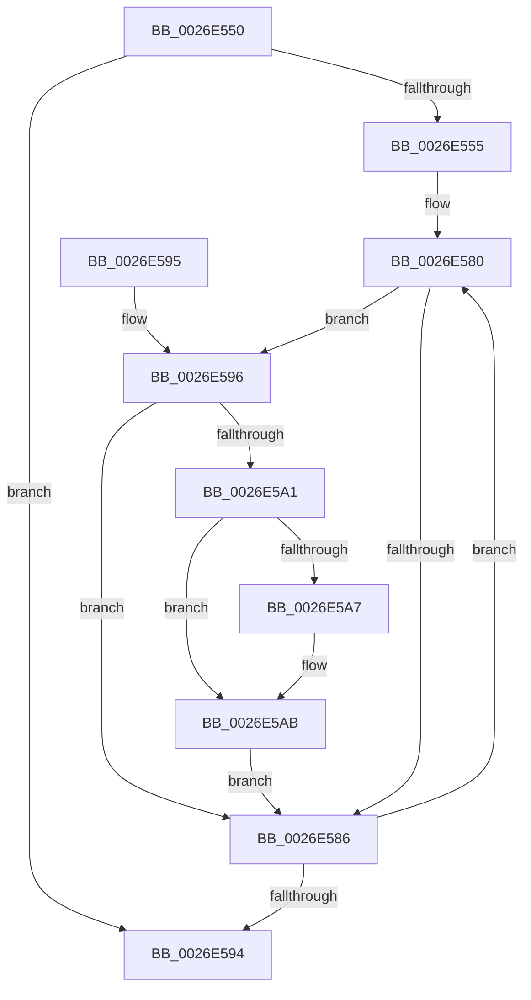

# PopPepCancelActivityRange

- RVA: `0x0026E550`–`0x0026E5B3` (길이 `99` bytes)
- VA: `0x000000014026E550`
- 실행 섹션: `.text`
- PDB 이름 있음: `예`; PDB Function 태그: `아니요`
- unwind 정보 RVA: `0x000DB714`
- 디코드: `32`개 명령, `99/99` bytes 표시
- 미해석 바이트: `0` (있으면 어셈블리에 `.byte`로 보존)

> 이 문서는 커널 이미지의 기계어와 PDB 기호를 분석해 생성했습니다. 4번과 5번은 함수 원형과 자료형을 바이너리 사용 방식에서 추정한 C 해석이며 원본 소스 복구 결과는 아닙니다.

## 1. Dependencies

- 직접 호출 지점: **0**; 고유 호출 대상: **0**
- 직접 호출자로 확인된 함수: **1**
- RIP 상대 이미지 참조: **1**

### Outgoing calls
- 직접 디코드된 call 명령이 없습니다.

### Direct callers
- [PopPepUpdateConstraints](PopPepUpdateConstraints_function_0026F5C8.md) at `0x0026F710`

### Static image references
- `0x0026E563` → RVA `0x00001058` (`.rdata`; read)

## 2. Other-region calls and transfers

- 다른 실행 섹션으로 향하는 call: **0**
- 별도 외부 분기/꼬리 이동을 확인하지 못했습니다.

## 3. Assembly (complete function range)

```asm
0026E550  45 3B C1                        cmp r8d, r9d
0026E553  7F 3F                           jg 0x14026e594
0026E555  4D 63 D0                        movsxd r10, r8d
0026E558  48 63 C2                        movsxd rax, edx
0026E55B  4E 8D 1C D1                     lea r11, [rcx + r10*8]
0026E55F  48 6B C8 22                     imul rcx, rax, 0x22
0026E563  48 8D 05 EE 2A D9 FF            lea rax, [rip - 0x26d512]
0026E56A  49 03 CA                        add rcx, r10
0026E56D  4C 8B 54 24 28                  mov r10, qword ptr [rsp + 0x28]
0026E572  45 2B C8                        sub r9d, r8d
0026E575  48 8D 04 88                     lea rax, [rax + rcx*4]
0026E579  45 8D 41 01                     lea r8d, [r9 + 1]
0026E57D  0F 1F 00                        nop dword ptr [rax]
0026E580  8B 10                           mov edx, dword ptr [rax]
0026E582  85 D2                           test edx, edx
0026E584  75 10                           jne 0x14026e596
0026E586  48 83 C0 04                     add rax, 4
0026E58A  49 83 C3 08                     add r11, 8
0026E58E  49 83 E8 01                     sub r8, 1
0026E592  75 EC                           jne 0x14026e580
0026E594  C3                              ret
0026E595  CC                              int3
0026E596  49 8B 0B                        mov rcx, qword ptr [r11]
0026E599  44 8B 09                        mov r9d, dword ptr [rcx]
0026E59C  41 85 D1                        test r9d, edx
0026E59F  74 E5                           je 0x14026e586
0026E5A1  41 F6 C1 02                     test r9b, 2
0026E5A5  74 04                           je 0x14026e5ab
0026E5A7  F0 41 FF 0A                     lock dec dword ptr [r10]
0026E5AB  49 8B 0B                        mov rcx, qword ptr [r11]
0026E5AE  83 21 FC                        and dword ptr [rcx], 0xfffffffc
0026E5B1  EB D3                           jmp 0x14026e586
```

## 4. C-style interpretation (structured pseudocode)

```c
__int64 __fastcall PopPepCancelActivityRange(__int64 a1, int a2, int a3, int a4, __int64 a5)
{
    __int64 result;
    __int64 v_r11;

    if (a3 > a4) goto loc_0026E594;
    a1 = (a1) * ((int)(a2));
    a1 = (a1) + ((int)(a3));
    a4 = (unsigned int)((a4) - (a3));
loc_0026E580:
    if ((unsigned int)((unsigned int)(*(unsigned int *)(v_rip - 2544914 + a1 * 4))) != 0) goto loc_0026E596;
loc_0026E586:
    result = (v_rip - 2544914 + a1 * 4) + (4);
    v_r11 = (a1 + (int)(a3) * 8) + (8);
    a3 = (a4 + 1) - (1);
    if (condition_is_not_equal) goto loc_0026E580;
loc_0026E594:
    return result;
loc_0026E596:
    if ((((unsigned int)((unsigned int)(*(unsigned int *)(*(unsigned __int64 *)(v_r11))))) & ((unsigned int)((unsigned int)(*(unsigned int *)(v_rip - 2544914 + a1 * 4))))) == 0) goto loc_0026E586;
    if ((((unsigned __int8)((unsigned int)(*(unsigned int *)(*(unsigned __int64 *)(v_r11))))) & (2)) != 0) {
    }
    goto loc_0026E586;
}
```

## 5. (Beta) C Style

```c
int64_t PopPepCancelActivityRange(void *Arg1, int32_t Arg2, int32_t Arg3, void *Arg4, void *Arg5)
{
    uint8_t *arg1 = (uint8_t *)Arg1;
    uint8_t *arg4 = (uint8_t *)Arg4;
    uint8_t *arg5 = (uint8_t *)Arg5;

    int64_t result;
    int64_t local_r11;

    if (Arg3 > Arg4) goto loc_0026E594;
    Arg1 = (Arg1) * ((int32_t)(Arg2));
    Arg1 = (Arg1) + ((int32_t)(Arg3));
    Arg4 = (uint32_t)((Arg4) - (Arg3));
loc_0026E580:
    if ((uint32_t)((uint32_t)(*(uint32_t *)(v_rip - 0x26D512 + arg1 * 4))) != 0) goto loc_0026E596;
loc_0026E586:
    result = (v_rip - 2544914 + Arg1 * 4) + (4);
    local_r11 = (Arg1 + (int32_t)(Arg3) * 8) + (8);
    Arg3 = (Arg4 + 1) - (1);
    if (condition_is_not_equal) goto loc_0026E580;
loc_0026E594:
    return result;
loc_0026E596:
    if ((((uint32_t)((uint32_t)(*(uint32_t *)(*(uint64_t *)(local_r11))))) & ((uint32_t)((uint32_t)(*(uint32_t *)(v_rip - 0x26D512 + arg1 * 4))))) == 0) goto loc_0026E586;
    if ((((uint8_t)((uint32_t)(*(uint32_t *)(*(uint64_t *)(local_r11))))) & (2)) != 0) {
    }
    goto loc_0026E586;
}
```

### 관측된 메모리 오프셋

구조체 형식이 확인되지 않은 접근은 인자 기준의 오프셋으로만 기록했습니다.

| 기준 인자 | 오프셋 표현 | 폭 (bit) | 접근 |
|---|---:|---:|---|
| `Arg1` | `+ 0x0` | `64` | `R` |
| `Arg1` | `+ 0x0 + r10*8` | `64` | `R` |
| `Arg4` | `+ 0x1` | `32` | `R` |
| `Arg5` | `+ 0x0` | `32` | `R/W` |

## 6. Execution-region graph

[열기: 2D/3D 그래프와 함수 탐색 컨트롤 패널](../../../control-panel.html?section=text&rva=0x0026E550&view=graph)

- 2D 그래프는 위에서 아래로 흐르고, 3D 그래프는 빈 공간을 드래그해 회전합니다. Shift+드래그는 이동, 휠은 확대·축소, 함수 노드 선택은 대상 보고서 이동입니다.

### Static fallback


