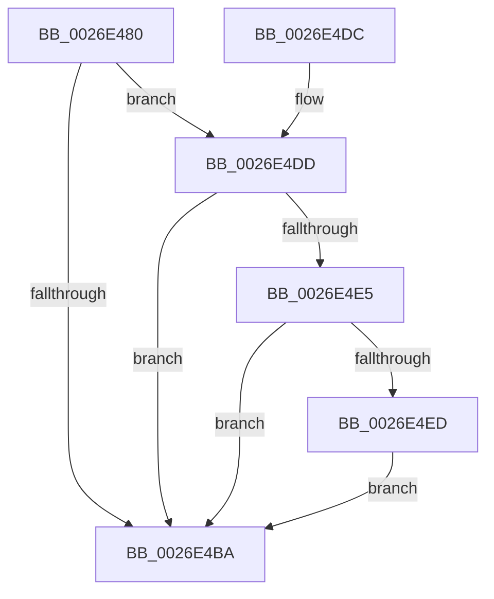

# PopPepSurprisePowerOn

- RVA: `0x0026E480`–`0x0026E51E` (길이 `158` bytes)
- VA: `0x000000014026E480`
- 실행 섹션: `.text`
- PDB 이름 있음: `예`; PDB Function 태그: `아니요`
- unwind 정보 RVA: `0x00065720`
- 디코드: `48`개 명령, `158/158` bytes 표시
- 미해석 바이트: `0` (있으면 어셈블리에 `.byte`로 보존)

> 이 문서는 커널 이미지의 기계어와 PDB 기호를 분석해 생성했습니다. 4번과 5번은 함수 원형과 자료형을 바이너리 사용 방식에서 추정한 C 해석이며 원본 소스 복구 결과는 아닙니다.

## 1. Dependencies

- 직접 호출 지점: **5**; 고유 호출 대상: **5**
- 직접 호출자로 확인된 함수: **1**
- RIP 상대 이미지 참조: **0**

### Outgoing calls
- `0x0026E4AA` → [PopPepLockActivityLink](PopPepLockActivityLink_function_0026F7A0.md) (function, `0x0026F7A0`)
- `0x0026E4C7` → [PopPepReleaseActivityLink](../24/PopPepReleaseActivityLink_function_0024CC90.md) (function, `0x0024CC90`)
- `0x0026E4FB` → [PopPepTriggerActivity](../24/PopPepTriggerActivity_function_0024CDB0.md) (function, `0x0024CDB0`)
- `0x0026E509` → [PopPepPromoteActivities](../24/PopPepPromoteActivities_function_0024D0D0.md) (function, `0x0024D0D0`)
- `0x0026E517` → [PopPepRequestWork](../39/PopPepRequestWork_function_003986F0.md) (function, `0x003986F0`)

### Direct callers
- [PoFxNotifySurprisePowerOn](PoFxNotifySurprisePowerOn_function_0026E620.md) at `0x0026E66F`

### Static image references
- 디코드된 RIP-relative 메모리 참조가 없습니다.

## 2. Other-region calls and transfers

- 다른 실행 섹션으로 향하는 call: **0**
- 별도 외부 분기/꼬리 이동을 확인하지 못했습니다.

## 3. Assembly (complete function range)

```asm
0026E480  48 8B C4                        mov rax, rsp
0026E483  48 89 58 10                     mov qword ptr [rax + 0x10], rbx
0026E487  48 89 70 18                     mov qword ptr [rax + 0x18], rsi
0026E48B  57                              push rdi
0026E48C  48 83 EC 30                     sub rsp, 0x30
0026E490  33 DB                           xor ebx, ebx
0026E492  45 33 C9                        xor r9d, r9d
0026E495  88 58 08                        mov byte ptr [rax + 8], bl
0026E498  48 8D 40 08                     lea rax, [rax + 8]
0026E49C  33 D2                           xor edx, edx
0026E49E  48 89 44 24 20                  mov qword ptr [rsp + 0x20], rax
0026E4A3  48 8B F9                        mov rdi, rcx
0026E4A6  44 8D 43 06                     lea r8d, [rbx + 6]
0026E4AA  E8 F1 12 00 00                  call 0x14026f7a0
0026E4AF  40 8A F0                        mov sil, al
0026E4B2  39 9F 8C 00 00 00               cmp dword ptr [rdi + 0x8c], ebx
0026E4B8  74 23                           je 0x14026e4dd
0026E4BA  44 8A 4C 24 40                  mov r9b, byte ptr [rsp + 0x40]
0026E4BF  44 8A C6                        mov r8b, sil
0026E4C2  33 D2                           xor edx, edx
0026E4C4  48 8B CF                        mov rcx, rdi
0026E4C7  E8 C4 E7 FD FF                  call 0x14024cc90
0026E4CC  48 8B 5C 24 48                  mov rbx, qword ptr [rsp + 0x48]
0026E4D1  48 8B 74 24 50                  mov rsi, qword ptr [rsp + 0x50]
0026E4D6  48 83 C4 30                     add rsp, 0x30
0026E4DA  5F                              pop rdi
0026E4DB  C3                              ret
0026E4DC  CC                              int3
0026E4DD  38 9F 88 00 00 00               cmp byte ptr [rdi + 0x88], bl
0026E4E3  75 D5                           jne 0x14026e4ba
0026E4E5  48 8B 4F 48                     mov rcx, qword ptr [rdi + 0x48]
0026E4E9  39 19                           cmp dword ptr [rcx], ebx
0026E4EB  75 CD                           jne 0x14026e4ba
0026E4ED  8B 5F 78                        mov ebx, dword ptr [rdi + 0x78]
0026E4F0  45 33 C9                        xor r9d, r9d
0026E4F3  45 33 C0                        xor r8d, r8d
0026E4F6  33 D2                           xor edx, edx
0026E4F8  48 8B CF                        mov rcx, rdi
0026E4FB  E8 B0 E8 FD FF                  call 0x14024cdb0
0026E500  33 D2                           xor edx, edx
0026E502  48 8B CF                        mov rcx, rdi
0026E505  44 8D 42 01                     lea r8d, [rdx + 1]
0026E509  E8 C2 EB FD FF                  call 0x14024d0d0
0026E50E  44 8B 47 78                     mov r8d, dword ptr [rdi + 0x78]
0026E512  8B D3                           mov edx, ebx
0026E514  48 8B CF                        mov rcx, rdi
0026E517  E8 D4 A1 12 00                  call 0x1403986f0
0026E51C  EB 9C                           jmp 0x14026e4ba
```

## 4. C-style interpretation (structured pseudocode)

```c
__int64 __fastcall PopPepSurprisePowerOn(__int64 a1, int a2, __int64 a3, int a4)
{
    __int64 result;
    __int64 v_rbx;
    __int64 v_rsp;
    unsigned __int64 v_stack_m18;
    unsigned __int64 v_stack_p10;
    unsigned __int64 v_stack_p18;
    unsigned __int8 v_stack_p8;

    *(unsigned __int64 *)(v_rsp + 16) = v_rbx;
    *(unsigned __int64 *)(v_rsp + 24) = v_rsi;
    v_rsp = (v_rsp) - (48);
    v_rbx = 0;
    a4 = 0;
    *(unsigned __int8 *)(v_rsp + 8) = 0;
    a2 = 0;
    v_stack_m18 = v_rsp + 8;
    result = PopPepLockActivityLink(a1, a2, v_rbx + 6, a4);
    if ((*(unsigned int *)(a1 + 140)) == 0) goto loc_0026E4DD;
loc_0026E4BA:
    a2 = 0;
    result = PopPepReleaseActivityLink(a1, a2, (unsigned __int8)((unsigned __int8)(result)), v_stack_p8);
    v_rsp = (v_rsp) + (48);
    return result;
loc_0026E4DD:
    if ((*(unsigned __int8 *)(a1 + 136)) != ((unsigned __int8)(v_stack_p10))) goto loc_0026E4BA;
    if ((*(unsigned int *)(*(unsigned __int64 *)(a1 + 72))) != ((unsigned int)(v_stack_p10))) goto loc_0026E4BA;
    a4 = 0;
    a3 = 0;
    a2 = 0;
    result = PopPepTriggerActivity(a1, a2, a3, a4);
    a2 = 0;
    result = PopPepPromoteActivities(a1, a2, a2 + 1, a4);
    result = PopPepRequestWork(a1, (unsigned int)((unsigned int)((unsigned int)(*(unsigned int *)(a1 + 120)))), (unsigned int)(*(unsigned int *)(a1 + 120)), a4);
    goto loc_0026E4BA;
}
```

## 5. (Beta) C Style

```c
int64_t PopPepSurprisePowerOn(void *Arg1, int32_t Arg2, int64_t Arg3, int32_t Arg4)
{
    uint8_t *arg1 = (uint8_t *)Arg1;

    int64_t result;
    int64_t local_rbx;
    int64_t local_rsp;
    uint64_t v_stack_m18;
    uint64_t v_stack_p10;
    uint64_t v_stack_p18;
    uint8_t v_stack_p8;

    *(uint64_t *)(local_rsp + 0x10) = local_rbx;
    *(uint64_t *)(local_rsp + 0x18) = local_rsi;
    local_rsp = (local_rsp) - (48);
    local_rbx = 0;
    Arg4 = 0;
    *(uint8_t *)(local_rsp + 0x8) = 0;
    Arg2 = 0;
    v_stack_m18 = local_rsp + 8;
    result = PopPepLockActivityLink(Arg1, Arg2, local_rbx + 6, Arg4);
    if ((*(uint32_t *)(arg1 + 0x8C)) == 0) goto loc_0026E4DD;
loc_0026E4BA:
    Arg2 = 0;
    result = PopPepReleaseActivityLink(Arg1, Arg2, (uint8_t)((uint8_t)(result)), v_stack_p8);
    local_rsp = (local_rsp) + (48);
    return result;
loc_0026E4DD:
    if ((*(uint8_t *)(arg1 + 0x88)) != ((uint8_t)(v_stack_p10))) goto loc_0026E4BA;
    if ((*(uint32_t *)(*(uint64_t *)(arg1 + 0x48))) != ((uint32_t)(v_stack_p10))) goto loc_0026E4BA;
    Arg4 = 0;
    Arg3 = 0;
    Arg2 = 0;
    result = PopPepTriggerActivity(Arg1, Arg2, Arg3, Arg4);
    Arg2 = 0;
    result = PopPepPromoteActivities(Arg1, Arg2, Arg2 + 1, Arg4);
    result = PopPepRequestWork(Arg1, (uint32_t)((uint32_t)((uint32_t)(*(uint32_t *)(arg1 + 0x78)))), (uint32_t)(*(uint32_t *)(arg1 + 0x78)), Arg4);
    goto loc_0026E4BA;
}
```

### 관측된 메모리 오프셋

구조체 형식이 확인되지 않은 접근은 인자 기준의 오프셋으로만 기록했습니다.

| 기준 인자 | 오프셋 표현 | 폭 (bit) | 접근 |
|---|---:|---:|---|
| `Arg1` | `+ 0x48` | `64` | `R` |
| `Arg1` | `+ 0x78` | `32` | `R` |
| `Arg1` | `+ 0x88` | `8` | `R` |
| `Arg1` | `+ 0x8C` | `32` | `R` |

## 6. Execution-region graph

[열기: 2D/3D 그래프와 함수 탐색 컨트롤 패널](../../../control-panel.html?section=text&rva=0x0026E480&view=graph)

- 2D 그래프는 위에서 아래로 흐르고, 3D 그래프는 빈 공간을 드래그해 회전합니다. Shift+드래그는 이동, 휠은 확대·축소, 함수 노드 선택은 대상 보고서 이동입니다.

### Static fallback


