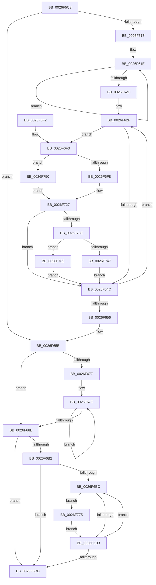

# PopPepUpdateConstraints

- RVA: `0x0026F5C8`–`0x0026F797` (길이 `463` bytes)
- VA: `0x000000014026F5C8`
- 실행 섹션: `.text`
- PDB 이름 있음: `예`; PDB Function 태그: `아니요`
- unwind 정보 RVA: `0x00065884`
- 디코드: `126`개 명령, `463/463` bytes 표시
- 미해석 바이트: `0` (있으면 어셈블리에 `.byte`로 보존)

> 이 문서는 커널 이미지의 기계어와 PDB 기호를 분석해 생성했습니다. 4번과 5번은 함수 원형과 자료형을 바이너리 사용 방식에서 추정한 C 해석이며 원본 소스 복구 결과는 아닙니다.

## 1. Dependencies

- 직접 호출 지점: **9**; 고유 호출 대상: **9**
- 직접 호출자로 확인된 함수: **4**
- RIP 상대 이미지 참조: **0**

### Outgoing calls
- `0x0026F5FE` → [PopPepLockActivityLink](PopPepLockActivityLink_function_0026F7A0.md) (function, `0x0026F7A0`)
- `0x0026F664` → [PopPepPromoteActivities](../24/PopPepPromoteActivities_function_0024D0D0.md) (function, `0x0024D0D0`)
- `0x0026F693` → [PopPepRequestWork](../39/PopPepRequestWork_function_003986F0.md) (function, `0x003986F0`)
- `0x0026F6A8` → [PopPepReleaseActivityLink](../24/PopPepReleaseActivityLink_function_0024CC90.md) (function, `0x0024CC90`)
- `0x0026F710` → [PopPepCancelActivityRange](PopPepCancelActivityRange_function_0026E550.md) (function, `0x0026E550`)
- `0x0026F722` → [KeResetEvent](../24/KeResetEvent_function_00248350.md) (function, `0x00248350`)
- `0x0026F730` → [PopPepUpdateIdleState](../2B/PopPepUpdateIdleState_function_002BF794.md) (function, `0x002BF794`)
- `0x0026F76B` → [KeSetEvent](../33/KeSetEvent_function_0033F310.md) (function, `0x0033F310`)
- `0x0026F78D` → [KeWaitForSingleObject](../20/KeWaitForSingleObject_function_0020E6B0.md) (function, `0x0020E6B0`)

### Direct callers
- [PopRequestCompletion](PopRequestCompletion_function_0026EEF0.md) at `0x0026EFFF`
- [PopRequestPowerIrp](../27/PopRequestPowerIrp_function_00270ED4.md) at `0x002710D9`
- [PopPepDeviceDState](../2B/PopPepDeviceDState_function_002BFE70.md) at `0x002BFEC4`
- [PopPepDeviceDState](../2B/PopPepDeviceDState_function_002BFE70.md) at `0x002BFEE1`
- [PopFxCompleteDevicePowerRequired](../39/PopFxCompleteDevicePowerRequired_function_003908AC.md) at `0x0039096D`

### Static image references
- 디코드된 RIP-relative 메모리 참조가 없습니다.

## 2. Other-region calls and transfers

- 다른 실행 섹션으로 향하는 call: **0**
- 별도 외부 분기/꼬리 이동을 확인하지 못했습니다.

## 3. Assembly (complete function range)

```asm
0026F5C8  48 8B C4                        mov rax, rsp
0026F5CB  48 89 58 10                     mov qword ptr [rax + 0x10], rbx
0026F5CF  55                              push rbp
0026F5D0  56                              push rsi
0026F5D1  57                              push rdi
0026F5D2  41 54                           push r12
0026F5D4  41 55                           push r13
0026F5D6  41 56                           push r14
0026F5D8  41 57                           push r15
0026F5DA  48 83 EC 30                     sub rsp, 0x30
0026F5DE  4C 63 EA                        movsxd r13, edx
0026F5E1  33 D2                           xor edx, edx
0026F5E3  C6 40 18 00                     mov byte ptr [rax + 0x18], 0
0026F5E7  48 8D 40 18                     lea rax, [rax + 0x18]
0026F5EB  45 8A E0                        mov r12b, r8b
0026F5EE  48 89 44 24 20                  mov qword ptr [rsp + 0x20], rax
0026F5F3  48 8B D9                        mov rbx, rcx
0026F5F6  44 8D 4A 01                     lea r9d, [rdx + 1]
0026F5FA  44 8D 42 04                     lea r8d, [rdx + 4]
0026F5FE  E8 9D 01 00 00                  call 0x14026f7a0
0026F603  8B 93 B4 00 00 00               mov edx, dword ptr [rbx + 0xb4]
0026F609  40 8A F8                        mov dil, al
0026F60C  8B 6B 78                        mov ebp, dword ptr [rbx + 0x78]
0026F60F  88 44 24 70                     mov byte ptr [rsp + 0x70], al
0026F613  85 D2                           test edx, edx
0026F615  74 44                           je 0x14026f65b
0026F617  48 8D 8B 28 01 00 00            lea rcx, [rbx + 0x128]
0026F61E  03 29                           add ebp, dword ptr [rcx]
0026F620  48 8D 89 D0 00 00 00            lea rcx, [rcx + 0xd0]
0026F627  48 83 EA 01                     sub rdx, 1
0026F62B  75 F1                           jne 0x14026f61e
0026F62D  33 F6                           xor esi, esi
0026F62F  8B C6                           mov eax, esi
0026F631  48 69 F8 D0 00 00 00            imul rdi, rax, 0xd0
0026F638  48 81 C7 C0 00 00 00            add rdi, 0xc0
0026F63F  48 03 FB                        add rdi, rbx
0026F642  F6 47 10 01                     test byte ptr [rdi + 0x10], 1
0026F646  0F 85 A7 00 00 00               jne 0x14026f6f3
0026F64C  FF C6                           inc esi
0026F64E  3B B3 B4 00 00 00               cmp esi, dword ptr [rbx + 0xb4]
0026F654  72 D9                           jb 0x14026f62f
0026F656  40 8A 7C 24 70                  mov dil, byte ptr [rsp + 0x70]
0026F65B  33 D2                           xor edx, edx
0026F65D  48 8B CB                        mov rcx, rbx
0026F660  44 8D 42 03                     lea r8d, [rdx + 3]
0026F664  E8 67 DA FD FF                  call 0x14024d0d0
0026F669  8B 8B B4 00 00 00               mov ecx, dword ptr [rbx + 0xb4]
0026F66F  44 8B 43 78                     mov r8d, dword ptr [rbx + 0x78]
0026F673  85 C9                           test ecx, ecx
0026F675  74 17                           je 0x14026f68e
0026F677  48 8D 83 28 01 00 00            lea rax, [rbx + 0x128]
0026F67E  44 03 00                        add r8d, dword ptr [rax]
0026F681  48 8D 80 D0 00 00 00            lea rax, [rax + 0xd0]
0026F688  48 83 E9 01                     sub rcx, 1
0026F68C  75 F0                           jne 0x14026f67e
0026F68E  8B D5                           mov edx, ebp
0026F690  48 8B CB                        mov rcx, rbx
0026F693  E8 58 90 12 00                  call 0x1403986f0
0026F698  44 8A 8C 24 80 00 00 00         mov r9b, byte ptr [rsp + 0x80]
0026F6A0  44 8A C7                        mov r8b, dil
0026F6A3  33 D2                           xor edx, edx
0026F6A5  48 8B CB                        mov rcx, rbx
0026F6A8  E8 E3 D5 FD FF                  call 0x14024cc90
0026F6AD  45 84 E4                        test r12b, r12b
0026F6B0  75 2B                           jne 0x14026f6dd
0026F6B2  33 FF                           xor edi, edi
0026F6B4  39 BB B4 00 00 00               cmp dword ptr [rbx + 0xb4], edi
0026F6BA  76 21                           jbe 0x14026f6dd
0026F6BC  8B C7                           mov eax, edi
0026F6BE  48 69 C8 D0 00 00 00            imul rcx, rax, 0xd0
0026F6C5  F6 84 19 D0 00 00 00 01         test byte ptr [rcx + rbx + 0xd0], 1
0026F6CD  0F 85 A2 00 00 00               jne 0x14026f775
0026F6D3  FF C7                           inc edi
0026F6D5  3B BB B4 00 00 00               cmp edi, dword ptr [rbx + 0xb4]
0026F6DB  72 DF                           jb 0x14026f6bc
0026F6DD  48 8B 5C 24 78                  mov rbx, qword ptr [rsp + 0x78]
0026F6E2  48 83 C4 30                     add rsp, 0x30
0026F6E6  41 5F                           pop r15
0026F6E8  41 5E                           pop r14
0026F6EA  41 5D                           pop r13
0026F6EC  41 5C                           pop r12
0026F6EE  5F                              pop rdi
0026F6EF  5E                              pop rsi
0026F6F0  5D                              pop rbp
0026F6F1  C3                              ret
0026F6F2  CC                              int3
0026F6F3  45 84 E4                        test r12b, r12b
0026F6F6  75 58                           jne 0x14026f750
0026F6F8  BA 01 00 00 00                  mov edx, 1
0026F6FD  48 8D 47 68                     lea rax, [rdi + 0x68]
0026F701  44 8B CA                        mov r9d, edx
0026F704  48 89 44 24 20                  mov qword ptr [rsp + 0x20], rax
0026F709  44 8B C2                        mov r8d, edx
0026F70C  48 8D 4F 38                     lea rcx, [rdi + 0x38]
0026F710  E8 3B EE FF FF                  call 0x14026e550
0026F715  42 83 A4 AF 98 00 00 00 00      and dword ptr [rdi + r13*4 + 0x98], 0
0026F71E  48 8D 4F 20                     lea rcx, [rdi + 0x20]
0026F722  E8 29 8C FD FF                  call 0x140248350
0026F727  45 8A C4                        mov r8b, r12b
0026F72A  48 8B D7                        mov rdx, rdi
0026F72D  48 8B CB                        mov rcx, rbx
0026F730  E8 5F 00 05 00                  call 0x1402bf794
0026F735  45 84 E4                        test r12b, r12b
0026F738  0F 85 0E FF FF FF               jne 0x14026f64c
0026F73E  48 8B 47 40                     mov rax, qword ptr [rdi + 0x40]
0026F742  83 38 00                        cmp dword ptr [rax], 0
0026F745  74 1B                           je 0x14026f762
0026F747  C6 40 10 01                     mov byte ptr [rax + 0x10], 1
0026F74B  E9 FC FE FF FF                  jmp 0x14026f64c
0026F750  8B 87 BC 00 00 00               mov eax, dword ptr [rdi + 0xbc]
0026F756  FF C8                           dec eax
0026F758  42 89 84 AF 98 00 00 00         mov dword ptr [rdi + r13*4 + 0x98], eax
0026F760  EB C5                           jmp 0x14026f727
0026F762  45 33 C0                        xor r8d, r8d
0026F765  48 8D 4F 20                     lea rcx, [rdi + 0x20]
0026F769  33 D2                           xor edx, edx
0026F76B  E8 A0 FB 0C 00                  call 0x14033f310
0026F770  E9 D7 FE FF FF                  jmp 0x14026f64c
0026F775  48 83 64 24 20 00               and qword ptr [rsp + 0x20], 0
0026F77B  48 81 C1 E0 00 00 00            add rcx, 0xe0
0026F782  48 03 CB                        add rcx, rbx
0026F785  45 33 C9                        xor r9d, r9d
0026F788  45 33 C0                        xor r8d, r8d
0026F78B  33 D2                           xor edx, edx
0026F78D  E8 1E EF F9 FF                  call 0x14020e6b0
0026F792  E9 3C FF FF FF                  jmp 0x14026f6d3
```

## 4. C-style interpretation (structured pseudocode)

```c
__int64 __fastcall PopPepUpdateConstraints(__int64 a1, int a2, unsigned __int8 a3)
{
    __int64 result;
    __int64 v_rbp;
    __int64 v_rdi;
    __int64 v_rsi;
    __int64 v_rsp;
    unsigned __int64 v_stack_m48;
    unsigned __int64 v_stack_p10;
    unsigned __int8 v_stack_p18;
    unsigned __int64 v_stack_p20;
    unsigned __int8 v_stack_p8;

    *(unsigned __int64 *)(v_rsp + 16) = v_rbx;
    v_rsp = (v_rsp) - (48);
    a2 = 0;
    *(unsigned __int8 *)(v_rsp + 24) = 0;
    v_stack_m48 = v_rsp + 24;
    result = PopPepLockActivityLink(a1, a2, a2 + 4, a2 + 1);
    v_stack_p8 = (unsigned __int8)(result);
    if ((unsigned int)((unsigned int)(*(unsigned int *)(a1 + 180))) == 0) goto loc_0026F65B;
loc_0026F61E:
    v_rbp = (unsigned int)(((unsigned int)(*(unsigned int *)(a1 + 120))) + (*(unsigned int *)(a1 + 296)));
    a2 = ((unsigned int)(*(unsigned int *)(a1 + 180))) - (1);
    if (condition_is_not_equal) goto loc_0026F61E;
    v_rsi = 0;
loc_0026F62F:
    v_rdi = ((unsigned __int8)(result)) * (0);
    v_rdi = (v_rdi) + (192);
    v_rdi = (v_rdi) + (a1);
    if (((*(unsigned __int8 *)(v_rdi + 16)) & (1)) != 0) goto loc_0026F6F3;
loc_0026F64C:
    v_rsi = (unsigned int)((v_rsi) + 1);
    if (((unsigned int)(v_rsi)) < (*(unsigned int *)(a1 + 180))) goto loc_0026F62F;
loc_0026F65B:
    a2 = 0;
    result = PopPepPromoteActivities(a1, a2, a2 + 3, a2 + 1);
    if ((unsigned int)((unsigned int)(*(unsigned int *)(a1 + 180))) == 0) goto loc_0026F68E;
loc_0026F67E:
    a3 = (unsigned int)(((unsigned int)(*(unsigned int *)(a1 + 120))) + (*(unsigned int *)(a1 + 296)));
    a1 = ((unsigned int)(*(unsigned int *)(a1 + 180))) - (1);
    if (condition_is_not_equal) goto loc_0026F67E;
loc_0026F68E:
    result = PopPepRequestWork(a1, (unsigned int)((unsigned int)(v_rbp)), a3, a2 + 1);
    a2 = 0;
    result = PopPepReleaseActivityLink(a1, a2, (unsigned __int8)(v_stack_p8), v_stack_p18);
    if (a3 != 0) goto loc_0026F6DD;
    v_rdi = 0;
    if ((*(unsigned int *)(a1 + 180)) <= 0) goto loc_0026F6DD;
loc_0026F6BC:
    a1 = (a1) * (0);
    if (((*(unsigned __int8 *)(a1 + a1 * 1 + 208)) & (1)) != 0) goto loc_0026F775;
loc_0026F6D3:
    v_rdi = (unsigned int)((v_rdi) + 1);
    if (((unsigned int)(v_rdi)) < (*(unsigned int *)(a1 + 180))) goto loc_0026F6BC;
loc_0026F6DD:
    v_rsp = (v_rsp) + (48);
    return 0;
loc_0026F6F3:
    if (a3 != 0) goto loc_0026F750;
    v_stack_p20 = v_rdi + 104;
    result = PopPepCancelActivityRange(v_rdi + 56, 1, 1, 1);
    result = KeResetEvent(v_rdi + 32, 1, 1, 1);
loc_0026F727:
    result = PopPepUpdateIdleState(v_stack_p10, v_rdi, a3, 1);
    if (a3 != 0) goto loc_0026F64C;
    if ((*(unsigned int *)(*(unsigned __int64 *)(v_rdi + 64))) == 0) goto loc_0026F762;
    *(unsigned __int8 *)(*(unsigned __int64 *)(v_rdi + 64) + 16) = 1;
    goto loc_0026F64C;
loc_0026F750:
    result = (unsigned int)(((unsigned int)(*(unsigned int *)(v_rdi + 188))) - 1);
    *(unsigned int *)(v_rdi + (int)(a2) * 4 + 152) = (unsigned int)(result);
    goto loc_0026F727;
loc_0026F762:
    a3 = 0;
    a2 = 0;
    result = KeSetEvent(v_rdi + 32, a2, a3, 1);
    goto loc_0026F64C;
loc_0026F775:
    a1 = (v_rdi + 32) + (224);
    a1 = (a1) + (v_stack_p10);
    a4 = 0;
    a3 = 0;
    a2 = 0;
    result = KeWaitForSingleObject(a1, a2, a3, a4);
    goto loc_0026F6D3;
}
```

## 5. (Beta) C Style

```c
int64_t PopPepUpdateConstraints(void *Arg1, int32_t Arg2, uint8_t Arg3)
{
    uint8_t *arg1 = (uint8_t *)Arg1;

    int64_t result;
    int64_t local_rbp;
    int64_t local_rdi;
    int64_t local_rsi;
    int64_t local_rsp;
    uint64_t v_stack_m48;
    uint64_t v_stack_p10;
    uint8_t v_stack_p18;
    uint64_t v_stack_p20;
    uint8_t v_stack_p8;

    *(uint64_t *)(local_rsp + 0x10) = local_rbx;
    local_rsp = (local_rsp) - (48);
    Arg2 = 0;
    *(uint8_t *)(local_rsp + 0x18) = 0;
    v_stack_m48 = local_rsp + 24;
    result = PopPepLockActivityLink(Arg1, Arg2, Arg2 + 4, Arg2 + 1);
    v_stack_p8 = (uint8_t)(result);
    if ((uint32_t)((uint32_t)(*(uint32_t *)(arg1 + 0xB4))) == 0) goto loc_0026F65B;
loc_0026F61E:
    local_rbp = (uint32_t)(((uint32_t)(*(uint32_t *)(arg1 + 0x78))) + (*(uint32_t *)(arg1 + 0x128)));
    Arg2 = ((uint32_t)(*(uint32_t *)(arg1 + 0xB4))) - (1);
    if (condition_is_not_equal) goto loc_0026F61E;
    local_rsi = 0;
loc_0026F62F:
    local_rdi = ((uint8_t)(result)) * (0);
    local_rdi = (local_rdi) + (192);
    local_rdi = (local_rdi) + (Arg1);
    if (((*(uint8_t *)(local_rdi + 0x10)) & (1)) != 0) goto loc_0026F6F3;
loc_0026F64C:
    local_rsi = (uint32_t)((local_rsi) + 1);
    if (((uint32_t)(local_rsi)) < (*(uint32_t *)(arg1 + 0xB4))) goto loc_0026F62F;
loc_0026F65B:
    Arg2 = 0;
    result = PopPepPromoteActivities(Arg1, Arg2, Arg2 + 3, Arg2 + 1);
    if ((uint32_t)((uint32_t)(*(uint32_t *)(arg1 + 0xB4))) == 0) goto loc_0026F68E;
loc_0026F67E:
    Arg3 = (uint32_t)(((uint32_t)(*(uint32_t *)(arg1 + 0x78))) + (*(uint32_t *)(arg1 + 0x128)));
    Arg1 = ((uint32_t)(*(uint32_t *)(arg1 + 0xB4))) - (1);
    if (condition_is_not_equal) goto loc_0026F67E;
loc_0026F68E:
    result = PopPepRequestWork(Arg1, (uint32_t)((uint32_t)(local_rbp)), Arg3, Arg2 + 1);
    Arg2 = 0;
    result = PopPepReleaseActivityLink(Arg1, Arg2, (uint8_t)(v_stack_p8), v_stack_p18);
    if (Arg3 != 0) goto loc_0026F6DD;
    local_rdi = 0;
    if ((*(uint32_t *)(arg1 + 0xB4)) <= 0) goto loc_0026F6DD;
loc_0026F6BC:
    Arg1 = (Arg1) * (0);
    if (((*(uint8_t *)(arg1 + arg1 * 1 + 0xD0)) & (1)) != 0) goto loc_0026F775;
loc_0026F6D3:
    local_rdi = (uint32_t)((local_rdi) + 1);
    if (((uint32_t)(local_rdi)) < (*(uint32_t *)(arg1 + 0xB4))) goto loc_0026F6BC;
loc_0026F6DD:
    local_rsp = (local_rsp) + (48);
    return 0;
loc_0026F6F3:
    if (Arg3 != 0) goto loc_0026F750;
    v_stack_p20 = local_rdi + 104;
    result = PopPepCancelActivityRange(local_rdi + 56, 1, 1, 1);
    result = KeResetEvent(local_rdi + 32, 1, 1, 1);
loc_0026F727:
    result = PopPepUpdateIdleState(v_stack_p10, local_rdi, Arg3, 1);
    if (Arg3 != 0) goto loc_0026F64C;
    if ((*(uint32_t *)(*(uint64_t *)(local_rdi + 0x40))) == 0) goto loc_0026F762;
    *(uint8_t *)(*(uint64_t *)(local_rdi + 0x40) + 0x10) = 1;
    goto loc_0026F64C;
loc_0026F750:
    result = (uint32_t)(((uint32_t)(*(uint32_t *)(local_rdi + 0xBC))) - 1);
    *(uint32_t *)(local_rdi + (int32_t)(Arg2) * 4 + 0x98) = (uint32_t)(result);
    goto loc_0026F727;
loc_0026F762:
    Arg3 = 0;
    Arg2 = 0;
    result = KeSetEvent(local_rdi + 32, Arg2, Arg3, 1);
    goto loc_0026F64C;
loc_0026F775:
    Arg1 = (local_rdi + 32) + (224);
    Arg1 = (Arg1) + (v_stack_p10);
    a4 = 0;
    Arg3 = 0;
    Arg2 = 0;
    result = KeWaitForSingleObject(Arg1, Arg2, Arg3, a4);
    goto loc_0026F6D3;
}
```

### 관측된 메모리 오프셋

구조체 형식이 확인되지 않은 접근은 인자 기준의 오프셋으로만 기록했습니다.

| 기준 인자 | 오프셋 표현 | 폭 (bit) | 접근 |
|---|---:|---:|---|
| `Arg1` | `+ 0x0` | `32` | `R` |
| `Arg1` | `+ 0x78` | `32` | `R` |
| `Arg1` | `+ 0xB4` | `32` | `R` |
| `Arg1` | `+ 0xD0` | `64` | `R` |
| `Arg1` | `+ 0x128` | `64` | `R` |

## 6. Execution-region graph

[열기: 2D/3D 그래프와 함수 탐색 컨트롤 패널](../../../control-panel.html?section=text&rva=0x0026F5C8&view=graph)

- 2D 그래프는 위에서 아래로 흐르고, 3D 그래프는 빈 공간을 드래그해 회전합니다. Shift+드래그는 이동, 휠은 확대·축소, 함수 노드 선택은 대상 보고서 이동입니다.

### Static fallback


