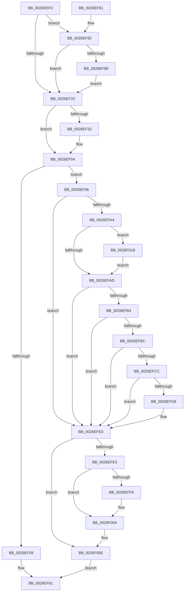

# PopRequestCompletion

- RVA: `0x0026EEF0`–`0x0026F026` (길이 `310` bytes)
- VA: `0x000000014026EEF0`
- 실행 섹션: `.text`
- PDB 이름 있음: `예`; PDB Function 태그: `아니요`
- unwind 정보 RVA: `0x000657E0`
- 디코드: `81`개 명령, `310/310` bytes 표시
- 미해석 바이트: `0` (있으면 어셈블리에 `.byte`로 보존)

> 이 문서는 커널 이미지의 기계어와 PDB 기호를 분석해 생성했습니다. 4번과 5번은 함수 원형과 자료형을 바이너리 사용 방식에서 추정한 C 해석이며 원본 소스 복구 결과는 아닙니다.

## 1. Dependencies

- 직접 호출 지점: **9**; 고유 호출 대상: **9**
- 직접 호출자로 확인된 함수: **0**
- RIP 상대 이미지 참조: **0**

### Outgoing calls
- `0x0026EF4F` → [guard_dispatch_icall](../6B/guard_dispatch_icall_function_006BAAD0.md) (function, `0x006BAAD0`)
- `0x0026EF5C` → [PopHandleDevicePowerIrpCompletion](PopHandleDevicePowerIrpCompletion_function_0026F030.md) (function, `0x0026F030`)
- `0x0026EF8F` → [PopFxNotifyPreDIrpCompletion](PopFxNotifyPreDIrpCompletion_function_0026F1F4.md) (function, `0x0026F1F4`)
- `0x0026EF99` → [PopDiagTraceIrpFinish](PopDiagTraceIrpFinish_function_0026F2A8.md) (function, `0x0026F2A8`)
- `0x0026EFDB` → [PopDirectedDripsStartDisengageTimer](../5D/PopDirectedDripsStartDisengageTimer_function_005D1230.md) (function, `0x005D1230`)
- `0x0026EFFF` → [PopPepUpdateConstraints](PopPepUpdateConstraints_function_0026F5C8.md) (function, `0x0026F5C8`)
- `0x0026F009` → [PopFxDereferenceDevice](../27/PopFxDereferenceDevice_function_0027038C.md) (function, `0x0027038C`)
- `0x0026F011` → [PopFreeIrp](PopFreeIrp_function_0026FAA0.md) (function, `0x0026FAA0`)
- `0x0026F01F` → [PopUpdateWakeSource](../4A/PopUpdateWakeSource_function_004AA70C.md) (function, `0x004AA70C`)

### Direct callers
- 이 함수 시작 RVA로 연결되는 직접 call은 확인되지 않았습니다. 간접 호출은 완전히 역산할 수 없습니다.

### Static image references
- 디코드된 RIP-relative 메모리 참조가 없습니다.

## 2. Other-region calls and transfers

- 다른 실행 섹션으로 향하는 call: **0**
- 별도 외부 분기/꼬리 이동을 확인하지 못했습니다.

## 3. Assembly (complete function range)

```asm
0026EEF0  48 8B C4                        mov rax, rsp
0026EEF3  48 89 58 08                     mov qword ptr [rax + 8], rbx
0026EEF7  48 89 68 10                     mov qword ptr [rax + 0x10], rbp
0026EEFB  48 89 70 18                     mov qword ptr [rax + 0x18], rsi
0026EEFF  48 89 78 20                     mov qword ptr [rax + 0x20], rdi
0026EF03  41 56                           push r14
0026EF05  48 83 EC 30                     sub rsp, 0x30
0026EF09  49 8B B8 C8 00 00 00            mov rdi, qword ptr [r8 + 0xc8]
0026EF10  49 8B D8                        mov rbx, r8
0026EF13  45 8A B0 B8 00 00 00            mov r14b, byte ptr [r8 + 0xb8]
0026EF1A  48 8B F2                        mov rsi, rdx
0026EF1D  48 85 FF                        test rdi, rdi
0026EF20  75 60                           jne 0x14026ef82
0026EF22  48 8B 83 D8 00 00 00            mov rax, qword ptr [rbx + 0xd8]
0026EF29  48 8D 6E 30                     lea rbp, [rsi + 0x30]
0026EF2D  48 85 C0                        test rax, rax
0026EF30  74 22                           je 0x14026ef54
0026EF32  4C 8B 8B E0 00 00 00            mov r9, qword ptr [rbx + 0xe0]
0026EF39  41 8A D6                        mov dl, r14b
0026EF3C  44 8B 83 C0 00 00 00            mov r8d, dword ptr [rbx + 0xc0]
0026EF43  48 8B 8B E8 00 00 00            mov rcx, qword ptr [rbx + 0xe8]
0026EF4A  48 89 6C 24 20                  mov qword ptr [rsp + 0x20], rbp
0026EF4F  E8 7C BB 44 00                  call 0x1406baad0
0026EF54  45 84 F6                        test r14b, r14b
0026EF57  74 3D                           je 0x14026ef96
0026EF59  48 8B CB                        mov rcx, rbx
0026EF5C  E8 CF 00 00 00                  call 0x14026f030
0026EF61  48 8B 5C 24 40                  mov rbx, qword ptr [rsp + 0x40]
0026EF66  B8 16 00 00 C0                  mov eax, 0xc0000016
0026EF6B  48 8B 6C 24 48                  mov rbp, qword ptr [rsp + 0x48]
0026EF70  48 8B 74 24 50                  mov rsi, qword ptr [rsp + 0x50]
0026EF75  48 8B 7C 24 58                  mov rdi, qword ptr [rsp + 0x58]
0026EF7A  48 83 C4 30                     add rsp, 0x30
0026EF7E  41 5E                           pop r14
0026EF80  C3                              ret
0026EF81  CC                              int3
0026EF82  41 80 FE 02                     cmp r14b, 2
0026EF86  75 9A                           jne 0x14026ef22
0026EF88  44 8B 42 30                     mov r8d, dword ptr [rdx + 0x30]
0026EF8C  48 8B CF                        mov rcx, rdi
0026EF8F  E8 60 02 00 00                  call 0x14026f1f4
0026EF94  EB 8C                           jmp 0x14026ef22
0026EF96  48 8B CE                        mov rcx, rsi
0026EF99  E8 0A 03 00 00                  call 0x14026f2a8
0026EF9E  83 7D 00 00                     cmp dword ptr [rbp], 0
0026EFA2  7C 3C                           jl 0x14026efe0
0026EFA4  80 BB F0 00 00 00 00            cmp byte ptr [rbx + 0xf0], 0
0026EFAB  75 6E                           jne 0x14026f01b
0026EFAD  83 7D 00 00                     cmp dword ptr [rbp], 0
0026EFB1  7C 2D                           jl 0x14026efe0
0026EFB3  48 8B 43 18                     mov rax, qword ptr [rbx + 0x18]
0026EFB7  48 85 C0                        test rax, rax
0026EFBA  74 24                           je 0x14026efe0
0026EFBC  48 8B 80 38 01 00 00            mov rax, qword ptr [rax + 0x138]
0026EFC3  48 8B 40 28                     mov rax, qword ptr [rax + 0x28]
0026EFC7  48 85 C0                        test rax, rax
0026EFCA  74 14                           je 0x14026efe0
0026EFCC  8B 80 F8 02 00 00               mov eax, dword ptr [rax + 0x2f8]
0026EFD2  A9 00 00 03 00                  test eax, 0x30000
0026EFD7  74 07                           je 0x14026efe0
0026EFD9  33 C9                           xor ecx, ecx
0026EFDB  E8 50 22 36 00                  call 0x1405d1230
0026EFE0  48 85 FF                        test rdi, rdi
0026EFE3  74 29                           je 0x14026f00e
0026EFE5  48 8B 4F 38                     mov rcx, qword ptr [rdi + 0x38]
0026EFE9  83 C8 FF                        or eax, 0xffffffff
0026EFEC  F0 0F C1 81 80 00 00 00         lock xadd dword ptr [rcx + 0x80], eax
0026EFF4  83 F8 01                        cmp eax, 1
0026EFF7  75 0B                           jne 0x14026f004
0026EFF9  44 8A C0                        mov r8b, al
0026EFFC  8D 50 04                        lea edx, [rax + 4]
0026EFFF  E8 C4 05 00 00                  call 0x14026f5c8
0026F004  33 D2                           xor edx, edx
0026F006  48 8B CF                        mov rcx, rdi
0026F009  E8 7E 13 00 00                  call 0x14027038c
0026F00E  48 8B CE                        mov rcx, rsi
0026F011  E8 8A 0A 00 00                  call 0x14026faa0
0026F016  E9 46 FF FF FF                  jmp 0x14026ef61
0026F01B  48 8B 4B 18                     mov rcx, qword ptr [rbx + 0x18]
0026F01F  E8 E8 B6 23 00                  call 0x1404aa70c
0026F024  EB 87                           jmp 0x14026efad
```

## 4. C-style interpretation (structured pseudocode)

```c
__int64 __fastcall PopRequestCompletion(__int64 a1, __int64 a2, __int64 a3)
{
    __int64 result;
    __int64 v_rsp;
    unsigned __int64 v_stack_m18;
    unsigned __int64 v_stack_p10;
    unsigned __int64 v_stack_p18;
    unsigned __int64 v_stack_p20;
    unsigned __int64 v_stack_p8;

    *(unsigned __int64 *)(v_rsp + 8) = v_rbx;
    *(unsigned __int64 *)(v_rsp + 16) = v_rbp;
    *(unsigned __int64 *)(v_rsp + 24) = v_rsi;
    *(unsigned __int64 *)(v_rsp + 32) = v_rdi;
    v_rsp = (v_rsp) - (48);
    if (*(unsigned __int64 *)(a3 + 200) != 0) goto loc_0026EF82;
loc_0026EF22:
    result = *(unsigned __int64 *)(a3 + 216);
    if (*(unsigned __int64 *)(a3 + 216) != 0) {
        a4 = *(unsigned __int64 *)(a3 + 224);
        a2 = (unsigned __int8)(*(unsigned __int8 *)(a3 + 184));
        a3 = *(unsigned int *)(a3 + 192);
        a1 = *(unsigned __int64 *)(a3 + 232);
        v_stack_m18 = a2 + 48;
        result = guard_dispatch_icall(a1, a2, a3, a4);
    }
    if ((unsigned __int8)(*(unsigned __int8 *)(a3 + 184)) == 0) goto loc_0026EF96;
    result = PopHandleDevicePowerIrpCompletion(a3, a2, a3, a4);
loc_0026EF61:
    v_rsp = (v_rsp) + (48);
    return (unsigned int)(0xC0000016ULL);
loc_0026EF82:
    if (((unsigned __int8)(*(unsigned __int8 *)(a3 + 184))) != 2) goto loc_0026EF22;
    result = PopFxNotifyPreDIrpCompletion(v_stack_p20, a2, (unsigned int)(*(unsigned int *)(a2 + 48)), a4);
    goto loc_0026EF22;
loc_0026EF96:
    result = PopDiagTraceIrpFinish(v_stack_p18, a2, (unsigned int)(*(unsigned int *)(a2 + 48)), a4);
    if ((*(unsigned int *)(v_stack_p10)) < 0) goto loc_0026EFE0;
    if ((*(unsigned __int8 *)(v_stack_p8 + 240)) != 0) goto loc_0026F01B;
loc_0026EFAD:
    if ((*(unsigned int *)(v_stack_p10)) < 0) goto loc_0026EFE0;
    if (*(unsigned __int64 *)(v_stack_p8 + 24) == 0) goto loc_0026EFE0;
    if (*(unsigned __int64 *)(*(unsigned __int64 *)(*(unsigned __int64 *)(v_stack_p8 + 24) + 312) + 40) == 0) goto loc_0026EFE0;
    result = (unsigned int)(*(unsigned int *)(*(unsigned __int64 *)(*(unsigned __int64 *)(*(unsigned __int64 *)(v_stack_p8 + 24) + 312) + 40) + 760));
    if ((((unsigned int)((unsigned int)(*(unsigned int *)(*(unsigned __int64 *)(*(unsigned __int64 *)(*(unsigned __int64 *)(v_stack_p8 + 24) + 312) + 40) + 760)))) & (0x30000ULL)) != 0) {
        a1 = 0;
        result = PopDirectedDripsStartDisengageTimer(a1, a2, (unsigned int)(*(unsigned int *)(a2 + 48)), a4);
    }
    if (v_stack_p20 == 0) goto loc_0026F00E;
    result = (unsigned int)((result) | (0xFFFFFFFFULL));
    if (((unsigned int)(result)) == 1) {
        a3 = (unsigned __int8)(result);
        a2 = result + 4;
        result = PopPepUpdateConstraints(*(unsigned __int64 *)(v_stack_p20 + 56), a2, a3, a4);
    }
    a2 = 0;
    result = PopFxDereferenceDevice(v_stack_p20, a2, a3, a4);
loc_0026F00E:
    result = PopFreeIrp(v_stack_p18, a2, a3, a4);
    goto loc_0026EF61;
loc_0026F01B:
    result = PopUpdateWakeSource(*(unsigned __int64 *)(v_stack_p8 + 24), a2, a3, a4);
    goto loc_0026EFAD;
}
```

## 5. (Beta) C Style

```c
int64_t PopRequestCompletion(int64_t Arg1, void *Arg2, void *Arg3)
{
    uint8_t *arg2 = (uint8_t *)Arg2;
    uint8_t *arg3 = (uint8_t *)Arg3;

    int64_t result;
    int64_t local_rsp;
    uint64_t v_stack_m18;
    uint64_t v_stack_p10;
    uint64_t v_stack_p18;
    uint64_t v_stack_p20;
    uint64_t v_stack_p8;

    *(uint64_t *)(local_rsp + 0x8) = local_rbx;
    *(uint64_t *)(local_rsp + 0x10) = local_rbp;
    *(uint64_t *)(local_rsp + 0x18) = local_rsi;
    *(uint64_t *)(local_rsp + 0x20) = local_rdi;
    local_rsp = (local_rsp) - (48);
    if (*(uint64_t *)(arg3 + 0xC8) != 0) goto loc_0026EF82;
loc_0026EF22:
    result = *(uint64_t *)(arg3 + 0xD8);
    if (*(uint64_t *)(arg3 + 0xD8) != 0) {
        a4 = *(uint64_t *)(arg3 + 0xE0);
        Arg2 = (uint8_t)(*(uint8_t *)(arg3 + 0xB8));
        Arg3 = *(uint32_t *)(arg3 + 0xC0);
        Arg1 = *(uint64_t *)(arg3 + 0xE8);
        v_stack_m18 = Arg2 + 48;
        result = guard_dispatch_icall(Arg1, Arg2, Arg3, a4);
    }
    if ((uint8_t)(*(uint8_t *)(arg3 + 0xB8)) == 0) goto loc_0026EF96;
    result = PopHandleDevicePowerIrpCompletion(Arg3, Arg2, Arg3, a4);
loc_0026EF61:
    local_rsp = (local_rsp) + (48);
    return (uint32_t)(0xC0000016ULL);
loc_0026EF82:
    if (((uint8_t)(*(uint8_t *)(arg3 + 0xB8))) != 2) goto loc_0026EF22;
    result = PopFxNotifyPreDIrpCompletion(v_stack_p20, Arg2, (uint32_t)(*(uint32_t *)(arg2 + 0x30)), a4);
    goto loc_0026EF22;
loc_0026EF96:
    result = PopDiagTraceIrpFinish(v_stack_p18, Arg2, (uint32_t)(*(uint32_t *)(arg2 + 0x30)), a4);
    if ((*(uint32_t *)(v_stack_p10)) < 0) goto loc_0026EFE0;
    if ((*(uint8_t *)(v_stack_p8 + 0xF0)) != 0) goto loc_0026F01B;
loc_0026EFAD:
    if ((*(uint32_t *)(v_stack_p10)) < 0) goto loc_0026EFE0;
    if (*(uint64_t *)(v_stack_p8 + 0x18) == 0) goto loc_0026EFE0;
    if (*(uint64_t *)(*(uint64_t *)(*(uint64_t *)(v_stack_p8 + 0x18) + 0x138) + 0x28) == 0) goto loc_0026EFE0;
    result = (uint32_t)(*(uint32_t *)(*(uint64_t *)(*(uint64_t *)(*(uint64_t *)(v_stack_p8 + 0x18) + 0x138) + 0x28) + 0x2F8));
    if ((((uint32_t)((uint32_t)(*(uint32_t *)(*(uint64_t *)(*(uint64_t *)(*(uint64_t *)(v_stack_p8 + 0x18) + 0x138) + 0x28) + 0x2F8)))) & (0x30000ULL)) != 0) {
        Arg1 = 0;
        result = PopDirectedDripsStartDisengageTimer(Arg1, Arg2, (uint32_t)(*(uint32_t *)(arg2 + 0x30)), a4);
    }
    if (v_stack_p20 == 0) goto loc_0026F00E;
    result = (uint32_t)((result) | (0xFFFFFFFFULL));
    if (((uint32_t)(result)) == 1) {
        Arg3 = (uint8_t)(result);
        Arg2 = result + 4;
        result = PopPepUpdateConstraints(*(uint64_t *)(v_stack_p20 + 0x38), Arg2, Arg3, a4);
    }
    Arg2 = 0;
    result = PopFxDereferenceDevice(v_stack_p20, Arg2, Arg3, a4);
loc_0026F00E:
    result = PopFreeIrp(v_stack_p18, Arg2, Arg3, a4);
    goto loc_0026EF61;
loc_0026F01B:
    result = PopUpdateWakeSource(*(uint64_t *)(v_stack_p8 + 0x18), Arg2, Arg3, a4);
    goto loc_0026EFAD;
}
```

### 관측된 메모리 오프셋

구조체 형식이 확인되지 않은 접근은 인자 기준의 오프셋으로만 기록했습니다.

| 기준 인자 | 오프셋 표현 | 폭 (bit) | 접근 |
|---|---:|---:|---|
| `Arg2` | `+ 0x0` | `32` | `R` |
| `Arg2` | `+ 0x30` | `32` | `R` |
| `Arg2` | `+ 0x30` | `64` | `R` |
| `Arg3` | `+ 0x18` | `64` | `R` |
| `Arg3` | `+ 0xB8` | `8` | `R` |
| `Arg3` | `+ 0xC0` | `32` | `R` |
| `Arg3` | `+ 0xC8` | `64` | `R` |
| `Arg3` | `+ 0xD8` | `64` | `R` |
| `Arg3` | `+ 0xE0` | `64` | `R` |
| `Arg3` | `+ 0xE8` | `64` | `R` |
| `Arg3` | `+ 0xF0` | `8` | `R` |

## 6. Execution-region graph

[열기: 2D/3D 그래프와 함수 탐색 컨트롤 패널](../../../control-panel.html?section=text&rva=0x0026EEF0&view=graph)

- 2D 그래프는 위에서 아래로 흐르고, 3D 그래프는 빈 공간을 드래그해 회전합니다. Shift+드래그는 이동, 휠은 확대·축소, 함수 노드 선택은 대상 보고서 이동입니다.

### Static fallback


