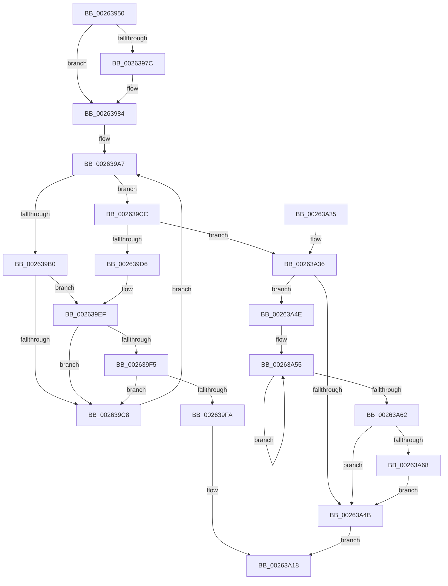

# PspUnlockProcessShared

- RVA: `0x00263950`–`0x00263A6F` (길이 `287` bytes)
- VA: `0x0000000140263950`
- 실행 섹션: `.text`
- PDB 이름 있음: `예`; PDB Function 태그: `아니요`
- unwind 정보 RVA: `0x00064784`
- 디코드: `79`개 명령, `287/287` bytes 표시
- 미해석 바이트: `0` (있으면 어셈블리에 `.byte`로 보존)

> 이 문서는 커널 이미지의 기계어와 PDB 기호를 분석해 생성했습니다. 4번과 5번은 함수 원형과 자료형을 바이너리 사용 방식에서 추정한 C 해석이며 원본 소스 복구 결과는 아닙니다.

## 1. Dependencies

- 직접 호출 지점: **5**; 고유 호출 대상: **5**
- 직접 호출자로 확인된 함수: **10**
- RIP 상대 이미지 참조: **0**

### Outgoing calls
- `0x0026397F` → [ExfReleasePushLockShared](ExfReleasePushLockShared_function_00263440.md) (function, `0x00263440`)
- `0x002639E9` → [KeBugCheckEx](../4F/KeBugCheckEx_function_004FD660.md) (function, `0x004FD660`)
- `0x00263A13` → [KiAbEntryFreeAndEnableInterrupts](KiAbEntryFreeAndEnableInterrupts_function_002622D0.md) (function, `0x002622D0`)
- `0x00263A1B` → [KeLeaveCriticalRegionThread](../25/KeLeaveCriticalRegionThread_function_0025EFF0.md) (function, `0x0025EFF0`)
- `0x00263A68` → [KiRemoveSystemWorkPriorityKick](KiRemoveSystemWorkPriorityKick_function_002631D0.md) (function, `0x002631D0`)

### Direct callers
- [PspApplyCoreIsolationPolicy](../../page/78/PspApplyCoreIsolationPolicy_function_00783E48.md) at `0x00783EB6`
- [PspAssignPrimaryToken](../../page/78/PspAssignPrimaryToken_function_00784870.md) at `0x007849D1`
- [DbgkForwardException](../../page/8A/DbgkForwardException_function_008A2D60.md) at `0x008A3002`
- [PsGetProcessDeepFreezeStats](../../page/8A/PsGetProcessDeepFreezeStats_function_008A375C.md) at `0x008A3805`
- [PspGetPreviousProcessThread](../../page/8C/PspGetPreviousProcessThread_function_008C9A68.md) at `0x008C9ADB`
- [NtSetInformationThread](../../page/8C/NtSetInformationThread_function_008C9F60.md) at `0x008CB319`
- [PsCaptureExceptionPort](../../page/90/PsCaptureExceptionPort_function_00904CB0.md) at `0x00904CF7`
- [PfpPrivSourceEnum](../../page/91/PfpPrivSourceEnum_function_0091BF00.md) at `0x0091C390`
- [PspInheritSyscallProvider](../../page/94/PspInheritSyscallProvider_function_00947F68.md) at `0x00947FD1`
- [NtQueryInformationProcess](../../page/9A/NtQueryInformationProcess_function_009AA250.md) at `0x009AD141`

### Static image references
- 디코드된 RIP-relative 메모리 참조가 없습니다.

## 2. Other-region calls and transfers

- 다른 실행 섹션으로 향하는 call: **0**
- 별도 외부 분기/꼬리 이동을 확인하지 못했습니다.

## 3. Assembly (complete function range)

```asm
00263950  48 89 5C 24 10                  mov qword ptr [rsp + 0x10], rbx
00263955  48 89 6C 24 18                  mov qword ptr [rsp + 0x18], rbp
0026395A  48 89 74 24 20                  mov qword ptr [rsp + 0x20], rsi
0026395F  57                              push rdi
00263960  48 83 EC 30                     sub rsp, 0x30
00263964  48 8B FA                        mov rdi, rdx
00263967  48 8D 99 C8 01 00 00            lea rbx, [rcx + 0x1c8]
0026396E  33 F6                           xor esi, esi
00263970  B8 11 00 00 00                  mov eax, 0x11
00263975  F0 48 0F B1 33                  lock cmpxchg qword ptr [rbx], rsi
0026397A  74 08                           je 0x140263984
0026397C  48 8B CB                        mov rcx, rbx
0026397F  E8 BC FA FF FF                  call 0x140263440
00263984  65 4C 8B 1C 25 88 01 00 00      mov r11, qword ptr gs:[0x188]
0026398D  FA                              cli
0026398E  4D 8B 83 70 04 00 00            mov r8, qword ptr [r11 + 0x470]
00263995  4C 8B CB                        mov r9, rbx
00263998  48 BD FC FF FF FF FF FF FF 7F   movabs rbp, 0x7ffffffffffffffc
002639A2  8B C6                           mov eax, esi
002639A4  4C 23 CD                        and r9, rbp
002639A7  41 0F B6 48 0C                  movzx ecx, byte ptr [r8 + 0xc]
002639AC  3B C1                           cmp eax, ecx
002639AE  73 1C                           jae 0x1402639cc
002639B0  8B C8                           mov ecx, eax
002639B2  4C 6B D1 58                     imul r10, rcx, 0x58
002639B6  4D 03 D0                        add r10, r8
002639B9  49 8B 52 10                     mov rdx, qword ptr [r10 + 0x10]
002639BD  48 8B CA                        mov rcx, rdx
002639C0  48 23 CD                        and rcx, rbp
002639C3  49 3B C9                        cmp rcx, r9
002639C6  74 27                           je 0x1402639ef
002639C8  FF C0                           inc eax
002639CA  EB DB                           jmp 0x1402639a7
002639CC  41 8B 43 78                     mov eax, dword ptr [r11 + 0x78]
002639D0  0F BA E0 10                     bt eax, 0x10
002639D4  72 60                           jb 0x140263a36
002639D6  45 33 C9                        xor r9d, r9d
002639D9  48 89 74 24 20                  mov qword ptr [rsp + 0x20], rsi
002639DE  4C 8B C3                        mov r8, rbx
002639E1  49 8B D3                        mov rdx, r11
002639E4  B9 62 01 00 00                  mov ecx, 0x162
002639E9  E8 72 9C 29 00                  call 0x1404fd660
002639EE  CC                              int3
002639EF  41 38 72 1A                     cmp byte ptr [r10 + 0x1a], sil
002639F3  74 D3                           je 0x1402639c8
002639F5  F6 C2 01                        test dl, 1
002639F8  75 CE                           jne 0x1402639c8
002639FA  41 B9 01 00 00 00               mov r9d, 1
00263A00  41 88 72 1A                     mov byte ptr [r10 + 0x1a], sil
00263A04  4C 8B C3                        mov r8, rbx
00263A07  48 89 74 24 20                  mov qword ptr [rsp + 0x20], rsi
00263A0C  49 8B D3                        mov rdx, r11
00263A0F  49 8D 4A 10                     lea rcx, [r10 + 0x10]
00263A13  E8 B8 E8 FF FF                  call 0x1402622d0
00263A18  48 8B CF                        mov rcx, rdi
00263A1B  E8 D0 B5 FF FF                  call 0x14025eff0
00263A20  48 8B 5C 24 48                  mov rbx, qword ptr [rsp + 0x48]
00263A25  48 8B 6C 24 50                  mov rbp, qword ptr [rsp + 0x50]
00263A2A  48 8B 74 24 58                  mov rsi, qword ptr [rsp + 0x58]
00263A2F  48 83 C4 30                     add rsp, 0x30
00263A33  5F                              pop rdi
00263A34  C3                              ret
00263A35  CC                              int3
00263A36  65 48 8B 0C 25 20 00 00 00      mov rcx, qword ptr gs:[0x20]
00263A3F  4C 8B 81 B8 8E 00 00            mov r8, qword ptr [rcx + 0x8eb8]
00263A46  4D 85 C0                        test r8, r8
00263A49  75 03                           jne 0x140263a4e
00263A4B  FB                              sti
00263A4C  EB CA                           jmp 0x140263a18
00263A4E  41 0F 0D 08                     prefetchw byte ptr [r8]
00263A52  41 8B 00                        mov eax, dword ptr [r8]
00263A55  8B D0                           mov edx, eax
00263A57  0F BA F2 15                     btr edx, 0x15
00263A5B  F0 41 0F B1 10                  lock cmpxchg dword ptr [r8], edx
00263A60  75 F3                           jne 0x140263a55
00263A62  0F BA E0 15                     bt eax, 0x15
00263A66  73 E3                           jae 0x140263a4b
00263A68  E8 63 F7 FF FF                  call 0x1402631d0
00263A6D  EB DC                           jmp 0x140263a4b
```

## 4. C-style interpretation (structured pseudocode)

```c
__int64 __fastcall PspUnlockProcessShared(__int64 a1, __int64 a2)
{
    __int64 result;
    __int64 v_r10;
    __int64 v_rsi;
    __int64 v_rsp;
    unsigned __int64 v_stack_m18;
    unsigned __int64 v_stack_p10;
    unsigned __int64 v_stack_p18;
    unsigned __int64 v_stack_p20;

    v_stack_p10 = v_rbx;
    v_stack_p18 = v_rbp;
    v_stack_p20 = v_rsi;
    v_rsp = (v_rsp) - (48);
    v_rsi = 0;
    result = 17;
    if (!(condition_is_equal)) {
        a1 = a1 + 456;
        result = ExfReleasePushLockShared(a1, a2, a3, a4);
    }
    a4 = (a1 + 456) & (v_rbp);
loc_002639A7:
    if (0 >= ((unsigned int)(*(unsigned __int8 *)(*(unsigned __int64 *)(*(unsigned __int64 *)(gs_base + (0 + 392)) + 1136) + 12)))) goto loc_002639CC;
    v_r10 = (v_r10) * (0);
    v_r10 = (v_r10) + (*(unsigned __int64 *)(*(unsigned __int64 *)(gs_base + (0 + 392)) + 1136));
    a1 = (*(unsigned __int64 *)(v_r10 + 16)) & (v_rbp);
    if (a1 == a4) goto loc_002639EF;
loc_002639C8:
    result = (unsigned int)((0) + 1);
    goto loc_002639A7;
loc_002639CC:
    if (a1 < a4) goto loc_00263A36;
    a4 = 0;
    v_stack_m18 = 0;
    result = KeBugCheckEx(354, *(unsigned __int64 *)(gs_base + (0 + 392)), a1 + 456, a4);
loc_002639EF:
    if ((*(unsigned __int8 *)(v_r10 + 26)) == 0) goto loc_002639C8;
    if ((((unsigned __int8)(*(unsigned __int64 *)(gs_base + (0 + 392)))) & (1)) != 0) goto loc_002639C8;
    *(unsigned __int8 *)(v_r10 + 26) = 0;
    v_stack_m18 = 0;
    result = KiAbEntryFreeAndEnableInterrupts(v_r10 + 16, *(unsigned __int64 *)(gs_base + (0 + 392)), a1 + 456, 1);
loc_00263A18:
    result = KeLeaveCriticalRegionThread(a2, *(unsigned __int64 *)(gs_base + (0 + 392)), a1 + 456, 1);
    v_rsp = (v_rsp) + (48);
    return result;
loc_00263A36:
    if (*(unsigned __int64 *)(*(unsigned __int64 *)(gs_base + (0 + 32)) + 36536) != 0) goto loc_00263A4E;
loc_00263A4B:
    goto loc_00263A18;
loc_00263A4E:
loc_00263A55:
    if (*(unsigned __int64 *)(*(unsigned __int64 *)(gs_base + (0 + 32)) + 36536) != 0) goto loc_00263A55;
    if (condition_is_above_or_equal) goto loc_00263A4B;
    result = KiRemoveSystemWorkPriorityKick(*(unsigned __int64 *)(gs_base + (0 + 32)), (unsigned int)((unsigned int)((unsigned int)(*(unsigned int *)(*(unsigned __int64 *)(*(unsigned __int64 *)(gs_base + (0 + 32)) + 36536))))), *(unsigned __int64 *)(*(unsigned __int64 *)(gs_base + (0 + 32)) + 36536), 1);
    goto loc_00263A4B;
}
```

## 5. (Beta) C Style

```c
int64_t PspUnlockProcessShared(void *Arg1, int64_t Arg2)
{
    uint8_t *arg1 = (uint8_t *)Arg1;

    int64_t result;
    int64_t local_r10;
    int64_t local_rsi;
    int64_t local_rsp;
    uint64_t v_stack_m18;
    uint64_t v_stack_p10;
    uint64_t v_stack_p18;
    uint64_t v_stack_p20;

    v_stack_p10 = local_rbx;
    v_stack_p18 = local_rbp;
    v_stack_p20 = local_rsi;
    local_rsp = (local_rsp) - (48);
    local_rsi = 0;
    result = 17;
    if (!(condition_is_equal)) {
        Arg1 = Arg1 + 456;
        result = ExfReleasePushLockShared(Arg1, Arg2, a3, a4);
    }
    a4 = (Arg1 + 456) & (local_rbp);
loc_002639A7:
    if (0 >= ((uint32_t)(*(uint8_t *)(*(uint64_t *)(*(uint64_t *)(gs_base + (0 + 0x188)) + 0x470) + 0xC)))) goto loc_002639CC;
    local_r10 = (local_r10) * (0);
    local_r10 = (local_r10) + (*(uint64_t *)(*(uint64_t *)(gs_base + (0 + 0x188)) + 0x470));
    Arg1 = (*(uint64_t *)(local_r10 + 0x10)) & (local_rbp);
    if (Arg1 == a4) goto loc_002639EF;
loc_002639C8:
    result = (uint32_t)((0) + 1);
    goto loc_002639A7;
loc_002639CC:
    if (Arg1 < a4) goto loc_00263A36;
    a4 = 0;
    v_stack_m18 = 0;
    result = KeBugCheckEx(354, *(uint64_t *)(gs_base + (0 + 0x188)), Arg1 + 456, a4);
loc_002639EF:
    if ((*(uint8_t *)(local_r10 + 0x1A)) == 0) goto loc_002639C8;
    if ((((uint8_t)(*(uint64_t *)(gs_base + (0 + 0x188)))) & (1)) != 0) goto loc_002639C8;
    *(uint8_t *)(local_r10 + 0x1A) = 0;
    v_stack_m18 = 0;
    result = KiAbEntryFreeAndEnableInterrupts(local_r10 + 16, *(uint64_t *)(gs_base + (0 + 0x188)), Arg1 + 456, 1);
loc_00263A18:
    result = KeLeaveCriticalRegionThread(Arg2, *(uint64_t *)(gs_base + (0 + 0x188)), Arg1 + 456, 1);
    local_rsp = (local_rsp) + (48);
    return result;
loc_00263A36:
    if (*(uint64_t *)(*(uint64_t *)(gs_base + (0 + 0x20)) + 0x8EB8) != 0) goto loc_00263A4E;
loc_00263A4B:
    goto loc_00263A18;
loc_00263A4E:
loc_00263A55:
    if (*(uint64_t *)(*(uint64_t *)(gs_base + (0 + 0x20)) + 0x8EB8) != 0) goto loc_00263A55;
    if (condition_is_above_or_equal) goto loc_00263A4B;
    result = KiRemoveSystemWorkPriorityKick(*(uint64_t *)(gs_base + (0 + 0x20)), (uint32_t)((uint32_t)((uint32_t)(*(uint32_t *)(*(uint64_t *)(*(uint64_t *)(gs_base + (0 + 0x20)) + 0x8EB8))))), *(uint64_t *)(*(uint64_t *)(gs_base + (0 + 0x20)) + 0x8EB8), 1);
    goto loc_00263A4B;
}
```

### 관측된 메모리 오프셋

구조체 형식이 확인되지 않은 접근은 인자 기준의 오프셋으로만 기록했습니다.

| 기준 인자 | 오프셋 표현 | 폭 (bit) | 접근 |
|---|---:|---:|---|
| `Arg1` | `+ 0x0` | `64` | `R` |
| `Arg1` | `+ 0x1C8` | `64` | `R` |

## 6. Execution-region graph

[열기: 2D/3D 그래프와 함수 탐색 컨트롤 패널](../../../control-panel.html?section=text&rva=0x00263950&view=graph)

- 2D 그래프는 위에서 아래로 흐르고, 3D 그래프는 빈 공간을 드래그해 회전합니다. Shift+드래그는 이동, 휠은 확대·축소, 함수 노드 선택은 대상 보고서 이동입니다.

### Static fallback


