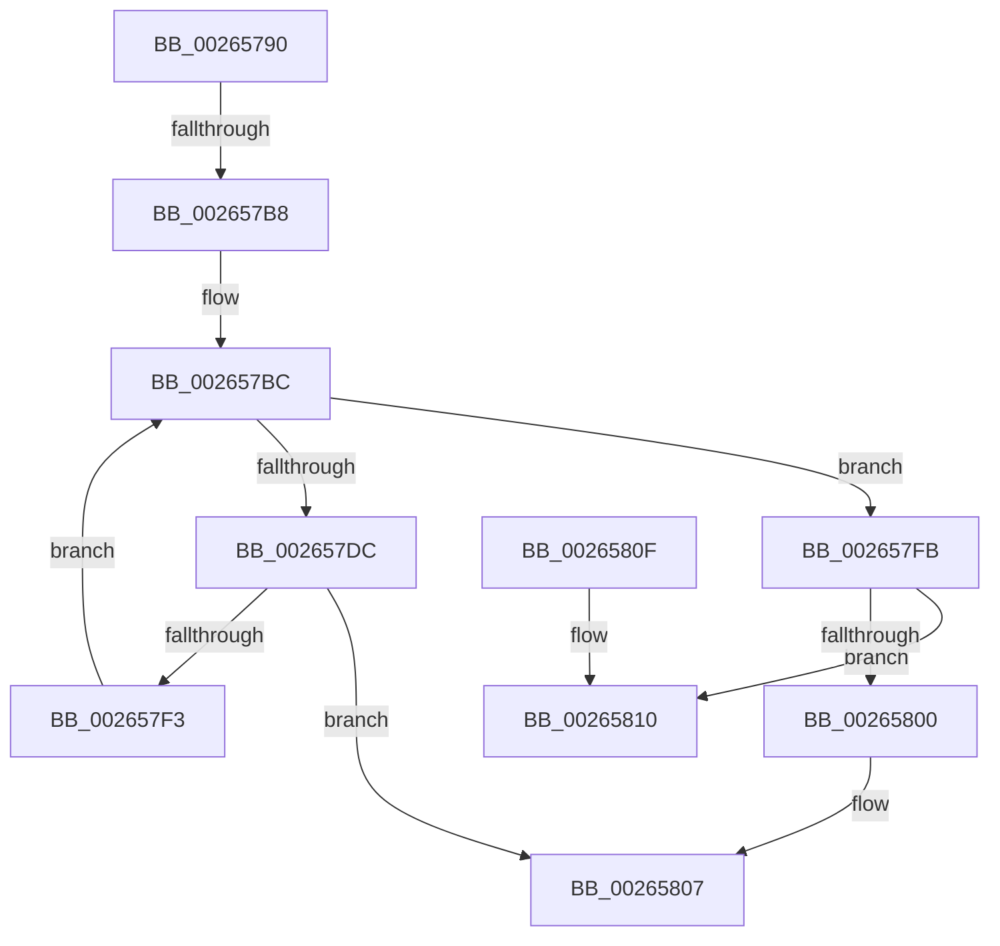

# RtlAvlInsertNodeEx

- RVA: `0x00265790`–`0x00265815` (길이 `133` bytes)
- VA: `0x0000000140265790`
- 실행 섹션: `.text`
- PDB 이름 있음: `예`; PDB Function 태그: `아니요`
- unwind 정보 RVA: `0x00064BA4`
- 디코드: `44`개 명령, `133/133` bytes 표시
- 미해석 바이트: `0` (있으면 어셈블리에 `.byte`로 보존)

> 이 문서는 커널 이미지의 기계어와 PDB 기호를 분석해 생성했습니다. 4번과 5번은 함수 원형과 자료형을 바이너리 사용 방식에서 추정한 C 해석이며 원본 소스 복구 결과는 아닙니다.

## 1. Dependencies

- 직접 호출 지점: **0**; 고유 호출 대상: **0**
- 직접 호출자로 확인된 함수: **49**
- RIP 상대 이미지 참조: **0**

### Outgoing calls
- 직접 디코드된 call 명령이 없습니다.

### Direct callers
- [MiInsertVad](MiInsertVad_function_00265540.md) at `0x0026566E`
- [MiInsertSubsectionNode](MiInsertSubsectionNode_function_00265C7C.md) at `0x00265D32`
- [MiActivateCombineBlock](MiActivateCombineBlock_function_00266094.md) at `0x0026614C`
- [MiInsertInSystemSpace](../3B/MiInsertInSystemSpace_function_003B2F5C.md) at `0x003B3267`
- [MiUpdateDriverLoadInProgress](../43/MiUpdateDriverLoadInProgress_function_004318DC.md) at `0x00431A28`
- [MiAddMdlTracker](../49/MiAddMdlTracker_function_0049A240.md) at `0x0049A3CE`
- [MiInsertMappingNode](../4A/MiInsertMappingNode_function_004A9560.md) at `0x004A95B0`
- [MiUpdatePerSessionProto](../4A/MiUpdatePerSessionProto_function_004AD938.md) at `0x004AD9D1`
- [MiFlowThroughInsertNode](../4B/MiFlowThroughInsertNode_function_004B560C.md) at `0x004B56FE`
- [IopMcAddMdlPagesToTable](../4C/IopMcAddMdlPagesToTable_function_004C82F8.md) at `0x004C8440`
- [MiInsertClone](../4D/MiInsertClone_function_004D4A7C.md) at `0x004D4AE3`
- [MiCreateKernelStackNode](../4F/MiCreateKernelStackNode_function_004FB0B8.md) at `0x004FB160`
- [PsAdjustBasicEnclaveThreadList](../5E/PsAdjustBasicEnclaveThreadList_function_005E4BD8.md) at `0x005E4CF7`
- [PsLoadVsmEnclaveData](../5E/PsLoadVsmEnclaveData_function_005E4D5C.md) at `0x005E4E7B`
- [MmUpdateMdlTrackerForMdlSwitch](../67/MmUpdateMdlTrackerForMdlSwitch_function_00674298.md) at `0x00674452`
- [MiHotRemoveHugeRange](../67/MiHotRemoveHugeRange_function_00675DD0.md) at `0x00675ED8`
- [MiMarkHugePfnBad](../67/MiMarkHugePfnBad_function_00676744.md) at `0x00676971`
- [MiAddPendingBadPageNode](../67/MiAddPendingBadPageNode_function_006793B4.md) at `0x0067941E`
- [MiCheckLostBadPageNode](../67/MiCheckLostBadPageNode_function_00679550.md) at `0x00679607`
- [MiCreateIoPageExclusion](../67/MiCreateIoPageExclusion_function_0067B638.md) at `0x0067B6FC`
- [MiMakeIoRangePermanent](../67/MiMakeIoRangePermanent_function_0067C29C.md) at `0x0067C4D0`
- [MiUpdatePageFileList](../68/MiUpdatePageFileList_function_006803AC.md) at `0x0068044E`
- [MiInsertExtentList](../68/MiInsertExtentList_function_006814EC.md) at `0x0068157C`
- [MmManageFaultRange](../68/MmManageFaultRange_function_00686AD4.md) at `0x00686C04`
- [MiCombiningInProgress](../68/MiCombiningInProgress_function_0068BD6C.md) at `0x0068BE53`
- [MiActOnPartitionNodePages](../68/MiActOnPartitionNodePages_function_0068F7F4.md) at `0x0068FEEE`
- [MiAddRangeToPartitionTree](../69/MiAddRangeToPartitionTree_function_0069020C.md) at `0x0069041B`
- [MiFreePartitionTree](../69/MiFreePartitionTree_function_00690E50.md) at `0x00690EFB`
- [MiMergePageNodes](../69/MiMergePageNodes_function_006916A0.md) at `0x00691788`
- [MiMergePageNodes](../69/MiMergePageNodes_function_006916A0.md) at `0x006918A8`
- [MiReplaceSystemProtoPtesNode](../69/MiReplaceSystemProtoPtesNode_function_00699658.md) at `0x006996ED`
- [sub_006D79AA](../6D/Unknown_function_006D79AA.md) at `0x006D7A1D`
- [sub_006E710A](../6E/Unknown_function_006E710A.md) at `0x006E715B`
- [sub_006EF650](../6E/Unknown_function_006EF650.md) at `0x006EF6C7`
- [RtlAddDynamicEHContinuationTarget](../../page/79/RtlAddDynamicEHContinuationTarget_function_00794DB8.md) at `0x00794E40`
- [RtlAddDynamicEnforcedAddressRange](../../page/79/RtlAddDynamicEnforcedAddressRange_function_00794E64.md) at `0x00794EE2`
- [MiInsertHotPatchRecord](../../page/80/MiInsertHotPatchRecord_function_008041D4.md) at `0x008042F1`
- [MiInsertPreviouslyRegisteredHotPatchRecord](../../page/80/MiInsertPreviouslyRegisteredHotPatchRecord_function_00804370.md) at `0x00804457`
- [MiInsertSecureImageActivePatch](../../page/80/MiInsertSecureImageActivePatch_function_0080448C.md) at `0x008044DF`
- [sub_008874E4](../../page/88/Unknown_function_008874E4.md) at `0x00887517`
- [sub_008874E4](../../page/88/Unknown_function_008874E4.md) at `0x00887562`
- [ExpWnfCreateNameInstance](../../page/8B/ExpWnfCreateNameInstance_function_008BF590.md) at `0x008BF70E`
- [Pdcv2ActivationClientActivate](../../page/95/Pdcv2ActivationClientActivate_function_00953C70.md) at `0x00953FB6`
- [MiProcessCrcList](../../page/9F/MiProcessCrcList_function_009F6F94.md) at `0x009F728E`
- [MiFindLargePageMemory](../../page/AA/MiFindLargePageMemory_function_00AA8334.md) at `0x00AA85CC`
- [MiLoadHotPatchForUserSid](../../page/AB/MiLoadHotPatchForUserSid_function_00AB4F08.md) at `0x00AB511D`
- [PspMakeSessionVisible](../../page/AC/PspMakeSessionVisible_function_00ACA0B8.md) at `0x00ACA146`
- [sub_00B2AB7A](../../page/B2/Unknown_function_00B2AB7A.md) at `0x00B2ACC7`
- [sub_00B36710](../../page/B3/Unknown_function_00B36710.md) at `0x00B368AB`
- [MiInitializeDriverPtes](../../init/C6/MiInitializeDriverPtes_function_00C61818.md) at `0x00C618FA`
- [MiCreateEnclaveRegions](../../init/C6/MiCreateEnclaveRegions_function_00C68AD4.md) at `0x00C68BD4`

### Static image references
- 디코드된 RIP-relative 메모리 참조가 없습니다.

## 2. Other-region calls and transfers

- 다른 실행 섹션으로 향하는 call: **0**
- call이 아닌 외부 분기/꼬리 이동: **1**
  - `0x002657B2` → [sub_002658E2](Unknown_function_002658E2.md) (`tail-transfer`)

## 3. Assembly (complete function range)

```asm
00265790  40 53                           push rbx
00265792  41 54                           push r12
00265794  48 83 EC 08                     sub rsp, 8
00265798  33 C0                           xor eax, eax
0026579A  41 0F B6 D8                     movzx ebx, r8b
0026579E  49 89 01                        mov qword ptr [r9], rax
002657A1  4D 8B D1                        mov r10, r9
002657A4  49 89 41 08                     mov qword ptr [r9 + 8], rax
002657A8  4C 8B E1                        mov r12, rcx
002657AB  49 89 51 10                     mov qword ptr [r9 + 0x10], rdx
002657AF  48 85 D2                        test rdx, rdx
002657B2  0F 84 2A 01 00 00               je 0x1402658e2
002657B8  4C 89 0C DA                     mov qword ptr [rdx + rbx*8], r9
002657BC  44 0F B6 4A 10                  movzx r9d, byte ptr [rdx + 0x10]
002657C1  4C 8D 5A 10                     lea r11, [rdx + 0x10]
002657C5  0F B6 C3                        movzx eax, bl
002657C8  45 0F B6 C1                     movzx r8d, r9b
002657CC  02 C0                           add al, al
002657CE  FE C8                           dec al
002657D0  0F B6 C8                        movzx ecx, al
002657D3  80 E1 03                        and cl, 3
002657D6  41 80 E0 03                     and r8b, 3
002657DA  75 1F                           jne 0x1402657fb
002657DC  41 32 C1                        xor al, r9b
002657DF  4C 8B D2                        mov r10, rdx
002657E2  24 03                           and al, 3
002657E4  41 32 C1                        xor al, r9b
002657E7  41 88 03                        mov byte ptr [r11], al
002657EA  49 8B 13                        mov rdx, qword ptr [r11]
002657ED  48 83 E2 FC                     and rdx, 0xfffffffffffffffc
002657F1  74 14                           je 0x140265807
002657F3  4C 39 12                        cmp qword ptr [rdx], r10
002657F6  0F 95 C3                        setne bl
002657F9  EB C1                           jmp 0x1402657bc
002657FB  44 3A C1                        cmp r8b, cl
002657FE  74 10                           je 0x140265810
00265800  41 80 E1 FC                     and r9b, 0xfc
00265804  45 88 0B                        mov byte ptr [r11], r9b
00265807  48 83 C4 08                     add rsp, 8
0026580B  41 5C                           pop r12
0026580D  5B                              pop rbx
0026580E  C3                              ret
0026580F  CC                              int3
00265810  41 0F B6 42 10                  movzx eax, byte ptr [r10 + 0x10]
```

## 4. C-style interpretation (structured pseudocode)

```c
__int64 __fastcall RtlAvlInsertNodeEx(__int64 a1, __int64 a2, unsigned __int8 a3, __int64 a4)
{
    __int64 result;
    __int64 v_rbx;
    __int64 v_rsp;

    v_rsp = (v_rsp) - (8);
    result = 0;
    *(unsigned __int64 *)(a4) = 0;
    *(unsigned __int64 *)(a4 + 8) = 0;
    *(unsigned __int64 *)(a4 + 16) = a2;
    *(unsigned __int64 *)(a2 + a3 * 8) = a4;
loc_002657BC:
    result = (unsigned __int8)((a3) + (a3));
    result = (unsigned __int8)((result) - 1);
    a1 = (unsigned __int8)(((unsigned __int8)(result)) & (3));
    a3 = (unsigned __int8)(((unsigned __int8)(*(unsigned __int8 *)(a2 + 16))) & (3));
    if (condition_is_not_equal) goto loc_002657FB;
    result = (unsigned __int8)((result) ^ ((unsigned __int8)(*(unsigned __int8 *)(a2 + 16))));
    result = (unsigned __int8)((result) & (3));
    result = (unsigned __int8)((result) ^ ((unsigned __int8)(*(unsigned __int8 *)(a2 + 16))));
    *(unsigned __int8 *)(a2 + 16) = (unsigned __int8)(result);
    a2 = (*(unsigned __int64 *)(a2 + 16)) & (-4);
    if (condition_is_equal) goto loc_00265807;
    v_rbx = ((*(unsigned __int64 *)(a2)) != a2) ? 1 : 0;
    goto loc_002657BC;
loc_002657FB:
    if (a3 == ((unsigned __int8)(a1))) goto loc_00265810;
    a4 = (unsigned __int8)((*(unsigned __int8 *)(a2 + 16)) & (252));
    *(unsigned __int8 *)(a2 + 16) = (unsigned __int8)(a4);
loc_00265807:
    v_rsp = (v_rsp) + (8);
    return result;
loc_00265810:
    return *(unsigned __int8 *)(a2 + 16);
}
```

## 5. (Beta) C Style

```c
int64_t RtlAvlInsertNodeEx(int64_t Arg1, int64_t Arg2, uint8_t Arg3, void *Arg4)
{
    uint8_t *arg4 = (uint8_t *)Arg4;

    int64_t result;
    int64_t local_rbx;
    int64_t local_rsp;

    local_rsp = (local_rsp) - (8);
    result = 0;
    *(uint64_t *)(arg4) = 0;
    *(uint64_t *)(arg4 + 0x8) = 0;
    *(uint64_t *)(arg4 + 0x10) = Arg2;
    *(void **)(Arg2 + Arg3 * 8) = Arg4;
loc_002657BC:
    result = (uint8_t)((Arg3) + (Arg3));
    result = (uint8_t)((result) - 1);
    Arg1 = (uint8_t)(((uint8_t)(result)) & (3));
    Arg3 = (uint8_t)(((uint8_t)(*(uint8_t *)(Arg2 + 0x10))) & (3));
    if (condition_is_not_equal) goto loc_002657FB;
    result = (uint8_t)((result) ^ ((uint8_t)(*(uint8_t *)(Arg2 + 0x10))));
    result = (uint8_t)((result) & (3));
    result = (uint8_t)((result) ^ ((uint8_t)(*(uint8_t *)(Arg2 + 0x10))));
    *(uint8_t *)(Arg2 + 0x10) = (uint8_t)(result);
    Arg2 = (*(uint64_t *)(Arg2 + 0x10)) & (-4);
    if (condition_is_equal) goto loc_00265807;
    local_rbx = ((*(uint64_t *)(Arg2)) != Arg2) ? 1 : 0;
    goto loc_002657BC;
loc_002657FB:
    if (Arg3 == ((uint8_t)(Arg1))) goto loc_00265810;
    Arg4 = (uint8_t)((*(uint8_t *)(Arg2 + 0x10)) & (252));
    *(uint8_t *)(Arg2 + 0x10) = (uint8_t)(Arg4);
loc_00265807:
    local_rsp = (local_rsp) + (8);
    return result;
loc_00265810:
    return *(uint8_t *)(Arg2 + 0x10);
}
```

### 관측된 메모리 오프셋

구조체 형식이 확인되지 않은 접근은 인자 기준의 오프셋으로만 기록했습니다.

| 기준 인자 | 오프셋 표현 | 폭 (bit) | 접근 |
|---|---:|---:|---|
| `Arg4` | `+ 0x0` | `64` | `W` |
| `Arg4` | `+ 0x8` | `64` | `W` |
| `Arg4` | `+ 0x10` | `64` | `W` |

## 6. Execution-region graph

[열기: 2D/3D 그래프와 함수 탐색 컨트롤 패널](../../../control-panel.html?section=text&rva=0x00265790&view=graph)

- 2D 그래프는 위에서 아래로 흐르고, 3D 그래프는 빈 공간을 드래그해 회전합니다. Shift+드래그는 이동, 휠은 확대·축소, 함수 노드 선택은 대상 보고서 이동입니다.

### Static fallback


