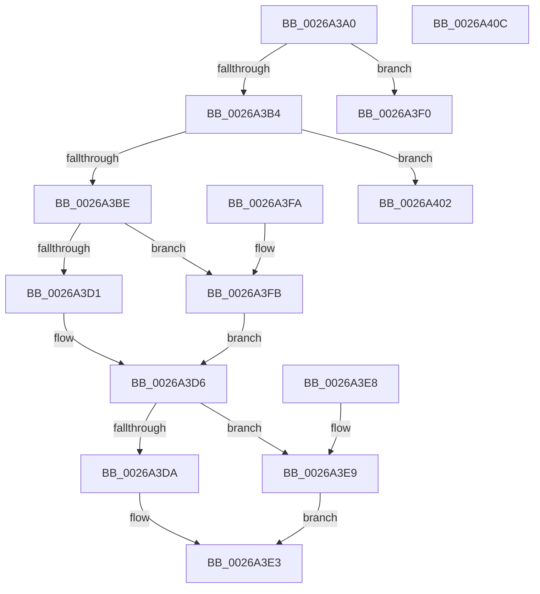

# RtlCompressBufferLz4

- RVA: `0x0026A3A0`–`0x0026A40D` (길이 `109` bytes)
- VA: `0x000000014026A3A0`
- 실행 섹션: `.text`
- PDB 이름 있음: `예`; PDB Function 태그: `아니요`
- unwind 정보 RVA: `0x00065418`
- 디코드: `36`개 명령, `109/109` bytes 표시
- 미해석 바이트: `0` (있으면 어셈블리에 `.byte`로 보존)

> 이 문서는 커널 이미지의 기계어와 PDB 기호를 분석해 생성했습니다. 4번과 5번은 함수 원형과 자료형을 바이너리 사용 방식에서 추정한 C 해석이며 원본 소스 복구 결과는 아닙니다.

## 1. Dependencies

- 직접 호출 지점: **2**; 고유 호출 대상: **2**
- 직접 호출자로 확인된 함수: **2**
- RIP 상대 이미지 참조: **0**

### Outgoing calls
- `0x0026A3D1` → [LZ4_compress_fast_extState](LZ4_compress_fast_extState_function_0026A420.md) (function, `0x0026A420`)
- `0x0026A3FB` → [LZ4_compress_HC_extStateHC](../4E/LZ4_compress_HC_extStateHC_function_004E2F10.md) (function, `0x004E2F10`)

### Direct callers
- [SmStoreCompressBuffer](SmStoreCompressBuffer_function_002683E0.md) at `0x00268494`
- [RtlCompressBuffer](RtlCompressBuffer_function_0026A220.md) at `0x0026A29A`

### Static image references
- 디코드된 RIP-relative 메모리 참조가 없습니다.

## 2. Other-region calls and transfers

- 다른 실행 섹션으로 향하는 call: **0**
- 별도 외부 분기/꼬리 이동을 확인하지 못했습니다.

## 3. Assembly (complete function range)

```asm
0026A3A0  48 83 EC 38                     sub rsp, 0x38
0026A3A4  0F B7 C1                        movzx eax, cx
0026A3A7  4D 8B D1                        mov r10, r9
0026A3AA  B9 FF FE 00 00                  mov ecx, 0xfeff
0026A3AF  66 85 C1                        test cx, ax
0026A3B2  75 3C                           jne 0x14026a3f0
0026A3B4  48 8B 4C 24 78                  mov rcx, qword ptr [rsp + 0x78]
0026A3B9  F6 C1 07                        test cl, 7
0026A3BC  75 44                           jne 0x14026a402
0026A3BE  66 85 C0                        test ax, ax
0026A3C1  45 8B C8                        mov r9d, r8d
0026A3C4  8B 44 24 60                     mov eax, dword ptr [rsp + 0x60]
0026A3C8  4D 8B C2                        mov r8, r10
0026A3CB  89 44 24 20                     mov dword ptr [rsp + 0x20], eax
0026A3CF  75 2A                           jne 0x14026a3fb
0026A3D1  E8 4A 00 00 00                  call 0x14026a420
0026A3D6  85 C0                           test eax, eax
0026A3D8  7E 0F                           jle 0x14026a3e9
0026A3DA  48 8B 4C 24 70                  mov rcx, qword ptr [rsp + 0x70]
0026A3DF  89 01                           mov dword ptr [rcx], eax
0026A3E1  33 C0                           xor eax, eax
0026A3E3  48 83 C4 38                     add rsp, 0x38
0026A3E7  C3                              ret
0026A3E8  CC                              int3
0026A3E9  B8 23 00 00 C0                  mov eax, 0xc0000023
0026A3EE  EB F3                           jmp 0x14026a3e3
0026A3F0  B8 BB 00 00 C0                  mov eax, 0xc00000bb
0026A3F5  48 83 C4 38                     add rsp, 0x38
0026A3F9  C3                              ret
0026A3FA  CC                              int3
0026A3FB  E8 10 8B 27 00                  call 0x1404e2f10
0026A400  EB D4                           jmp 0x14026a3d6
0026A402  B8 74 04 00 C0                  mov eax, 0xc0000474
0026A407  48 83 C4 38                     add rsp, 0x38
0026A40B  C3                              ret
0026A40C  CC                              int3
```

## 4. C-style interpretation (structured pseudocode)

```c
__int64 __fastcall RtlCompressBufferLz4(unsigned __int16 a1, __int64 a2, int a3, __int64 a4, unsigned int a5, __int64 a6, __int64 a7, __int64 a8)
{
    __int64 result;
    __int64 v_rsp;
    unsigned int v_stack_m18;

    v_rsp = (v_rsp) - (56);
    if ((((unsigned __int16)((unsigned int)(0xFEFFULL))) & (a1)) != 0) goto loc_0026A3F0;
    if ((((unsigned __int8)(a8)) & (7)) != 0) goto loc_0026A402;
    v_stack_m18 = (unsigned int)((unsigned int)(a5));
    if (a1 != 0) goto loc_0026A3FB;
    result = LZ4_compress_fast_extState(a8, a2, a4, (unsigned int)(a3));
loc_0026A3D6:
    if (condition_is_less_or_equal) goto loc_0026A3E9;
    *(unsigned int *)(a7) = (unsigned int)(result);
    result = 0;
loc_0026A3E3:
    v_rsp = (v_rsp) + (56);
    return result;
loc_0026A3E9:
    goto loc_0026A3E3;
loc_0026A3F0:
    v_rsp = (v_rsp) + (56);
    return (unsigned int)(0xC00000BBULL);
loc_0026A3FB:
    result = LZ4_compress_HC_extStateHC(a7, a2, a4, (unsigned int)(a3));
    goto loc_0026A3D6;
loc_0026A402:
    v_rsp = (v_rsp) + (56);
    return (unsigned int)(0xC0000474ULL);
}
```

## 5. (Beta) C Style

```c
int64_t RtlCompressBufferLz4(uint16_t Arg1, int64_t Arg2, int32_t Arg3, int64_t Arg4, uint32_t Arg5, uint64_t Arg6, void *Arg7, int64_t Arg8)
{
    uint8_t *arg7 = (uint8_t *)Arg7;

    int64_t result;
    int64_t local_rsp;
    uint32_t v_stack_m18;

    local_rsp = (local_rsp) - (56);
    if ((((uint16_t)((uint32_t)(0xFEFFULL))) & (Arg1)) != 0) goto loc_0026A3F0;
    if ((((uint8_t)(Arg8)) & (7)) != 0) goto loc_0026A402;
    v_stack_m18 = (uint32_t)((uint32_t)(Arg5));
    if (Arg1 != 0) goto loc_0026A3FB;
    result = LZ4_compress_fast_extState(Arg8, Arg2, Arg4, (uint32_t)(Arg3));
loc_0026A3D6:
    if (condition_is_less_or_equal) goto loc_0026A3E9;
    *(uint32_t *)(arg7) = (uint32_t)(result);
    result = 0;
loc_0026A3E3:
    local_rsp = (local_rsp) + (56);
    return result;
loc_0026A3E9:
    goto loc_0026A3E3;
loc_0026A3F0:
    local_rsp = (local_rsp) + (56);
    return (uint32_t)(0xC00000BBULL);
loc_0026A3FB:
    result = LZ4_compress_HC_extStateHC(Arg7, Arg2, Arg4, (uint32_t)(Arg3));
    goto loc_0026A3D6;
loc_0026A402:
    local_rsp = (local_rsp) + (56);
    return (uint32_t)(0xC0000474ULL);
}
```

### 관측된 메모리 오프셋

구조체 형식이 확인되지 않은 접근은 인자 기준의 오프셋으로만 기록했습니다.

| 기준 인자 | 오프셋 표현 | 폭 (bit) | 접근 |
|---|---:|---:|---|
| `Arg7` | `+ 0x0` | `32` | `W` |

## 6. Execution-region graph

[열기: 2D/3D 그래프와 함수 탐색 컨트롤 패널](../../../control-panel.html?section=text&rva=0x0026A3A0&view=graph)

- 2D 그래프는 위에서 아래로 흐르고, 3D 그래프는 빈 공간을 드래그해 회전합니다. Shift+드래그는 이동, 휠은 확대·축소, 함수 노드 선택은 대상 보고서 이동입니다.

### Static fallback


