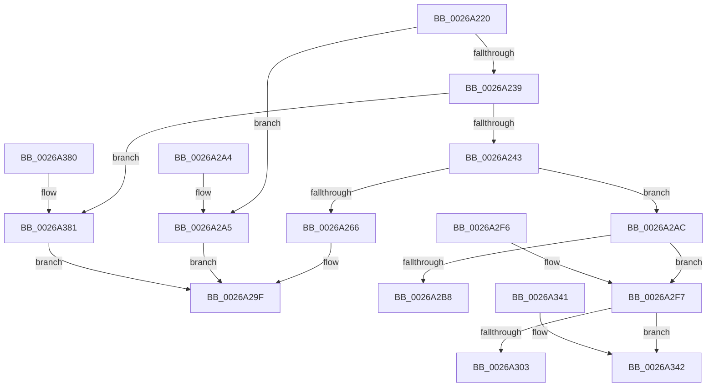

# RtlCompressBuffer

- RVA: `0x0026A220`–`0x0026A38B` (길이 `363` bytes)
- VA: `0x000000014026A220`
- 실행 섹션: `.text`
- PDB 이름 있음: `예`; PDB Function 태그: `아니요`
- unwind 정보 RVA: `0x00065404`
- 디코드: `79`개 명령, `363/363` bytes 표시
- 미해석 바이트: `0` (있으면 어셈블리에 `.byte`로 보존)

> 이 문서는 커널 이미지의 기계어와 PDB 기호를 분석해 생성했습니다. 4번과 5번은 함수 원형과 자료형을 바이너리 사용 방식에서 추정한 C 해석이며 원본 소스 복구 결과는 아닙니다.

## 1. Dependencies

- 직접 호출 지점: **4**; 고유 호출 대상: **4**
- 직접 호출자로 확인된 함수: **7**
- RIP 상대 이미지 참조: **4**

### Outgoing calls
- `0x0026A29A` → [RtlCompressBufferLz4](RtlCompressBufferLz4_function_0026A3A0.md) (function, `0x0026A3A0`)
- `0x0026A2EC` → [RtlCompressBufferLZNT1](../../pagelk/B7/RtlCompressBufferLZNT1_function_00B758E0.md) (function, `0x00B758E0`)
- `0x0026A337` → [RtlCompressBufferXpressHuff](RtlCompressBufferXpressHuff_function_0026B9A0.md) (function, `0x0026B9A0`)
- `0x0026A376` → [guard_dispatch_icall](../6B/guard_dispatch_icall_function_006BAAD0.md) (function, `0x006BAAD0`)

### Direct callers
- [ST_STORE&lt;SM_TRAITS&gt;::StDmpSinglePageAdd](../20/ST_STORE_SM_TRAITS_StDmpSinglePageAdd_function_0020502C.md) at `0x002051D3`
- [EtwpFileModeCompress](../42/EtwpFileModeCompress_function_004241B8.md) at `0x00424235`
- [EtwpCompressBuffer](../65/EtwpCompressBuffer_function_00652DBC.md) at `0x00652EA1`
- [EtwpCompressBuffer](../65/EtwpCompressBuffer_function_00652DBC.md) at `0x00652F52`
- [sub_006D904C](../6D/Unknown_function_006D904C.md) at `0x006D90C6`
- [RtlCompressChunks](../../page/78/RtlCompressChunks_function_0078B3E0.md) at `0x0078B46C`
- [EtwpWriteBufferCompressed](../../page/7B/EtwpWriteBufferCompressed_function_007BFB64.md) at `0x007BFBD9`
- [PopAddPagesToCompressedPageSet](../../pagelk/B6/PopAddPagesToCompressedPageSet_function_00B6C804.md) at `0x00B6C95B`

### Static image references
- `0x0026A24F` → RVA `0x00001360` (`.rdata`; read)
- `0x0026A25A` → RVA `0x0026A3A0` (`RtlCompressBufferLz4`; read)
- `0x0026A2AC` → RVA `0x00B758E0` (`RtlCompressBufferLZNT1`; read)
- `0x0026A2F7` → RVA `0x0026B9A0` (`RtlCompressBufferXpressHuff`; read)

## 2. Other-region calls and transfers

- 다른 실행 섹션으로 향하는 call: **1**
  - `0x0026A2EC` → [RtlCompressBufferLZNT1](../../pagelk/B7/RtlCompressBufferLZNT1_function_00B758E0.md) (`.text` → `PAGELK`)
- 별도 외부 분기/꼬리 이동을 확인하지 못했습니다.

## 3. Assembly (complete function range)

```asm
0026A220  48 83 EC 58                     sub rsp, 0x58
0026A224  0F B7 C1                        movzx eax, cx
0026A227  44 0F B7 D1                     movzx r10d, cx
0026A22B  B9 FF 00 00 00                  mov ecx, 0xff
0026A230  66 23 C1                        and ax, cx
0026A233  66 83 F8 02                     cmp ax, 2
0026A237  72 6C                           jb 0x14026a2a5
0026A239  66 83 F8 08                     cmp ax, 8
0026A23D  0F 87 3E 01 00 00               ja 0x14026a381
0026A243  B9 00 FF 00 00                  mov ecx, 0xff00
0026A248  66 44 23 D1                     and r10w, cx
0026A24C  0F B7 C8                        movzx ecx, ax
0026A24F  48 8D 05 0A 71 D9 FF            lea rax, [rip - 0x268ef6]
0026A256  48 8B 04 C8                     mov rax, qword ptr [rax + rcx*8]
0026A25A  48 8D 0D 3F 01 00 00            lea rcx, [rip + 0x13f]
0026A261  48 3B C1                        cmp rax, rcx
0026A264  75 46                           jne 0x14026a2ac
0026A266  48 8B 84 24 98 00 00 00         mov rax, qword ptr [rsp + 0x98]
0026A26E  41 0F B7 CA                     movzx ecx, r10w
0026A272  48 89 44 24 38                  mov qword ptr [rsp + 0x38], rax
0026A277  48 8B 84 24 90 00 00 00         mov rax, qword ptr [rsp + 0x90]
0026A27F  48 89 44 24 30                  mov qword ptr [rsp + 0x30], rax
0026A284  8B 84 24 88 00 00 00            mov eax, dword ptr [rsp + 0x88]
0026A28B  89 44 24 28                     mov dword ptr [rsp + 0x28], eax
0026A28F  8B 84 24 80 00 00 00            mov eax, dword ptr [rsp + 0x80]
0026A296  89 44 24 20                     mov dword ptr [rsp + 0x20], eax
0026A29A  E8 01 01 00 00                  call 0x14026a3a0
0026A29F  48 83 C4 58                     add rsp, 0x58
0026A2A3  C3                              ret
0026A2A4  CC                              int3
0026A2A5  B8 0D 00 00 C0                  mov eax, 0xc000000d
0026A2AA  EB F3                           jmp 0x14026a29f
0026A2AC  48 8D 0D 2D B6 90 00            lea rcx, [rip + 0x90b62d]
0026A2B3  48 3B C1                        cmp rax, rcx
0026A2B6  75 3F                           jne 0x14026a2f7
0026A2B8  48 8B 84 24 98 00 00 00         mov rax, qword ptr [rsp + 0x98]
0026A2C0  41 0F B7 CA                     movzx ecx, r10w
0026A2C4  48 89 44 24 38                  mov qword ptr [rsp + 0x38], rax
0026A2C9  48 8B 84 24 90 00 00 00         mov rax, qword ptr [rsp + 0x90]
0026A2D1  48 89 44 24 30                  mov qword ptr [rsp + 0x30], rax
0026A2D6  8B 84 24 88 00 00 00            mov eax, dword ptr [rsp + 0x88]
0026A2DD  89 44 24 28                     mov dword ptr [rsp + 0x28], eax
0026A2E1  8B 84 24 80 00 00 00            mov eax, dword ptr [rsp + 0x80]
0026A2E8  89 44 24 20                     mov dword ptr [rsp + 0x20], eax
0026A2EC  E8 EF B5 90 00                  call 0x140b758e0
0026A2F1  48 83 C4 58                     add rsp, 0x58
0026A2F5  C3                              ret
0026A2F6  CC                              int3
0026A2F7  48 8D 0D A2 16 00 00            lea rcx, [rip + 0x16a2]
0026A2FE  48 3B C1                        cmp rax, rcx
0026A301  75 3F                           jne 0x14026a342
0026A303  48 8B 84 24 98 00 00 00         mov rax, qword ptr [rsp + 0x98]
0026A30B  41 0F B7 CA                     movzx ecx, r10w
0026A30F  48 89 44 24 38                  mov qword ptr [rsp + 0x38], rax
0026A314  48 8B 84 24 90 00 00 00         mov rax, qword ptr [rsp + 0x90]
0026A31C  48 89 44 24 30                  mov qword ptr [rsp + 0x30], rax
0026A321  8B 84 24 88 00 00 00            mov eax, dword ptr [rsp + 0x88]
0026A328  89 44 24 28                     mov dword ptr [rsp + 0x28], eax
0026A32C  8B 84 24 80 00 00 00            mov eax, dword ptr [rsp + 0x80]
0026A333  89 44 24 20                     mov dword ptr [rsp + 0x20], eax
0026A337  E8 64 16 00 00                  call 0x14026b9a0
0026A33C  48 83 C4 58                     add rsp, 0x58
0026A340  C3                              ret
0026A341  CC                              int3
0026A342  48 8B 8C 24 98 00 00 00         mov rcx, qword ptr [rsp + 0x98]
0026A34A  48 89 4C 24 38                  mov qword ptr [rsp + 0x38], rcx
0026A34F  48 8B 8C 24 90 00 00 00         mov rcx, qword ptr [rsp + 0x90]
0026A357  48 89 4C 24 30                  mov qword ptr [rsp + 0x30], rcx
0026A35C  8B 8C 24 88 00 00 00            mov ecx, dword ptr [rsp + 0x88]
0026A363  89 4C 24 28                     mov dword ptr [rsp + 0x28], ecx
0026A367  8B 8C 24 80 00 00 00            mov ecx, dword ptr [rsp + 0x80]
0026A36E  89 4C 24 20                     mov dword ptr [rsp + 0x20], ecx
0026A372  41 0F B7 CA                     movzx ecx, r10w
0026A376  E8 55 07 45 00                  call 0x1406baad0
0026A37B  48 83 C4 58                     add rsp, 0x58
0026A37F  C3                              ret
0026A380  CC                              int3
0026A381  B8 5F 02 00 C0                  mov eax, 0xc000025f
0026A386  E9 14 FF FF FF                  jmp 0x14026a29f
```

## 4. C-style interpretation (structured pseudocode)

```c
__int64 __fastcall RtlCompressBuffer(unsigned __int16 a1, __int64 a2, __int64 a3, __int64 a4, unsigned int a5, unsigned int a6, __int64 a7, __int64 a8)
{
    __int64 result;
    __int64 v_r10;
    __int64 v_rsp;
    unsigned __int64 v_stack_m20;
    unsigned __int64 v_stack_m28;
    unsigned int v_stack_m30;
    unsigned int v_stack_m38;
    unsigned int v_stack_p20;
    unsigned int v_stack_p28;
    unsigned __int64 v_stack_p30;
    unsigned __int64 v_stack_p38;
    unsigned int v_stack_p78;
    unsigned int v_stack_p80;
    unsigned __int64 v_stack_p88;
    unsigned __int64 v_stack_p90;
    unsigned int v_stack_pD0;
    unsigned int v_stack_pD8;
    unsigned __int64 v_stack_pE0;
    unsigned __int64 v_stack_pE8;

    v_rsp = (v_rsp) - (88);
    result = (unsigned __int16)((a1) & (255));
    if (((unsigned __int16)(result)) < 2) goto loc_0026A2A5;
    if (((unsigned __int16)(result)) > 8) goto loc_0026A381;
    v_r10 = (unsigned __int16)((a1) & ((unsigned __int16)((unsigned int)(0xFF00ULL))));
    if ((*(unsigned __int64 *)(v_rip - 2526966 + (unsigned __int16)(result) * 8)) != (v_rip + 319)) goto loc_0026A2AC;
    v_stack_m20 = a8;
    v_stack_m28 = a7;
    v_stack_m30 = (unsigned int)((unsigned int)(a6));
    v_stack_m38 = (unsigned int)((unsigned int)(a5));
    result = RtlCompressBufferLz4((unsigned __int16)(v_r10), a2, a3, a4);
loc_0026A29F:
    v_rsp = (v_rsp) + (88);
    return result;
loc_0026A2A5:
    goto loc_0026A29F;
loc_0026A2AC:
    if (((unsigned int)(0xC000000DULL)) != (v_rip + 9483821)) goto loc_0026A2F7;
    v_stack_p38 = a8;
    v_stack_p30 = a7;
    v_stack_p28 = (unsigned int)((unsigned int)(a6));
    v_stack_p20 = (unsigned int)((unsigned int)(a5));
    result = RtlCompressBufferLZNT1((unsigned __int16)(v_r10), a2, a3, a4);
    v_rsp = (v_rsp) + (88);
    return result;
loc_0026A2F7:
    if (result != (v_rip + 5794)) goto loc_0026A342;
    v_stack_p90 = a8;
    v_stack_p88 = a7;
    v_stack_p80 = (unsigned int)((unsigned int)(a6));
    v_stack_p78 = (unsigned int)((unsigned int)(a5));
    result = RtlCompressBufferXpressHuff((unsigned __int16)(v_r10), a2, a3, a4);
    v_rsp = (v_rsp) + (88);
    return result;
loc_0026A342:
    v_stack_pE8 = a8;
    v_stack_pE0 = a7;
    v_stack_pD8 = (unsigned int)((unsigned int)(a6));
    v_stack_pD0 = (unsigned int)((unsigned int)(a5));
    result = guard_dispatch_icall((unsigned __int16)(v_r10), a2, a3, a4);
    v_rsp = (v_rsp) + (88);
    return result;
loc_0026A381:
    goto loc_0026A29F;
}
```

## 5. (Beta) C Style

```c
int64_t RtlCompressBuffer(uint16_t Arg1, int64_t Arg2, int64_t Arg3, int64_t Arg4, uint32_t Arg5, uint32_t Arg6, int64_t Arg7, int64_t Arg8)
{
    int64_t result;
    int64_t local_r10;
    int64_t local_rsp;
    uint64_t v_stack_m20;
    uint64_t v_stack_m28;
    uint32_t v_stack_m30;
    uint32_t v_stack_m38;
    uint32_t v_stack_p20;
    uint32_t v_stack_p28;
    uint64_t v_stack_p30;
    uint64_t v_stack_p38;
    uint32_t v_stack_p78;
    uint32_t v_stack_p80;
    uint64_t v_stack_p88;
    uint64_t v_stack_p90;
    uint32_t v_stack_pD0;
    uint32_t v_stack_pD8;
    uint64_t v_stack_pE0;
    uint64_t v_stack_pE8;

    local_rsp = (local_rsp) - (88);
    result = (uint16_t)((Arg1) & (255));
    if (((uint16_t)(result)) < 2) goto loc_0026A2A5;
    if (((uint16_t)(result)) > 8) goto loc_0026A381;
    local_r10 = (uint16_t)((Arg1) & ((uint16_t)((uint32_t)(0xFF00ULL))));
    if ((*(uint64_t *)(v_rip - 0x268EF6 + (uint16_t)(result) * 8)) != (v_rip + 319)) goto loc_0026A2AC;
    v_stack_m20 = Arg8;
    v_stack_m28 = Arg7;
    v_stack_m30 = (uint32_t)((uint32_t)(Arg6));
    v_stack_m38 = (uint32_t)((uint32_t)(Arg5));
    result = RtlCompressBufferLz4((uint16_t)(local_r10), Arg2, Arg3, Arg4);
loc_0026A29F:
    local_rsp = (local_rsp) + (88);
    return result;
loc_0026A2A5:
    goto loc_0026A29F;
loc_0026A2AC:
    if (((uint32_t)(0xC000000DULL)) != (v_rip + 9483821)) goto loc_0026A2F7;
    v_stack_p38 = Arg8;
    v_stack_p30 = Arg7;
    v_stack_p28 = (uint32_t)((uint32_t)(Arg6));
    v_stack_p20 = (uint32_t)((uint32_t)(Arg5));
    result = RtlCompressBufferLZNT1((uint16_t)(local_r10), Arg2, Arg3, Arg4);
    local_rsp = (local_rsp) + (88);
    return result;
loc_0026A2F7:
    if (result != (v_rip + 5794)) goto loc_0026A342;
    v_stack_p90 = Arg8;
    v_stack_p88 = Arg7;
    v_stack_p80 = (uint32_t)((uint32_t)(Arg6));
    v_stack_p78 = (uint32_t)((uint32_t)(Arg5));
    result = RtlCompressBufferXpressHuff((uint16_t)(local_r10), Arg2, Arg3, Arg4);
    local_rsp = (local_rsp) + (88);
    return result;
loc_0026A342:
    v_stack_pE8 = Arg8;
    v_stack_pE0 = Arg7;
    v_stack_pD8 = (uint32_t)((uint32_t)(Arg6));
    v_stack_pD0 = (uint32_t)((uint32_t)(Arg5));
    result = guard_dispatch_icall((uint16_t)(local_r10), Arg2, Arg3, Arg4);
    local_rsp = (local_rsp) + (88);
    return result;
loc_0026A381:
    goto loc_0026A29F;
}
```

## 6. Execution-region graph

[열기: 2D/3D 그래프와 함수 탐색 컨트롤 패널](../../../control-panel.html?section=text&rva=0x0026A220&view=graph)

- 2D 그래프는 위에서 아래로 흐르고, 3D 그래프는 빈 공간을 드래그해 회전합니다. Shift+드래그는 이동, 휠은 확대·축소, 함수 노드 선택은 대상 보고서 이동입니다.

### Static fallback


