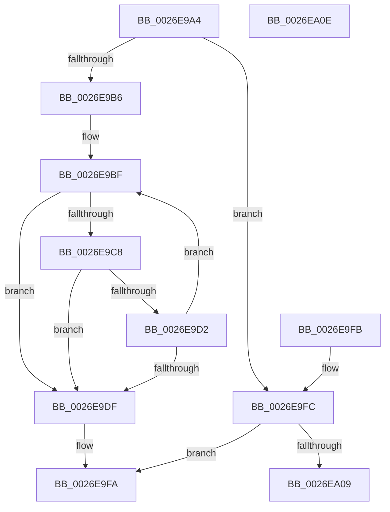

# RtlStringCchCopyW

- RVA: `0x0026E9A4`–`0x0026EA0F` (길이 `107` bytes)
- VA: `0x000000014026E9A4`
- 실행 섹션: `.text`
- PDB 이름 있음: `예`; PDB Function 태그: `아니요`
- unwind 정보 RVA: `0x000DB714`
- 디코드: `35`개 명령, `107/107` bytes 표시
- 미해석 바이트: `0` (있으면 어셈블리에 `.byte`로 보존)

> 이 문서는 커널 이미지의 기계어와 PDB 기호를 분석해 생성했습니다. 4번과 5번은 함수 원형과 자료형을 바이너리 사용 방식에서 추정한 C 해석이며 원본 소스 복구 결과는 아닙니다.

## 1. Dependencies

- 직접 호출 지점: **0**; 고유 호출 대상: **0**
- 직접 호출자로 확인된 함수: **36**
- RIP 상대 이미지 참조: **0**

### Outgoing calls
- 직접 디코드된 call 명령이 없습니다.

### Direct callers
- [PopLogNotifyDevice](../27/PopLogNotifyDevice_function_00270400.md) at `0x0027052B`
- [CarCopyRuleViolationDetails](../61/CarCopyRuleViolationDetails_function_00618590.md) at `0x0061864E`
- [CarReportDifPluginRuleViolation](../61/CarReportDifPluginRuleViolation_function_00619250.md) at `0x0061945D`
- [SdbpGetPathAppPatchPreRS3](../69/SdbpGetPathAppPatchPreRS3_function_0069CCF0.md) at `0x0069CDDB`
- [PopFxInitializeSocSubsystemStaticInfo](../../page/75/PopFxInitializeSocSubsystemStaticInfo_function_00758EC8.md) at `0x0075919B`
- [PpmRegisterProfiles](../../page/77/PpmRegisterProfiles_function_007709F0.md) at `0x00770B25`
- [TtmNotifyDeviceArrival](../../page/77/TtmNotifyDeviceArrival_function_007754F0.md) at `0x007756AF`
- [TtmpPublishDeviceEvent](../../page/77/TtmpPublishDeviceEvent_function_00776718.md) at `0x007767C7`
- [RtlpGetTokenNamedObjectPath](../../page/78/RtlpGetTokenNamedObjectPath_function_0078ED40.md) at `0x0078F188`
- [Pdcv2ActivationClientRenewActivation](../../page/79/Pdcv2ActivationClientRenewActivation_function_0079B0F0.md) at `0x0079B20A`
- [Pdcv2ActivationClientRenewActivation](../../page/79/Pdcv2ActivationClientRenewActivation_function_0079B0F0.md) at `0x0079B265`
- [PdcPortOpenCommon](../../page/79/PdcPortOpenCommon_function_0079B544.md) at `0x0079B653`
- [SdbQueryDataExTagID](../../page/81/SdbQueryDataExTagID_function_008136E0.md) at `0x008137C7`
- [AslPathCombine](../../page/81/AslPathCombine_function_0081B100.md) at `0x0081B1A5`
- [AslPathCombine](../../page/81/AslPathCombine_function_0081B100.md) at `0x0081B1E4`
- [AslPathToSystemPathBuf](../../page/81/AslPathToSystemPathBuf_function_0081B430.md) at `0x0081B465`
- [AslPathWildcardFindFirst](../../page/81/AslPathWildcardFindFirst_function_0081B534.md) at `0x0081B6F2`
- [AslEnvGetSysNativeDirPathForGuestBuf](../../page/81/AslEnvGetSysNativeDirPathForGuestBuf_function_0081D184.md) at `0x0081D24C`
- [AslEnvGetSystem32DirPathBuf](../../page/81/AslEnvGetSystem32DirPathBuf_function_0081D2BC.md) at `0x0081D3C5`
- [AslpEnvResolveVars](../../page/81/AslpEnvResolveVars_function_0081D608.md) at `0x0081D6F7`
- [AslpEnvResolveVars](../../page/81/AslpEnvResolveVars_function_0081D608.md) at `0x0081D7CE`
- [AslpEnvResolveVars](../../page/81/AslpEnvResolveVars_function_0081D608.md) at `0x0081D8A4`
- [AslpFileQueryVersionString](../../page/82/AslpFileQueryVersionString_function_0082113C.md) at `0x008211BB`
- [CmDeviceClassesSubkeyCallback](../../page/82/CmDeviceClassesSubkeyCallback_function_0082C940.md) at `0x0082CBCE`
- [CmEnumSubkeyCallback](../../page/82/CmEnumSubkeyCallback_function_0082CE50.md) at `0x0082CF0A`
- [CmDevicePanelEnumSubkeyCallback](../../page/82/CmDevicePanelEnumSubkeyCallback_function_0082E9B0.md) at `0x0082EB07`
- [_CmGetDeviceContainerIdFromBase](../../page/8F/_CmGetDeviceContainerIdFromBase_function_008FD2B4.md) at `0x008FD2F9`
- [_CmGetDeviceContainerIdFromBase](../../page/8F/_CmGetDeviceContainerIdFromBase_function_008FD2B4.md) at `0x008FD432`
- [Pdcv2ActivationClientActivate](../../page/95/Pdcv2ActivationClientActivate_function_00953C70.md) at `0x00953E2C`
- [Pdcv2ActivationClientActivate](../../page/95/Pdcv2ActivationClientActivate_function_00953C70.md) at `0x00954070`
- [Pdcv2ActivationClientActivate](../../page/95/Pdcv2ActivationClientActivate_function_00953C70.md) at `0x00954084`
- [AslStringDuplicate](../../page/95/AslStringDuplicate_function_00958604.md) at `0x0095869E`
- [WmipMangleInstanceName](../../page/9D/WmipMangleInstanceName_function_009DE2DC.md) at `0x009DE35E`
- [DrvDbGetObjectSubKeyCallback](../../page/A1/DrvDbGetObjectSubKeyCallback_function_00A11300.md) at `0x00A113B3`
- [RtlpInitNlsFileName](../../page/A1/RtlpInitNlsFileName_function_00A19B9C.md) at `0x00A19D5C`
- [PipMakeGloballyUniqueId](../../page/A6/PipMakeGloballyUniqueId_function_00A6F428.md) at `0x00A6F763`
- [AslPathSplit](../../page/AB/AslPathSplit_function_00ABE87C.md) at `0x00ABE8F3`
- [AslPathSplit](../../page/AB/AslPathSplit_function_00ABE87C.md) at `0x00ABE9AC`
- [AslPathSplit](../../page/AB/AslPathSplit_function_00ABE87C.md) at `0x00ABE9CE`
- [DbgkWerCaptureLiveKernelDump2](../../page/AC/DbgkWerCaptureLiveKernelDump2_function_00AC1F10.md) at `0x00AC2051`
- [sub_00B32AA2](../../page/B3/Unknown_function_00B32AA2.md) at `0x00B32E73`
- [sub_00B444BA](../../page/B4/Unknown_function_00B444BA.md) at `0x00B44718`
- [sub_00B488F0](../../page/B4/Unknown_function_00B488F0.md) at `0x00B48934`
- [sub_00B488F0](../../page/B4/Unknown_function_00B488F0.md) at `0x00B489A6`
- [IopStoreSystemPartitionInformation](../../init/C2/IopStoreSystemPartitionInformation_function_00C2D780.md) at `0x00C2D7E5`
- [BapdpProcessVsmKeyBlobs](../../init/C4/BapdpProcessVsmKeyBlobs_function_00C4FD60.md) at `0x00C50059`

### Static image references
- 디코드된 RIP-relative 메모리 참조가 없습니다.

## 2. Other-region calls and transfers

- 다른 실행 섹션으로 향하는 call: **0**
- 별도 외부 분기/꼬리 이동을 확인하지 못했습니다.

## 3. Assembly (complete function range)

```asm
0026E9A4  48 8D 42 FF                     lea rax, [rdx - 1]
0026E9A8  41 B9 FE FF FF 7F               mov r9d, 0x7ffffffe
0026E9AE  4D 8B D0                        mov r10, r8
0026E9B1  49 3B C1                        cmp rax, r9
0026E9B4  77 46                           ja 0x14026e9fc
0026E9B6  4C 2B CA                        sub r9, rdx
0026E9B9  4C 2B D1                        sub r10, rcx
0026E9BC  45 33 C0                        xor r8d, r8d
0026E9BF  49 8D 04 11                     lea rax, [r9 + rdx]
0026E9C3  48 85 C0                        test rax, rax
0026E9C6  74 17                           je 0x14026e9df
0026E9C8  41 0F B7 04 0A                  movzx eax, word ptr [r10 + rcx]
0026E9CD  66 85 C0                        test ax, ax
0026E9D0  74 0D                           je 0x14026e9df
0026E9D2  66 89 01                        mov word ptr [rcx], ax
0026E9D5  48 83 C1 02                     add rcx, 2
0026E9D9  48 83 EA 01                     sub rdx, 1
0026E9DD  75 E0                           jne 0x14026e9bf
0026E9DF  48 85 D2                        test rdx, rdx
0026E9E2  48 8D 41 FE                     lea rax, [rcx - 2]
0026E9E6  48 0F 45 C1                     cmovne rax, rcx
0026E9EA  48 F7 DA                        neg rdx
0026E9ED  66 44 89 00                     mov word ptr [rax], r8w
0026E9F1  1B C0                           sbb eax, eax
0026E9F3  F7 D0                           not eax
0026E9F5  25 05 00 00 80                  and eax, 0x80000005
0026E9FA  C3                              ret
0026E9FB  CC                              int3
0026E9FC  45 33 C0                        xor r8d, r8d
0026E9FF  B8 0D 00 00 C0                  mov eax, 0xc000000d
0026EA04  48 85 D2                        test rdx, rdx
0026EA07  74 F1                           je 0x14026e9fa
0026EA09  66 44 89 01                     mov word ptr [rcx], r8w
0026EA0D  C3                              ret
0026EA0E  CC                              int3
```

## 4. C-style interpretation (structured pseudocode)

```c
__int64 __fastcall RtlStringCchCopyW(__int64 a1, __int64 a2, __int64 a3)
{
    __int64 result;
    __int64 v_r10;

    if ((a2 - 1) > ((unsigned int)(0x7FFFFFFEULL))) goto loc_0026E9FC;
    a4 = ((unsigned int)(0x7FFFFFFEULL)) - (a2);
    v_r10 = (a3) - (a1);
    a3 = 0;
loc_0026E9BF:
    if (a4 + a2 * 1 == 0) goto loc_0026E9DF;
    if ((unsigned __int16)(*(unsigned __int16 *)(v_r10 + a1 * 1)) == 0) goto loc_0026E9DF;
    *(unsigned __int16 *)(a1) = (unsigned __int16)(*(unsigned __int16 *)(v_r10 + a1 * 1));
    a1 = (a1) + (2);
    a2 = (a2) - (1);
    if (condition_is_not_equal) goto loc_0026E9BF;
loc_0026E9DF:
    result = a1 - 2;
    if (a2 != 0) { result = a1; }
    a2 = -(a2);
    *(unsigned __int16 *)(result) = 0;
    result = (unsigned int)(~(result));
    result = (unsigned int)((result) & (0x80000005ULL));
loc_0026E9FA:
    return result;
loc_0026E9FC:
    a3 = 0;
    if (a2 == 0) goto loc_0026E9FA;
    *(unsigned __int16 *)(a1) = 0;
    return (unsigned int)(0xC000000DULL);
}
```

## 5. (Beta) C Style

```c
int64_t RtlStringCchCopyW(void *Arg1, void *Arg2, void *Arg3)
{
    uint8_t *arg1 = (uint8_t *)Arg1;
    uint8_t *arg2 = (uint8_t *)Arg2;
    uint8_t *arg3 = (uint8_t *)Arg3;

    int64_t result;
    int64_t local_r10;

    if ((Arg2 - 1) > ((uint32_t)(0x7FFFFFFEULL))) goto loc_0026E9FC;
    a4 = ((uint32_t)(0x7FFFFFFEULL)) - (Arg2);
    local_r10 = (Arg3) - (Arg1);
    Arg3 = 0;
loc_0026E9BF:
    if (a4 + Arg2 * 1 == 0) goto loc_0026E9DF;
    if ((uint16_t)(*(uint16_t *)(local_r10 + arg1 * 1)) == 0) goto loc_0026E9DF;
    *(uint16_t *)(arg1) = (uint16_t)(*(uint16_t *)(local_r10 + arg1 * 1));
    Arg1 = (Arg1) + (2);
    Arg2 = (Arg2) - (1);
    if (condition_is_not_equal) goto loc_0026E9BF;
loc_0026E9DF:
    result = Arg1 - 2;
    if (Arg2 != NULL) { result = Arg1; }
    Arg2 = -(Arg2);
    *(uint16_t *)(result) = 0;
    result = (uint32_t)(~(result));
    result = (uint32_t)((result) & (0x80000005ULL));
loc_0026E9FA:
    return result;
loc_0026E9FC:
    Arg3 = 0;
    if (Arg2 == NULL) goto loc_0026E9FA;
    *(uint16_t *)(arg1) = 0;
    return (uint32_t)(0xC000000DULL);
}
```

### 관측된 메모리 오프셋

구조체 형식이 확인되지 않은 접근은 인자 기준의 오프셋으로만 기록했습니다.

| 기준 인자 | 오프셋 표현 | 폭 (bit) | 접근 |
|---|---:|---:|---|
| `Arg1` | `- 0x2` | `64` | `R` |
| `Arg1` | `+ 0x0` | `16` | `W` |
| `Arg2` | `- 0x1` | `64` | `R` |
| `Arg3` | `+ 0x0 + rcx*1` | `16` | `R` |

## 6. Execution-region graph

[열기: 2D/3D 그래프와 함수 탐색 컨트롤 패널](../../../control-panel.html?section=text&rva=0x0026E9A4&view=graph)

- 2D 그래프는 위에서 아래로 흐르고, 3D 그래프는 빈 공간을 드래그해 회전합니다. Shift+드래그는 이동, 휠은 확대·축소, 함수 노드 선택은 대상 보고서 이동입니다.

### Static fallback


