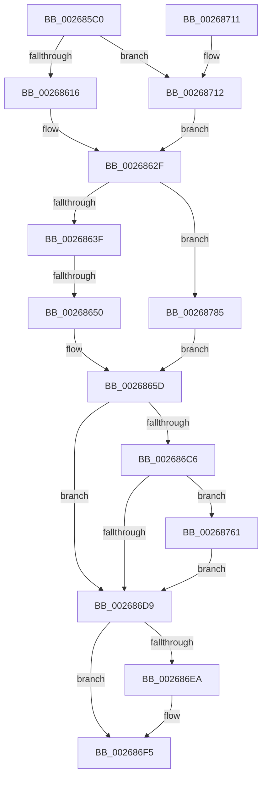

# SMKM_STORE_MGR&lt;SM_TRAITS&gt;::SmCompressCtxCompleteEntry

- RVA: `0x002685C0`–`0x0026878D` (길이 `461` bytes)
- VA: `0x00000001402685C0`
- 실행 섹션: `.text`
- PDB 이름 있음: `예`; PDB Function 태그: `예`
- unwind 정보 RVA: `0x0006514C`
- 디코드: `118`개 명령, `461/461` bytes 표시
- 미해석 바이트: `0` (있으면 어셈블리에 `.byte`로 보존)

> 이 문서는 커널 이미지의 기계어와 PDB 기호를 분석해 생성했습니다. 4번과 5번은 함수 원형과 자료형을 바이너리 사용 방식에서 추정한 C 해석이며 원본 소스 복구 결과는 아닙니다.

## 1. Dependencies

- 직접 호출 지점: **7**; 고유 호출 대상: **7**
- 직접 호출자로 확인된 함수: **2**
- RIP 상대 이미지 참조: **1**

### Outgoing calls
- `0x0026862A` → [IoBuildPartialMdl](IoBuildPartialMdl_function_00267BE0.md) (function, `0x00267BE0`)
- `0x00268655` → [wyhash](wyhash_function_00269FE4.md) (function, `0x00269FE4`)
- `0x00268679` → [ExAcquireSpinLockExclusive](../24/ExAcquireSpinLockExclusive_function_00248690.md) (function, `0x00248690`)
- `0x002686DC` → [ExReleaseSpinLockExclusiveFromDpcLevel](../24/ExReleaseSpinLockExclusiveFromDpcLevel_function_002497E0.md) (function, `0x002497E0`)
- `0x002686F0` → [KiLowerIrqlProcessIrqlFlags](../4F/KiLowerIrqlProcessIrqlFlags_function_004F5698.md) (function, `0x004F5698`)
- `0x00268757` → [MmBuildMdlForNonPagedPool](../23/MmBuildMdlForNonPagedPool_function_0023A870.md) (function, `0x0023A870`)
- `0x0026877B` → [SMKM_STORE_MGR<SM_TRAITS>::SmCompressCtxProcessReadyQueue](SMKM_STORE_MGR_SM_TRAITS_SmCompressCtxProcessReadyQueue_function_002678F0.md) (function, `0x002678F0`)

### Direct callers
- [SMKM_STORE_MGR&lt;SM_TRAITS&gt;::SmCompressCtxProcessEntry](SMKM_STORE_MGR_SM_TRAITS_SmCompressCtxProcessEntry_function_002681DC.md) at `0x002682DC`
- [SMKM_STORE_MGR&lt;SM_TRAITS&gt;::SmCompressCtxCompletePendingEntry](../4A/SMKM_STORE_MGR_SM_TRAITS_SmCompressCtxCompletePendingEntry_function_004A59F8.md) at `0x004A5A92`

### Static image references
- `0x002686E1` → RVA `0x00FC6D20` (`ALMOSTRO`; read)

## 2. Other-region calls and transfers

- 다른 실행 섹션으로 향하는 call: **0**
- call이 아닌 외부 분기/꼬리 이동: **1**
  - `0x0026864A` → [sub_006D9154](../6D/Unknown_function_006D9154.md) (`tail-transfer`)

## 3. Assembly (complete function range)

```asm
002685C0  48 89 5C 24 18                  mov qword ptr [rsp + 0x18], rbx
002685C5  48 89 4C 24 08                  mov qword ptr [rsp + 8], rcx
002685CA  55                              push rbp
002685CB  56                              push rsi
002685CC  57                              push rdi
002685CD  41 54                           push r12
002685CF  41 55                           push r13
002685D1  41 56                           push r14
002685D3  41 57                           push r15
002685D5  48 83 EC 30                     sub rsp, 0x30
002685D9  4C 8B 61 08                     mov r12, qword ptr [rcx + 8]
002685DD  48 8D 72 28                     lea rsi, [rdx + 0x28]
002685E1  4C 8B 7A 10                     mov r15, qword ptr [rdx + 0x10]
002685E5  48 8D 7E 48                     lea rdi, [rsi + 0x48]
002685E9  BD 00 10 00 00                  mov ebp, 0x1000
002685EE  45 8B E9                        mov r13d, r9d
002685F1  45 33 C9                        xor r9d, r9d
002685F4  4C 89 64 24 20                  mov qword ptr [rsp + 0x20], r12
002685F9  41 8B D8                        mov ebx, r8d
002685FC  4C 8B F2                        mov r14, rdx
002685FF  4C 89 7C 24 28                  mov qword ptr [rsp + 0x28], r15
00268604  44 8D 55 FF                     lea r10d, [rbp - 1]
00268608  44 39 8C 24 90 00 00 00         cmp dword ptr [rsp + 0x90], r9d
00268610  0F 8D FC 00 00 00               jge 0x140268712
00268616  45 8B 47 2C                     mov r8d, dword ptr [r15 + 0x2c]
0026861A  48 8B D6                        mov rdx, rsi
0026861D  4D 03 47 20                     add r8, qword ptr [r15 + 0x20]
00268621  49 8B CF                        mov rcx, r15
00268624  49 8B 7F 18                     mov rdi, qword ptr [r15 + 0x18]
00268628  8B DD                           mov ebx, ebp
0026862A  E8 B1 F5 FF FF                  call 0x140267be0
0026862F  48 8B 4E 40                     mov rcx, qword ptr [rsi + 0x40]
00268633  F7 01 00 00 20 00               test dword ptr [rcx], 0x200000
00268639  0F 84 46 01 00 00               je 0x140268785
0026863F  8B 81 C0 12 00 00               mov eax, dword ptr [rcx + 0x12c0]
00268645  45 33 C0                        xor r8d, r8d
00268648  85 C0                           test eax, eax
0026864A  0F 85 04 0B 47 00               jne 0x1406d9154
00268650  8B D3                           mov edx, ebx
00268652  48 8B CF                        mov rcx, rdi
00268655  E8 8A 19 00 00                  call 0x140269fe4
0026865A  4C 8B C0                        mov r8, rax
0026865D  4C 89 46 38                     mov qword ptr [rsi + 0x38], r8
00268661  49 8D BC 24 88 00 00 00         lea rdi, [r12 + 0x88]
00268669  4C 89 3E                        mov qword ptr [rsi], r15
0026866C  48 8B CF                        mov rcx, rdi
0026866F  41 0F BA 6E 08 1E               bts dword ptr [r14 + 8], 0x1e
00268675  49 89 76 10                     mov qword ptr [r14 + 0x10], rsi
00268679  E8 12 00 FE FF                  call 0x140248690
0026867E  49 8B 8C 24 80 00 00 00         mov rcx, qword ptr [r12 + 0x80]
00268686  0F B6 D8                        movzx ebx, al
00268689  48 8B 11                        mov rdx, qword ptr [rcx]
0026868C  41 8B 0E                        mov ecx, dword ptr [r14]
0026868F  48 83 E2 F8                     and rdx, 0xfffffffffffffff8
00268693  83 E1 07                        and ecx, 7
00268696  48 83 C2 08                     add rdx, 8
0026869A  48 0B D1                        or rdx, rcx
0026869D  49 89 16                        mov qword ptr [r14], rdx
002686A0  49 8B 8C 24 80 00 00 00         mov rcx, qword ptr [r12 + 0x80]
002686A8  8B 01                           mov eax, dword ptr [rcx]
002686AA  83 E0 07                        and eax, 7
002686AD  49 0B C6                        or rax, r14
002686B0  48 89 01                        mov qword ptr [rcx], rax
002686B3  4D 89 B4 24 80 00 00 00         mov qword ptr [r12 + 0x80], r14
002686BB  41 83 BC 24 8C 00 00 00 00      cmp dword ptr [r12 + 0x8c], 0
002686C4  75 13                           jne 0x1402686d9
002686C6  49 8B 06                        mov rax, qword ptr [r14]
002686C9  48 83 E0 F8                     and rax, 0xfffffffffffffff8
002686CD  48 3D 80 00 00 00               cmp rax, 0x80
002686D3  0F 83 88 00 00 00               jae 0x140268761
002686D9  48 8B CF                        mov rcx, rdi
002686DC  E8 FF 10 FE FF                  call 0x1402497e0
002686E1  83 3D 38 E6 D5 00 00            cmp dword ptr [rip + 0xd5e638], 0
002686E8  74 0B                           je 0x1402686f5
002686EA  44 0F 20 C1                     mov rcx, cr8
002686EE  8A D3                           mov dl, bl
002686F0  E8 A3 CF 28 00                  call 0x1404f5698
002686F5  44 0F 22 C3                     mov cr8, rbx
002686F9  48 8B 9C 24 80 00 00 00         mov rbx, qword ptr [rsp + 0x80]
00268701  48 83 C4 30                     add rsp, 0x30
00268705  41 5F                           pop r15
00268707  41 5E                           pop r14
00268709  41 5D                           pop r13
0026870B  41 5C                           pop r12
0026870D  5F                              pop rdi
0026870E  5E                              pop rsi
0026870F  5D                              pop rbp
00268710  C3                              ret
00268711  CC                              int3
00268712  44 8B C7                        mov r8d, edi
00268715  4C 89 0E                        mov qword ptr [rsi], r9
00268718  41 8B C8                        mov ecx, r8d
0026871B  66 44 89 4E 0A                  mov word ptr [rsi + 0xa], r9w
00268720  49 23 CA                        and rcx, r10
00268723  89 5E 28                        mov dword ptr [rsi + 0x28], ebx
00268726  45 23 C2                        and r8d, r10d
00268729  48 8D 93 FF 0F 00 00            lea rdx, [rbx + 0xfff]
00268730  48 03 D1                        add rdx, rcx
00268733  44 89 46 2C                     mov dword ptr [rsi + 0x2c], r8d
00268737  48 C1 EA 0C                     shr rdx, 0xc
0026873B  48 8B C7                        mov rax, rdi
0026873E  66 83 C2 06                     add dx, 6
00268742  48 25 00 F0 FF FF               and rax, 0xfffffffffffff000
00268748  66 C1 E2 03                     shl dx, 3
0026874C  48 8B CE                        mov rcx, rsi
0026874F  66 89 56 08                     mov word ptr [rsi + 8], dx
00268753  48 89 46 20                     mov qword ptr [rsi + 0x20], rax
00268757  E8 14 21 FD FF                  call 0x14023a870
0026875C  E9 CE FE FF FF                  jmp 0x14026862f
00268761  48 8B 54 24 70                  mov rdx, qword ptr [rsp + 0x70]
00268766  44 8A C3                        mov r8b, bl
00268769  41 C7 84 24 8C 00 00 00 01 00 00 00  mov dword ptr [r12 + 0x8c], 1
00268775  49 8B CC                        mov rcx, r12
00268778  48 8B 12                        mov rdx, qword ptr [rdx]
0026877B  E8 70 F1 FF FF                  call 0x1402678f0
00268780  E9 54 FF FF FF                  jmp 0x1402686d9
00268785  4D 8B C5                        mov r8, r13
00268788  E9 D0 FE FF FF                  jmp 0x14026865d
```

## 4. C-style interpretation (structured pseudocode)

```c
__int64 __fastcall SMKM_STORE_MGR_SM_TRAITS___SmCompressCtxCompleteEntry(__int64 a1, __int64 a2, int a3, int a4, unsigned int a5)
{
    __int64 result;
    __int64 v_rsp;
    unsigned __int64 v_stack_m40;
    unsigned __int64 v_stack_m48;
    unsigned __int64 v_stack_p18;
    unsigned __int64 v_stack_p70;
    unsigned __int64 v_stack_p8;

    v_stack_p18 = v_rbx;
    v_stack_p8 = a1;
    v_rsp = (v_rsp) - (48);
    a4 = 0;
    v_stack_m48 = *(unsigned __int64 *)(a1 + 8);
    v_stack_m40 = *(unsigned __int64 *)(a2 + 16);
    if (a5 >= 0) goto loc_00268712;
    a3 = ((unsigned int)(*(unsigned int *)(*(unsigned __int64 *)(a2 + 16) + 44))) + (*(unsigned __int64 *)(*(unsigned __int64 *)(a2 + 16) + 32));
    result = IoBuildPartialMdl(*(unsigned __int64 *)(a2 + 16), a2 + 40, a3, a4);
loc_0026862F:
    if (((*(unsigned int *)(*(unsigned __int64 *)(a2 + 40 + 64))) & (0x200000ULL)) == 0) goto loc_00268785;
    a3 = 0;
    result = wyhash(*(unsigned __int64 *)(*(unsigned __int64 *)(a2 + 16) + 24), (unsigned int)((unsigned int)((unsigned int)((unsigned int)((unsigned int)(0x1000ULL))))), a3, a4);
loc_0026865D:
    *(unsigned __int64 *)(a2 + 40 + 56) = result;
    *(unsigned __int64 *)(a2 + 40) = *(unsigned __int64 *)(a2 + 16);
    *(unsigned __int64 *)(a2 + 16) = a2 + 40;
    result = ExAcquireSpinLockExclusive(*(unsigned __int64 *)(a1 + 8) + 136, (unsigned int)((unsigned int)((unsigned int)((unsigned int)((unsigned int)(0x1000ULL))))), result, a4);
    a2 = (*(unsigned __int64 *)(*(unsigned __int64 *)(*(unsigned __int64 *)(a1 + 8) + 128))) & (-8);
    a1 = (unsigned int)(((unsigned int)(*(unsigned int *)(a2))) & (7));
    a2 = (a2) + (8);
    a2 = (a2) | (a1);
    *(unsigned __int64 *)(a2) = a2;
    result = (unsigned int)(((unsigned int)(*(unsigned int *)(*(unsigned __int64 *)(*(unsigned __int64 *)(a1 + 8) + 128)))) & (7));
    result = (result) | (a2);
    *(unsigned __int64 *)(*(unsigned __int64 *)(*(unsigned __int64 *)(a1 + 8) + 128)) = result;
    *(unsigned __int64 *)(*(unsigned __int64 *)(a1 + 8) + 128) = a2;
    if ((*(unsigned int *)(*(unsigned __int64 *)(a1 + 8) + 140)) != 0) goto loc_002686D9;
    result = (*(unsigned __int64 *)(a2)) & (-8);
    if (result >= 128) goto loc_00268761;
loc_002686D9:
    result = ExReleaseSpinLockExclusiveFromDpcLevel(*(unsigned __int64 *)(a1 + 8) + 136, a2, result, a4);
    if ((*(unsigned int *)(v_rip + 14018104)) != 0) {
        a1 = v_cr8;
        a2 = (unsigned __int8)((unsigned __int8)(result));
        result = KiLowerIrqlProcessIrqlFlags(a1, a2, result, a4);
    }
    v_rsp = (v_rsp) + (48);
    return result;
loc_00268712:
    *(unsigned __int64 *)(a2 + 40) = 0;
    *(unsigned __int16 *)(a2 + 40 + 10) = 0;
    a1 = ((unsigned int)((unsigned int)((unsigned int)((unsigned int)(*(unsigned __int64 *)(a1 + 8) + 136))))) & ((unsigned int)(0x1000ULL) - 1);
    *(unsigned int *)(a2 + 40 + 40) = (unsigned int)(v_stack_p18);
    a3 = (unsigned int)(((unsigned int)((unsigned int)(*(unsigned __int64 *)(a1 + 8) + 136))) & ((unsigned int)((unsigned int)(0x1000ULL) - 1)));
    a2 = (v_stack_p18 + 4095) + (a1);
    *(unsigned int *)(a2 + 40 + 44) = a3;
    a2 = (a2) >> (12);
    a2 = (unsigned __int16)((a2) + (6));
    result = (*(unsigned __int64 *)(a1 + 8) + 136) & (0xFFFFFFFFFFFFF000ULL);
    a2 = (unsigned __int16)((a2) << (3));
    *(unsigned __int16 *)(a2 + 40 + 8) = (unsigned __int16)(a2);
    *(unsigned __int64 *)(a2 + 40 + 32) = result;
    result = MmBuildMdlForNonPagedPool(a2 + 40, a2, a3, a4);
    goto loc_0026862F;
loc_00268761:
    *(unsigned int *)(*(unsigned __int64 *)(a1 + 8) + 140) = 1;
    result = SMKM_STORE_MGR_SM_TRAITS___SmCompressCtxProcessReadyQueue(*(unsigned __int64 *)(a1 + 8), *(unsigned __int64 *)(v_stack_p70), (unsigned __int8)(v_stack_p18), a4);
    goto loc_002686D9;
loc_00268785:
    goto loc_0026865D;
}
```

## 5. (Beta) C Style

```c
int64_t SMKM_STORE_MGR_SM_TRAITS___SmCompressCtxCompleteEntry(void *Arg1, void *Arg2, void *Arg3, int32_t Arg4, uint32_t Arg5)
{
    uint8_t *arg1 = (uint8_t *)Arg1;
    uint8_t *arg2 = (uint8_t *)Arg2;
    uint8_t *arg3 = (uint8_t *)Arg3;

    int64_t result;
    int64_t local_rsp;
    uint64_t v_stack_m40;
    uint64_t v_stack_m48;
    uint64_t v_stack_p18;
    uint64_t v_stack_p70;
    uint64_t v_stack_p8;

    v_stack_p18 = local_rbx;
    v_stack_p8 = Arg1;
    local_rsp = (local_rsp) - (48);
    Arg4 = 0;
    v_stack_m48 = *(uint64_t *)(arg1 + 0x8);
    v_stack_m40 = *(uint64_t *)(arg2 + 0x10);
    if (Arg5 >= 0) goto loc_00268712;
    Arg3 = ((uint32_t)(*(uint32_t *)(*(uint64_t *)(arg2 + 0x10) + 0x2C))) + (*(uint64_t *)(*(uint64_t *)(arg2 + 0x10) + 0x20));
    result = IoBuildPartialMdl(*(uint64_t *)(arg2 + 0x10), Arg2 + 40, Arg3, Arg4);
loc_0026862F:
    if (((*(uint32_t *)(*(uint64_t *)(arg2 + 0x28 + 0x40))) & (0x200000ULL)) == 0) goto loc_00268785;
    Arg3 = 0;
    result = wyhash(*(uint64_t *)(*(uint64_t *)(arg2 + 0x10) + 0x18), (uint32_t)((uint32_t)((uint32_t)((uint32_t)((uint32_t)(0x1000ULL))))), Arg3, Arg4);
loc_0026865D:
    *(uint64_t *)(arg2 + 0x28 + 0x38) = result;
    *(uint64_t *)(arg2 + 0x28) = *(uint64_t *)(arg2 + 0x10);
    *(void **)(arg2 + 0x10) = Arg2 + 40;
    result = ExAcquireSpinLockExclusive(*(uint64_t *)(arg1 + 0x8) + 136, (uint32_t)((uint32_t)((uint32_t)((uint32_t)((uint32_t)(0x1000ULL))))), result, Arg4);
    Arg2 = (*(uint64_t *)(*(uint64_t *)(*(uint64_t *)(arg1 + 0x8) + 0x80))) & (-8);
    Arg1 = (uint32_t)(((uint32_t)(*(uint32_t *)(arg2))) & (7));
    Arg2 = (Arg2) + (8);
    Arg2 = (Arg2) | (Arg1);
    *(void **)(arg2) = Arg2;
    result = (uint32_t)(((uint32_t)(*(uint32_t *)(*(uint64_t *)(*(uint64_t *)(arg1 + 0x8) + 0x80)))) & (7));
    result = (result) | (Arg2);
    *(uint64_t *)(*(uint64_t *)(*(uint64_t *)(arg1 + 0x8) + 0x80)) = result;
    *(void **)(*(uint64_t *)(arg1 + 0x8) + 0x80) = Arg2;
    if ((*(uint32_t *)(*(uint64_t *)(arg1 + 0x8) + 0x8C)) != 0) goto loc_002686D9;
    result = (*(uint64_t *)(arg2)) & (-8);
    if (result >= 128) goto loc_00268761;
loc_002686D9:
    result = ExReleaseSpinLockExclusiveFromDpcLevel(*(uint64_t *)(arg1 + 0x8) + 136, Arg2, result, Arg4);
    if ((*(uint32_t *)(v_rip + 0xD5E638)) != 0) {
        Arg1 = v_cr8;
        Arg2 = (uint8_t)((uint8_t)(result));
        result = KiLowerIrqlProcessIrqlFlags(Arg1, Arg2, result, Arg4);
    }
    local_rsp = (local_rsp) + (48);
    return result;
loc_00268712:
    *(uint64_t *)(arg2 + 0x28) = 0;
    *(uint16_t *)(arg2 + 0x28 + 0xA) = 0;
    Arg1 = ((uint32_t)((uint32_t)((uint32_t)((uint32_t)(*(uint64_t *)(arg1 + 0x8) + 136))))) & ((uint32_t)(0x1000ULL) - 1);
    *(uint32_t *)(arg2 + 0x28 + 0x28) = (uint32_t)(v_stack_p18);
    Arg3 = (uint32_t)(((uint32_t)((uint32_t)(*(uint64_t *)(arg1 + 0x8) + 136))) & ((uint32_t)((uint32_t)(0x1000ULL) - 1)));
    Arg2 = (v_stack_p18 + 4095) + (Arg1);
    *(uint32_t *)(arg2 + 0x28 + 0x2C) = Arg3;
    Arg2 = (Arg2) >> (12);
    Arg2 = (uint16_t)((Arg2) + (6));
    result = (*(uint64_t *)(arg1 + 0x8) + 136) & (0xFFFFFFFFFFFFF000ULL);
    Arg2 = (uint16_t)((Arg2) << (3));
    *(uint16_t *)(arg2 + 0x28 + 0x8) = (uint16_t)(Arg2);
    *(uint64_t *)(arg2 + 0x28 + 0x20) = result;
    result = MmBuildMdlForNonPagedPool(Arg2 + 40, Arg2, Arg3, Arg4);
    goto loc_0026862F;
loc_00268761:
    *(uint32_t *)(*(uint64_t *)(arg1 + 0x8) + 0x8C) = 1;
    result = SMKM_STORE_MGR_SM_TRAITS___SmCompressCtxProcessReadyQueue(*(uint64_t *)(arg1 + 0x8), *(uint64_t *)(v_stack_p70), (uint8_t)(v_stack_p18), Arg4);
    goto loc_002686D9;
loc_00268785:
    goto loc_0026865D;
}
```

### 관측된 메모리 오프셋

구조체 형식이 확인되지 않은 접근은 인자 기준의 오프셋으로만 기록했습니다.

| 기준 인자 | 오프셋 표현 | 폭 (bit) | 접근 |
|---|---:|---:|---|
| `Arg1` | `+ 0x8` | `64` | `R` |
| `Arg2` | `+ 0x0` | `32` | `R` |
| `Arg2` | `+ 0x0` | `64` | `R` |
| `Arg2` | `+ 0x0` | `64` | `W` |
| `Arg2` | `+ 0x8` | `16` | `W` |
| `Arg2` | `+ 0x8` | `32` | `R/W` |
| `Arg2` | `+ 0xA` | `16` | `W` |
| `Arg2` | `+ 0x10` | `64` | `R` |
| `Arg2` | `+ 0x10` | `64` | `W` |
| `Arg2` | `+ 0x20` | `64` | `W` |
| `Arg2` | `+ 0x28` | `32` | `W` |
| `Arg2` | `+ 0x28` | `64` | `R` |
| `Arg2` | `+ 0x2C` | `32` | `W` |
| `Arg2` | `+ 0x38` | `64` | `W` |
| `Arg2` | `+ 0x40` | `64` | `R` |
| `Arg2` | `+ 0x48` | `64` | `R` |
| `Arg3` | `+ 0xFFF` | `64` | `R` |

## 6. Execution-region graph

[열기: 2D/3D 그래프와 함수 탐색 컨트롤 패널](../../../control-panel.html?section=text&rva=0x002685C0&view=graph)

- 2D 그래프는 위에서 아래로 흐르고, 3D 그래프는 빈 공간을 드래그해 회전합니다. Shift+드래그는 이동, 휠은 확대·축소, 함수 노드 선택은 대상 보고서 이동입니다.

### Static fallback


