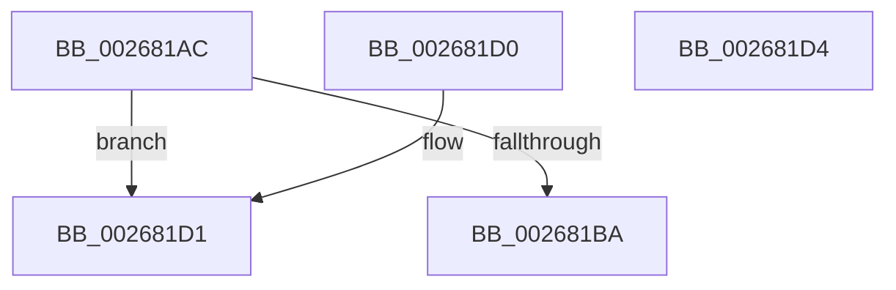

# SMKM_STORE_MGR&lt;SM_TRAITS&gt;::SmCompressCtxNewThreadNeeded

- RVA: `0x002681AC`–`0x002681D5` (길이 `41` bytes)
- VA: `0x00000001402681AC`
- 실행 섹션: `.text`
- PDB 이름 있음: `예`; PDB Function 태그: `아니요`
- unwind 정보 RVA: `0x000DB714`
- 디코드: `16`개 명령, `41/41` bytes 표시
- 미해석 바이트: `0` (있으면 어셈블리에 `.byte`로 보존)

> 이 문서는 커널 이미지의 기계어와 PDB 기호를 분석해 생성했습니다. 4번과 5번은 함수 원형과 자료형을 바이너리 사용 방식에서 추정한 C 해석이며 원본 소스 복구 결과는 아닙니다.

## 1. Dependencies

- 직접 호출 지점: **0**; 고유 호출 대상: **0**
- 직접 호출자로 확인된 함수: **2**
- RIP 상대 이미지 참조: **0**

### Outgoing calls
- 직접 디코드된 call 명령이 없습니다.

### Direct callers
- [SMKM_STORE_MGR&lt;SM_TRAITS&gt;::SmCompressCtxWorkerThread](SMKM_STORE_MGR_SM_TRAITS_SmCompressCtxWorkerThread_function_00267D20.md) at `0x00267F3B`
- [SMKM_STORE_MGR&lt;SM_TRAITS&gt;::SmCompressCtxBalancerThread](../3B/SMKM_STORE_MGR_SM_TRAITS_SmCompressCtxBalancerThread_function_003B22C0.md) at `0x003B2323`

### Static image references
- 디코드된 RIP-relative 메모리 참조가 없습니다.

## 2. Other-region calls and transfers

- 다른 실행 섹션으로 향하는 call: **0**
- 별도 외부 분기/꼬리 이동을 확인하지 못했습니다.

## 3. Assembly (complete function range)

```asm
002681AC  48 8B 41 08                     mov rax, qword ptr [rcx + 8]
002681B0  8B 50 2C                        mov edx, dword ptr [rax + 0x2c]
002681B3  8B 40 28                        mov eax, dword ptr [rax + 0x28]
002681B6  3B D0                           cmp edx, eax
002681B8  79 17                           jns 0x1402681d1
002681BA  8B 91 9C 00 00 00               mov edx, dword ptr [rcx + 0x9c]
002681C0  33 C0                           xor eax, eax
002681C2  48 8B 49 18                     mov rcx, qword ptr [rcx + 0x18]
002681C6  C1 E2 05                        shl edx, 5
002681C9  48 39 11                        cmp qword ptr [rcx], rdx
002681CC  0F 97 C0                        seta al
002681CF  C3                              ret
002681D0  CC                              int3
002681D1  33 C0                           xor eax, eax
002681D3  C3                              ret
002681D4  CC                              int3
```

## 4. C-style interpretation (structured pseudocode)

```c
__int64 __fastcall SMKM_STORE_MGR_SM_TRAITS___SmCompressCtxNewThreadNeeded(__int64 a1)
{
    __int64 result;

    if (!sign_flag) goto loc_002681D1;
    result = 0;
    a2 = (unsigned int)(((unsigned int)(*(unsigned int *)(a1 + 156))) << (5));
    result = ((*(unsigned __int64 *)(*(unsigned __int64 *)(a1 + 24))) > a2) ? 1 : 0;
    return result;
loc_002681D1:
    result = 0;
    return result;
}
```

## 5. (Beta) C Style

```c
int64_t SMKM_STORE_MGR_SM_TRAITS___SmCompressCtxNewThreadNeeded(void *Arg1)
{
    uint8_t *arg1 = (uint8_t *)Arg1;

    int64_t result;

    if (!sign_flag) goto loc_002681D1;
    result = 0;
    a2 = (uint32_t)(((uint32_t)(*(uint32_t *)(arg1 + 0x9C))) << (5));
    result = ((*(uint64_t *)(*(uint64_t *)(arg1 + 0x18))) > a2) ? 1 : 0;
    return result;
loc_002681D1:
    result = 0;
    return result;
}
```

### 관측된 메모리 오프셋

구조체 형식이 확인되지 않은 접근은 인자 기준의 오프셋으로만 기록했습니다.

| 기준 인자 | 오프셋 표현 | 폭 (bit) | 접근 |
|---|---:|---:|---|
| `Arg1` | `+ 0x8` | `64` | `R` |
| `Arg1` | `+ 0x18` | `64` | `R` |
| `Arg1` | `+ 0x9C` | `32` | `R` |

## 6. Execution-region graph

[열기: 2D/3D 그래프와 함수 탐색 컨트롤 패널](../../../control-panel.html?section=text&rva=0x002681AC&view=graph)

- 2D 그래프는 위에서 아래로 흐르고, 3D 그래프는 빈 공간을 드래그해 회전합니다. Shift+드래그는 이동, 휠은 확대·축소, 함수 노드 선택은 대상 보고서 이동입니다.

### Static fallback


